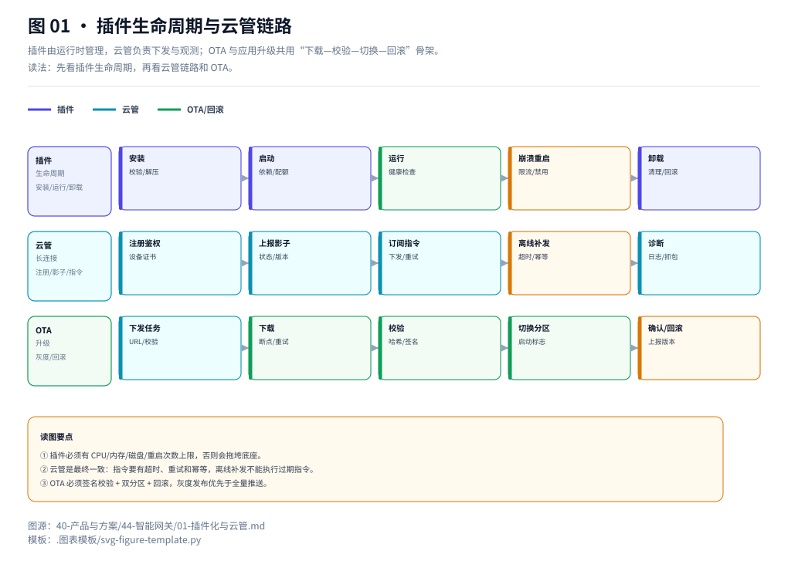
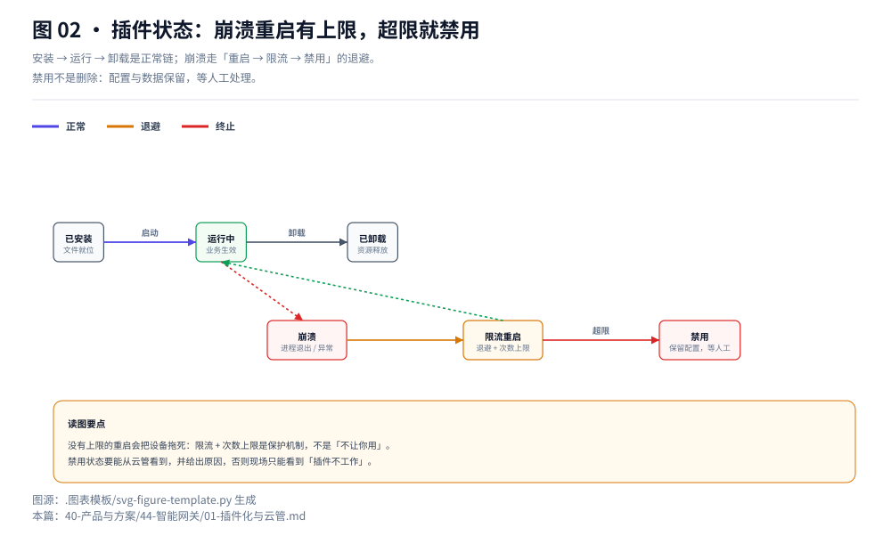

# 插件化与云管

智能网关的「智能」来自插件，规模运维来自云管。两者的共同约束是：**插件不能拖垮底座，云管不能成为单点依赖**。

> 本篇定位：插件运行时、生命周期、权限与资源限制，以及设备注册、设备影子、OTA 和远程诊断的产品方案。网络底座去 `00-智能网关架构`，协议接入去 `02-智能家居与安全`。

## 目录

- [1 一句话模型](#s1)
- [2 速览](#s2)
- [3 插件与云管字段](#s3)
- [4 交互流程](#s4)
- [5 状态机与定时器](#s5)
- [6 设计取舍与边界](#s6)
- [7 与相邻主题的关系](#s7)
- [名词解释](#名词解释)
- [8 参考与关联](#s8)

## 1 · 一句话模型：插件是租客，云管是物业

```text
插件：安装 → 启动 → 运行 → 停止/崩溃 → 重启/卸载
云管：注册 → 在线 → 上报/下发 → OTA → 诊断
```

三个关键认知：

1. **插件必须被「限额」**：CPU、内存、磁盘、网络、重启次数都要有上限，否则一个插件能拖垮整机。
2. **云管是「最终一致」**：设备离线时指令排队，上线后补发；不能假设云端指令实时到达。
3. **OTA 必须可回滚**：下载、校验、安装、重启、确认，每一步都要有失败处理。

## 2 · 速览

| 项 | 内容 |
| --- | --- |
| 插件形态 | 进程、容器、脚本（按产品能力选择） |
| 插件描述 | manifest：名称、版本、入口、依赖、权限、资源 |
| 生命周期 | 安装 → 启动 → 运行 → 停止 → 卸载/升级 |
| 云管协议 | MQTT/HTTPS/WebSocket，JSON 或 CBOR |
| 关键能力 | 注册、设备影子、指令下发、OTA、日志、远程诊断 |
| 安全 | 签名校验、权限最小化、密钥保护、审计 |
| 主要指标 | 插件启动时间、内存占用、崩溃率、OTA 成功率 |

## 3 · 插件与云管字段

### 3.1 插件 manifest

| 字段 | 作用 | 坑/边界 |
| --- | --- | --- |
| 名称/ID | 唯一标识 | 重名会导致升级覆盖错误 |
| 版本 | 升级/回滚依据 | 版本比较规则要统一 |
| 入口 | 启动命令/镜像 | 路径/架构不匹配会启动失败 |
| 依赖 | 库、服务、内核模块 | 依赖缺失在目标机型才暴露 |
| 权限 | 网络、设备、文件、总线 | 权限过大等于没有沙箱 |
| 资源限额 | CPU/内存/磁盘/重启 | 限额过小会频繁被杀 |
| 配置 schema | 参数定义与校验 | 配置升级要兼容旧版本 |

### 3.2 插件运行时能力

| 能力 | 说明 | 边界 |
| --- | --- | --- |
| 进程隔离 | 独立进程/用户 | 共享内核，逃逸风险仍在 |
| 容器隔离 | namespace/cgroup | 资源开销大，启动慢 |
| 消息总线 | 插件与底座通信 | 总线故障会连带所有插件 |
| 设备模型 | 统一设备抽象 | 模型不统一会导致插件各自造轮子 |
| 日志 | 分级、轮转、上报 | 日志过多会写满 Flash |
| 看门狗 | 心跳/重启 | 重启风暴要限流 |

### 3.3 云管对象

| 对象 | 作用 | 关键字段 |
| --- | --- | --- |
| 设备注册 | 标识与鉴权 | 设备 ID、密钥、证书、型号 |
| 设备影子 | 云端保存最新状态 | 期望值/上报值、版本号 |
| 指令 | 下行控制 | 指令 ID、超时、重试、幂等 |
| 配置 | 远程参数 | 版本、生效方式、回滚 |
| OTA 任务 | 固件/插件升级 | 包 URL、校验、灰度、回滚 |
| 遥测 | 运行数据 | 采样周期、上报频率、隐私 |
| 诊断 | 远程排障 | 日志、抓包、Ping/Traceroute |

## 4 · 交互流程



**读图**：插件从安装到卸载由运行时管理，云管只负责下发和观测；OTA 与应用升级共用「下载—校验—切换—回滚」骨架。

> 图源：`images/图01-插件生命周期与云管.svg`

### 4.1 插件安装与启动

```text
云端/本地选择插件 → 下载包 → 校验签名/哈希
  → 检查依赖与资源 → 解压到插件目录
  → 注册 manifest → 启动进程/容器
  → 健康检查 → 上报运行状态
```

### 4.2 云管上线与指令

```text
设备上电 → 读取设备凭证 → 连接云管（MQTT/HTTPS）
  → 注册/鉴权 → 上报影子 → 订阅指令
  → 云端下发指令 → 设备执行 → 回报结果
  → 离线指令排队 → 上线补发
```

### 4.3 OTA

```text
创建任务 → 选择设备/灰度 → 下发 URL+校验值
  → 设备下载 → 校验 → 写入备用分区
  → 设置启动标志 → 重启
  → 新版本上报 → 云端确认/回滚
```

### 4.4 异常分支

| 异常 | 现象 | 定位方向 |
| --- | --- | --- |
| 插件装不上 | 安装失败/回滚 | 架构不匹配、依赖缺失、空间不足、签名 |
| 插件反复重启 | 业务时断时续 | 资源限额、崩溃日志、看门狗 |
| 云管频繁掉线 | 远程不可用 | 网络、证书、心跳、服务端限流 |
| 指令不生效 | 云端显示已发 | 设备离线、指令过期、幂等冲突 |
| OTA 失败 | 版本不变/变砖 | 下载、校验、分区、回滚 |
| 日志写满 | 设备异常/升级失败 | 日志轮转、上报策略 |

## 5 · 状态机与定时器




**读图**：插件从安装到卸载由运行时管理；崩溃后重启限流，超限则禁用。

> 图源：`images/图02-插件与云管状态.svg`

| 对象 | 状态 | 关键参数 |
| --- | --- | --- |
| 插件 | 未安装 → 已安装 → 启动中 → 运行 → 停止 → 卸载 | 启动超时、健康检查间隔 |
| 插件异常 | 崩溃 → 重启 → 限流 → 禁用 | 最大重启次数、退避 |
| 云管连接 | 未连接 → 连接中 → 在线 → 重连 | 心跳、退避、凭证有效期 |
| 设备影子 | 同步中 → 一致 → 冲突 | 版本号、冲突解决策略 |
| OTA | 待下载 → 下载 → 校验 → 安装 → 重启 → 确认 | 超时、重试、回滚窗口 |

> 待验证：各产品的插件隔离级别、重启策略、云管协议和 OTA 灰度规则不同，需按平台文档确认。

## 6 · 设计取舍与边界

### 6.1 开放插件 vs 封闭系统

开放插件能快速扩展生态，但审核、权限和兼容性成本高；封闭系统稳定，但功能迭代慢。运营商网关通常只开放「白名单插件」，消费级网关可开放应用商店。

### 6.2 容器化的代价

容器提供更好的隔离和依赖打包，但内存/存储开销大，启动慢，且需要内核支持。低端网关更适合「进程 + 权限 + cgroup」的轻量方案。

### 6.3 云管依赖的边界

云管不能成为业务单点：本地场景、安防、基础网络必须在断网时可用。云端指令要有超时和幂等，避免恢复网络后「补发一堆过期指令」。

### 6.4 OTA 的灰度

全量推送风险高，应按型号/区域/批次灰度，并保留回滚窗口。升级包要签名，设备要校验，不能只靠 HTTPS。

### 6.5 遥测与隐私

遥测能提升运维效率，但会采集设备状态、网络质量甚至用户行为。产品要明确采集范围、脱敏方式和用户授权，避免合规风险。

## 7 · 与相邻主题的关系

| 相邻对象 | 关系 |
| --- | --- |
| [智能网关架构](./00-智能网关架构.md) | 插件运行的底座 |
| [智能家居与安全](./02-智能家居与安全.md) | 插件接入的设备与隔离 |
| [TR-069 与 ACS 运维](../43-CPE/02-TR-069与ACS运维.md) | 运营商传统管理通道 |
| [OpenWrt 系统框架](../../20-平台与系统/22-OpenWrt/02-系统框架/00-系统框架总览.md) | procd/ubus/UCI |
| [OpenWrt 升级与恢复](../../20-平台与系统/22-OpenWrt/05-升级与恢复/00-升级与恢复总览.md) | 双分区与回滚 |

一句话：**插件化解决「功能怎么长出来」，云管解决「设备怎么管得住」，两者都必须服从底座的稳定性。**

## 名词解释

> 缩写给出英文全称；非缩写用“—”表示。

| 术语 | 英文全称 | 解释 |
| --- | --- | --- |
| OTA | Over-The-Air | 空中升级。 |
| MQTT | Message Queuing Telemetry Transport | 轻量消息发布/订阅协议。 |
| manifest | — | 插件描述文件。 |
| cgroup | Control Group | Linux 资源隔离机制。 |
| namespace | — | Linux 命名空间隔离机制。 |
| 设备影子 | Device Shadow | 云端保存的设备状态副本。 |
| 幂等 | Idempotency | 同一指令重复执行结果一致。 |
| 灰度 | Canary Release | 分批逐步放量。 |
| 看门狗 | Watchdog | 监控进程/系统并触发重启。 |
| CBOR | Concise Binary Object Representation | 简洁二进制对象表示。 |

## 8 · 参考与关联

**标准/文档**

- MQTT 3.1.1 / 5.0
- TR-369：USP 多控制器与消息传输
- Matter：设备模型与配网
- OpenWrt procd/ubus 文档

**关联**

- [设备形态对比](../00-设备形态对比.md)
- [智能网关架构](./00-智能网关架构.md)
- [智能家居与安全](./02-智能家居与安全.md)
- [TR-069 与 ACS 运维](../43-CPE/02-TR-069与ACS运维.md)

---

> **本篇定位**：智能网关插件运行时、生命周期、权限限额与云管/OTA 的产品方案。
> **素材来源**：`studyspace/3.协议应用/12.zerotier/`（插件化业务与设备端验证参考）、`studyspace/1.知识体系/7.openwrt/2.应用管理平面/`。
> **待验证**：具体产品的插件隔离方案、云管协议、OTA 灰度策略和遥测范围。
