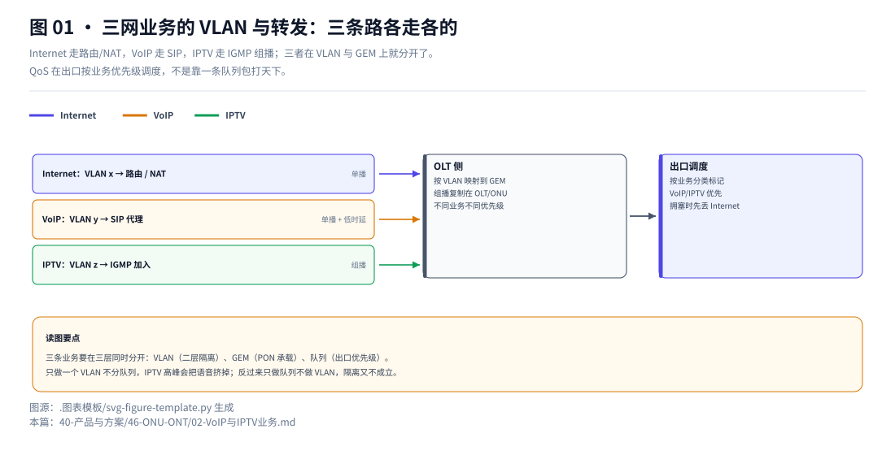
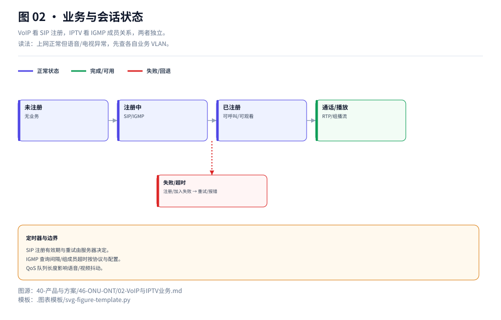

# VoIP 与 IPTV 业务

光猫/ONU 的「三网融合」不是把三个业务塞进一个 LAN，而是**用 VLAN 把 Internet、VoIP、IPTV 分开，各自走独立的业务通道和 QoS**。分错 VLAN 或漏配组播，表现为「上网正常、电视黑屏、电话无声」。

> 本篇定位：VoIP 与 IPTV 的业务模型、VLAN/QoS 配置、协议与排障边界。SIP/IGMP 协议原理去 `10-基础理论`，VLAN 原理去 `02-链路层`，PON 通道去 `01-PON注册与OMCI`。

## 目录

- [1 一句话模型](#s1)
- [2 速览](#s2)
- [3 业务与字段](#s3)
- [4 交互流程](#s4)
- [5 状态机与定时器](#s5)
- [6 设计取舍与边界](#s6)
- [7 与相邻主题的关系](#s7)
- [名词解释](#名词解释)
- [8 参考与关联](#s8)

## 1 · 一句话模型：三张网，三条路

```text
Internet：普通 VLAN → 路由/NAT → 上网
VoIP：语音 VLAN → SIP/RTP → FXS 话机
IPTV：组播 VLAN → IGMP → 机顶盒
```

三个关键认知：

1. **业务隔离靠 VLAN**，不是靠端口「大概分开」；同一 LAN 口也可能承载多个业务 VLAN。
2. **IPTV 是组播业务**：IGMP snooping/proxy 决定组播会不会泛洪，组播 VLAN 决定它走哪条通道。
3. **VoIP 对时延/丢包敏感**：需要独立队列和优先级，和下载抢带宽就会「断断续续」。

## 2 · 速览

| 项 | 内容 |
| --- | --- |
| 业务类型 | Internet、VoIP、IPTV（含 VoD） |
| 承载方式 | 独立 VLAN、独立 GEM Port、独立 QoS 队列 |
| VoIP 协议 | SIP、MGCP、H.248；RTP/RTCP 承载媒体 |
| IPTV 协议 | IGMP/MLD、组播、HTTP 单播（VoD） |
| 关键配置 | VLAN、PVID、IGMP 版本、组播 VLAN、DSCP/队列 |
| 主要风险 | VLAN 错配、组播泛洪、SIP NAT 问题、带宽争抢 |
| 关键指标 | 语音 MOS、IPTV 丢包/卡顿、换台时延、组播复制效率 |

## 3 · 业务与字段

### 3.1 三网业务模型

| 业务 | 二层承载 | 三层处理 | 典型终端 |
| --- | --- | --- | --- |
| Internet | 普通业务 VLAN | 路由/NAT/DHCP | PC/手机/路由 |
| VoIP | 语音 VLAN | SIP 注册/RTP | FXS 话机 |
| IPTV 直播 | 组播 VLAN | IGMP proxy/snooping | 机顶盒 |
| IPTV 点播 | 单播 VLAN/Internet | HTTP/RTSP | 机顶盒 |

### 3.2 VoIP 关键字段

| 字段 | 作用 | 坑/边界 |
| --- | --- | --- |
| SIP 服务器/端口 | 注册与呼叫 | 地址/端口错会导致注册失败 |
| 账号/密码 | 鉴权 | 特殊字符、域匹配 |
| 编解码 | G.711/G.729 等 | 带宽与音质权衡 |
| FXS 口 | 接话机 | 馈电/振铃/脉冲拨号 |
| 拨号计划 | 号码变换 | 前缀/紧急号码 |
| NAT/ALG | 媒体穿越 | ALG 可能破坏 SIP |
| QoS | 语音优先级 | 与下载争抢 |

### 3.3 IPTV 关键字段

| 字段 | 作用 | 坑/边界 |
| --- | --- | --- |
| 组播 VLAN | 承载直播流 | 配错则黑屏 |
| IGMP 版本 | v2/v3 | 与上游/机顶盒一致 |
| IGMP snooping | 按需复制 | 关闭会泛洪 |
| IGMP proxy | 代理加入 | 与 snooping 二选一 |
| 组播路由 | 上游复制点 | 跨网段需要 |
| QoS | 视频优先级 | 丢包导致花屏/卡顿 |
| VoD | 单播 | 带宽与并发 |

## 4 · 交互流程



**读图**：三条业务分别进入不同 VLAN/GEM，Internet 走路由，VoIP 走 SIP，IPTV 走组播；QoS 在出口按业务优先级调度。

> 图源：`images/图01-三网业务VLAN.svg`

### 4.1 VoIP 注册与呼叫

```text
FXS 上电 → 读取 SIP 配置 → REGISTER → 401/407 挑战
  → 带凭证再注册 → 200 OK
  → 摘机 → INVITE → 振铃/应答 → RTP 双向
  → 挂机 → BYE
```

### 4.2 IPTV 直播

```text
机顶盒上电 → 获取地址（DHCP/静态）→ 加入组播组（IGMP Report）
  → ONU/OLT 复制组播流 → 机顶盒解码
  → 换台：Leave 旧组 + Join 新组
```

### 4.3 IPTV 点播

```text
机顶盒 → HTTP/RTSP 请求 → 单播流 → 解码
  → 暂停/拖动 → 重新请求分片
```

### 4.4 异常分支

| 异常 | 现象 | 定位方向 |
| --- | --- | --- |
| VoIP 注册失败 | 话机无拨号音/忙音 | SIP 地址/账号/网络/VLAN |
| VoIP 单通 | 能听不能说 | NAT/防火墙/RTP 端口/编解码 |
| 语音断续 | 有杂音/断句 | 丢包/抖动/QoS/带宽 |
| IPTV 黑屏 | 无画面 | 组播 VLAN/IGMP/复制点 |
| 换台慢 | 等待久 | IGMP 加入时延/组播路由 |
| IPTV 花屏 | 马赛克 | 丢包/带宽不足/线路误码 |
| 上网正常电视不通 | 单业务故障 | 业务 VLAN/PON 通道 |

## 5 · 状态机与定时器




**读图**：VoIP 看 SIP 注册，IPTV 看 IGMP 成员关系；两者独立排障。

> 图源：`images/图02-业务与会话状态.svg`

| 对象 | 状态 | 关键参数 |
| --- | --- | --- |
| SIP 注册 | 未注册 → 注册中 → 已注册 → 失败 | 注册有效期、重试间隔 |
| 呼叫 | 空闲 → 振铃 → 通话 → 结束 | 超时、保持/转接 |
| IGMP 主机 | 非成员 → 加入 → 成员 → 离开 | 查询间隔、组成员超时 |
| 组播流 | 未复制 → 复制中 → 停止 | 加入/离开时延 |
| QoS 队列 | 空 → 排队 → 调度 | 队列长度、优先级 |

> 待验证：SIP 注册周期、IGMP 查询/超时参数由运营商网络和协议版本决定，需按现网配置。

## 6 · 设计取舍与边界

### 6.1 独立 VLAN vs 共用 Internet

独立 VLAN 能保证语音/视频的带宽和安全，但增加配置和排障复杂度；共用 Internet 简单，但下载会直接影响通话和电视。运营商通常选择独立 VLAN。

### 6.2 IGMP snooping vs proxy

snooping 在二层按需复制，配置简单；proxy 在第三层代理加入，适合跨网段。两者选择取决于组播复制点和网络层次，不能同时乱开。

### 6.3 SIP ALG 的取舍

ALG 能改写 SIP/SDP 解决 NAT 穿越，但实现不好会破坏注册或媒体。现代部署更倾向「终端/服务器侧穿透 + 关闭 ALG」，而不是依赖设备 ALG。

### 6.4 语音编码的选择

G.711 音质好、带宽高；G.729 省带宽、音质略差。选择要考虑链路质量、并发数和终端支持，不是「越省越好」。

### 6.5 IPTV 的带宽边界

直播是组播，带宽由「同时观看的频道数」决定，不是「用户数」；点播是单播，按并发计。产品规格要区分两者，不能用一个「IPTV 带宽」笼统描述。

## 7 · 与相邻主题的关系

| 相邻对象 | 关系 |
| --- | --- |
| [VLAN 与 Trunk](../../10-基础理论/11-网络科学/02-链路层/02-VLAN与Trunk.md) | 业务隔离 |
| [组播 IGMP/MLD](../../10-基础理论/11-网络科学/03-网络层/07-组播IGMP-MLD.md) | IGMP 原理 |
| [SIP](../../10-基础理论/12-通信科学/05-协议与标准/01-接入网标准索引.md) | 语音信令（标准索引） |
| [QoS 与流控方案](../42-路由器/02-QoS与流控方案.md) | 队列与优先级 |
| [ONU/ONT 系统架构](./00-ONU-ONT系统架构.md) | 业务承载 |
| [PON 注册与 OMCI](./01-PON注册与OMCI.md) | T-CONT/GEM/VLAN |
| [光猫产品形态](./03-光猫产品形态.md) | 家用接口形态 |

一句话：**三网融合的关键不是「都接进来」，而是「各走各的 VLAN、各拿各的带宽」。**

## 名词解释

> 缩写给出英文全称；非缩写用“—”表示。

| 术语 | 英文全称 | 解释 |
| --- | --- | --- |
| VoIP | Voice over IP | IP 语音。 |
| SIP | Session Initiation Protocol | 会话发起协议。 |
| MGCP | Media Gateway Control Protocol | 媒体网关控制协议。 |
| RTP | Real-time Transport Protocol | 实时传输协议。 |
| RTCP | RTP Control Protocol | RTP 控制协议。 |
| FXS | Foreign Exchange Subscriber | 连接普通话机的语音接口。 |
| MOS | Mean Opinion Score | 语音质量主观评分。 |
| IPTV | Internet Protocol Television | IP 电视。 |
| IGMP | Internet Group Management Protocol | 互联网组管理协议。 |
| MLD | Multicast Listener Discovery | 组播侦听发现。 |
| VoD | Video on Demand | 视频点播。 |
| VLAN | Virtual Local Area Network | 虚拟局域网。 |
| QoS | Quality of Service | 服务质量。 |
| ALG | Application Layer Gateway | 应用层网关。 |
| SDP | Session Description Protocol | 会话描述协议。 |

## 8 · 参考与关联

**标准**

- RFC 3261：SIP
- RFC 3550：RTP/RTCP
- RFC 3435：MGCP
- RFC 2236 / 3376：IGMPv2 / IGMPv3
- RFC 4541：IGMP/MLD Snooping 考虑
- ITU-T G.711 / G.729：语音编码

**关联**

- [设备形态对比](../00-设备形态对比.md)
- [ONU/ONT 系统架构](./00-ONU-ONT系统架构.md)
- [PON 注册与 OMCI](./01-PON注册与OMCI.md)
- [光猫产品形态](./03-光猫产品形态.md)
- [组播 IGMP/MLD](../../10-基础理论/11-网络科学/03-网络层/07-组播IGMP-MLD.md)

---

> **本篇定位**：ONU/光猫的 VoIP/IPTV 业务模型、VLAN/QoS 配置与排障边界。
> **素材来源**：`studyspace/1.知识体系/2.TCP IP协议/m-8-IGMP和MLD.md`、`studyspace/1.知识体系/7.openwrt/3.网络业务/`。
> **待验证**：各运营商的语音协议/编码、IPTV VLAN/组播地址和 QoS 标记。
