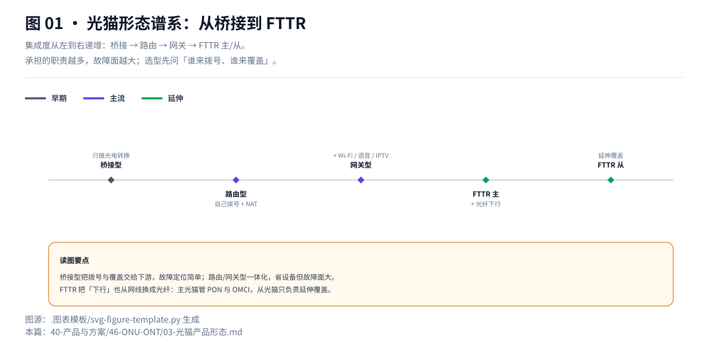
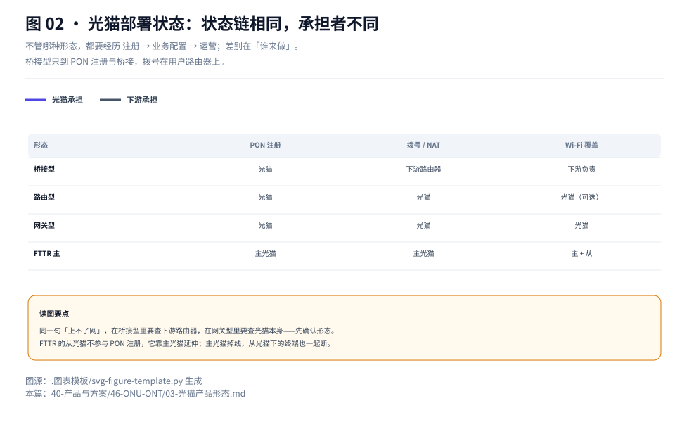

# 光猫产品形态

「光猫」是家用 ONU/ONT 的俗称，产品上是一族设备而不是一种：**桥接型只做光电转换，路由型带 NAT/Wi-Fi，10G 型提升上行，FTTR 主光猫再向下延伸光纤**。选型的核心是「谁来拨号、谁来管、谁来覆盖」。

> 本篇定位：光猫的形态谱系、与 ONU/ONT/CPE/路由的边界、典型配置与选型判据。PON 注册去 `01-PON注册与OMCI`，整机架构去 `00-ONU-ONT系统架构`，家用网关能力去 `43-CPE`。

## 目录

- [1 一句话模型](#s1)
- [2 速览](#s2)
- [3 形态与字段](#s3)
- [4 交互流程](#s4)
- [5 状态与定时器](#s5)
- [6 设计取舍与边界](#s6)
- [7 与相邻主题的关系](#s7)
- [名词解释](#名词解释)
- [8 参考与关联](#s8)

## 1 · 一句话模型：光猫是「PON 侧的家用终端」，形态由下游需求决定

```text
纯桥接（SFU）        ：光猫只做 PON ↔ 以太，路由拨号交给下游
路由型（HGU）        ：光猫自己做路由/NAT/Wi-Fi/语音
10G 光猫             ：上行升级到 XG(S)-PON，接口/ Wi-Fi 同步升级
FTTR 主光猫          ：在 HGU 基础上增加光纤下行，带从网关
```

三个关键认知：

1. **光猫 ≠ 路由器**：桥接型只是「光电转换 + VLAN」，路由型才具备 NAT/DHCP/Wi-Fi。
2. **形态由「谁拨号」决定**：运营商让光猫桥接、用户自备路由，和光猫一体路由，是两种完全不同的产品定义。
3. **「光猫」是俗称，规范名是 ONU/ONT**；写规格、做认证时要用标准名称，避免和「光模块」「光端机」混淆。

## 2 · 速览

| 项 | 内容 |
| --- | --- |
| 规范名 | ONU（光网络单元）/ ONT（光网络终端） |
| 俗称 | 光猫、光纤猫、宽带猫 |
| 主要形态 | 桥接型 SFU、路由型 HGU、10G 光猫、FTTR 主光猫、企业 ONU |
| 上行 | GPON / XG-PON / XGS-PON / EPON / 10G-EPON |
| 下行接口 | 以太口、Wi-Fi、FXS、USB（部分） |
| 管理 | OMCI（PON 业务）+ TR-069（设备业务） |
| 选型关键 | 谁拨号、是否要 Wi-Fi/语音、上行速率、覆盖方式 |

## 3 · 形态与字段

### 3.1 形态谱系

| 形态 | 转发能力 | 典型接口 | 适用 | 边界 |
| --- | --- | --- | --- | --- |
| 桥接型 SFU | 二层桥接 | 1×PON + 1~4×LAN | 用户自备路由/企业专线 | 不能拨号、无 Wi-Fi |
| 路由型 HGU | 路由/NAT/Wi-Fi | PON + LAN + Wi-Fi + FXS | 家庭一体机 | 故障面大、性能有限 |
| 10G 光猫 | 路由/桥接 | PON 10G + 2.5G/10G LAN + Wi-Fi 6/7 | 千兆/万兆宽带 | 成本高、散热要求高 |
| FTTR 主光猫 | 路由 + 光纤下行 | PON + 光纤下行口 + LAN + Wi-Fi | 全屋光纤组网 | 依赖从网关、施工复杂 |
| 企业 ONU | 二层/三层 | 多 LAN、光口、语音 | 政企/园区 | 管理方式不同（OMCI/网管） |
| 模块化 ONU | 桥接 | SFP/板卡 | 嵌入式/设备内置 | 无独立外壳/管理 |

### 3.2 关键配置

| 配置项 | 桥接型 | 路由型 | 说明 |
| --- | --- | --- | --- |
| WAN 模式 | 透传/桥接 | PPPoE/DHCP/静态 | 决定谁拨号 |
| VLAN | 必须 | 必须 | 业务隔离 |
| NAT/DHCP | 无 | 有 | 路由型才需要 |
| Wi-Fi | 无 | 有 | SSID/信道/功率 |
| VoIP | 无/可选 | 有 | FXS/SIP |
| TR-069 | 有 | 有 | 运营商管理 |
| OMCI | 有 | 有 | PON 业务配置 |

### 3.3 与相邻形态的边界

| 形态 | 与光猫的关系 | 区别 |
| --- | --- | --- |
| ONU/ONT | 同义词（规范名） | 光猫是家用俗称 |
| CPE | 上位概念 | CPE 包含 xDSL/PON/蜂窝终端 |
| 路由器 | 下游或集成 | 桥接光猫 + 独立路由；路由光猫 = 二合一 |
| 智能网关 | 功能叠加 | 光猫可演进为带插件/云管的网关 |
| 光端机 | 不同设备 | 光端机多指 PDH/SDH/视频光端设备，不是 PON ONU |

## 4 · 交互流程



**读图**：从桥接到 FTTR 主光猫，集成度越来越高；桥接型把拨号和覆盖交给下游，路由型自己承担，FTTR 再向下延伸光纤。

> 图源：`images/图01-光猫形态谱系.svg`

### 4.1 桥接型部署

```text
OLT → 光猫（桥接，透传 VLAN）→ 用户路由器拨号 → LAN/Wi-Fi
```

光猫只负责 PON 注册、OMCI 配置和二层透传；拨号、NAT、Wi-Fi 都在下游路由器。

### 4.2 路由型部署

```text
OLT → 光猫（路由，PPPoE/NAT）→ LAN/Wi-Fi/语音
```

光猫自己完成拨号、NAT、DHCP、Wi-Fi 和 VoIP，用户无需额外路由。

### 4.3 FTTR 主光猫部署

```text
OLT → 主光猫（路由 + 光纤下行）→ 从网关（房间）
```

主光猫承担 PON、路由和整网管理，从网关只做房间覆盖。

### 4.4 异常分支

| 异常 | 现象 | 定位方向 |
| --- | --- | --- |
| 桥接型不能上网 | 下游路由拨号失败 | 光猫 VLAN/透传、下游拨号配置 |
| 路由型不能上网 | 光猫 WAN 无地址 | PON 注册、VLAN、账号 |
| 改桥接后 IPTV 不通 | 电视黑屏 | 桥接 VLAN/组播透传 |
| 换光猫不注册 | PON 灯异常 | SN/密码、OLT 绑定、PON 类型 |
| 10G 光猫协商不到 10G | 速率低 | 光模块/线缆/对端端口能力 |
| FTTR 从网关不上线 | 单房间无网 | 光纤/供电/主从注册 |

## 5 · 状态与定时器




**读图**：不同形态状态链相同，但拨号/管理/覆盖的承担者不同。

> 图源：`images/图02-光猫部署状态.svg`

| 对象 | 状态 | 关键参数 |
| --- | --- | --- |
| PON 注册 | 同步 → 发现 → 测距 → 授权 → 运营 | 注册超时、重试 |
| WAN（路由型） | 未连接 → 拨号 → 已连接 | 重拨间隔、保活 |
| 桥接口 | Down → Up | 链路去抖 |
| 管理 | OMCI/TR-069 在线/离线 | 周期、心跳 |
| 升级 | 下载 → 校验 → 重启 → 确认 | 回滚窗口 |

## 6 · 设计取舍与边界

### 6.1 桥接 vs 路由：谁掌握控制权

桥接把拨号、NAT、Wi-Fi 交给用户，运营商只保证管道；路由型把控制权收回运营商，便于远程管理和业务开通，但故障面更大、性能受限。集采产品通常两种模式都支持，出厂默认由运营商决定。

### 6.2 一体机 vs 分离式

一体机省设备、省空间，适合普通家庭；分离式（光猫 + 路由/AP）性能更好、升级灵活，适合大户型/高要求用户。FTTR 是分离式的进一步演进。

### 6.3 10G 光猫的必要性

只有宽带速率、内网设备、Wi-Fi 都超过千兆时，10G 光猫才有意义；否则瓶颈在路由/Wi-Fi/终端，换光猫不会提升体验。

### 6.4 光猫的「智能」边界

加插件、云管、智能家居能把光猫变成智能网关，但会增加成本、功耗和故障率。运营商产品应优先保证注册稳定、管理可控、升级可回滚。

### 6.5 光猫不是「光模块」

光猫是整机（PON MAC + CPU + 接口 + 电源），光模块只是光电转换器件。采购/排障时混用这两个词，容易把「模块不兼容」误判为「光猫故障」。

## 7 · 与相邻主题的关系

| 相邻对象 | 关系 |
| --- | --- |
| [ONU/ONT 系统架构](./00-ONU-ONT系统架构.md) | 整机分层与业务对象 |
| [PON 注册与 OMCI](./01-PON注册与OMCI.md) | 注册与业务配置 |
| [VoIP 与 IPTV 业务](./02-VoIP与IPTV业务.md) | 三网业务 |
| [CPE 系统架构](../43-CPE/00-CPE系统架构.md) | CPE 上位概念 |
| [路由器产品架构](../42-路由器/00-路由器产品架构.md) | 桥接型的下游设备 |
| [FTTR 组网架构](../45-FTTR/00-FTTR组网架构.md) | 主光猫的组网延伸 |
| [设备形态对比](../00-设备形态对比.md) | 全产品形态边界 |

一句话：**光猫的形态选择，本质是「拨号、管理、覆盖」三件事由谁来做。**

## 名词解释

> 缩写给出英文全称；非缩写用“—”表示。

| 术语 | 英文全称 | 解释 |
| --- | --- | --- |
| 光猫 | — | 家用 ONU/ONT 的俗称。 |
| ONU | Optical Network Unit | 光网络单元。 |
| ONT | Optical Network Terminal | 光网络终端。 |
| SFU | Single Family Unit | 单家庭单元，常指桥接型光猫。 |
| HGU | Home Gateway Unit | 家庭网关型光猫。 |
| PON | Passive Optical Network | 无源光网络。 |
| OLT | Optical Line Terminal | 光线路终端。 |
| OMCI | ONT Management and Control Interface | ONT 管理控制接口。 |
| CPE | Customer Premises Equipment | 用户侧设备。 |
| VLAN | Virtual Local Area Network | 虚拟局域网。 |
| PPPoE | Point-to-Point Protocol over Ethernet | 以太网 PPP 拨号。 |
| FTTR | Fiber To The Room | 光纤到房间。 |

## 8 · 参考与关联

**标准**

- ITU-T G.984 / G.987 / G.9807：GPON / XG-PON / XGS-PON
- IEEE 802.3ah / 802.3av：EPON / 10G-EPON
- ITU-T G.988：OMCI
- TR-069 / TR-369：远程管理

**关联**

- [设备形态对比](../00-设备形态对比.md)
- [ONU/ONT 系统架构](./00-ONU-ONT系统架构.md)
- [PON 注册与 OMCI](./01-PON注册与OMCI.md)
- [VoIP 与 IPTV 业务](./02-VoIP与IPTV业务.md)
- [CPE 系统架构](../43-CPE/00-CPE系统架构.md)

---

> **本篇定位**：光猫的形态谱系、与 ONU/ONT/CPE/路由的边界、配置与选型判据。
> **素材来源**：`studyspace/1.知识体系/7.openwrt/3.网络业务/`、`studyspace/1.知识体系/2.TCP IP协议/`。
> **待验证**：各运营商的桥接/路由默认策略、10G 光猫规格和 FTTR 主光猫形态定义。
