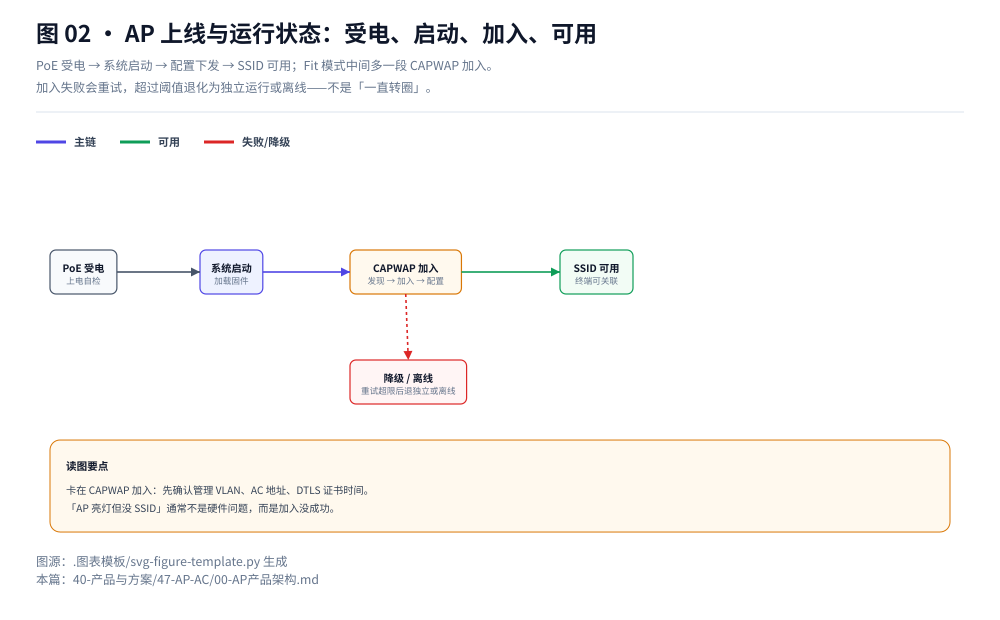

# AP 产品架构

AP（Access Point）是无线侧的「最后一跳」：**把以太网/PON 上行转成 Wi-Fi 空口，并接受 AC、云平台或本地管理**。产品差异不在「能不能发 Wi-Fi」，而在射频能力、供电、安装形态和管理方式。

> 本篇定位：AP 的形态分类、软硬件组成、Fat/Fit 模式和产品指标。802.11 帧与接入流程去 `10-基础理论`，驱动/hostapd 去 `20-平台与系统`，AC 与 CAPWAP 去 `01-AC产品架构与CAPWAP`。

## 目录

- [1 一句话模型](#s1)
- [2 速览](#s2)
- [3 结构与字段](#s3)
- [4 交互流程](#s4)
- [5 状态机与定时器](#s5)
- [6 设计取舍与边界](#s6)
- [7 与相邻主题的关系](#s7)
- [名词解释](#名词解释)
- [8 参考与关联](#s8)

## 1 · 一句话模型：射频决定覆盖，上行决定吞吐，管理决定运维

```text
以太网/PON 上行（PoE 供电）
  └─ AP：桥接/转发 + 射频（2.4/5/6 GHz）
        └─ 终端：SSID 接入 → 认证 → 加密 → 转发
  管理：Fat 本地 / Fit（CAPWAP）/ 云管
```

三个关键认知：

1. **AP 不是路由器**：它主要做二层桥接，把无线帧转到有线侧；NAT/路由通常在网关或 AC 侧。
2. **供电和上行是硬约束**：PoE 等级决定能不能带动 4x4/多射频；上行 1G 会让 Wi-Fi 6/7 的峰值无处可去。
3. **Fat/Fit 是产品定义**：Fat AP 自己能配，Fit AP 依赖 AC；同一硬件可以刷不同固件，但运维模式完全不同。

## 2 · 速览

| 项 | 内容 |
| --- | --- |
| 产品定位 | 无线接入点，提供 Wi-Fi 覆盖与终端接入 |
| 典型形态 | 吸顶、面板、放装、室外、工业、嵌入式 |
| 关键能力 | 双频/三频、Wi-Fi 6/7、PoE、集中管理、漫游 |
| 关键对象 | 射频、SSID、VLAN、功率/信道、上行口、PoE 等级 |
| 管理方式 | Fat 本地 Web、Fit + AC（CAPWAP）、云管 |
| 关键标准 | IEEE 802.11a/b/g/n/ac/ax/be、802.3af/at/bt、802.1X、CAPWAP |
| 主要指标 | 覆盖、并发、吞吐、漫游、功耗、MTBF |

## 3 · 结构与字段

### 3.1 形态分类

| 形态 | 安装 | 典型场景 | 差异点 |
| --- | --- | --- | --- |
| 吸顶 AP | 天花板 | 办公室/商场/教室 | 全向覆盖、PoE、隐藏布线 |
| 面板 AP | 墙面 86 盒 | 酒店/宿舍/家庭 | 面板式、端口少、覆盖近 |
| 放装 AP | 桌面/壁挂 | 小型办公/临时 | 成本低、天线内置 |
| 室外 AP | 抱杆/壁挂 | 园区/广场 | 防水防雷、外置天线、宽温 |
| 工业 AP | 导轨/机柜 | 工厂/仓储 | 抗干扰、宽温、防护 |
| 嵌入式 AP | 模块/板卡 | 设备内置 | 无独立外壳、定制供电 |

### 3.2 硬件组成

| 部件 | 作用 | 产品关注点 |
| --- | --- | --- |
| 主控 SoC | 协议栈、转发、管理 | 是否支持多射频/多空间流 |
| 射频芯片 | 2.4/5/6 GHz 收发 | 频段、带宽、空间流、Wi-Fi 6/7 |
| FEM | 功率放大/低噪放大 | 发射功率、噪声系数、线性度 |
| 天线 | 辐射与接收 | 增益、方向图、内置/外置、MIMO |
| 以太网 PHY | 上行接口 | 1G/2.5G/5G/10G、PoE 受电 |
| PoE 控制器 | 受电/分级 | 802.3af/at/bt、功耗预算 |
| Flash/内存 | 固件、配置、缓存 | 双镜像、剩余空间 |
| 安全芯片 | 密钥/安全启动（部分） | 证书注入、防克隆 |

### 3.3 软件模式

| 模式 | 管理 | 配置 | 适用 | 边界 |
| --- | --- | --- | --- | --- |
| Fat AP | 本地 Web/CLI | 每台独立 | 小规模、无 AC | 配置难统一 |
| Fit AP | AC（CAPWAP） | AC 统一下发 | 企业/园区 | 依赖 AC 可达 |
| 云 AP | 云平台 | 云端模板 | 连锁/分散站点 | 依赖公网和云 |
| 混合 | 本地 + 云/AC | 双通道 | 容灾/过渡 | 配置源要定优先级 |

### 3.4 关键参数

| 参数 | 含义 | 选型边界 |
| --- | --- | --- |
| 空间流 | 2x2/4x4 等 | 终端多为 2x2，4x4 提升多用户容量 |
| 频宽 | 20/40/80/160/320 MHz | 频宽越大越容易受干扰、信道越少 |
| 发射功率/EIRP | 空口覆盖能力 | 受法规限制，不是越大越好 |
| 天线增益 | 定向/全向 | 高增益牺牲覆盖角度 |
| PoE 等级 | af/at/bt | 决定供电和功耗上限 |
| 上行速率 | 1G/2.5G/10G | 要匹配空口峰值和多 AP 汇聚 |
| 并发终端 | 每射频建议值 | 与业务类型、带宽需求相关 |

## 4 · 交互流程


**读图**：上行经 PoE 以太网进入 AP，SoC 做桥接/管理，射频经 FEM 到天线；Fit 模式下管理流量走 CAPWAP，数据可按隧道或本地转发。

> 图源：`images/图01-AP软硬件架构.svg`

### 4.1 上电到 SSID 可用

```text
PoE 受电 → Boot → 固件加载
  → 读取配置（本地/AC/云）
  → 射频初始化 → 信道/功率设置
  → 建立 SSID → 认证/加密
  → Fit：CAPWAP 加入 AC；Fat：本地配置生效
  → 终端可接入
```

### 4.2 终端接入

```text
扫描 → 认证/关联 → 802.1X/PSK/Portal → 密钥协商
  → DHCP 获取地址 → 数据转发（本地/隧道）
  → 漫游时重新关联目标 AP
```

### 4.3 异常分支

| 异常 | 现象 | 定位方向 |
| --- | --- | --- |
| AP 不上电 | 指示灯不亮 | PoE 供电、网线、受电等级 |
| AP 起不来 | 反复重启 | 镜像损坏、供电不足、看门狗 |
| Fit AP 不上线 | 无法被 AC 管理 | CAPWAP 可达性、Option 43、证书 |
| SSID 搜不到 | 终端看不到网络 | 射频未起、SSID 隐藏、信道/功率 |
| 能连不能上网 | 有地址无转发 | VLAN、上行链路、DHCP、ACL |
| 速率低 | 协商速率低/丢包 | 频宽、干扰、空间流、上行瓶颈 |
| 漫游卡顿 | 走动时断流 | k/v/r、AP 间距、AC 间漫游 |

## 5 · 状态机与定时器



**读图**：AP 从 PoE 受电、启动、配置下发到 SSID 可用；Fit 模式多一段 CAPWAP 加入，失败会重试或降级。

> 图源：`images/图02-AP上线与运行状态.svg`

| 状态 | 动作 | 失败后 |
| --- | --- | --- |
| 受电 | PoE 检测/分级 | 供电不足则重启/限功率 |
| 启动 | Boot/内核/根文件系统 | 镜像损坏则回滚/恢复模式 |
| 配置 | 本地/AC/云下发 | 配置失败则用默认配置 |
| 射频就绪 | 信道/功率/SSID | 雷达/法规限制则换信道 |
| 运行 | 终端接入/转发 | 干扰/过载则降速 |
| 升级 | 下载/校验/重启 | 失败回滚旧镜像 |

| 定时器 | 作用 | 说明 |
| --- | --- | --- |
| CAPWAP Echo | Fit AP 与 AC 保活 | 超时重新发现/加入 |
| 发现重试 | AC 发现 | 广播/DNS/Option 43 失败后重试 |
| 信道扫描 | 射频管理 | DFS 信道需静默检测 |
| 终端空闲 | 踢除低活跃终端 | 阈值由产品/AC 配置 |
| 看门狗 | 进程/系统异常重启 | 防止假死 |

> 待验证：各厂商的 CAPWAP 心跳、DFS 静默时间、终端空闲阈值和 PoE 分级策略不同，需按设备文档确认。

## 6 · 设计取舍与边界

### 6.1 Fat vs Fit

Fat AP 部署简单、无 AC 依赖，但配置分散、漫游和射频管理弱；Fit AP 集中管理、支持漫游和射频调优，但依赖 AC 可达。小规模/临时场景 Fat 更划算，企业园区应选 Fit。

### 6.2 Wi-Fi 6 vs Wi-Fi 7

Wi-Fi 7 的 320 MHz、MLO、4K-QAM 提升峰值和时延，但需要终端、信道和上行一起匹配；终端仍是 Wi-Fi 6 时，升级收益有限。产品选型要看终端代际和业务带宽，而不是只看标称速率。

### 6.3 2x2 vs 4x4

4x4 提升多用户容量和覆盖，但成本、功耗、天线体积更高；终端普遍 2x2 时，4x4 的优势主要体现在多终端并发和上行 MIMO。覆盖不足优先加 AP，而不是盲目上 4x4。

### 6.4 内置天线 vs 外置天线

内置天线美观、施工简单，适合吸顶/面板；外置天线能调整方向和增益，适合室外/长距离。外置不是「更强」，装错方向反而更差。

### 6.5 PoE 与上行的边界

Wi-Fi 6/7 AP 功耗上升，802.3af 可能不够，需要 at/bt；上行 1G 会成为多射频 AP 的瓶颈。PoE 交换机、网线等级和 AP 功耗要一起核算，不能只看 AP 规格。

## 7 · 与相邻主题的关系

| 相邻对象 | 关系 |
| --- | --- |
| [802.11 原理与接入流程](../../10-基础理论/12-通信科学/04-无线通信/02-Wi-Fi/00-802.11原理与接入流程.md) | BSS/ESS、接入与漫游 |
| [Wi-Fi 频段信道与速率](../../10-基础理论/12-通信科学/04-无线通信/02-Wi-Fi/01-Wi-Fi频段信道与速率.md) | 信道、MCS、空间流 |
| [无线子系统总览](../../20-平台与系统/22-OpenWrt/04-无线/00-无线子系统总览.md) | hostapd/mac80211 实现 |
| [WiFi6-7 与射频参数](../../20-平台与系统/22-OpenWrt/04-无线/03-WiFi6-7与射频参数.md) | 射频能力与配置 |
| [AC 产品架构与 CAPWAP](./01-AC产品架构与CAPWAP.md) | Fit AP 的管理侧 |
| [AC-AP 组网与漫游](./02-AC-AP组网与漫游.md) | 组网与漫游 |
| [WLAN 覆盖与验收](./03-WLAN覆盖与验收.md) | 覆盖设计与验收 |

一句话：**AP 产品 = 射频能力 × 供电/上行能力 × 管理方式，三者必须匹配场景。**

## 名词解释

> 缩写给出英文全称；非缩写用“—”表示。

| 术语 | 英文全称 | 解释 |
| --- | --- | --- |
| AP | Access Point | 无线接入点。 |
| AC | Access Controller | 无线控制器。 |
| Fat AP | — | 具备完整本地管理能力的 AP。 |
| Fit AP | — | 依赖 AC 管理的瘦 AP。 |
| SSID | Service Set Identifier | 无线网络名称。 |
| BSS | Basic Service Set | 基本服务集。 |
| ESS | Extended Service Set | 扩展服务集。 |
| MIMO | Multiple-Input Multiple-Output | 多输入多输出。 |
| FEM | Front-End Module | 射频前端模块。 |
| EIRP | Equivalent Isotropically Radiated Power | 等效全向辐射功率。 |
| PoE | Power over Ethernet | 以太网供电。 |
| CAPWAP | Control and Provisioning of Wireless Access Points | AP 控制与配置协议。 |
| DFS | Dynamic Frequency Selection | 动态频率选择。 |
| MTBF | Mean Time Between Failures | 平均无故障时间。 |

## 8 · 参考与关联

**标准**

- IEEE 802.11a/b/g/n/ac/ax/be
- IEEE 802.3af/at/bt：PoE
- IEEE 802.1X：端口接入认证
- RFC 5415 / 5416：CAPWAP

**关联**

- [设备形态对比](../00-设备形态对比.md)
- [AC 产品架构与 CAPWAP](./01-AC产品架构与CAPWAP.md)
- [AC-AP 组网与漫游](./02-AC-AP组网与漫游.md)
- [WLAN 覆盖与验收](./03-WLAN覆盖与验收.md)

---

> **本篇定位**：AP 的形态、软硬件、Fat/Fit 模式与上线流程。
> **素材来源**：`studyspace/1.知识体系/10.wifi/wifi记录.md`、`studyspace/1.知识体系/7.openwrt/3.网络业务/2.关键组件服务/5.WiFi子系统/`。
> **待验证**：各型号的射频规格、PoE 功耗、并发建议值和 CAPWAP 实现差异。
