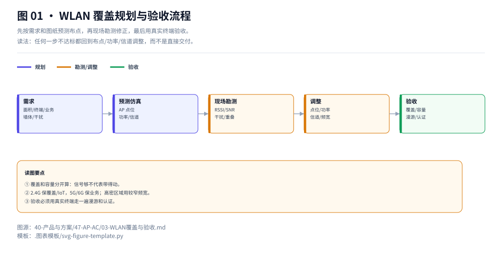
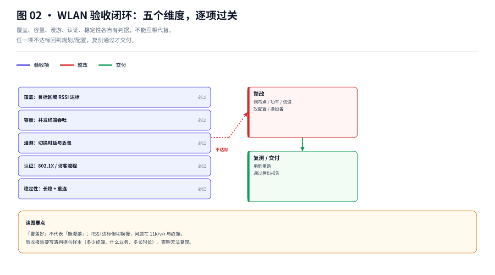

# WLAN 覆盖与验收

WLAN 的质量不是「信号满格」，而是**覆盖够、容量够、干扰可控、漫游不断**。覆盖设计决定 AP 放哪、功率多大；验收决定这套设计在真实终端和真实业务下是否成立。

> 本篇定位：AP 布点、信道/功率规划、容量估算和验收方法。802.11 速率计算去 `10-基础理论`，射频/天线去 `01-射频与天线`，AC/AP 产品去 `00/01`。

## 目录

- [1 一句话模型](#s1)
- [2 速览](#s2)
- [3 覆盖与容量字段](#s3)
- [4 交互流程](#s4)
- [5 状态机与定时器](#s5)
- [6 设计取舍与边界](#s6)
- [7 与相邻主题的关系](#s7)
- [名词解释](#名词解释)
- [8 参考与关联](#s8)

## 1 · 一句话模型：先算覆盖，再算容量，最后用终端验收

```text
覆盖：AP 位置 × 发射功率 × 天线方向 → RSSI/SNR
容量：AP 数 × 空间流 × 信道宽度 × 并发 → 每终端带宽
干扰：信道规划 × 功率控制 × 非 Wi-Fi 噪声
验收：覆盖/容量/漫游/认证/稳定性
```

三个关键认知：

1. **覆盖和容量是两件事**：信号够不代表带得动；会议室/教室要按并发算，而不是按面积。
2. **2.4G 只适合覆盖和 IoT**：信道少、干扰大，业务优先 5G/6G。
3. **验收要用真实终端和真实业务**：只用测试仪打流，发现不了终端兼容性和漫游问题。

## 2 · 速览

| 项 | 内容 |
| --- | --- |
| 设计输入 | 面积/户型、终端数、业务类型、墙体材质、干扰源 |
| 关键指标 | RSSI、SNR、信道利用率、并发、单终端吞吐、漫游时延 |
| 规划手段 | 预测仿真、现场勘测、上线验证 |
| 关键对象 | AP 点位、功率、信道、频宽、SSID/VLAN、漫游域 |
| 验收工具 | 无线测试仪/笔记本网卡、打流工具、漫游测试工具、频谱仪 |
| 主要风险 | 覆盖空洞、同频干扰、容量不足、漫游粘滞、认证失败 |

## 3 覆盖与容量字段

### 3.1 覆盖设计参数

| 参数 | 典型目标 | 说明 |
| --- | --- | --- |
| RSSI | 数据 ≥ -70 dBm，语音/视频 ≥ -65 dBm | 具体目标按业务和终端调整（待验证） |
| SNR | ≥ 25 dB | 低于门限会降 MCS/重传 |
| 信道利用率 | 忙时 < 50%～60% | 过高说明容量/干扰问题 |
| 重叠覆盖 | 相邻 AP 有适度重叠 | 太少会空洞，太多会干扰 |
| AP 间距 | 按覆盖半径和墙体衰减 | 不能只按面积平均 |
| 天线方向 | 朝向用户区 | 吸顶全向、室外定向 |

### 3.2 信道与频宽

| 频段 | 可用信道 | 建议 | 边界 |
| --- | --- | --- | --- |
| 2.4 GHz | 1～13（区域不同） | 只用 1/6/11，20 MHz | 干扰大，不适合高吞吐 |
| 5 GHz | UNII-1/2A/2C/3 | 非重叠信道，20/40/80 MHz | DFS 信道需雷达检测 |
| 6 GHz | dependent on region | 320 MHz（Wi-Fi 7） | 终端和法规支持有限 |

频宽越大，峰值越高但信道越少、越容易重叠。高密场景优先「多 AP + 较窄频宽」，而不是「少 AP + 320 MHz」。

### 3.3 容量估算

| 项 | 估算方式 | 说明 |
| --- | --- | --- |
| 单 AP 并发 | 按业务带宽/空口效率估算 | 不是按「最大关联数」 |
| 单终端带宽 | 总容量 / 并发终端 | 留 30%～50% 余量 |
| 空口时间 | 报文数 × 速率 × 重传 | 小包/重传会显著降低效率 |
| SSID 数 | 每 SSID 有 beacon/管理开销 | SSID 越多，空口开销越大 |
| 上行带宽 | AP 上行 × AP 数 | 汇聚口容易成为瓶颈 |

### 3.4 验收项

| 项 | 方法 | 判据 |
| --- | --- | --- |
| 覆盖 | 逐点测 RSSI/SNR | 达到设计目标，无空洞 |
| 容量 | 多终端并发打流 | 单终端/总吞吐达标 |
| 漫游 | 走动中持续打流 | 切换时延/丢包在业务允许范围 |
| 认证 | 802.1X/Portal/PSK | 成功率、时延达标 |
| 干扰 | 频谱/信道利用率 | 无持续高噪声/同频重叠 |
| 稳定性 | 长时间连接/漫游 | 无掉线、无 AP 重启 |
| 供电 | PoE 功率/温升 | 不超预算、不降频 |

## 4 · 交互流程



**读图**：从需求/图纸开始，先做预测布点，再现场勘测修正，最后用真实终端验收；任何一步不达标都要回到布点/功率/信道调整。

> 图源：`images/图01-覆盖规划与验收.svg`

### 4.1 覆盖规划

```text
收集需求（面积/终端/业务/墙体）
  → 预测仿真（AP 点位/功率/天线）
  → 现场勘测（RSSI/SNR/干扰）
  → 调整点位/功率/信道
  → 输出 AP 清单和配置基线
```

### 4.2 容量规划

```text
估算峰值并发 → 计算单 AP 可承载带宽
  → 确定 AP 数和频宽
  → 核算上行/汇聚带宽
  → 预留 30%～50% 余量
```

### 4.3 上线验收

```text
AP 上线 → 配置核对（SSID/VLAN/功率/信道）
  → 覆盖测试 → 容量测试 → 漫游测试
  → 认证/安全测试 → 长稳观察
  → 输出验收报告
```

### 4.4 异常分支

| 异常 | 现象 | 定位方向 |
| --- | --- | --- |
| 覆盖空洞 | 某区域信号弱/断连 | AP 点位、功率、墙体、天线方向 |
| 同频干扰 | 速率低、重传高 | 信道规划、功率过大、AP 过密 |
| 容量不足 | 人多就卡 | AP 数、频宽、空口效率、上行 |
| 漫游粘滞 | 走动不断/切换慢 | 功率、k/v/r、AP 间距、终端 |
| 认证失败 | 连不上/反复认证 | RADIUS/Portal、证书、VLAN |
| 终端兼容性 | 个别终端异常 | 加密/频宽/11r/厂商特性 |
| 夜间变差 | 特定时段干扰 | 邻居 AP、微波/蓝牙/非 Wi-Fi 干扰 |

## 5 · 状态机与定时器



**读图**：覆盖、容量、漫游、认证、稳定性逐项验收；不达标回到规划/配置调整，复测通过才交付。

> 图源：`images/图02-WLAN验收闭环.svg`

| 阶段 | 动作 | 不通过时 |
| --- | --- | --- |
| 需求 | 明确业务/终端/区域 | 重新确认指标 |
| 预测 | 布点/功率/信道仿真 | 调整模型/点位 |
| 勘测 | 现场测 RSSI/SNR/干扰 | 调整 AP/功率/信道 |
| 验收 | 覆盖/容量/漫游/认证 | 回配置或补 AP |
| 长稳 | 持续连接/漫游/吞吐 | 查干扰/设备/终端 |
| 交付 | 报告/基线/运维文档 | 补齐记录 |

| 定时器/阈值 | 作用 | 说明 |
| --- | --- | --- |
| Beacon 间隔 | 管理帧开销 | 常见 100 ms，调整影响发现/省电 |
| 漫游扫描 | 终端找邻居 | 过于频繁耗电 |
| 认证超时 | 802.1X/Portal | 超时拒绝/回退 |
| 空闲踢除 | 释放空口资源 | 阈值按业务配置 |
| 长稳观察 | 发现慢性问题 | 建议覆盖忙时/闲时 |

> 待验证：RSSI/SNR 目标、漫游时延和丢包判据应结合业务 SLA 与终端类型确定，本篇给的是通用参考。

## 6 · 设计取舍与边界

### 6.1 覆盖优先 vs 容量优先

覆盖优先用少量 AP + 大功率，成本低但容量和干扰差；容量优先用多 AP + 低功率，体验好但布线和成本高。高密场景必须容量优先。

### 6.2 2.4G 的定位

2.4G 穿透好、终端全，但信道少、干扰大。正确做法是「2.4G 保覆盖/IoT，5G/6G 保业务」，而不是让所有业务挤在 2.4G。

### 6.3 频宽的取舍

80/160/320 MHz 提升单终端峰值，但减少非重叠信道，增加同频干扰。高密区域用 20/40 MHz，开阔/低密区域才用大频宽。

### 6.4 预测仿真 vs 现场勘测

仿真能快速布点，但墙体材质、家具、金属和邻居 AP 很难准确建模；现场勘测更真实但耗时。正确流程是「仿真布点 + 现场修正」。

### 6.5 验收的边界

验收通过只代表「当时的终端、业务、环境」达标。终端换代、邻居 AP 增加、装修变化都会改变结果，交付时要留下复测方法和基线。

## 7 · 与相邻主题的关系

| 相邻对象 | 关系 |
| --- | --- |
| [802.11 原理与接入流程](../../10-基础理论/12-通信科学/04-无线通信/02-Wi-Fi/00-802.11原理与接入流程.md) | 接入、重传、漫游 |
| [Wi-Fi 频段信道与速率](../../10-基础理论/12-通信科学/04-无线通信/02-Wi-Fi/01-Wi-Fi频段信道与速率.md) | 信道/速率计算 |
| [无线传播与射频基础](../../10-基础理论/12-通信科学/04-无线通信/01-射频与天线/00-无线传播与射频基础.md) | 路径损耗/衰减 |
| [无线覆盖与干扰优化](../../10-基础理论/12-通信科学/04-无线通信/05-无线测试与优化/00-无线覆盖与干扰优化.md) | 覆盖/干扰方法 |
| [AP 产品架构](./00-AP产品架构.md) | AP 能力 |
| [AC 产品架构与 CAPWAP](./01-AC产品架构与CAPWAP.md) | AC 管理 |
| [AC-AP 组网与漫游](./02-AC-AP组网与漫游.md) | 组网与漫游 |

一句话：**WLAN 验收 = 覆盖达标 × 容量达标 × 漫游达标 × 真实终端可用。**

## 名词解释

> 缩写给出英文全称；非缩写用“—”表示。

| 术语 | 英文全称 | 解释 |
| --- | --- | --- |
| WLAN | Wireless Local Area Network | 无线局域网。 |
| AP | Access Point | 无线接入点。 |
| AC | Access Controller | 无线控制器。 |
| RSSI | Received Signal Strength Indicator | 接收信号强度指示。 |
| SNR | Signal-to-Noise Ratio | 信噪比。 |
| MCS | Modulation and Coding Scheme | 调制与编码策略。 |
| DFS | Dynamic Frequency Selection | 动态频率选择。 |
| SSID | Service Set Identifier | 无线网络名称。 |
| VLAN | Virtual Local Area Network | 虚拟局域网。 |
| PoE | Power over Ethernet | 以太网供电。 |
| SLA | Service Level Agreement | 服务等级协议。 |
| IoT | Internet of Things | 物联网。 |

## 8 · 参考与关联

**标准/方法**

- IEEE 802.11a/b/g/n/ac/ax/be
- IEEE 802.11k/v/r：测量、引导、快速切换
- Wi-Fi Alliance 测试与认证
- RFC 2544（有线打流方法，可参考）

**关联**

- [设备形态对比](../00-设备形态对比.md)
- [AP 产品架构](./00-AP产品架构.md)
- [AC 产品架构与 CAPWAP](./01-AC产品架构与CAPWAP.md)
- [AC-AP 组网与漫游](./02-AC-AP组网与漫游.md)
- [无线覆盖与干扰优化](../../10-基础理论/12-通信科学/04-无线通信/05-无线测试与优化/00-无线覆盖与干扰优化.md)

---

> **本篇定位**：WLAN 覆盖/容量规划、信道功率设计和验收方法。
> **素材来源**：`studyspace/1.知识体系/10.wifi/wifi记录.md`、`studyspace/1.知识体系/1.计算机网络/m-6-无线网络和移动网络.md`。
> **待验证**：RSSI/SNR/漫游判据、AP 并发建议值和不同业务的容量模型。
