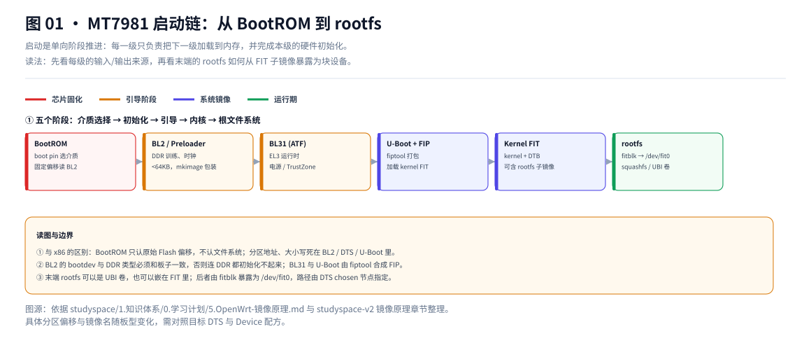
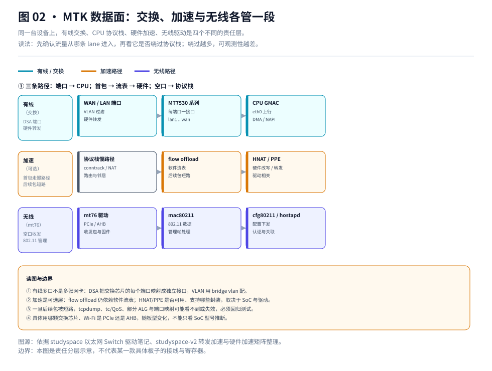

# MT7981 启动链与平台差异

一句话结论：MTK 平台适配的关键不是“CPU 是 ARM”，而是**引导件、分区布局与板级描述三者强绑定**：BootROM 从固定偏移加载 BL2，BL2 初始化 DDR 后经 BL31 进入 U-Boot，U-Boot 再从 FIT/UBI 引导内核；换一块板，先对齐 bootdev、DDR 类型、DTS 与分区，而不是先改应用。

> 本篇定位：以 MT7981（Filogic）为样本，讲 MTK SoC 的启动件、镜像结构、DSA 交换与加速边界。OpenWrt 通用构建与网络机制不在这里展开；具体分区偏移以目标板 DTS 为准。

## 目录

- [1 一句话模型](#s1)
- [2 速览](#s2)
- [3 引导件与镜像结构](#s3)
- [4 启动与数据面流程](#s4)
- [5 状态机与定时器](#s5)
- [6 设计取舍与边界](#s6)
- [7 与相邻主题的关系](#s7)
- [名词解释](#名词解释)
- [8 参考与关联](#s8)

## 1 · 一句话模型

```text
BootROM ──► BL2 ──► BL31 ──► U-Boot(FIP) ──► Kernel FIT ──► rootfs
 选介质     初始化DDR    EL3运行时   加载镜像         kernel+DTB     fitblk/UBI
```

三个关键认知：

1. **引导件是构建产物，不是预编译二进制**：BL2、BL31、U-Boot 都从源码构建，再分别被 `mkimage` 与 `fiptool` 包装。
2. **bootdev + DDR 类型 + DTS 必须同时匹配**：三者任一不一致，现象都可能停在“串口无输出”或“DDR 初始化失败”，而不是正常的软件报错。
3. **升级镜像与工厂镜像的分区假设不同**：`sysupgrade.itb` 可以不带 rootfs，rootfs 从 UBI 卷加载；`factory.ubi` 才是完整可启动镜像。

## 2 · 速览

| 项 | 内容 |
| --- | --- |
| 所属层/领域 | SoC 启动、板级适配、镜像与数据面 |
| 核心对象 | BootROM、BL2、BL31、FIP、U-Boot、kernel FIT、UBI、fitblk |
| 关键输入 | bootdev、DDR 类型、DTS、分区布局、Device 配方 |
| 关键输出 | `*-bl2.img`、`*-bl31.bin`、`*-u-boot.fip`、`sysupgrade.itb`、`factory.ubi` |
| 典型场景 | 新板 bring-up、换 Flash、改分区、双固件、量产烧录 |
| 主要标准 | ARM Trusted Firmware、U-Boot FIT/FIP、UBI、OpenWrt 镜像约定 |

## 3 · 引导件与镜像结构

MT7981 是 Filogic 系列 SoC（ARM Cortex-A53 双核，主频约 1.3GHz，集成 Wi-Fi 6；部分资料标 6E，按具体型号核对）。它的启动没有 BIOS/GRUB，只有芯片内固化的 BootROM。

| 对象 | 作用 | 边界与误判 |
| --- | --- | --- |
| BootROM | 按 boot pin 选择启动介质，从固定偏移读 BL2 | 只认原始 Flash，不认文件系统；读不到就无输出 |
| BL2 / Preloader | 初始化 DDR、时钟、pinctrl，加载 BL31/U-Boot | 通常小于 64KB；bootdev 与 DDR 类型必须匹配 |
| BL31 / ATF | EL3 运行时，提供电源管理与 TrustZone 服务 | 不参与日常业务，但缺失时 U-Boot 起不来 |
| FIP | 用 `fiptool` 把 BL31 与 U-Boot proper 打成一个包 | 典型成员是 `--soc-fw` 与 `--nt-fw` |
| U-Boot | 读取启动参数，加载 kernel FIT，传递 bootargs | 分区名、卷名、bootargs 与 DTS 不一致会引导失败 |
| Kernel FIT | 打包 kernel、DTB，可选 rootfs 子镜像 | 不带 rootfs 时，rootfs 由 UBI 卷提供 |
| fitblk | 把 FIT 内的 rootfs 子镜像暴露为块设备 | 依赖 DTS `chosen/rootdisk` 指向正确的卷 |
| UBI | NAND 的逻辑卷与坏块管理 | 卷名、卷大小、是否 `KERNEL_IN_UBI` 都要与配方一致 |

引导件命名有两套风格，排障时不要混：

- BL2：`mt7981-<bootdev>-<ddrtype>-bl2.img`，用连字符。
- FIP：`mt7981_<device>-u-boot.fip`，用下划线并带 `mt7981_` 前缀。

### 3.1 分区布局：参考设计与商业板不同

以 `openwrt_one` 的 SPI-NAND 为例，布局非常精简：

```text
flash@0 (spi-nand, 256MB)
├── partition@0       "bl2"   0x000000 - 0x100000   (1MB)
└── partition@100000  "ubi"   0x100000 - 0x10000000 (255MB)
    ├── fit      → kernel FIT
    ├── rootfs   → squashfs / UBIFS
    └── ubootenv → 两份环境变量
```

多数商业 NAND 板更复杂，常见顺序是：

```text
bl2 → u-boot-env → art → factory → fip → ubi
```

双 Flash 设备还会在 SPI-NOR 上放一套救援链：

```text
bl2-nor → factory(校准数据) → fip-nor → recovery
```

> 边界：以上是结构示例，不是通用偏移表。`0x380000`、`128KB` 这类数字只对具体板型成立，必须回到目标 DTS 与 Device 配方核对。

## 4 · 启动与数据面流程

### 4.1 正常启动



**读图**：从左到右是单向阶段推进；每一级只负责把下一级加载到内存。先看 BootROM 如何选介质，再看 BL2 的 DDR 初始化，最后看 rootfs 是从 UBI 卷还是 FIT 子镜像暴露。

> 图源：`images/图01-MT7981启动链.svg`

1. 上电后 BootROM 按 boot pin/strap 选择 SPI-NAND、SPI-NOR、eMMC 或 SD，并从固定偏移读取 BL2。
2. BL2 完成 DDR 训练、时钟与 pinctrl 初始化，加载 BL31 与 U-Boot（或直接进入 FIP）。
3. BL31 建立 EL3 运行时，随后把控制权交给 U-Boot proper。
4. U-Boot 读取环境变量与 bootargs，从 UBI 的 `fit` 卷（或独立分区）加载 kernel FIT。
5. 内核解析 DTB，挂载 rootfs；若 rootfs 嵌在 FIT 中，`fitblk` 依据 `chosen/rootdisk` 暴露 `/dev/fit0`。
6. 用户态启动，OpenWrt 的 procd/netifd 接管接口与业务。

### 4.2 异常分支

| 现象 | 优先怀疑 | 核对方向 |
| --- | --- | --- |
| 串口完全无输出 | 供电、boot pin、BL2 介质或 DDR 类型 | 换已知能启动的 BL2 组合，确认 bootdev 与 DDR 类型 |
| BL2 有输出，U-Boot 不启动 | BL31/FIP 不匹配或 FIP 分区位置错误 | 核对 FIP 成员、分区偏移与 U-Boot 变体 |
| U-Boot 启动但内核不加载 | 卷名、分区名、bootargs 不一致 | 对照 DTS 的 `chosen`、UBI 卷名与环境变量 |
| 内核 panic，找不到 rootfs | rootdisk phandle 或卷名错误 | 检查 `chosen/rootdisk` 与 fitblk 配置 |
| 系统起来但 LAN 口缺失 | 交换芯片未枚举或 DSA 端口映射不符 | 看 DTS 的 switch/port 节点与驱动日志 |
| sysupgrade 被拒绝 | 设备名、兼容性版本或镜像类型不匹配 | 检查镜像元数据与 `compat_version` |
| 升级后配置丢失 | overlay 位置或分区布局变化 | 升级前确认配置备份与迁移策略 |

### 4.3 数据面：交换、加速、无线各管一段



**读图**：三条 lane 分别是有线交换、可选加速、无线。先确认流量入口，再看它是否绕过协议栈；绕过得越多，抓包、QoS 和端口映射的可观测性越差。

> 图源：`images/图02-MTK数据面分层.svg`

- **有线**：MT7530 系列交换芯片把每个端口映射为独立接口（`lan1`…`wan`），OpenWrt 21.02+ 默认走 DSA；老方案可能仍是 swconfig 的 `switch0` 模型。
- **加速**：flow offload 是软件流表短路；HNAT/PPE 是 SoC 侧硬件改写/转发。两者都不是“默认更快”，要看封装（VLAN、PPPoE、IPv6）与驱动支持。
- **无线**：mt76 负责空口收发包，mac80211 处理 802.11 数据与管理帧，cfg80211/hostapd 负责配置与认证。三层的职责不要混在一起排障。

DSA 与 swconfig 的判断方法：

```text
看到 lan1/lan2/wan 等独立接口，且 swconfig list 为空  → DSA
看到 eth0.1/eth0.2 与 switch0，且存在 switch_vlan 配置 → swconfig
```

## 5 · 状态机与定时器

本主题没有协议连接状态机。启动链是**单向阶段推进**：掉电或复位后回到 BootROM，不存在“回退到上一级”的常规路径；异常恢复依赖双 Flash、recovery 分区或外部烧录。

升级侧只有“重启进入新系统”的一次性切换，具体回滚标记与双分区策略见 [05-升级与恢复](../../20-平台与系统/22-OpenWrt/05-升级与恢复/.readme.md)。看门狗与复位原因寄存器属于具体板级设计，当前资料不足，标注待验证。

## 6 · 设计取舍与边界

- **为什么 BL2 这么小**：BootROM 只能从固定偏移加载有限大小，BL2 必须先把 DDR 初始化出来，才能把更大的 U-Boot/内核搬进内存。代价是 BL2 与 DDR 类型、bootdev 强绑定。
- **为什么用 FIP**：把 BL31 与 U-Boot 打成一个带校验的包，减少“引导件版本错配”。代价是 FIP 成员与打包工具链绑定，换 ATF/U-Boot 版本要同步重建。
- **为什么 rootfs 可以嵌进 FIT**：减少独立分区，升级时原子性更好；`fitblk` 在运行期把它暴露成块设备。代价是镜像制作与 DTS 的 `chosen` 节点必须同步改。
- **为什么保留多份 BL2**：部分工厂镜像在不同偏移重复写入 BL2，用于兼容性与备份。代价是镜像变大，且偏移假设更难维护。
- **不适用**：只在应用层改配置、换软件包时，不需要动 BL2/FIP；用 ImageBuilder 或 opkg 更快。
- **常见误判**：
  - “镜像能烧进去”不等于“适配完成”，启动、网络、升级三条链路都要验证。
  - “CPU 型号相同”不代表镜像通用，bootdev、DDR、DTS、交换芯片都可能不同。
  - “开了 offload 就一定更快”，小包与复杂封装场景收益有限，还可能破坏 QoS/抓包。
  - “DSA 端口名固定是 lan1…lan4”，实际以 DTS 与 board.d 为准。

可观测现象（按启动阶段）：

| 阶段 | 可观察点 | 说明 |
| --- | --- | --- |
| BootROM/BL2 | 串口最早输出、DDR 训练日志 | 无输出先查供电、boot pin、BL2 组合 |
| U-Boot | 版本、环境变量、加载地址 | 确认加载的是哪个卷/分区 |
| 内核 | `dmesg` 中的 MTD/UBI/DSA 探测 | 分区与交换芯片是否被识别 |
| 用户态 | `ip link`、`bridge vlan show`、`ubus` | 接口、VLAN、业务是否就绪 |

## 7 · 与相邻主题的关系

| 相邻对象 | 关系 |
| --- | --- |
| [00-平台对比](../00-平台对比.md) | 横向看 MTK 与其他平台的差异与资料状态 |
| [OpenWrt 镜像生成与 Device/Profile](../../20-平台与系统/22-OpenWrt/01-构建与包管理/04-镜像生成与Device-Profile.md) | 通用镜像配方；本篇补 MTK 引导件与分区 |
| [DSA 与 bridge/VLAN](../../20-平台与系统/22-OpenWrt/03-网络数据面/02-DSA与bridge-VLAN.md) | DSA 的通用配置模型 |
| [NAT 与 offload](../../20-平台与系统/22-OpenWrt/03-网络数据面/03-NAT与offload.md) | flow offload 与硬件加速的通用边界 |
| [Linux 启动链](../../20-平台与系统/21-Linux/03-启动与根文件系统/00-启动链.md) | 内核接管之后的通用启动过程 |
| [升级与恢复](../../20-平台与系统/22-OpenWrt/05-升级与恢复/.readme.md) | sysupgrade、双分区与回滚 |

一句话边界：本篇讲“MTK 板子为什么这样启动、镜像为什么这样分区”，不讲 OpenWrt 通用的构建命令与网络配置。

## 名词解释

> 缩写给出英文全称；非缩写用“—”表示。

| 术语 | 英文全称 | 解释 |
| --- | --- | --- |
| SoC | System on Chip | 把 CPU、内存控制器、外设与网络单元集成到一颗芯片。 |
| MTK | MediaTek | 联发科，本文指其网络与无线 SoC 平台。 |
| DDR | Double Data Rate | 动态随机存储器接口标准；BL2 需按板型完成 DDR 训练。 |
| SPI | Serial Peripheral Interface | 串行外设接口，常见于 SPI-NAND/SPI-NOR 启动介质。 |
| eMMC | embedded MultiMediaCard | 板载闪存与控制器封装，可作为启动介质。 |
| SD | Secure Digital | 安全数字存储卡，部分参考设计支持从 SD 启动。 |
| EL3 | Exception Level 3 | ARM 最高特权异常级，ATF 的 BL31 运行在此。 |
| DMA | Direct Memory Access | 直接内存访问，外设与内存间搬运数据不占 CPU 核。 |
| NAPI | New API | Linux 网络收包的轮询/中断混合机制。 |
| PCIe | Peripheral Component Interconnect Express | 高速串行总线，常见 Wi-Fi 芯片通过它与 SoC 连接。 |
| AHB | Advanced High-performance Bus | AMBA 高性能片上总线，部分 Wi-Fi/外设挂在其上。 |
| QoS | Quality of Service | 服务质量，按优先级调度与限速；硬件加速可能绕过 tc。 |
| VLAN | Virtual Local Area Network | 虚拟局域网，用标签在同一物理网络上隔离广播域。 |
| UBIFS | UBI File System | 建立在 UBI 之上的可写文件系统。 |
| BootROM | Boot Read-Only Memory | 芯片出厂固化的引导代码，决定从哪里加载第一级引导件。 |
| BL2 | Boot Loader stage 2 | ATF 的第二级引导件，常称 Preloader，负责 DDR 等早期初始化。 |
| BL31 | Boot Loader stage 3-1 | ATF 的 EL3 运行时，提供安全监控与电源管理服务。 |
| ATF | ARM Trusted Firmware | ARM 官方的安全固件参考实现，包含 BL1/BL2/BL31 等阶段。 |
| FIP | Firmware Image Package | 用 `fiptool` 打包的固件容器，通常含 BL31 与 U-Boot。 |
| FIT | Flattened Image Tree | 用设备树描述的镜像容器，可含 kernel、DTB、rootfs 与校验。 |
| DTB | Device Tree Blob | 设备树二进制，描述板级硬件与分区。 |
| DTS | Device Tree Source | 设备树源码，编译后生成 DTB。 |
| UBI | Unsorted Block Images | NAND 上的逻辑卷管理层，负责坏块与磨损均衡。 |
| MTD | Memory Technology Device | Linux 对裸 Flash 的抽象层。 |
| DSA | Distributed Switch Architecture | 把交换芯片每个端口映射为独立网络接口的内核框架。 |
| GMAC | Gigabit Media Access Controller | 以太网 MAC 控制器，常作为交换芯片到 CPU 的上行。 |
| HNAT | Hardware Network Address Translation | 厂商 SoC 的硬件 NAT/转发单元。 |
| PPE | Packet Processing Engine | 厂商 SoC 的硬件包处理引擎。 |
| sysupgrade | — | OpenWrt 的系统升级工具与镜像类型。 |
| fitblk | — | 把 FIT 内 rootfs 子镜像暴露为块设备的内核驱动。 |
| SDK | Software Development Kit | 厂商提供的开发包，通常含内核、驱动、工具链与示例。 |
| BSP | Board Support Package | 面向具体板卡的引导、内核、驱动与配置集合。 |

## 8 · 参考与关联

**标准与文档**

- ARM Trusted Firmware：BL2/BL31 阶段与 FIP 打包约定。
- U-Boot：FIT 镜像格式与 `fiptool` 使用方式。
- OpenWrt：`target/linux/mediatek/image/filogic.mk` 的 Device 与镜像定义。

**关联**

- [本目录索引](./.readme.md)
- [平台对比](../00-平台对比.md)
- [MTK 图片索引](./images/.readme.md)
- [OpenWrt 构建与包管理](../../20-平台与系统/22-OpenWrt/01-构建与包管理/.readme.md)
- [OpenWrt 网络数据面](../../20-平台与系统/22-OpenWrt/03-网络数据面/.readme.md)

---

> **本篇定位**：MT7981 的引导件、镜像结构与数据面分层。
> **素材来源**：`studyspace/1.知识体系/0.学习计划/5.OpenWrt-镜像原理.md`、`studyspace/1.知识体系/7.openwrt/5.驱动/1.以太网switch驱动.md`、`studyspace-v2/8.数据面工程/`。
> **待验证**：MT7981 的 Wi-Fi 规格（6/6E）、具体板型的交换芯片型号与分区偏移、双 Flash 恢复链、看门狗与复位原因寄存器。
