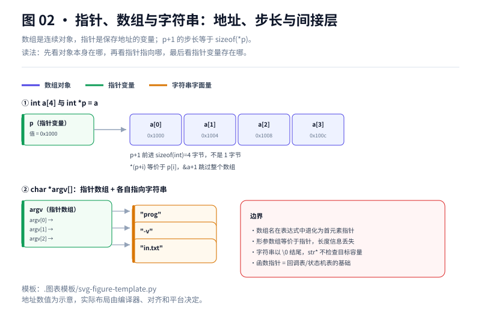

# 指针、数组与字符串

一句话结论：数组名在大多数表达式里**退化为指向首元素的指针**，但数组不是指针；指针是“地址 + 类型”，类型决定步长和解引用宽度。把「对象、地址、地址上的类型」三者分开，指针题就不再靠背。

> 本篇定位：讲指针运算、数组退化、多维数组、函数指针、`const` 限定和字符串边界。对象生命周期与内存分区见 [00-C语言对象与内存模型](./00-C语言对象与内存模型.md)。

## 目录

- [1 一句话模型](#s1)
- [2 速览](#s2)
- [3 声明与类型读法](#s3)
- [4 指针运算与数组退化](#s4)
- [5 状态机与定时器](#s5)
- [6 设计取舍与边界](#s6)
- [7 与相邻主题的关系](#s7)
- [名词解释](#名词解释)
- [8 参考与关联](#s8)

## 1 · 一句话模型

```text
p ──► [ 对象 ][ 对象 ][ 对象 ] ...
       ↑
     p+1 跳过 sizeof(*p) 字节，不是 1 字节
```

三个关键认知：

1. **指针的步长由所指类型决定**：`int *p; p+1` 前进 `sizeof(int)`，`char *q; q+1` 前进 1。
2. **数组退化发生在表达式里，不发生在定义里**：`sizeof(arr)` 在定义所在作用域是整块大小，作为参数传入后变成指针大小。
3. **字符串是“以 `\0` 结尾的字符数组”这一约定**，不是语言类型；越界读写首先破坏的是这个约定。

## 2 · 速览

| 项 | 内容 |
| --- | --- |
| 所属层/领域 | C 语言地址与复合类型 |
| 核心对象 | 指针、数组、字符串字面量、函数指针 |
| 关键参数 | `sizeof`、步长、`const` 位置、`restrict`、`NULL` |
| 典型场景 | 缓冲区处理、回调注册、配置表、协议解析 |
| 主要标准 | ISO C11/C17 第 6.3.2、6.5.2、6.5.6 节 |

## 3 · 声明与类型读法

### 3.1 从标识符向外读

| 声明 | 读法 | 类型 |
| --- | --- | --- |
| `int a[10]` | a 是含 10 个 int 的数组 | 数组 |
| `int *a[10]` | a 是含 10 个“int 指针”的数组 | 指针数组 |
| `int (*a)[10]` | a 是指向“含 10 个 int 的数组”的指针 | 数组指针 |
| `int (*f)(int)` | f 是指向“接受 int 返回 int 的函数”的指针 | 函数指针 |
| `int *f(int)` | f 是接受 int 返回 int 指针的函数 | 函数 |
| `const int *p` | p 指向只读 int，p 本身可改 | 指向常量的指针 |
| `int *const p` | p 是只读指针，指向的 int 可改 | 常量指针 |
| `char **argv` | argv 指向“char 指针” | 二级指针 |

规则：先找标识符，再看右边的 `[]`/`()`，最后看左边的 `*`；`const` 修饰它左边最近的东西（在最左边时修饰右边）。

### 3.2 关键字段

| 对象 | 作用 | 边界与误判 |
| --- | --- | --- |
| `NULL` | 表示“不指向任何对象” | 解引用必崩；`free(NULL)` 合法 |
| `void *` | 无类型地址，可与其他对象指针互转 | 不能解引用，不能做指针算术（GCC 扩展除外） |
| 函数指针 | 回调、状态机表、驱动 ops | 函数名退化为指针；`&f` 与 `f` 等价 |
| 字符串字面量 | 静态存储期的只读字符数组 | 修改是 UB；相同内容是否合并由实现决定 |
| `restrict` | 承诺同一对象不被多个指针访问 | 违约是 UB，但能给编译器优化空间 |

## 4 · 指针运算与数组退化



**读图**：上半部分是 `int a[4]` 的连续布局与 `p+1` 的步长；下半部分是 `char *argv[]` 这种“指针数组 + 各自指向字符串”的常见形态。注意数组本身和指针变量是两块不同的内存。

> 图源：`images/图02-指针数组与字符串.svg`

### 4.1 正常路径

1. **定义数组**：`int a[4] = {1,2,3,4};` 在栈上分配 16 字节（假设 `int` 为 4 字节）。
2. **取首地址**：`int *p = a;` 等价于 `&a[0]`，类型是 `int *`。
3. **指针运算**：`p + i` 指向 `a[i]`，`*(p+i)` 与 `p[i]` 等价；`&a` 的类型是 `int (*)[4]`，`&a + 1` 跳过整个数组。
4. **传参**：`void f(int a[4])` 与 `void f(int *a)` 完全等价，数组大小信息丢失，必须另传长度。
5. **字符串**：`char s[] = "abc"` 是可写副本（4 字节含 `\0`）；`char *s = "abc"` 指向只读字面量。

### 4.2 异常分支

| 现象 | 优先检查 | 说明 |
| --- | --- | --- |
| 函数内 `sizeof` 得到 8 | 参数是否写成数组形式 | 形参数组已退化为指针 |
| 越界后程序不立刻崩 | 是否写到相邻对象 | 栈上越界可能只破坏别的变量，属于 UB |
| `strcpy` 后数据错乱 | 目标缓冲区是否够长、源是否以 `\0` 结尾 | 用 `snprintf`/显式长度接口 |
| 回调调用崩溃 | 函数指针是否未初始化、签名是否一致 | 函数指针类型不匹配是 UB |
| 释放后仍能读 | 悬垂指针 | `free` 不置空，读完可能“看起来正常” |

### 4.3 字符串函数的边界

| 函数 | 保证 | 不保证 | 建议 |
| --- | --- | --- | --- |
| `strlen` | 统计到第一个 `\0` | 不检查缓冲区边界 | 只用于确定以 `\0` 结尾的串 |
| `strcpy` | 复制到 `\0` | 不检查目标容量 | 已知容量时用 `snprintf` 或 `memcpy` + 手动补 `\0` |
| `strncpy` | 最多复制 n 字节 | 源过长时**不补 `\0`** | 复制后显式 `dst[n-1] = '\0'` |
| `memcpy` | 复制 n 字节 | 区域重叠时 UB | 重叠用 `memmove` |
| `snprintf` | 最多写 size-1 字节并补 `\0` | 返回值是“本应写入的长度”，可能大于 size | 用返回值判断是否截断 |

## 5 · 状态机与定时器

没有状态机，也没有定时器。只有**指针有效性**这一约束：指针要么指向有效对象，要么为 `NULL`；一旦所指对象的存储期结束，指针立即失效，后续任何解引用都是 UB。

## 6 · 设计取舍与边界

- **为什么数组不携带长度**：C 追求“零开销抽象”，长度由程序员维护；代价是接口必须显式传 `len`，否则只能靠哨兵值。
- **为什么函数指针好用**：把“行为”当数据存进表里，状态机、驱动 ops、命令分发都能写成查表；代价是间接调用难以内联，且签名错误编译器未必报错。
- **为什么字符串以 `\0` 结尾**：实现简单、兼容历史；代价是不能直接存二进制，且每次求长度都是 O(n)。
- **二级指针的合理用途**：修改调用者的指针本身（如 `void list_push(Node **head, ...)`）；如果只是读数据，用一级指针即可。
- **不适用**：高频二进制协议解析不要用 `str*` 系列，改用“指针 + 剩余长度”的游标式解析，避免每次扫描 `\0`。

## 7 · 与相邻主题的关系

| 相邻对象 | 关系 |
| --- | --- |
| [00-C语言对象与内存模型](./00-C语言对象与内存模型.md) | 解释指针所指对象的存储期与对齐 |
| [02-结构体联合与位域](./02-结构体联合与位域.md) | 结构体指针、柔性数组、成员偏移 |
| [04-嵌入式C工程实践](./04-嵌入式C工程实践.md) | 回调表、缓冲区游标、内存池句柄 |
| [52-数据结构与算法/01-线性表栈与队列](../52-数据结构与算法/01-线性表栈与队列.md) | 链表指针操作的实际形态 |

一句话边界：本篇讲“地址怎么算、类型怎么读”，不讲“容器怎么选”。

## 名词解释

> 缩写给出英文全称；非缩写用“—”表示。

| 术语 | 英文全称 | 解释 |
| --- | --- | --- |
| 指针 | Pointer | 保存对象地址并带有类型信息的对象。 |
| 数组退化 | Array Decay | 数组名在表达式中转换为指向首元素的指针。 |
| 步长 | Stride | 指针加减 1 时实际移动的字节数，等于所指类型的大小。 |
| 二级指针 | Pointer to Pointer | 指向指针对象的指针，用于修改调用者的指针。 |
| 函数指针 | Function Pointer | 保存函数入口地址、可按签名调用的指针。 |
| 回调 | Callback | 把函数指针交给下层，由下层在适当时机调用。 |
| 悬垂指针 | Dangling Pointer | 所指对象已失效但仍被使用的指针。 |
| 字符串字面量 | String Literal | 静态存储期的只读字符数组，隐含结尾 `\0`。 |
| UB | Undefined Behavior | 标准未规定结果的行为，编译器可假设其不发生。 |
| restrict | Restricted Pointer | C99 关键字，承诺指针是访问其对象的唯一途径。 |

## 8 · 参考与关联

**标准**

- ISO/IEC 9899:2018，6.3.2（数组与指针转换）、6.5.6（指针加减）、7.24（字符串处理）。

**关联**

- [00-C语言对象与内存模型](./00-C语言对象与内存模型.md)
- [02-结构体联合与位域](./02-结构体联合与位域.md)
- [04-嵌入式C工程实践](./04-嵌入式C工程实践.md)
- [52-数据结构与算法/01-线性表栈与队列](../52-数据结构与算法/01-线性表栈与队列.md)

---

> **本篇定位**：把指针题从“背结论”还原为“地址 + 类型 + 生命周期”。
> **素材来源**：`studyspace/2.编程技能/1.C语言/链表申请空间.md`（函数指针与链表节点形态）。
> **待验证**：不同编译器对 `void *` 算术、函数指针与 `void *` 互转的扩展行为不一致，以目标工具链文档为准。
