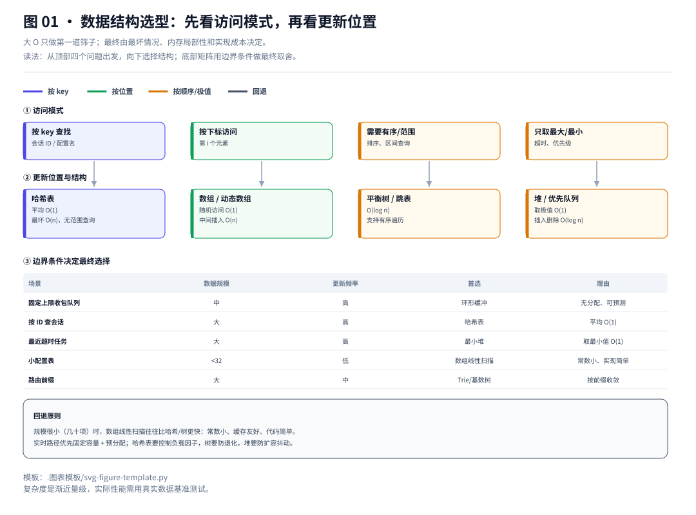

# 复杂度与数据结构选型

一句话结论：复杂度描述的是**输入规模趋向无穷时增长的量级**，不是精确耗时；工程选型真正比较的是“访问模式 + 内存局部性 + 最坏情况 + 实现成本”，大 O 只是第一道筛子。

> 本篇定位：讲大 O/摊还分析、常见操作代价和选型方法。具体结构见 [01-线性表栈与队列](./01-线性表栈与队列.md)、[02-树与堆](./02-树与堆.md)、[03-图](./03-图.md)、[04-查找与排序](./04-查找与排序.md)。

## 目录

- [1 一句话模型](#s1)
- [2 速览](#s2)
- [3 复杂度与代价表](#s3)
- [4 从需求到结构的选型流程](#s4)
- [5 状态机与定时器](#s5)
- [6 设计取舍与边界](#s6)
- [7 与相邻主题的关系](#s7)
- [名词解释](#名词解释)
- [8 参考与关联](#s8)

## 1 · 一句话模型

```text
选型 = 访问模式（随机/顺序/按 key） × 更新频率 × 数据规模 × 内存预算
        └── 先用大 O 淘汰，再用常数、缓存和实现成本定胜负
```

三个关键认知：

1. **大 O 忽略常数**：`O(log n)` 的二分查找在 n 很小时可能不如线性扫描，因为分支预测和缓存更友好。
2. **最坏情况与平均情况要分开**：哈希表平均 O(1)，最坏 O(n)；实时系统更关心“最坏”。
3. **内存局部性常常比复杂度更重要**：同样是 O(n)，连续数组遍历通常远快于链表指针跳转。

## 2 · 速览

| 项 | 内容 |
| --- | --- |
| 所属层/领域 | 算法分析与工程选型 |
| 核心对象 | 时间复杂度、空间复杂度、摊还代价、访问模式 |
| 关键参数 | n、常数因子、缓存行、最坏/平均、内存上限 |
| 典型场景 | 容器选择、协议表项管理、队列/缓存设计 |
| 主要标准 | —（计算机科学基础，无协议标准） |

## 3 · 复杂度与代价表

### 3.1 常见增长阶

| 阶 | 名称 | 典型算法 | n=1e3 时的量级感 |
| --- | --- | --- | --- |
| O(1) | 常数 | 数组下标、哈希查找 | 1 |
| O(log n) | 对数 | 二分查找、平衡树 | ~10 |
| O(n) | 线性 | 遍历、计数 | 1e3 |
| O(n log n) | 线性对数 | 归并/快排/堆排 | ~1e4 |
| O(n²) | 平方 | 冒泡、简单选择、双重循环 | 1e6 |
| O(2ⁿ) | 指数 | 朴素子集枚举 | 不可用 |
| O(n!) | 阶乘 | 全排列 | 不可用 |

大 O 的推导：用 1 取代加法常数，只保留最高阶项，去掉最高阶项的系数。`3n² + 2n + 7` → `O(n²)`。

### 3.2 常见操作代价

| 结构 | 查找 | 插入 | 删除 | 有序遍历 | 内存开销 | 边界 |
| --- | --- | --- | --- | --- | --- | --- |
| 数组 | O(n) | O(n)（中间） | O(n) | 支持 | 紧凑 | 扩容需搬移 |
| 动态数组 | O(n) | 摊还 O(1)（尾部） | O(n) | 支持 | 紧凑 + 余量 | 扩容瞬间有抖动 |
| 单链表 | O(n) | O(1)（已知前驱） | O(1)（已知前驱） | 支持 | 每节点一个指针 | 缓存不友好 |
| 双向链表 | O(n) | O(1) | O(1) | 支持 | 两个指针 | 指针维护复杂 |
| 栈/队列 | O(n) | O(1) | O(1) | 受限 | 紧凑 | 容量/溢出策略 |
| 哈希表 | 平均 O(1) | 平均 O(1) | 平均 O(1) | 不支持 | 桶 + 负载因子 | 最坏 O(n)，需扩容 |
| 平衡 BST | O(log n) | O(log n) | O(log n) | 支持 | 每节点多个指针 | 实现复杂 |
| 堆 | O(1) 取极值 | O(log n) | O(log n) | 不支持 | 数组即可 | 只保证堆序 |
| 跳表 | O(log n) 平均 | O(log n) 平均 | O(log n) 平均 | 支持 | 多层指针 | 随机化，最坏退化 |

### 3.3 摊还分析

| 场景 | 单次最坏 | 摊还 | 说明 |
| --- | --- | --- | --- |
| 动态数组追加 | O(n)（扩容搬移） | O(1) | 容量按倍数增长，总搬移量摊到每次 |
| 哈希表插入 | O(n)（扩容重排） | O(1) | 负载因子控制在阈值内 |
| 并查集 | O(n)（未优化） | 近 O(1) | 路径压缩 + 按秩合并 |

摊还不等于“每次都快”：实时路径要关注单次最坏，而不是平均值。

## 4 · 从需求到结构的选型流程



**读图**：先看访问模式（按 key 还是按位置），再看更新位置（尾部/任意/头部），最后看是否需要有序和范围查询。底部的边界条件（规模、更新频率）决定最终取舍：规模很小时，数组/固定池往往比复杂结构更稳。

> 图源：`images/图01-选型决策.svg`

### 4.1 选型步骤

1. **明确操作集合**：需要哪些操作？查找、插入、删除、取极值、范围查询、有序遍历。
2. **估算规模与频率**：n 的量级、每秒操作数、峰值倍数。
3. **确定内存预算**：每项开销、最大条目数、是否允许动态分配。
4. **检查最坏情况**：能否接受哈希退化、扩容抖动、递归深度。
5. **实现与验证**：先写正确版本，再用真实数据做基准测试；不要凭直觉优化。

### 4.2 典型场景映射

| 场景 | 首选 | 备选 | 理由 |
| --- | --- | --- | --- |
| 固定上限的收包队列 | 环形缓冲 | 链表队列 | 无分配、缓存友好、可预测 |
| 按 ID 查会话 | 哈希表 | 平衡树 | 平均 O(1)，ID 分布均匀 |
| 按超时时间取最近到期 | 最小堆 | 有序链表 | 取最小值 O(1)，插入 O(log n) |
| 路由前缀/区间查询 | Trie/基数树 | 平衡树 | 按位/按前缀收敛 |
| 小规模配置表（<32 项） | 数组线性扫描 | 哈希 | 常数小、实现简单 |
| 需要有序遍历且频繁插入 | 平衡树/跳表 | 排序数组 | 插入不搬移 |

### 4.3 异常分支

| 现象 | 优先检查 | 说明 |
| --- | --- | --- |
| 哈希表变慢 | 负载因子、哈希函数质量、冲突策略 | 冲突严重时退化为链表 |
| 队列偶发丢包 | 容量、溢出策略、生产者速度 | 固定队列必须定义“满时丢弃/覆盖/背压” |
| 定时器精度差 | 堆顶更新、tick 粒度 | 大量定时器时用时间轮 |
| 内存碎片 | 频繁不同大小分配 | 改用固定大小池或 slab |

## 5 · 状态机与定时器

没有状态机，也没有定时器。选型是**一次性决策 + 周期性复核**：数据规模或访问模式变化时，原结构可能不再合适，需要重新评估。

## 6 · 设计取舍与边界

- **为什么数组常胜**：连续内存命中缓存，常数因子小；代价是中间插入删除要搬移。
- **为什么链表不总是更快**：插入 O(1) 的前提是“已经拿到前驱”，而查找前驱仍是 O(n)；指针跳转还会导致缓存 miss。
- **为什么哈希表要控制负载因子**：冲突链变长会退化；代价是预留空间和扩容时的短暂抖动。
- **为什么实时系统偏爱固定池/环形缓冲**：行为可预测，不依赖分配器；代价是容量固定，需要溢出策略。
- **常见误判**：把大 O 当实际耗时；忽略常数和缓存；用平均复杂度掩盖最坏情况；在小 n 上过度设计。

## 7 · 与相邻主题的关系

| 相邻对象 | 关系 |
| --- | --- |
| [01-线性表栈与队列](./01-线性表栈与队列.md) | 数组/链表/栈/队列的具体实现与代价 |
| [02-树与堆](./02-树与堆.md) | 有序查找与取极值的结构 |
| [03-图](./03-图.md) | 关系型数据的存储与遍历 |
| [04-查找与排序](./04-查找与排序.md) | 具体算法及其复杂度 |
| [51-C语言/04-嵌入式C工程实践](../51-C语言/04-嵌入式C工程实践.md) | 内存池、环形队列的工程落地 |

一句话边界：本篇讲“怎么选”，具体实现放在后续各篇。

## 名词解释

> 缩写给出英文全称；非缩写用“—”表示。

| 术语 | 英文全称 | 解释 |
| --- | --- | --- |
| 时间复杂度 | Time Complexity | 运行时间随输入规模增长的量级。 |
| 空间复杂度 | Space Complexity | 额外内存随输入规模增长的量级。 |
| 大 O 记号 | Big-O Notation | 描述函数增长上界的渐进记号。 |
| 摊还分析 | Amortized Analysis | 把偶发高代价操作分摊到一系列操作上的分析方法。 |
| 最坏情况 | Worst Case | 所有合法输入中代价最大的情况。 |
| 平均情况 | Average Case | 按某种输入分布计算的期望代价。 |
| 缓存局部性 | Cache Locality | 访问地址集中时命中 CPU 缓存的特性。 |
| 负载因子 | Load Factor | 哈希表中元素数与桶数之比。 |
| 时间轮 | Timing Wheel | 用环形槽位组织大量定时器的结构。 |
| 背压 | Backpressure | 下游处理能力不足时向上游施加的限流。 |

## 8 · 参考与关联

**标准**

- —（算法分析属于计算机科学基础，无协议标准）。

**关联**

- [01-线性表栈与队列](./01-线性表栈与队列.md)
- [02-树与堆](./02-树与堆.md)
- [03-图](./03-图.md)
- [04-查找与排序](./04-查找与排序.md)
- [51-C语言/04-嵌入式C工程实践](../51-C语言/04-嵌入式C工程实践.md)

---

> **本篇定位**：把“选什么结构”变成可执行的判断流程，而不是背复杂度表。
> **素材来源**：`studyspace/2.编程技能/3.数据结构/1-绪论.md`、`2-算法.md`（已重写并补齐选型方法）。
> **待验证**：具体平台的缓存行大小、分配器行为和基准数据。
