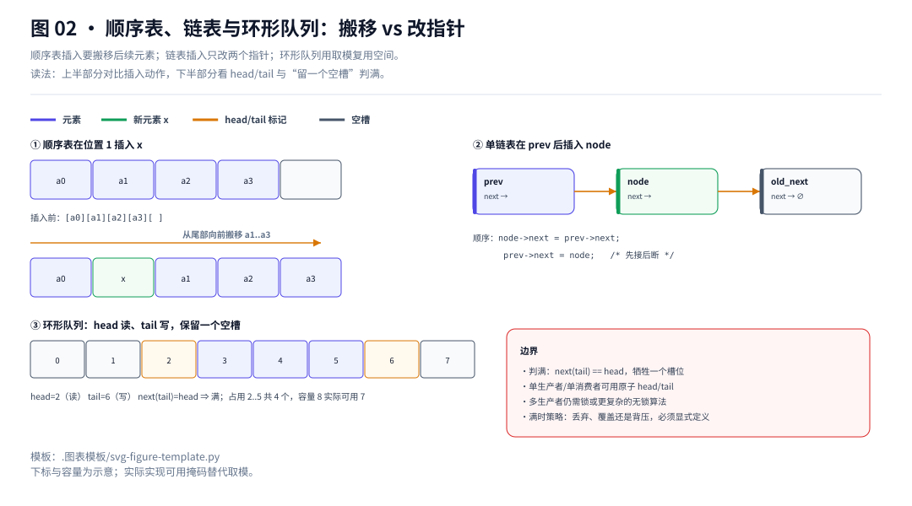

# 线性表、栈与队列

一句话结论：线性结构只解决一件事——**元素之间是一前一后的关系**；顺序存储赢在随机访问和缓存，链式存储赢在已知位置 O(1) 插入删除。栈和队列是“限制了操作端”的线性表，限制换来的是更简单的接口和更可预测的行为。

> 本篇定位：讲顺序表、单/双/循环链表、静态链表、栈（含表达式求值）、队列与环形缓冲。选型方法见 [00-复杂度与结构选型](./00-复杂度与结构选型.md)。

## 目录

- [1 一句话模型](#s1)
- [2 速览](#s2)
- [3 存储结构与字段表](#s3)
- [4 插入删除与队列流转](#s4)
- [5 状态机与定时器](#s5)
- [6 设计取舍与边界](#s6)
- [7 与相邻主题的关系](#s7)
- [名词解释](#名词解释)
- [8 参考与关联](#s8)

## 1 · 一句话模型

```text
顺序表：[a0][a1][a2][a3] ...        下标直达，插入要搬
单链表：head → [a0|→] → [a1|→] → ∅  已知前驱时插入 O(1)
栈：    ────────► push/pop 都在同一端（LIFO）
队列：  in ──► [ ][ ][ ][ ] ──► out  两端操作（FIFO）
```

三个关键认知：

1. **顺序表的核心是“下标 = 基址 + i × 元素大小”**，所以随机访问 O(1)。
2. **链表的核心是“节点自己保存后继”**，所以插入删除不搬移，但定位仍要遍历。
3. **栈和队列是接口约束**，不是新的存储方式；底层可以用数组，也可以用链表。

## 2 · 速览

| 项 | 内容 |
| --- | --- |
| 所属层/领域 | 基础数据结构 |
| 核心对象 | 数组、链表节点、栈顶、队头/队尾 |
| 关键参数 | 容量、长度、头/尾指针、哨兵节点 |
| 典型场景 | 缓冲区、表达式求值、BFS 队列、消息队列、撤销栈 |
| 主要标准 | —（计算机科学基础） |

## 3 · 存储结构与字段表

### 3.1 顺序表与链表

| 结构 | 组成 | 随机访问 | 插入/删除 | 内存 | 边界 |
| --- | --- | --- | --- | --- | --- |
| 顺序表 | 连续数组 + 长度 | O(1) | O(n) | 紧凑，可能预留容量 | 扩容搬移；中间删除要移动 |
| 单链表 | 数据域 + `next` | O(n) | O(1)（已知前驱） | 每节点一个指针 | 只能单向遍历；删除需前驱 |
| 双向链表 | `prev` + 数据 + `next` | O(n) | O(1)（已知节点） | 两个指针 | 指针维护成本高 |
| 循环链表 | 尾节点指回头节点 | O(n) | O(1) | 同单/双链表 | 遍历需终止条件，易死循环 |
| 静态链表 | 数组 + `cur` 下标 | O(n) | O(1) | 无指针，紧凑 | 容量固定；下标管理复杂 |
| 带头节点链表 | 固定哨兵头 | O(n) | O(1) | 多一个节点 | 统一空表/首节点操作 |

单链表插入的关键顺序（先接后断）：

```c
/* 在 prev 之后插入 node：顺序错了会丢链 */
node->next = prev->next;
prev->next = node;
```

双向链表删除：

```c
node->prev->next = node->next;
node->next->prev = node->prev;
free(node);
```

### 3.2 栈与队列

| 结构 | 操作端 | 规则 | 典型实现 | 边界 |
| --- | --- | --- | --- | --- |
| 栈 | 同一端（栈顶） | 后进先出 LIFO | 数组 + `top`；链表头插 | 栈空出栈、栈满入栈 |
| 队列 | 队尾入、队头出 | 先进先出 FIFO | 环形数组；链表头尾指针 | 队空出队、队满入队 |
| 双端队列 | 两端都可进出 | 灵活 | 环形数组/双向链表 | 边界判断更复杂 |
| 优先队列 | 按优先级出 | 不是 FIFO | 堆（见 [02-树与堆](./02-树与堆.md)） | 只保证极值，不保证整体有序 |

环形缓冲的核心：用 `head/tail` 和容量取模，**牺牲一个槽位**区分“空”和“满”。

```c
struct ring {
    uint8_t *buf;
    size_t   cap;   /* 实际可存 cap-1 字节 */
    size_t   head;  /* 读位置 */
    size_t   tail;  /* 写位置 */
};

static size_t ring_next(size_t i, size_t cap) { return (i + 1) % cap; }

int ring_put(struct ring *r, uint8_t v)
{
    size_t next = ring_next(r->tail, r->cap);
    if (next == r->head)
        return -1;              /* 满 */
    r->buf[r->tail] = v;
    r->tail = next;
    return 0;
}
```

单生产者/单消费者场景可把 `head/tail` 做成原子变量，避免锁；多生产者则仍需临界区或更复杂的无锁算法。

## 4 · 插入删除与队列流转



**读图**：上半部分对比顺序表插入（搬移后续元素）和链表插入（只改两个指针）；下半部分是环形队列的 `head/tail` 与“留一个空槽”判满规则。箭头表示指针/下标移动方向。

> 图源：`images/图02-线性结构.svg`

### 4.1 正常路径

1. **顺序表插入**：检查容量 → 从尾部向前搬移 `[pos, len)` → 写入 → `len++`。
2. **顺序表删除**：从 `pos+1` 向前搬移 → `len--`；不缩容，避免频繁抖动。
3. **链表插入**：定位前驱 → 新节点 `next` 指向前驱后继 → 前驱 `next` 指向新节点。
4. **链表删除**：定位前驱 → 前驱 `next` 指向待删节点后继 → 释放节点。
5. **栈操作**：`push` 检查满 → 写 `top` → `top++`；`pop` 检查空 → `top--` → 读值。
6. **队列操作**：`enqueue` 检查满 → 写 `tail` → `tail` 前进；`dequeue` 检查空 → 读 `head` → `head` 前进。
7. **表达式求值**：中缀转后缀用栈存运算符，后缀求值用栈存操作数。

### 4.2 异常分支

| 现象 | 优先检查 | 说明 |
| --- | --- | --- |
| 链表遍历死循环 | 尾节点 `next` 是否置 `NULL`；循环链表终止条件 | 环可能是 bug，也可能是设计 |
| 删除后程序崩溃 | 是否释放了仍被引用的节点 | 悬垂指针 |
| 队列“满”但实际有空位 | 判满规则 | 环形缓冲通常牺牲一个槽位 |
| 队列数据错乱 | 多生产者/消费者是否加锁 | `head/tail` 更新不是原子复合操作 |
| 栈溢出 | 容量与递归深度 | 递归本质上也用栈 |
| 顺序表扩容后指针失效 | `realloc` 可能搬移 | 保存的是旧地址 |

### 4.3 表达式求值（栈的经典应用）

| 步骤 | 规则 | 边界 |
| --- | --- | --- |
| 中缀转后缀 | 数字直接输出；运算符按优先级出栈；左括号入栈；右括号弹到左括号 | 括号不匹配要报错 |
| 后缀求值 | 数字入栈；遇运算符弹出右操作数、再弹左操作数，计算后入栈 | 操作数不足说明表达式非法 |
| 结果 | 栈中最后只剩一个值 | 多于一个说明有多余操作数 |

## 5 · 状态机与定时器

没有协议状态机，也没有定时器。队列可能有**水位状态**（空/正常/高水位/满），用于触发背压或丢弃策略；这是上层策略，不是队列结构本身的一部分。

## 6 · 设计取舍与边界

- **为什么顺序表仍是默认选择**：随机访问和缓存友好，常数小；代价是中间插入删除 O(n)。
- **为什么链表适合“已知位置频繁增删”**：不搬移元素；代价是每个节点额外指针和缓存 miss。
- **为什么环形缓冲适合嵌入式**：固定内存、无分配、读写都是 O(1)；代价是容量固定，必须定义满时行为。
- **哨兵节点的取舍**：统一空表/首节点操作，减少分支；代价是多一个节点和一层间接。
- **不适用**：需要范围查询或按 key 查找时，线性结构不合适，改用树/哈希（见 [04-查找与排序](./04-查找与排序.md)）。
- **常见误判**：链表插入一定比数组快（没算定位成本）；队列满就是 bug（没有定义溢出策略才是 bug）。

## 7 · 与相邻主题的关系

| 相邻对象 | 关系 |
| --- | --- |
| [00-复杂度与结构选型](./00-复杂度与结构选型.md) | 线性结构的代价与选型位置 |
| [02-树与堆](./02-树与堆.md) | 优先队列、有序查找 |
| [03-图](./03-图.md) | BFS 用队列，DFS 用栈/递归 |
| [51-C语言/01-指针数组与字符串](../51-C语言/01-指针数组与字符串.md) | 链表指针操作的语言基础 |
| [51-C语言/04-嵌入式C工程实践](../51-C语言/04-嵌入式C工程实践.md) | 侵入式链表、无锁环形队列 |

一句话边界：本篇讲“一前一后”的结构，不讲树和图的层次/网络关系。

## 名词解释

> 缩写给出英文全称；非缩写用“—”表示。

| 术语 | 英文全称 | 解释 |
| --- | --- | --- |
| 线性表 | Linear List | 元素之间只有前驱和后继关系的有限序列。 |
| 顺序存储 | Sequential Storage | 用连续内存按顺序存放元素。 |
| 链式存储 | Linked Storage | 用节点内的指针连接不连续的内存块。 |
| 静态链表 | Static Linked List | 用数组下标代替指针实现链表。 |
| 哨兵节点 | Sentinel Node | 不存业务数据的固定节点，用于简化边界处理。 |
| 栈 | Stack | 只在一端插入删除的线性表，后进先出。 |
| 队列 | Queue | 一端插入、另一端删除的线性表，先进先出。 |
| 环形缓冲 | Ring Buffer | 用取模下标循环复用的固定容量缓冲区。 |
| 双端队列 | Deque | 两端都可插入删除的队列。 |
| LIFO | Last In First Out | 后进先出。 |
| FIFO | First In First Out | 先进先出。 |
| 背压 | Backpressure | 队列满时向上游施加的限流或丢弃策略。 |

## 8 · 参考与关联

**标准**

- —（基础数据结构，无协议标准）。

**关联**

- [00-复杂度与结构选型](./00-复杂度与结构选型.md)
- [02-树与堆](./02-树与堆.md)
- [03-图](./03-图.md)
- [51-C语言/01-指针数组与字符串](../51-C语言/01-指针数组与字符串.md)

---

> **本篇定位**：把线性结构讲成“存储方式 + 操作端限制”，而不是零散的代码片段。
> **素材来源**：`studyspace/2.编程技能/3.数据结构/3-线性表.md`、`4-栈与队列.md`、`5-串.md`（已重写并补齐工程边界）。
> **待验证**：无锁环形队列的内存序要求依平台和编译器而定。
