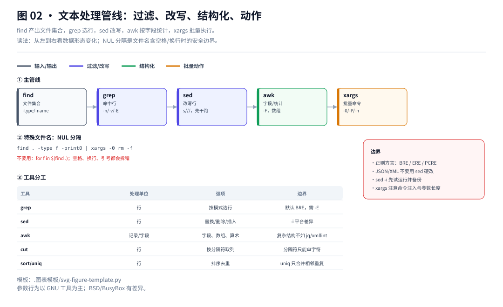

# 文本处理

一句话结论：Shell 文本处理是**流式管线**：`find` 找文件、`grep` 选行、`sed` 改行、`awk` 按字段算、`xargs` 批量执行。每个工具只做一件事，组合起来才有表达力；先把“输入是什么、分隔符是什么、要输出什么”说清楚。

> 本篇定位：讲 grep/sed/awk/find/xargs 及常用小工具的选择与边界。Shell 语法见 [00-Shell执行模型与语法](./00-Shell执行模型与语法.md)，工程化写法见 [02-脚本工程化与自动化案例](./02-脚本工程化与自动化案例.md)。

## 目录

- [1 一句话模型](#s1)
- [2 速览](#s2)
- [3 工具、正则与字段表](#s3)
- [4 管线处理流程](#s4)
- [5 状态机与定时器](#s5)
- [6 设计取舍与边界](#s6)
- [7 与相邻主题的关系](#s7)
- [名词解释](#名词解释)
- [8 参考与关联](#s8)

## 1 · 一句话模型

```text
文件集合 ──find──► 行集合 ──grep──► 命中行 ──sed──► 改写行 ──awk──► 字段/统计
                                      └──xargs──► 批量命令
```

三个关键认知：

1. **工具处理的是“流”，不是“文档”**：逐行/逐记录处理，内存占用与文件大小无关。
2. **正则方言不同**：`grep` 默认 BRE，`grep -E` 是 ERE，`awk` 是 ERE，`sed` 默认 BRE（GNU 支持 `-E`）。
3. **空格和换行是最大的坑**：文件名含空格时 `for f in $(find ...)` 会拆错，改用 `find -print0 | xargs -0`。

## 2 · 速览

| 项 | 内容 |
| --- | --- |
| 所属层/领域 | Shell 文本处理 |
| 核心对象 | 文件、行、字段、记录、匹配模式 |
| 关键参数 | `-E`、`-F`、`-v`、`-n`、`-print0`、`-0` |
| 典型场景 | 日志筛选、配置替换、批量改名、统计报表 |
| 主要标准 | POSIX 工具规范 + GNU 扩展 |

## 3 · 工具、正则与字段表

### 3.1 工具选择

| 需求 | 工具 | 典型写法 | 边界 |
| --- | --- | --- | --- |
| 找文件 | `find` | `find . -name '*.c' -type f` | 遍历深度、权限错误 |
| 按内容选行 | `grep` | `grep -nE 'error|fail' app.log` | 默认 BRE，需要 `-E` |
| 按行改写 | `sed` | `sed -i 's/old/new/g' file` | `-i` 是 GNU 扩展，BSD 需 `-i ''` |
| 按字段统计 | `awk` | `awk -F: '{print $1}' /etc/passwd` | 字段分隔符、空行 |
| 批量执行 | `xargs` | `find . -name '*.o' -print0 \| xargs -0 rm -f` | 参数过长会自动分批 |
| 取列 | `cut` | `cut -d, -f2,4 data.csv` | 只支持单字符分隔符 |
| 排序 | `sort` | `sort -t, -k2,2n data.csv` | 数值排序要 `-n`，稳定排序 `-s` |
| 去重 | `uniq` | `sort file \| uniq -c` | 只合并相邻重复行，必须先排序 |
| 字符转换 | `tr` | `tr -d '\r' < file` | 按字符映射，不按字符串 |
| 计数 | `wc` | `wc -l file` | 最后一行无换行时计数可能少 1 |

### 3.2 正则方言

| 方言 | 支持者 | 特点 | 例子 |
| --- | --- | --- | --- |
| BRE | `grep`、`sed` 默认 | `+ ? | ()` 需转义（GNU 扩展） | `grep 'a\{2,3\}'` |
| ERE | `grep -E`、`awk` | 扩展元字符直接可用 | `grep -E 'ab+'` |
| PCRE | `grep -P`、Perl | 支持 `\d`、断言、非贪婪 | `grep -P '\d{3}'` |

常用元字符：`^` 行首、`$` 行尾、`.` 任意字符、`*` 零次或多次、`[abc]` 字符集、`[^abc]` 排除、`\{n,m\}` 次数、`\|` 或（BRE）。

### 3.3 awk 的内置变量与结构

| 项 | 含义 | 边界 |
| --- | --- | --- |
| `$0` | 整行 | 修改会影响后续 |
| `$1..$n` | 第 n 个字段 | `-F` 指定分隔符 |
| `NF` | 字段数 | 最后字段是 `$NF` |
| `NR` | 已读记录数（跨文件累计） | 按行计数 |
| `FNR` | 当前文件记录数 | 多文件时区分 |
| `FS` | 输入字段分隔符 | `-F` 或 `BEGIN{FS=...}` |
| `OFS` | 输出字段分隔符 | 默认空格 |
| `BEGIN/END` | 处理前/后执行一次 | 适合初始化和汇总 |

```awk
# 统计状态码分布：输入 "GET /path 200 123"
awk '{ code[$3]++; bytes += $4 }
     END { for (c in code) printf "%s %d\n", c, code[c];
           printf "total_bytes %d\n", bytes }' access.log
```

## 4 · 管线处理流程



**读图**：从左到右是“文件集合 → 行流 → 命中行 → 改写 → 字段统计 → 批量动作”。每个工具的输入输出都是文本流；`xargs` 把流重新组装成命令参数，因此要用 `-print0/-0` 处理特殊字符。

> 图源：`images/图02-文本处理管线.svg`

### 4.1 正常路径

1. **确定输入范围**：`find` 限定目录、类型、时间、大小，避免全盘扫描。
2. **筛选**：`grep` 用 `-n` 保留行号、`-v` 反选、`-c` 计数。
3. **改写**：`sed` 先不加 `-i` 试运行，确认输出后再原地修改，并保留备份。
4. **结构化**：`awk` 按分隔符取字段，做聚合、格式化。
5. **批量执行**：`xargs` 处理参数，必要时 `-P` 并行、`-n` 控制每次数量。
6. **校验**：对输出做 `wc -l`、抽样、`diff`，确认没有误改。

### 4.2 异常分支

| 现象 | 优先检查 | 说明 |
| --- | --- | --- |
| 文件名含空格被拆开 | 是否用 `$(find ...)` | 改 `-print0 \| xargs -0` |
| `sed -i` 在 macOS 报错 | BSD sed 需要备份后缀 | `sed -i '' 's/a/b/' file` |
| 中文被截断 | `cut -c` 按字节/字符的行为 | 多字节字符用 `awk`/`perl` |
| `uniq` 没去重 | 输入未排序 | 先 `sort` 再 `uniq` |
| 正则不匹配 | BRE/ERE 方言 | 加 `-E` 或转义 |
| `xargs` 命令注入 | 文件名含引号/分号 | 用 `-0` 和 `--`，避免 `sh -c` 拼接 |

### 4.3 常用组合

| 目标 | 命令 |
| --- | --- |
| 统计日志错误 Top 10 | `grep -i error app.log \| awk '{print $5}' \| sort \| uniq -c \| sort -rn \| head` |
| 批量替换并备份 | `sed -i.bak 's/old/new/g' $(grep -rl old .)` |
| 删除空目录 | `find . -type d -empty -delete` |
| 按大小找大文件 | `find . -type f -size +100M -printf '%s %p\n' \| sort -rn` |
| CSV 第二列求和 | `awk -F, 'NR>1 {s+=$2} END {print s}' data.csv` |
| 去 Windows 换行 | `sed -i 's/\r$//' file` 或 `tr -d '\r'` |

## 5 · 状态机与定时器

没有状态机，也没有定时器。每个工具都是**无状态过滤器**：读一行/一条记录，处理，写一行；`awk` 的 `BEGIN/END` 是阶段钩子，不是持久状态。

## 6 · 设计取舍与边界

- **为什么用管线而不是一个大脚本**：每个工具职责单一、可独立验证、可组合；代价是多次进程创建和 IPC。
- **为什么 `awk` 比 `sed` 适合统计**：`awk` 有字段、数组和算术；`sed` 只擅长行级替换。
- **为什么 `find -print0` 必要**：文件名可以包含空格、换行、引号；NUL 分隔是唯一安全的边界。
- **`sed -i` 的取舍**：方便但不可逆，先试运行并备份；跨平台要注意 GNU/BSD 差异。
- **不适用**：复杂 JSON/XML/YAML 解析不要用正则硬拆，改用 `jq`/`xmllint`/专用库。
- **常见误判**：`grep` 默认支持 `+`；`cut -d` 支持多字符分隔符；`sort` 默认按数值排序。

## 7 · 与相邻主题的关系

| 相邻对象 | 关系 |
| --- | --- |
| [00-Shell执行模型与语法](./00-Shell执行模型与语法.md) | 引号、管道、重定向、退出码 |
| [02-脚本工程化与自动化案例](./02-脚本工程化与自动化案例.md) | 把管线封装成可维护脚本 |
| [60-工具与环境/61-Git](../../60-工具与环境/61-Git/.readme.md) | 用 `git grep`/`git log` 处理版本库文本 |
| [20-平台与系统/21-Linux](../../20-平台与系统/21-Linux/.readme.md) | 系统日志与 `/proc` 文本接口 |

一句话边界：本篇讲“怎么筛、改、算”，不讲“脚本怎么组织”。

## 名词解释

> 缩写给出英文全称；非缩写用“—”表示。

| 术语 | 英文全称 | 解释 |
| --- | --- | --- |
| 正则表达式 | Regular Expression | 描述字符串匹配模式的语法。 |
| BRE | Basic Regular Expression | 基本正则，部分元字符需要转义。 |
| ERE | Extended Regular Expression | 扩展正则，元字符直接可用。 |
| PCRE | Perl Compatible Regular Expression | 兼容 Perl 语法的正则实现。 |
| 流 | Stream | 按顺序读取、处理的数据序列。 |
| 字段 | Field | 按分隔符切分后的一个数据项。 |
| 记录 | Record | 一行或一条结构化数据。 |
| 分隔符 | Delimiter | 用于切分字段的字符或字符串。 |
| 管线 | Pipeline | 用管道把多个命令的输入输出串联起来。 |
| NUL 分隔 | NUL Separation | 用 `\0` 分隔文件名，避免特殊字符歧义。 |
| 原地修改 | In-place Edit | 直接改写源文件，如 `sed -i`。 |

## 8 · 参考与关联

**标准**

- POSIX.1：`grep`、`sed`、`awk`、`find`、`xargs` 规范。
- GNU grep/sed/awk/findutils 手册（扩展行为）。

**关联**

- [00-Shell执行模型与语法](./00-Shell执行模型与语法.md)
- [02-脚本工程化与自动化案例](./02-脚本工程化与自动化案例.md)
- [20-平台与系统/21-Linux](../../20-平台与系统/21-Linux/.readme.md)

---

> **本篇定位**：把文本处理讲成“输入 → 过滤 → 改写 → 结构化 → 动作”的管线。
> **素材来源**：`studyspace/4.其他技能/2.shell/shell.md`、`process_xml.sh`、`文件操作相关/`（已重写并补齐工具边界）。
> **待验证**：GNU/BSD/BusyBox 工具的参数差异，以目标系统为准。
