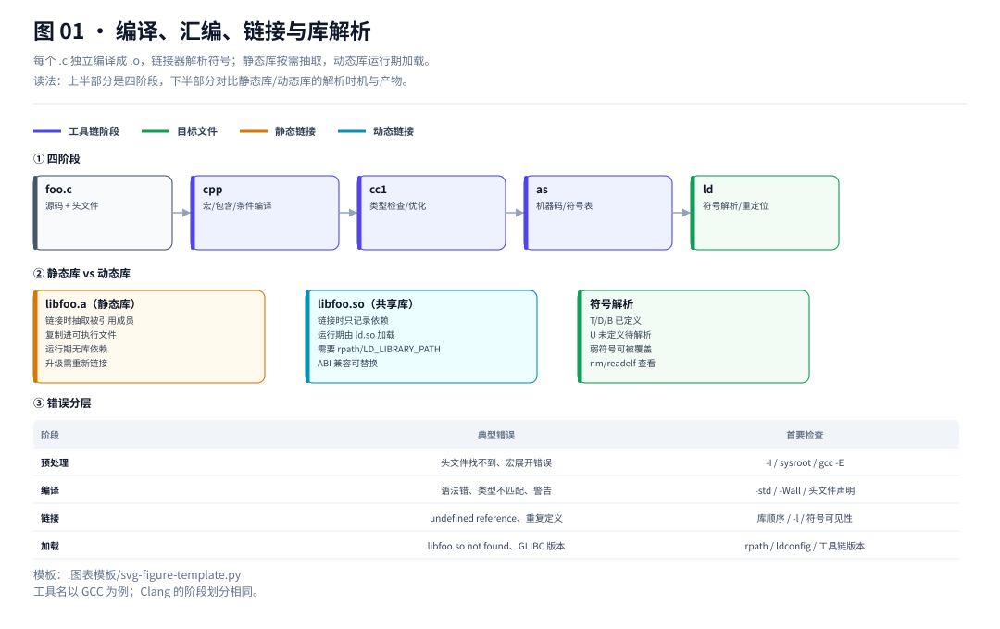

# 从源码到可执行文件

一句话结论：构建分四步——**预处理、编译、汇编、链接**；前两步是“每个源文件各自为战”，链接才把符号拼成程序。看懂“符号从哪来、落到哪去”，就能把大部分 `undefined reference`、库顺序、ABI 问题定位到具体阶段。

> 本篇定位：讲工具链阶段、ELF/符号、静态库与动态库、常用编译参数和交叉编译。Make/CMake 的组织方式见 [01-Make与CMake](./01-Make与CMake.md)，运行期调试见 [02-调试与诊断](./02-调试与诊断.md)。

## 目录

- [1 一句话模型](#s1)
- [2 速览](#s2)
- [3 产物、段与符号表](#s3)
- [4 编译链接流程](#s4)
- [5 状态机与定时器](#s5)
- [6 设计取舍与边界](#s6)
- [7 与相邻主题的关系](#s7)
- [名词解释](#名词解释)
- [8 参考与关联](#s8)

## 1 · 一句话模型

```text
foo.c ──cpp──► foo.i ──cc1──► foo.s ──as──► foo.o ─┐
bar.c ──cpp──► bar.i ──cc1──► bar.s ──as──► bar.o ─┼─ld──► a.out
libfoo.a / libfoo.so ──────────────────────────────┘
```

三个关键认知：

1. **编译期只检查声明**：函数有没有定义，要到链接期才知道。
2. **目标文件里符号分“已定义/未定义”**：`T/D/B` 是已定义，`U` 是未解析，链接器负责配对。
3. **静态库按需抽取，动态库整体映射**：库的顺序和 `--start-group` 会影响解析结果。

## 2 · 速览

| 项 | 内容 |
| --- | --- |
| 所属层/领域 | C/C++ 构建工具链 |
| 核心对象 | 源文件、目标文件、静态库、共享库、可执行文件 |
| 关键参数 | `-O`、`-g`、`-std`、`-I`、`-L`、`-l`、`-fPIC`、`-Wl,` |
| 典型场景 | 编译失败、链接失败、库版本冲突、交叉编译 |
| 主要标准 | ELF 规范 + 目标平台 ABI + GCC/Clang 文档 |

## 3 · 产物、段与符号表

### 3.1 四个阶段

| 阶段 | 工具 | 输入 → 输出 | 主要工作 | 典型错误 |
| --- | --- | --- | --- | --- |
| 预处理 | `cpp` | `.c` → `.i` | 展开宏/头文件/条件编译 | 宏展开错误、头文件找不到 |
| 编译 | `cc1/cc1plus` | `.i` → `.s` | 语法/类型检查、优化、生成汇编 | 语法错、类型不匹配、警告 |
| 汇编 | `as` | `.s` → `.o` | 生成机器码、符号表、重定位项 | 汇编语法错（少见） |
| 链接 | `ld` | `.o` + 库 → 可执行/共享库 | 符号解析、重定位、段合并 | `undefined reference`、重复定义 |

### 3.2 ELF 常用段

| 段 | 内容 | 运行期 | 说明 |
| --- | --- | --- | --- |
| `.text` | 机器码 | 只读可执行 | 函数体 |
| `.rodata` | 只读数据 | 只读 | 字符串字面量、常量表 |
| `.data` | 已初始化全局/静态 | 可写 | 非零初值 |
| `.bss` | 未初始化/零初始化 | 可写 | 不占文件空间 |
| `.symtab` | 符号表 | 不加载 | 可用 `strip` 删除 |
| `.dynsym` | 动态符号表 | 加载 | 动态链接需要 |
| `.rela.*` | 重定位表 | 加载/链接 | 记录需要修正的地址 |
| `.plt/.got` | 动态跳转/全局偏移表 | 加载 | 延迟绑定与地址间接 |

### 3.3 符号类型

| 字母 | 含义 | 示例 |
| --- | --- | --- |
| `T/t` | 代码段符号（全局/局部） | 函数 |
| `D/d` | 已初始化数据段 | 全局变量 |
| `B/b` | BSS 段 | 未初始化全局变量 |
| `R/r` | 只读数据段 | 常量 |
| `U` | 未定义，等待链接 | 外部函数引用 |
| `W/w` | 弱符号 | 可被覆盖的默认实现 |

查看命令：`nm -C foo.o`、`readelf -sW a.out`、`objdump -d`。

## 4 · 编译链接流程



**读图**：上半部分是单文件到目标文件的四阶段；下半部分是链接器处理静态库与动态库的差异。静态库只抽取被引用的成员，动态库整体映射并在加载时解析；库的顺序从“使用方”到“被使用方”。

> 图源：`images/图01-编译链接.svg`

### 4.1 正常路径

1. **预处理**：`gcc -E foo.c -o foo.i`，确认宏和头文件展开。
2. **编译**：`gcc -c foo.c -o foo.o`，生成目标文件。
3. **汇编**：通常由 `gcc` 驱动自动调用 `as`。
4. **链接**：`gcc foo.o bar.o -L/path -lfoo -o app`，解析符号。
5. **检查**：`file app`、`ldd app`、`nm -u app` 确认产物和依赖。
6. **运行**：动态库路径由 `rpath`、`LD_LIBRARY_PATH`、`ldconfig` 缓存决定。

### 4.2 常用参数

| 参数 | 作用 | 边界 |
| --- | --- | --- |
| `-O0/-O1/-O2/-O3/-Os` | 优化级别 | `-O3` 可能放大代码体积；调试用 `-O0`/`-Og` |
| `-g` | 生成调试信息 | 与优化级别独立，`-g -O2` 也可用 |
| `-std=c11/c17` | 语言标准 | 扩展语法需 `-std=gnu11` |
| `-Wall -Wextra` | 常用警告 | 建议配合 `-Werror` 在 CI 中固化 |
| `-I dir` | 头文件搜索路径 | 顺序影响同名头文件 |
| `-L dir` | 库搜索路径 | 运行时不一定生效 |
| `-lfoo` | 链接 `libfoo.so`/`libfoo.a` | 顺序敏感，放在使用它的目标之后 |
| `-static` | 全静态链接 | 体积大、glibc 静态链接有约束 |
| `-shared -fPIC` | 生成共享库 | 所有被链接的目标都要 `-fPIC` |
| `-Wl,-rpath,'$ORIGIN/lib'` | 写入运行时库路径 | 部署路径要可预测 |
| `--sysroot=dir` | 交叉编译根目录 | 头文件/库/工具链要匹配 |

### 4.3 静态库与动态库

| 维度 | 静态库 `.a` | 共享库 `.so` |
| --- | --- | --- |
| 链接时机 | 编译期把用到的成员复制进产物 | 运行期由动态链接器加载 |
| 体积 | 产物大 | 产物小，库单独部署 |
| 升级 | 需重新链接 | 替换库即可（ABI 兼容时） |
| 依赖 | 无运行时库依赖 | 需要 `ldd`/`rpath`/`ldconfig` |
| 符号冲突 | 可能重复定义 | 符号可见性需控制 |
| 适用 | 独立工具、嵌入式镜像 | 多程序共享、插件 |

### 4.4 异常分支

| 现象 | 阶段 | 优先检查 |
| --- | --- | --- |
| `fatal error: xxx.h: No such file` | 预处理 | `-I`、sysroot、包是否安装 |
| `undefined reference to 'foo'` | 链接 | 是否链接库、库顺序、符号是否 `static`、C/C++ 名字修饰 |
| `multiple definition of 'foo'` | 链接 | 头文件里定义变量、重复链接同一目标 |
| `cannot find -lfoo` | 链接 | `-L` 路径、库文件名（`libfoo.so`） |
| 运行时报 `libfoo.so not found` | 加载 | `rpath`、`LD_LIBRARY_PATH`、`ldconfig` |
| `GLIBC_2.xx not found` | 加载 | 编译机 glibc 比运行机新，需降级工具链或静态链接 |
| `relocation R_X86_64_PC32 ... recompile with -fPIC` | 链接 | 共享库目标未用 `-fPIC` |
| C++ 调用 C 库链接失败 | 链接 | 头文件缺 `extern "C"`，名字修饰不同 |

## 5 · 状态机与定时器

没有状态机，也没有定时器。构建只有**阶段推进**和**缓存状态**：源文件时间戳、目标文件、依赖文件（`.d`）决定是否需要重编；任一阶段失败，后续阶段不执行。

## 6 · 设计取舍与边界

- **为什么先编译成 `.o` 再链接**：增量构建只需要重编变化的文件；代价是管理目标文件和依赖。
- **为什么静态库按需抽取**：避免把未使用的代码打进产物；代价是库顺序敏感，循环依赖需要 `--start-group`。
- **为什么共享库要 `-fPIC`**：代码要能在任意地址加载，使用相对寻址/GOT；代价是少量性能开销。
- **`-O2` 与 `-g` 的取舍**：优化后变量可能被寄存器化，调试体验变差；发布版保留 `-g` 并分离 debug 包是常见做法。
- **交叉编译的边界**：工具链、sysroot、目标 ABI 必须一致；混用主机头文件/库会产生难查的运行时问题。
- **常见误判**：编译通过就代表能链接；`-L` 同时影响运行时；`ldd` 能反映所有依赖（它可能执行程序，不宜对不可信文件使用）。

## 7 · 与相邻主题的关系

| 相邻对象 | 关系 |
| --- | --- |
| [01-Make与CMake](./01-Make与CMake.md) | 用构建系统组织这些编译命令 |
| [02-调试与诊断](./02-调试与诊断.md) | 用 `-g` 和符号定位运行期问题 |
| [51-C语言/03-宏预处理与编译链接](../51-C语言/03-宏预处理与编译链接.md) | 语言层的声明/定义/链接属性 |
| [20-平台与系统/23-嵌入式基础](../../20-平台与系统/23-嵌入式基础/.readme.md) | 交叉编译与目标板部署 |
| [22-OpenWrt/01-构建与包管理](../../20-平台与系统/22-OpenWrt/01-构建与包管理/.readme.md) | 实际项目的工具链与包构建 |

一句话边界：本篇讲“工具链怎么把源码变成产物”，不讲“Makefile/CMake 怎么写”。

## 名词解释

> 缩写给出英文全称；非缩写用“—”表示。

| 术语 | 英文全称 | 解释 |
| --- | --- | --- |
| 预处理 | Preprocessing | 展开宏、头文件和条件编译的编译前阶段。 |
| 目标文件 | Object File | 编译器生成的、含机器码和符号表的中间产物。 |
| 链接器 | Linker | 合并目标文件、解析符号并生成可执行文件的工具。 |
| 符号 | Symbol | 目标文件中函数/变量的名字和地址信息。 |
| 重定位 | Relocation | 把符号引用修正为最终地址的过程。 |
| ELF | Executable and Linkable Format | Linux 下可执行文件、目标文件和共享库的格式。 |
| 静态库 | Static Library | 以 `.a` 归档、链接时按需复制的库。 |
| 共享库 | Shared Library | 以 `.so` 形式在运行期加载的库。 |
| PIC | Position Independent Code | 可在任意地址加载的代码，共享库必需。 |
| GOT | Global Offset Table | 存放全局符号地址的表，供 PIC 间接访问。 |
| PLT | Procedure Linkage Table | 动态函数调用的跳转桩，支持延迟绑定。 |
| ABI | Application Binary Interface | 二进制层面的调用约定、布局和符号规则。 |
| sysroot | System Root | 交叉编译时使用的目标系统头文件与库根目录。 |
| rpath | Run-time Search Path | 写入 ELF 的运行时库搜索路径。 |

## 8 · 参考与关联

**标准**

- System V ABI / ELF 规范。
- GCC、Clang、GNU ld 手册。

**关联**

- [01-Make与CMake](./01-Make与CMake.md)
- [02-调试与诊断](./02-调试与诊断.md)
- [51-C语言/03-宏预处理与编译链接](../51-C语言/03-宏预处理与编译链接.md)
- [20-平台与系统/23-嵌入式基础](../../20-平台与系统/23-嵌入式基础/.readme.md)

---

> **本篇定位**：把构建错误按“预处理/编译/汇编/链接/加载”分层定位。
> **素材来源**：`studyspace/4.其他技能/4.make/`（仅链接，内容已按工具链模型重写）。
> **待验证**：具体工具链的默认参数、glibc 版本兼容策略和 `ldd` 行为。
