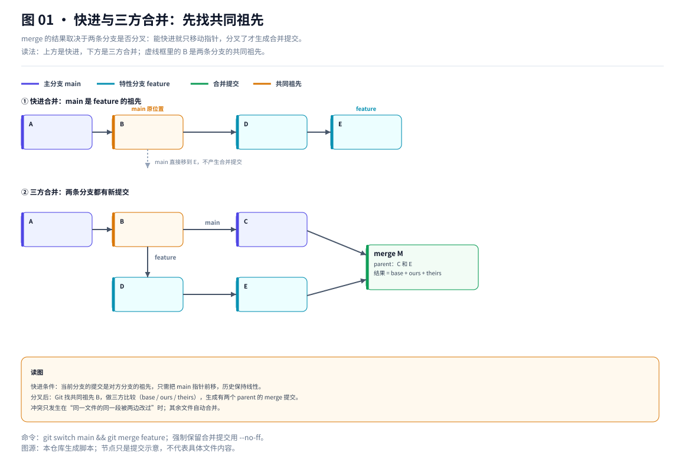
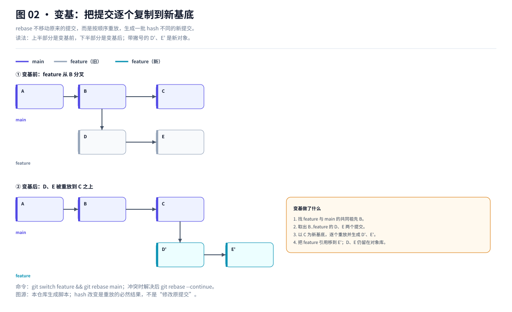
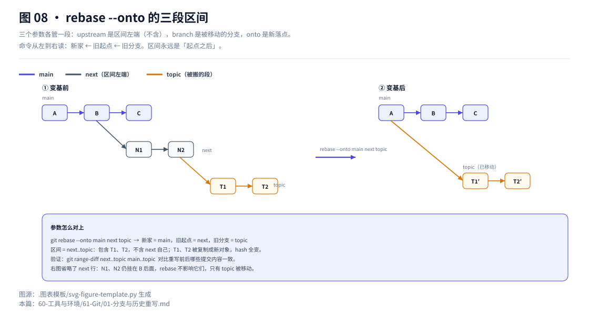

# 分支与历史重写

一句话结论：分支只是指向提交的可移动指针；**merge 保留分叉并生成合并提交，rebase 把提交逐个复制到新基底**——前者保留真实历史，后者换取线性历史，代价是改写 hash。

> 本篇定位：分支/切换、快进与三方合并、rebase（含 `--onto` 与交互式）、cherry-pick、冲突处理、rerere、bisect、stash，以及 reset/amend 对历史的改写边界。对象模型见 [00-Git对象模型与引用](./00-Git对象模型与引用.md)，远程引用与恢复见 [02-远程协作与多远程仓库](./02-远程协作与多远程仓库.md)。

## 目录

- [1 一句话模型](#s1)
- [2 速览](#s2)
- [3 分支、祖先与合并基](#s3)
- [4 合并、变基与冲突](#s4)
- [5 状态机与临时引用](#s5)
- [6 设计取舍与边界](#s6)
- [7 与相邻主题的关系](#s7)
- [名词解释](#名词解释)
- [8 参考与关联](#s8)

## 1 · 一句话模型：在提交图上移动指针

Git 的历史是一张有向无环图（DAG）：节点是提交，边是 `parent` 指针。分支是图上的一个书签，`HEAD` 是"当前书签"的指针。

```text
A ← B ← C        main
     ↖
       D ← E     feature

merge：保留 D、E，生成 M（parent = C 和 E）
rebase：把 D、E 复制成 D'、E'，接到 C 后面
```

三个关键认知：

1. **合并看"共同祖先"**：两条分支从哪个提交分叉，决定了三方合并的 base。
2. **快进不是合并**：当前分支是对方的祖先时，只移动指针，不产生新提交。
3. **变基会换 hash**：重放产生新对象，原提交仍在对象库，但分支不再指向它们。

> **为什么两种都要有**：merge 记录"事情实际怎么发生的"，适合共享分支与发布分支——回溯问题时能看出并行开发和合入点；rebase 呈现"希望它看起来怎样"，适合本地整理——评审时不被十几个"wip"提交干扰。**它们回答的是不同问题，不是新旧替代关系。**

## 2 · 速览

| 项 | 内容 |
| --- | --- |
| 所属领域 | 版本控制 / 协作流程 |
| 核心对象 | commit DAG、分支引用、HEAD、merge base |
| 合并方式 | fast-forward、三方合并（`--no-ff` 强制合并提交） |
| 历史整理 | `rebase`、`rebase --onto`、`rebase -i`、`cherry-pick` |
| 冲突辅助 | `rerere`（记录解法）、`zdiff3`（显示 base）、`--ours/--theirs` |
| 定位工具 | `bisect`（二分找回归）、`range-diff`（对比重写前后） |
| 临时状态 | `MERGE_HEAD`、`rebase-merge/`、`CHERRY_PICK_HEAD` |
| 典型场景 | 特性分支合入主干、同步上游、整理提交、找回回归点 |
| 主要风险 | 已推送分支 rebase、冲突误删、squash 丢信息 |

## 3 · 分支、祖先与合并基

### 3.1 分支与 HEAD

| 操作 | 作用 | 对工作区的影响 |
| --- | --- | --- |
| `git branch feature` | 新建分支引用，不切换 | 无 |
| `git switch feature` | 移动 HEAD 到 feature，更新索引和工作区 | 切换到该提交的树 |
| `git switch -c feature` | 新建并切换 | 同上 |
| `git checkout -b feature origin/feature` | 基于远程分支建本地分支 | 同上 |
| `git branch -d feature` | 删除已合并分支 | 无 |
| `git branch -D feature` | 强制删除未合并分支 | 无，提交可能变悬空 |

`switch` 和 `checkout` 都能切分支；`switch` 语义更窄，推荐日常使用。`checkout` 还能检出文件（`git checkout -- file`），这也是它容易误用的原因。

### 3.2 祖先关系与 merge base

- **祖先**：从提交沿 `parent` 能走到另一个提交，前者就是后者的祖先。
- **merge base**：两个提交的共同祖先中"最近"的一个；三方合并以它为基准。
- 合并提交有多个 parent，所以"祖先"不是一条单链，而是一张图。

查看关系：

```bash
git log --oneline --graph --decorate --all
git merge-base main feature
git log --oneline main..feature    # feature 有、main 没有
git log --oneline feature..main    # main 有、feature 没有
```

### 3.3 冲突时索引里有什么

冲突文件的 index 会同时保留三条记录：

| stage | 内容 | 来源 |
| --- | --- | --- |
| 1 | 共同祖先版本 | merge base |
| 2 | 当前分支版本 | ours |
| 3 | 对方分支版本 | theirs |

工作区文件被写入冲突标记：

```text
<<<<<<< HEAD
当前分支的内容
=======
对方分支的内容
>>>>>>> feature
```

解决冲突就是编辑文件、删掉标记、`git add`，把三条记录合并成 stage 0。`git checkout --ours <file>` / `--theirs <file>` 可以整文件选一边，但会丢掉另一边的修改。

> **一个必须记住的反转**：`--ours` / `--theirs` 的语义**在 rebase 时是反的**。merge 时 ours = 你所在的分支，theirs = 被合入的分支；rebase 时 Git 正在把"你的提交"重放到"上游"上，于是 **ours = 上游（别人的）**，**theirs = 你正在重放的那个提交**。选错方向就是把上游改动全部丢掉，而命令本身不会报错。
> **一条对策**：不确定时别用 `--ours/--theirs`，改用 `git checkout --conflict=diff3 <file>` 把 base 也显示出来，人工看三方。

显示 base 的另一种方式是一次性配置：

```bash
git config --global merge.conflictStyle zdiff3   # 冲突块里带上 base（较新版本）
```

## 4 · 合并、变基与冲突

### 4.1 快进与三方合并



**读图**：上方 main 停在 B、feature 已经到 E，合并只需把 main 移到 E；下方两条分支都有新提交，Git 以 B 为 base 做三方比较，生成有两个 parent 的 M。

> 图源：`images/图03-快进与三方合并.svg`

| 场景 | 条件 | 结果 |
| --- | --- | --- |
| 快进 | 当前分支是对方的祖先 | 只移动指针，不产生提交 |
| 三方合并 | 两条分支都有对方没有的提交 | 生成 merge 提交，parent 为两边 |
| `--no-ff` | 即使能快进也强制合并 | 保留"曾经有分支"的结构 |
| `--squash` | 把对方所有变更压成一个工作区变更 | 不产生合并提交，需要再 commit |

命令顺序：

```text
git switch main
git merge feature
  ├─ 能快进 → main 指针前移
  └─ 不能快进 → 三方合并
       ├─ 无冲突 → 自动生成 merge 提交
       └─ 有冲突 → 解决后 git add，再 git commit
```

### 4.2 变基：重放提交



**读图**：变基前 feature 从 B 分叉；变基时 Git 取出 B..feature 的提交，以 C 为新基底逐个重放，生成 D'、E'，再把 feature 引用移过去。旧 D、E 没有被删除，只是不再被分支引用。

> 图源：`images/图04-变基重放.svg`

变基的四个步骤：

1. 找 `feature` 与 `main` 的共同祖先 B。
2. 收集 `B..feature` 的提交（D、E）。
3. 以 `main` 的最新提交 C 为基底，逐个应用并生成新提交。
4. 把 `feature` 引用移到最后一个新提交。

每重放一个提交都可能冲突。冲突时：

```text
git rebase main
  ├─ 冲突 → 编辑文件 → git add → git rebase --continue
  ├─ 想跳过当前提交 → git rebase --skip
  └─ 想放弃 → git rebase --abort（回到变基前）
```

`cherry-pick` 可以看作"只重放一个提交"的变基：

```bash
git switch main
git cherry-pick <commit>
```

它在 main 上生成一个内容相同、hash 不同的新提交；原提交是否还在别的分支上，与 cherry-pick 无关。

### 4.3 变基的区间：`--onto` 到底搬了哪一段

普通 `git rebase main` 的区间是 `merge-base..HEAD`，它默认"整条分支都要搬"。真正需要挑一段时，用三段式 `--onto`。



**读图**：三个参数各管一段——`<upstream>` 是**区间的左端**（不含它），`<branch>` 是**要被移动的分支**（区间的右端），`<newbase>` 是**新的落点**。图中把 `next..topic` 这段搬到 `main` 上，而不是把 `master..topic` 全搬过去。

> 图源：`images/图08-rebase-onto.svg`

```bash
# 把 next 之后、topic 之前的提交，搬到 main 上
git rebase --onto main next topic
#                    ↑     ↑    ↑
#                新基底  区间左端 被移动的分支
```

典型场景：从一条长分支上"摘"出后半段做独立特性分支。

| 写法 | 搬什么 | 什么时候用 |
| --- | --- | --- |
| `git rebase main` | `merge-base..HEAD` | 常规同步上游 |
| `git rebase --onto main A` | `A..HEAD` | 当前分支只搬 A 之后的部分 |
| `git rebase --onto main A B` | `A..B`，结果给分支 B | 从别的分支上摘一段 |
| `git rebase --onto main A B --update-refs` | 同上，顺带更新栈式分支 | 版本支持时（**待验证**） |

> **推论**：`--onto` 的两个左参数容易记混。记法：**读命令从左到右 = 新家、旧起点、旧分支**；区间永远是"起点之后"，起点自己也**不**被搬。
> **验证手段**：搬完用 `git range-diff <旧起点>..<旧分支> <新起点>..<新分支>` 对比重写前后，能看到"哪些提交内容一致、哪些变了"。

### 4.4 交互式变基：整理提交

`git rebase -i <base>` 打开提交列表，可对每个提交执行：

| 动作 | 作用 | 注意 |
| --- | --- | --- |
| `pick` | 保留 | 默认 |
| `reword` | 改提交信息 | hash 改变 |
| `edit` | 停下来修改内容 | 修改后 `--continue` |
| `squash` | 合并到前一个提交，保留两边信息 | 信息需要编辑 |
| `fixup` | 合并到前一个提交，丢弃当前信息 | 适合"修错别字" |
| `drop` | 删除提交 | 内容可能丢失 |
| `exec <cmd>` | 在每个提交后跑一次命令 | 适合逐提交跑测试 |
| `break` | 暂停，回到 shell | 调试变基过程 |

配套的两个开关：

```bash
git commit --fixup=<sha>          # 生成 "fixup! 原提交标题" 的提交
git rebase -i --autosquash <base>  # 自动把它排到目标提交后面并标 fixup
```

交互式变基只应作用于**本地、未推送**的提交。已经推送的共享分支上做交互式变基，会让其他人基于旧 hash 的工作全部失效。

> **一个边界**：`rebase -i` 默认会**抹掉合并提交**（把分支历史拉平）。要在变基中保留合并结构，需要 `--rebase-merges`；否则一条带合并的分支会被压成一条线，丢失"哪里合入过"的信息。

### 4.5 重复冲突：rerere

同一个冲突解过一遍，下次还要再解一遍——这是长期分支反复 rebase 最烦的地方。`rerere`（reuse recorded resolution）把"冲突片段 → 解法"记下来，下次自动套用：

```bash
git config --global rerere.enabled true
git config --global rerere.autoupdate true   # 自动套用后直接 git add
git rerere status    # 看当前记录
git rerere diff      # 看记录的解法
```

| 场景 | rerere 的作用 | 边界 |
| --- | --- | --- |
| 反复 rebase 同一分支 | 同一冲突自动解决 | 解法"正确性"不会被检查 |
| 长期特性分支定期同步主干 | 减少重复劳动 | 冲突上下文变了就不生效 |
| 多人共享解法 | `rerere-train.sh` 可从历史学习 | 属于团队约定，不是标准流程 |

> **边界**：rerere 只保证"和上次解得一样"，不保证"上次解得对"。所以第一次解冲突要格外认真——它会成为后续的模板。

### 4.6 定位回归：bisect

"上个版本好的，这个版本坏了，中间有 200 个提交"——不要逐个试，用二分：

```bash
git bisect start
git bisect bad                 # 当前版本有问题
git bisect good v1.2.0         # 已知好的版本
# Git 每次 checkout 一个中间提交，你测完标记
git bisect good | git bisect bad
git bisect reset               # 结束后回到原分支
```

能自动判定时，直接交给脚本：

```bash
git bisect run ./test.sh
# 退出码：0 = good，1–127 = bad，125 = 跳过（无法判定）
```

| 要点 | 说明 |
| --- | --- |
| 前提 | 历史必须是"单调"的：好版本之后某处开始坏，中间不能反复 |
| 成本 | 约 log₂(N) 次构建/测试；200 个提交约 8 次 |
| 加速 | `git bisect skip` 跳过无法构建的提交 |
| 与 squash 的关系 | 把提交压成一个会**破坏可二分性**——这也是"整理历史"的隐性代价 |

> **推论**：bisect 的价值取决于提交粒度。一个提交只做一件事，"定位到提交"就等于"定位到原因"；一个提交混了十个改动，bisect 只能告诉你"在这十个里"。

### 4.7 暂存改动：stash

切换分支前手上有半成品，`stash` 把它收进一个特殊引用 `refs/stash`：

```bash
git stash push -m "wip: 调试串口"      # 收起来（含已跟踪文件的改动）
git stash push -u                      # 连未跟踪文件一起收
git stash push -p                      # 交互式挑选要收的片段
git stash list                         # 看栈
git stash apply stash@{1}              # 应用但保留记录
git stash pop                          # 应用并弹出栈顶
git stash drop stash@{0}               # 丢弃
git stash branch fix-now stash@{0}     # 从该 stash 建分支（解决冲突更稳）
```

| 易错点 | 说明 |
| --- | --- |
| `apply` vs `pop` | `pop` 成功才删除；冲突时**不会**删除，容易误以为丢了 |
| 未跟踪文件 | 默认不收，要 `-u`；被 `.gitignore` 忽略的要 `-a` |
| stash 不是分支 | 它不在任何分支上，误 `drop` 后只能靠 reflog 找 `refs/stash` 的历史 |
| 跨机器 | stash 不随 push 走，换机器就没有 |

### 4.8 异常分支：冲突之外

| 现象 | 原因 | 处理 |
| --- | --- | --- |
| 合并后想反悔 | 还没提交 | `git merge --abort` |
| 合并提交已生成 | 已提交 | `git reset --hard ORIG_HEAD` 或 `git revert -m 1 <merge>` |
| 变基中途丢失方向 | 状态目录还在 | `git status` 看提示，`--continue`/`--abort` |
| 冲突解决错了 | 已 `git add` | 重新编辑再 `git add`；不要重复 `--continue` |
| 误删分支 | 提交还在 | `git reflog` 找 hash，`git branch rescue <hash>` |
| 变基后提交"消失" | 被 `drop` 或 `--skip` 跳过 | 用 `git reflog` 找原分支 tip，再 `range-diff` 对比 |
| 重复解同一冲突 | 长期分支反复 rebase | 开 `rerere`（§4.5） |

`ORIG_HEAD` 是危险操作前 Git 记录的"原位置"，merge/rebase/reset 都会写它，是快速回退的锚点。

## 5 · 状态机与临时引用

Git 的合并/变基没有网络定时器，但有明确的**进行中状态**，落在 `.git/` 下：

| 状态 | 标志 | 进入 | 退出 |
| --- | --- | --- | --- |
| 合并中 | `.git/MERGE_HEAD` | `git merge` 产生冲突 | `git commit` 或 `git merge --abort` |
| 变基中 | `.git/rebase-merge/` 或 `.git/rebase-apply/` | `git rebase` 产生冲突 | `--continue` / `--skip` / `--abort` |
| 拣选中 | `.git/CHERRY_PICK_HEAD` | `git cherry-pick` 冲突 | `--continue` / `--abort` |
| 二分中 | `.git/BISECT_LOG`、`BISECT_START` | `git bisect start` | `git bisect reset` |
| 冲突文件 | index stage 1/2/3 | 上述操作冲突 | `git add` 后变 stage 0 |

```text
干净状态
  ├─ merge 冲突 → MERGE_HEAD → 解决/add/commit → 干净
  ├─ rebase 冲突 → rebase-merge → continue/skip → 干净
  ├─ bisect 中   → BISECT_LOG → good/bad 循环 → reset
  └─ 任意时刻 --abort → 回到操作前
```

没有"超时自动失败"的机制；状态会一直保留，直到显式完成或中止。这也是为什么中断后 `git status` 总会提示下一步命令。

> **一个反直觉的点**：这些状态是**文件**，不是内存标记。所以杀进程、断网、重启都不会丢——但也意味着"手工删 `.git/rebase-merge/`"会把仓库留在半完成状态，永远别这么干。

## 6 · 设计取舍与边界

### 6.1 merge 与 rebase 的取舍

| 维度 | merge | rebase |
| --- | --- | --- |
| 历史形状 | 保留分叉，真实 | 线性，整洁 |
| hash | 原提交不变 | 全部重写 |
| 冲突次数 | 一次合并冲突 | 每个提交都可能冲突 |
| 可追溯性 | 能看出分支何时合入 | 看不出曾经分叉 |
| 可二分性 | 保留原始粒度 | squash 后粒度变粗 |
| 适合 | 共享分支、发布分支 | 本地整理、同步上游 |
| 不适合 | 追求线性历史的团队规范 | 已推送的共享分支 |

没有绝对正确的选择。团队要统一规范：要么"主干只接受 merge"，要么"合入前必须 rebase + squash"，最怕的是同一条分支上两种做法混用。

### 6.2 线性历史不等于更正确

rebase 后的历史看起来干净，但丢失了"这些提交是并行开发的"这一事实。排查回归时，merge 提交能标出合入点，rebase 后的线性历史反而需要靠提交信息还原上下文。

### 6.3 已推送分支的边界

判断标准不是"有没有 push 过"，而是"**有没有别人基于它工作**"：

- 个人草稿分支：可以 rebase 后 `push --force-with-lease`。
- 共享特性分支：不要 rebase；要整理就新建分支或等合入后处理。
- 主干/发布分支：只允许追加提交，历史改写会影响所有人的 clone。

`--force-with-lease` 比 `--force` 安全：远程分支被别人更新过时，它会拒绝覆盖。

### 6.4 squash 的信息损失

`squash` 把多个提交压成一个，细节提交信息可能丢失。适合"修错别字、格式调整"这类无独立价值的提交；如果每个提交都对应独立设计决策，压缩后不利于回溯。

### 6.5 冲突不是"谁对谁错"

冲突只说明两边改了同一区域，Git 无法自动判断意图。解决冲突必须理解两边为什么改，而不是简单选 ours/theirs。批量选一边最容易引入回归——尤其在 rebase 中，`--ours` 指向的是上游。

### 6.6 常见误判

- "快进合并没有合并提交，所以没合并"：快进也是合并，只是历史形状不同。
- "rebase 会删除原提交"：原提交还在对象库，分支只是不再指向它。
- "冲突解决完就自动提交"：merge 需要再 `git commit`（或 `git merge --continue`），rebase 需要 `--continue`。
- "`git pull` 等于 `fetch + merge`"：默认是，但配置 `pull.rebase=true` 后等于 `fetch + rebase`。
- "rebase 时的 `--ours` 是我自己的代码"：反了，那才是上游。
- "`stash pop` 冲突了改动就丢了"：没丢，pop 失败时不会删除记录。
- "把提交压成一个更清晰"：清晰的是阅读体验，代价是 bisect 失去粒度。

## 7 · 与相邻主题的关系

| 相邻对象 | 关系 |
| --- | --- |
| Git 对象模型 | merge/rebase 都在 commit DAG 上移动引用，见 [00-Git对象模型与引用](./00-Git对象模型与引用.md) |
| 远程协作 | `origin/main` 是远程跟踪引用，rebase 上游前先 fetch，见 [02-远程协作与多远程仓库](./02-远程协作与多远程仓库.md) |
| 代码评审 | 评审通常针对"分支相对主干的差异"，rebase 会改变评审基线 |
| CI/CD | 强制线性历史的项目常在合并队列里做 rebase/squash |
| SVN | SVN 的合并跟踪依赖属性，Git 依赖提交图，模型不同 |

一句话：**merge 记录"发生过什么"，rebase 整理"看起来像什么"。**

## 名词解释

> 缩写给出英文全称；非缩写用“—”表示。

| 术语 | 英文全称 | 解释 |
| --- | --- | --- |
| DAG | Directed Acyclic Graph | 有向无环图，Git 提交历史的模型。 |
| branch | — | 指向提交的可移动引用。 |
| HEAD | — | 指向当前分支或当前提交的特殊引用。 |
| merge | — | 把两条分支的历史汇合，可能生成合并提交。 |
| fast-forward | — | 当前分支是对方祖先时，只移动指针的合并。 |
| merge base | — | 两个提交的最近共同祖先，三方合并的基准。 |
| three-way merge | — | 以 base、ours、theirs 三方比较的合并方式。 |
| rebase | — | 把提交重放到新基底，生成新的提交。 |
| --onto | — | 指定变基的新基底与区间左端，只搬一段提交。 |
| cherry-pick | — | 把指定提交的变更应用到当前分支。 |
| squash | — | 把多个提交压成一个。 |
| fixup | — | 合并到前一个提交并丢弃当前提交信息。 |
| autosquash | — | 让 `fixup!`/`squash!` 提交自动排到目标后面。 |
| conflict | — | 两边修改同一区域，Git 无法自动合并。 |
| ours / theirs | — | 冲突中的当前分支版本 / 对方分支版本；rebase 时语义反转。 |
| rerere | Reuse Recorded Resolution | 记录并复用冲突解法。 |
| bisect | — | 二分查找引入问题的提交。 |
| stash | — | 把未提交改动暂存到 `refs/stash`。 |
| range-diff | — | 对比两段提交序列，常用于检查重写前后。 |
| ORIG_HEAD | — | 危险操作前记录的原位置引用。 |
| force-with-lease | — | 带远程状态校验的强制推送。 |
| CI/CD | Continuous Integration / Continuous Delivery | 持续集成 / 持续交付。 |

## 8 · 参考与关联

**标准与文档**

- Pro Git（第 2 版）：第 3 章 Git Branching、第 7 章 Git Tools（Interactive Rebasing、Rerere、Bisect）
- `git help merge`、`git help rebase`、`git help cherry-pick`、`git help bisect`、`git help stash`
- `git help merge-strategies`：ort/recursive 等合并策略

**关联**

- [00-Git对象模型与引用](./00-Git对象模型与引用.md)：commit DAG 与引用
- [02-远程协作与多远程仓库](./02-远程协作与多远程仓库.md)：远程跟踪分支、reflog 恢复
- [50-软件开发/构建调试](../../50-软件开发/.readme.md)：分支策略与发布流程
- [60-工具与环境/62-Docker](../62-Docker/.readme.md)：镜像构建的分层与缓存，和提交历史是两种"不可变链"

---

> **本篇定位**：讲清 merge/rebase 的选择、`--onto` 区间、冲突处理、重复冲突与回归定位，以及已推送历史的边界。
> **素材来源**：`studyspace/4.其他技能/3.linux/linux命令/git.md`（分支、rebase、push 命令片段）、`studyspace-v2/10.工程方法/3.开发环境/04-git.md`（补），原理部分按 Pro Git 补写。
> **待验证**：不同 Git 版本的默认合并策略不同（2.34 起默认 ort）；`--update-refs`、`zdiff3` 等选项需要较新版本；团队规范需以实际仓库为准。
