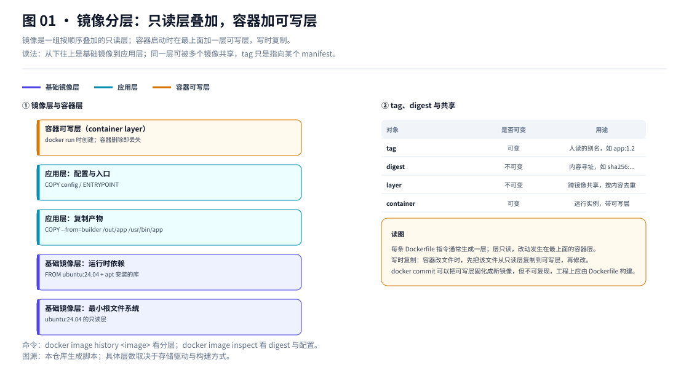
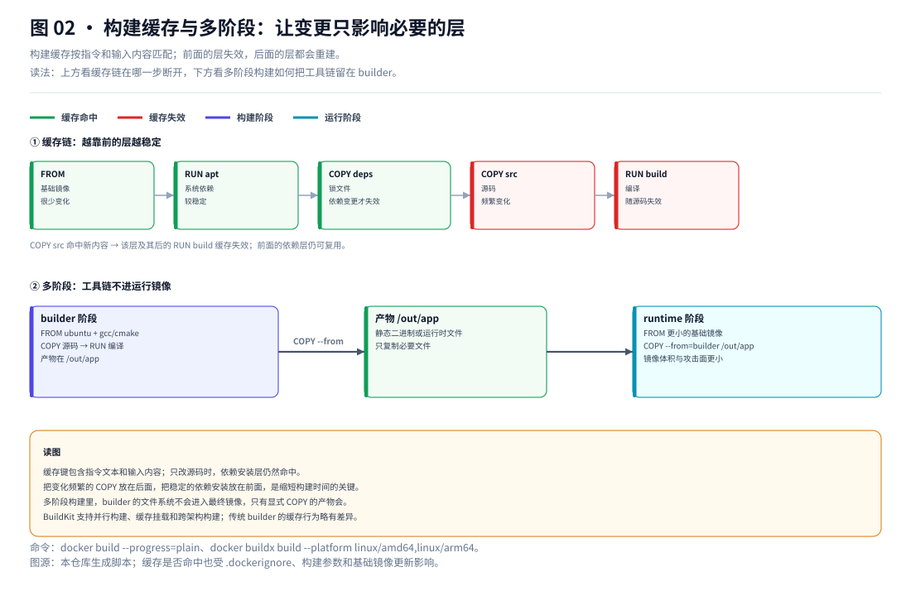
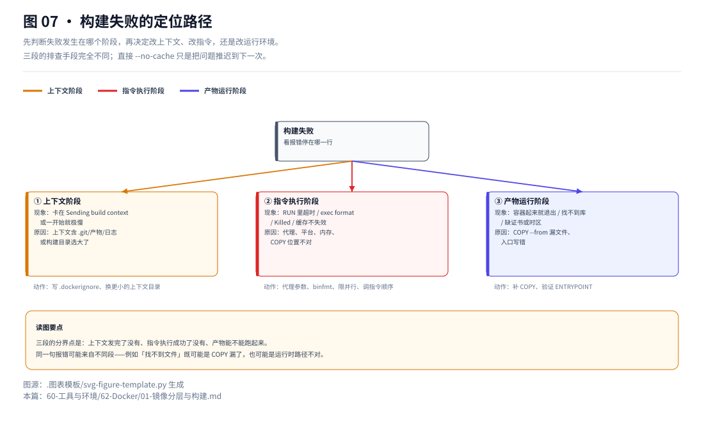

# 镜像分层与构建

一句话结论：镜像是一组**按顺序叠加的只读层**，容器启动时在最上面加一层可写层；Dockerfile 每条指令通常生成一层，构建缓存按"指令 + 输入内容"逐层匹配，**前面失效后面全重建**。

> 本篇定位：镜像/层的结构、Dockerfile 关键指令、构建缓存与缓存挂载、多阶段与跨架构构建、构建失败怎么定位。容器网络/存储见 [02-容器网络与存储](./02-容器网络与存储.md)，多容器编排与交叉编译环境见 [03-Compose与交叉编译环境](./03-Compose与交叉编译环境.md)。

## 目录

- [1 一句话模型](#s1)
- [2 速览](#s2)
- [3 镜像结构与字段](#s3)
- [4 构建流程与缓存](#s4)
- [5 生命周期与回收](#s5)
- [6 设计取舍与边界](#s6)
- [7 与相邻主题的关系](#s7)
- [名词解释](#名词解释)
- [8 参考与关联](#s8)

## 1 · 一句话模型：只读层 + 可写层

镜像不是一个大文件，而是"manifest + config + 若干层"的组合。每层是文件系统变更的归档，按内容寻址；容器在镜像之上加一层可写层，写时复制。

```text
镜像 = manifest ──► config（环境变量/入口/工作目录）
                └─► layer 1 → layer 2 → layer 3（只读，按内容寻址）

容器 = 镜像 + 可写层（container layer）
```

三个关键认知：

1. **层是只读且共享的**：不同镜像可以复用同一基础层，拉取时只下载缺的层。
2. **tag 可变，digest 不可变**：`app:latest` 可以指向新镜像；`app@sha256:...` 永远指向同一内容。
3. **构建缓存是逐层的**：某层输入变了，它和它之后的所有层都重建。

> **为什么要有"层"**：分发和构建都靠它。同一台机器上 20 个镜像共用 `ubuntu:24.04`，磁盘里只有一份；推一个新版本只上传变化的层。如果镜像是一个整包，每次改一行代码都要重传几百 MB。代价是层不可撤销——删文件只是在新层里盖一个 whiteout，旧层的数据仍在，这就是"删了文件镜像没变小"的原因。

## 2 · 速览

| 项 | 内容 |
| --- | --- |
| 所属领域 | 容器 / 构建与交付 |
| 核心对象 | manifest、config、layer、image、container |
| 镜像标识 | tag（可变）、digest（内容寻址） |
| 存储驱动 | overlay2（Linux 常用）、fuse-overlayfs 等 |
| 构建工具 | Docker BuildKit（默认）、docker buildx、Buildah |
| 关键文件 | `Dockerfile`、`.dockerignore` |
| 跨架构 | `--platform`、QEMU/binfmt、原生 arm 节点 |
| 典型场景 | 固化编译工具链、交付服务、复现构建环境 |

## 3 · 镜像结构与字段

### 3.1 manifest、config 与 layer

| 对象 | 内容 | 作用 | 注意 |
| --- | --- | --- | --- |
| manifest | config 的 digest、各层 digest、平台信息 | 描述"这个镜像由哪些层组成" | 多架构时还有 manifest list |
| config | 环境变量、入口、工作目录、历史、rootfs | 容器怎么启动 | 镜像 ID 通常就是 config digest |
| layer | 文件系统变更的 tar 归档 | 保存文件内容 | 删除文件用 whiteout 标记，不是真的"减层" |
| tag | 人类可读的别名 | 方便引用 | 可被覆盖，不能当版本保证 |
| digest | `sha256:...` | 内容寻址 | 适合固定版本、校验完整性 |

查看：

```bash
docker image ls
docker image inspect <image>          # 看 config、digest、Env、Entrypoint
docker image history <image>          # 看每层由哪条指令产生
docker manifest inspect <image>       # 看多架构 manifest（需启用实验特性或 buildx）
```

> **边界**：`history` 显示的是**构建历史**，不是磁盘占用排行。一层里删掉 200 MB、再加 10 MB，`history` 里只看到"这条命令"，实际占用却是两层之和。

### 3.2 Dockerfile 关键指令

| 指令 | 作用 | 边界 |
| --- | --- | --- |
| `FROM` | 指定基础镜像 | 可用 `AS builder` 起多阶段 |
| `RUN` | 在构建时执行命令 | 每条 RUN 生成一层，尽量合并 |
| `COPY` | 从构建上下文复制文件 | 语义清晰，优先于 ADD |
| `ADD` | 复制并支持自动解压/URL | 行为隐式，非必要不用 |
| `WORKDIR` | 设置工作目录 | 不存在会自动创建 |
| `ENV` | 设置运行时环境变量 | 会写进镜像，不要放密钥 |
| `ARG` | 构建参数 | 构建后可查，不适合传密钥 |
| `USER` | 指定运行用户 | 建议非 root；需先创建用户 |
| `ENTRYPOINT` | 容器入口 | exec 形式更利于信号传递 |
| `CMD` | 默认参数/命令 | 与 ENTRYPOINT 配合时作为默认参数 |
| `EXPOSE` | 声明端口 | 只是文档，不实际发布端口 |
| `VOLUME` | 声明匿名卷 | 可能掩盖镜像内目录，谨慎使用 |
| `HEALTHCHECK` | 健康检查 | 需要镜像内有检查命令 |

`ENTRYPOINT` 与 `CMD` 的组合：

```dockerfile
ENTRYPOINT ["/usr/bin/app"]
CMD ["--config", "/etc/app/config.yaml"]
```

运行 `docker run image --debug` 时，`--debug` 会替换 CMD，ENTRYPOINT 不变。shell 形式（不带方括号）会经过 `/bin/sh -c`，PID 1 可能是 shell，信号可能传不到应用。

> **推论**：如果容器 `docker stop` 要等满 10 秒才退出，先看入口是不是 shell 形式——SIGTERM 发给了 `sh`，应用收不到，只能等超时后 SIGKILL。

### 3.3 构建上下文与 .dockerignore

`docker build .` 会把当前目录作为构建上下文发给 builder。上下文越大，构建越慢，也越容易把无关文件（`.git`、`node_modules`、日志、密钥）带进去。

`.dockerignore` 的优先级高于 `.gitignore`，只影响构建上下文，不影响镜像内已有文件。常见条目：

```text
.git
build/
node_modules/
*.log
.env
```

> **一个常被忽略的联动**：`COPY . .` 的缓存键是**被复制内容的校验和**。所以把日志、构建产物留在上下文里，即使它们跟编译无关，也会让这一层每次都失效；`COPY src/ ./src/` 这种精确写法比"先 `COPY . .` 再忽略"更可靠。

### 3.4 镜像 ID、tag 与 digest

```text
repo:tag          → 可变的引用
repo@sha256:...   → 不可变的内容引用
image ID          → 本地 config 的 digest，通常显示为 12 位短 hash
```

`docker pull repo:tag` 得到的是"当前 tag 指向的 digest"；同一个 tag 明天可能指向新内容。要固定版本，生产环境应使用 digest 或不可变 tag 规范。

## 4 · 构建流程与缓存

### 4.1 从 Dockerfile 到镜像



**读图**：左侧从下往上是基础镜像层、应用层，最上面是容器可写层；右侧是 tag/digest/layer/container 的可变性对比。写时复制发生在容器层，镜像层始终只读。

> 图源：`images/图01-镜像分层.svg`

构建过程：

```text
读取 Dockerfile
  ├─ 解析 FROM：拉取基础镜像（或复用本地缓存）
  ├─ 逐条执行指令
  │    ├─ RUN：在临时容器里执行，提交成新层
  │    ├─ COPY/ADD：把上下文文件写入新层
  │    └─ ENV/WORKDIR/USER 等：只改 config，不产生文件层
  └─ 生成 config 与 manifest，打 tag
```

每条 `RUN` 都会启动一个临时容器再提交，所以"把多条命令合并成一条 RUN"能减少层数，但也会降低缓存粒度——要按变更频率权衡。

### 4.2 缓存是怎么命中的



**读图**：上方缓存链中，`COPY src` 的输入变了，它和后面的 `RUN build` 失效，而前面的基础镜像、依赖安装层仍然命中；下方多阶段构建把工具链留在 builder，只把产物复制进运行镜像。

> 图源：`images/图02-构建缓存与多阶段.svg`

| 指令 | 缓存键 | 常见误判 |
| --- | --- | --- |
| `FROM` | 基础镜像 digest | 基础镜像更新会让后续层全部失效 |
| `RUN` | 命令字符串 + 父层 | 命令里 `apt update` 不保证拿到最新索引 |
| `COPY` | 文件内容校验和 | 只改 mtime 不会失效；改内容会 |
| `ADD` | 内容 + URL/解压行为 | URL 内容变化不一定被检测 |
| `ARG` | 参数值 | 参数变化会使后续层失效 |
| `ENV` | 值 | 只改 config，通常不产生文件层 |

优化顺序：**稳定的放前面，易变的放后面**。

```dockerfile
FROM ubuntu:24.04
RUN apt-get update && apt-get install -y build-essential cmake
COPY requirements.txt .
RUN pip install -r requirements.txt
COPY . .
RUN make
```

这样改源码只重建最后两步，依赖安装层仍然命中。

> **边界**：`apt-get update` 和 `apt-get install` 必须写在**同一条 RUN** 里。分开写时，`update` 那层会被长期缓存，等到 install 时索引已经过期，于是出现"昨天能装、今天 404"，而且清缓存后问题才消失。

### 4.3 多阶段构建

多阶段把"构建环境"和"运行环境"分开：

```dockerfile
FROM ubuntu:24.04 AS builder
RUN apt-get update && apt-get install -y gcc make
WORKDIR /src
COPY . .
RUN make

FROM debian:bookworm-slim
COPY --from=builder /src/app /usr/bin/app
ENTRYPOINT ["/usr/bin/app"]
```

好处：

- 运行镜像不含编译器、头文件、包管理器缓存，体积更小。
- 攻击面更小，构建工具链的漏洞不带进运行环境。
- 可以用 `--target builder` 只构建到某个阶段，方便调试。

注意：`COPY --from` 只复制显式指定的文件；动态链接库、证书、时区数据要一并复制，否则运行时报"找不到库/证书"。

### 4.4 缓存挂载：编译场景的正确姿势

层缓存解决的是"少重建"，不解决"每次重建都要重编译整个工程"。C 项目尤其明显：改一个 `.c` 文件，`make` 依然要重编全部——因为**中间产物在层里**，而层已经失效了。

`RUN --mount=type=cache` 把目录挂在**层之外**：

```dockerfile
RUN --mount=type=cache,target=/root/.cache/go-build \
    --mount=type=cache,target=/root/go/pkg/mod \
    go build -o /out/app ./cmd/app
```

```dockerfile
RUN --mount=type=cache,target=/src/build \
    cmake -S . -B build && cmake --build build -j"$(nproc)"
```

| 参数 | 作用 | 边界 |
| --- | --- | --- |
| `target` | 容器内的缓存目录 | 该目录内容**不会进镜像** |
| `id` | 多个构建共享/区分缓存 | 不写时按 target 推导，容易误共享 |
| `sharing=shared` | 默认，允许多个构建并发读写 | 并发写同一目录可能互相破坏 |
| `sharing=locked` | 串行访问 | 更慢，但适合会写索引的缓存（如 apt） |
| `ro` | 只读挂载 | 用于"预热好的依赖缓存" |

> **推论**：缓存挂载让"第一次构建"仍然慢，第二次开始才快。所以它在**开发机反复构建**和**CI 命中远端缓存**两种场景收益最大，一次性构建收益接近零。
> **边界**：缓存目录不在层里，也不在镜像里，`docker save` 带不走；团队共享要配 `--cache-to type=registry`，且 CI 需要能访问同一个仓库。

apt 类缓存要小心：

```dockerfile
RUN --mount=type=cache,target=/var/cache/apt,sharing=locked \
    --mount=type=cache,target=/var/lib/apt,sharing=locked \
    apt-get update && apt-get install -y --no-install-recommends gcc
```

否则多个并行构建会同时改 apt 索引，出现"包元数据损坏"。

### 4.5 跨架构构建：先分清三条路

在 x86 机器上构建 arm 镜像，常用几种方式，代价完全不同：

| 方式 | 做法 | 代价 | 适用 |
| --- | --- | --- | --- |
| QEMU/binfmt | 注册 binfmt，buildx 用模拟执行 | 慢，部分指令不支持（常卡在 `exec format error`） | 偶尔构建、验证产物 |
| 原生节点 | 在 arm 机器/CI runner 上构建 | 需要多架构节点 | 高频构建 |
| 交叉工具链 | 镜像内装 cross compiler | 需要维护工具链 | 编译型项目 |

```bash
docker buildx create --name multi --use
docker buildx build --platform linux/amd64,linux/arm64 -t app:1.0 --push .
```

多架构镜像推送后是一个 manifest list，拉取时按宿主机架构自动选择。

**`--load` 与 `--push` 不能混用**，这是最容易白等半小时的地方：

| 输出 | 能做什么 | 边界 |
| --- | --- | --- |
| `--load` | 载入本地镜像库 | **只支持单平台**；多平台必须逐个构建 |
| `--push` | 推到 registry | 需要先 `docker login` |
| `--output type=oci` | 导出 OCI 布局到目录 | 适合离线分发，不能直接 `docker images` 看到 |

`exec format error` 的根因几乎总是 binfmt 没注册，而不是镜像坏了：

```bash
docker run --privileged --rm tonistiigi/binfmt --install all
docker run --rm --platform linux/arm64 <image> uname -m   # 应输出 aarch64
```

> **待验证**：`tonistiigi/binfmt` 的可用架构与内核版本相关；macOS 上的 Docker Desktop 通常已内置，Linux 需要手动注册。

### 4.6 构建失败的六个分支



**读图**：从"构建失败"出发，先按报错位置分流——上下文阶段、指令执行阶段、产物运行阶段。**同一个现象可能来自三个不同层**，先定位阶段再改 Dockerfile，比反复 `--no-cache` 有效。

> 图源：`images/图07-构建失败定位.svg`

| 现象 | 根因方向 | 处理方向 |
| --- | --- | --- |
| 卡在 `Sending build context` | 上下文太大（含 `.git`、产物、日志） | 加 `.dockerignore`，或换更小的构建目录 |
| `RUN` 里下载超时 / SSL 错误 | 容器内没继承宿主代理 | `--build-arg http_proxy=...` 或 `RUN` 内配置；注意别写进镜像历史 |
| `standard_init_linux.go: exec format error` | 平台不匹配，binfmt 未注册 | 检查 `--platform`；`binfmt --install all` |
| `Killed` / `signal: killed` | 编译器 OOM | 限制并行（`-j2`）；给 buildkitd 加内存；查 `dmesg` |
| 改了代码但产物没变 | 缓存命中了错误的层（`COPY . .` 早于构建） | 调换指令顺序，或精确 `COPY` |
| 本地能过、CI 不能过 | 基础镜像/依赖版本漂移 | 固定 digest 与包版本；CI 用 `--cache-to/--cache-from` 复用缓存 |

对应的动作顺序：**先确认失败发生在哪个阶段**（拉上下文 / 执行指令 / 运行产物），再决定是改上下文、改指令，还是改运行环境。直接 `--no-cache` 只会把问题推迟到下一次。

## 5 · 生命周期与回收

镜像本身没有运行状态，但有四类"生命周期"需要认识：

| 对象/状态 | 含义 | 清理方式 |
| --- | --- | --- |
| dangling image | 没有 tag 引用的镜像 | `docker image prune` |
| unused image | 没有被容器使用的镜像 | `docker image prune -a` |
| build cache | BuildKit 的构建缓存 | `docker builder prune` |
| container layer | 容器可写层 | 删除容器时一并删除 |
| volume | 独立于容器生命周期的数据 | `docker volume prune`（慎用） |

```text
docker build → image（只读层）
docker run   → container（image + 可写层）
docker stop  → container 停止，可写层保留
docker rm    → 可写层删除，镜像层不变
```

**没有自动过期机制**——这一点和"缓存会自己清"的直觉相反：

| 对象 | 会不会自动回收 | 说明 |
| --- | --- | --- |
| 镜像 | 不会 | 只能 prune 或手工 rm |
| 构建缓存 | **会，但按 buildkitd 的 GC 策略** | 默认上限与保留期由 daemon 配置决定，Docker Desktop 与 Engine 不同（**待验证**） |
| 容器可写层 | 随容器删除 | 容器不删就一直占 |
| 匿名 volume | 特定条件下随 `rm -v` 删除 | 命名 volume 永不自动删 |

`docker system df` 可以看镜像、容器、卷、缓存各占多少；`docker system df -v` 展开到单个对象。

```bash
docker builder prune --filter until=24h    # 按时间清缓存，比 -a 温和
```

## 6 · 设计取舍与边界

### 6.1 层数不是越少越好

合并 `RUN` 能减少层数，但会让缓存粒度变粗：改一个包就要重装全部依赖。工程上按"变更频率"分层，比单纯追求层数更重要。

### 6.2 基础镜像的选择

| 基础镜像 | 优点 | 代价 |
| --- | --- | --- |
| `ubuntu` / `debian` | 工具全、兼容好 | 体积大、攻击面大 |
| `alpine` | 体积小 | musl libc，glibc 二进制可能不兼容 |
| `distroless` | 只含运行时 | 没有 shell，排障困难 |
| `scratch` | 最小 | 需要静态链接，证书/时区要自己带 |

选择标准不是"越小越好"，而是"运行时需要什么、排障需要什么"。通信设备里的交叉编译环境通常需要完整工具链，运行镜像则尽量精简。

### 6.3 UID/GID 与 bind mount

容器默认以 root 运行，bind mount 到宿主机后，产物文件可能变成 root 所有。常见做法是在镜像里创建与宿主机相同 UID/GID 的用户：

```dockerfile
ARG UID=1000
ARG GID=1000
RUN groupadd -g ${GID} dev && \
    useradd -u ${UID} -g ${GID} -m -s /bin/bash dev
USER dev
```

构建时传入宿主机 ID：

```bash
docker build --build-arg UID=$(id -u) --build-arg GID=$(id -g) -t compiler:local .
```

代价是镜像与用户 ID 绑定，不适合直接分发；更通用的做法是运行时用 `--user` 覆盖，或构建后用 `chown` 修正。

### 6.4 密钥不能进镜像

`ENV`、`ARG`、`COPY` 都会留在层历史里，即使后续删除也能从历史层找回。构建期密钥用 BuildKit secret：

```bash
docker build --secret id=netrc,src=$HOME/.netrc .
```

```dockerfile
RUN --mount=type=secret,id=netrc \
    cp /run/secrets/netrc ~/.netrc && make && rm ~/.netrc
```

> **边界**：`--build-arg` 传的密钥会出现在 `docker history` 和镜像 config 里；secret 挂载不会进层，但**同一构建里的恶意指令仍能读到**——它防的是"事后翻镜像"，不是"构建期泄露"。

### 6.5 可复现构建的边界

固定基础镜像 digest、固定包版本、固定构建参数，才能让同一份 Dockerfile 产出相同内容。但 `apt update`、`pip install` 默认拉最新索引，时间戳也会影响层 digest。完全可复现需要额外约束，不能只靠"写了 Dockerfile"。

### 6.6 常见误判

- "`docker build` 会把整个磁盘发过去"：只发构建上下文，但上下文过大仍然很慢。
- "`EXPOSE` 会开放端口"：不会，只是声明；实际发布用 `-p` 或 Compose `ports`。
- "删了文件镜像就变小"：删除发生在某一层，前面的层仍然存在；要减小体积得改构建方式。
- "`latest` 是最新稳定版"：只是默认 tag，可能指向任意内容。
- "多阶段构建会自动只保留产物"：只有显式 `COPY --from` 的文件才会进最终镜像。
- "加 `--no-cache` 能修好一切"：它只是强制重建，不改变失效原因；下次还会出现。

## 7 · 与相邻主题的关系

| 相邻对象 | 关系 |
| --- | --- |
| 容器网络与存储 | 镜像提供只读层，容器运行时的网络/挂载见 [02-容器网络与存储](./02-容器网络与存储.md) |
| Compose 与交叉编译 | 多阶段产物常作为 Compose 服务镜像，见 [03-Compose与交叉编译环境](./03-Compose与交叉编译环境.md) |
| Git 对象模型 | 都是内容寻址、不可变对象；Git 管源码历史，镜像层管文件系统快照 |
| 构建系统 | Dockerfile 是构建的"外层封装"，编译规则仍在 Make/CMake |
| 制品库 | 镜像仓库负责分发；镜像 tag/digest 是发布版本的一部分 |

一句话：**Dockerfile 管"怎么产出不可变镜像"，不负责"镜像怎么跑起来"。**

## 名词解释

> 缩写给出英文全称；非缩写用“—”表示。

| 术语 | 英文全称 | 解释 |
| --- | --- | --- |
| Docker | — | 容器化平台，负责镜像构建与容器运行。 |
| image | — | 只读的镜像，由 manifest、config 和若干层组成。 |
| container | — | 镜像的运行实例，带一层可写层。 |
| layer | — | 文件系统变更的只读归档，按内容寻址。 |
| whiteout | — | 层内表示"删除下层文件"的特殊标记，不真正减层。 |
| manifest | — | 描述镜像由哪些层组成及平台信息的清单。 |
| config | — | 镜像的运行时配置，如 Env、Entrypoint、Cmd。 |
| tag | — | 镜像的可变别名。 |
| digest | — | 镜像内容的不可变哈希标识。 |
| Dockerfile | — | 描述镜像构建步骤的文本文件。 |
| build context | — | 发送给构建器的文件集合。 |
| BuildKit | — | Docker 的现代构建引擎，支持并行、缓存挂载和 secret。 |
| buildx | — | Docker CLI 的构建扩展，支持多架构输出。 |
| cache mount | — | `RUN --mount=type=cache`，把目录挂在层外用于复用中间产物。 |
| multi-stage build | — | 在同一个 Dockerfile 中分阶段构建，只复制产物。 |
| binfmt | Binary Format | 内核的二进制格式注册机制，QEMU 靠它执行异构架构。 |
| QEMU | Quick Emulator | 模拟器，binfmt 常借助它执行异构架构指令。 |
| COW | Copy-on-Write | 写时复制，容器修改文件时复制到可写层。 |
| OCI | Open Container Initiative | 容器镜像与运行时标准组织。 |
| UID / GID | User Identifier / Group Identifier | 用户 ID / 组 ID。 |
| bind mount | — | 把宿主机目录直接挂进容器。 |
| volume | — | 由 Docker 管理的持久化数据卷。 |
| dangling image | — | 没有 tag 引用的镜像。 |

## 8 · 参考与关联

**标准与文档**

- Docker 官方文档：Build images、Dockerfile reference、Build cache、Cache mounts
- OCI Image Specification：manifest、config、layer
- BuildKit 文档：cache mounts、secrets、multi-platform、registry cache

**关联**

- [02-容器网络与存储](./02-容器网络与存储.md)：网络模式、volume/bind mount
- [03-Compose与交叉编译环境](./03-Compose与交叉编译环境.md)：多容器编排与工具链镜像
- [00-Git对象模型与引用](../61-Git/00-Git对象模型与引用.md)：另一种内容寻址模型
- [50-软件开发/构建调试](../../50-软件开发/55-构建与调试/.readme.md)：Make/CMake 与交叉编译
- [40-平台与芯片](../../40-平台与芯片/.readme.md)：目标平台工具链与架构差异

---

> **本篇定位**：讲清镜像分层、Dockerfile 指令、构建缓存与缓存挂载、多阶段与跨架构构建，以及构建失败的分阶段定位。
> **素材来源**：`studyspace/4.其他技能/1.docker/docker.md`、`studyspace/4.其他技能/3.linux/linux命令/docker.md`、`studyspace-v2/10.工程方法/3.开发环境/01-docker.md` 与 `01-docker-examples/`（构建、save/load、UID/GID 实践），原理部分按 Docker/OCI 文档补写。
> **待验证**：不同 Docker 版本的默认 builder、BuildKit 开关、缓存 GC 策略与 `docker manifest inspect` 的可用性不同；binfmt 的内置情况随平台变化。
