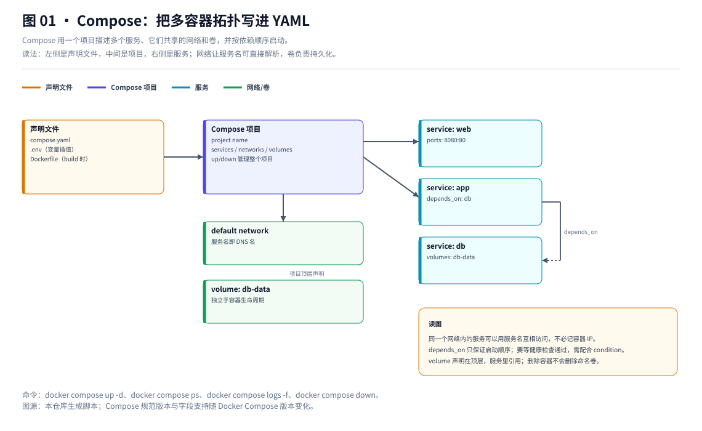
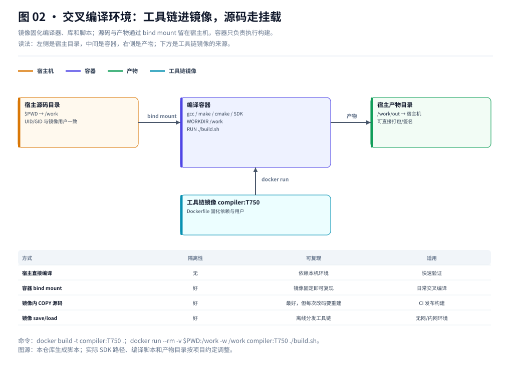
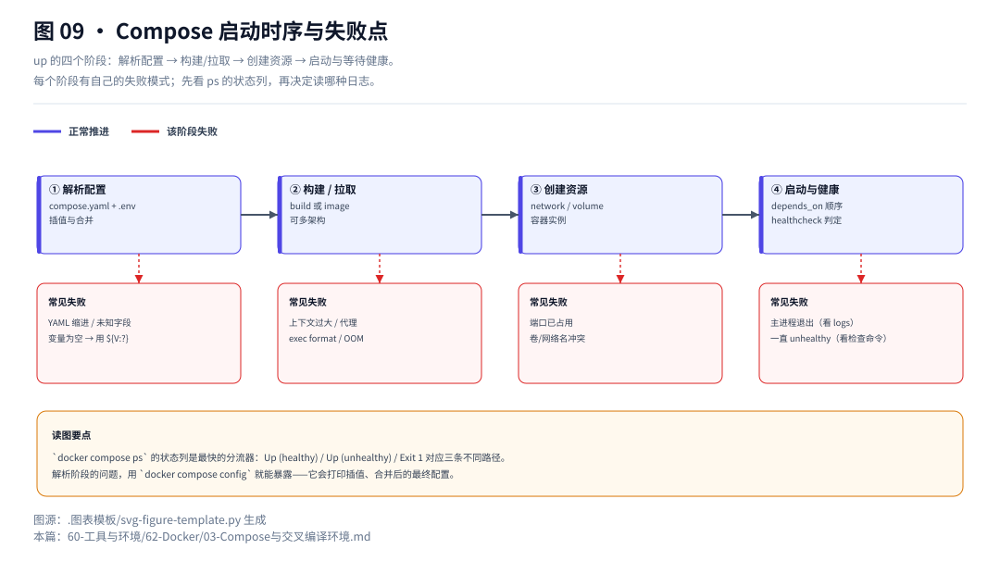

# Compose 与交叉编译环境

一句话结论：Compose 用 YAML 把"多个容器 + 网络 + 卷"声明成一个项目；交叉编译环境用镜像固化工具链、用 bind mount 挂源码，让宿主机保持干净、构建结果可复现。

> 本篇定位：Compose 的服务/网络/卷模型、多文件覆盖与 `extends`、启动顺序与健康检查，以及用 Docker 做交叉编译环境的落地方式。镜像分层见 [01-镜像分层与构建](./01-镜像分层与构建.md)，网络/存储细节见 [02-容器网络与存储](./02-容器网络与存储.md)。

## 目录

- [1 一句话模型](#s1)
- [2 速览](#s2)
- [3 Compose 结构与字段](#s3)
- [4 编排与交叉编译流程](#s4)
- [5 状态机与依赖顺序](#s5)
- [6 设计取舍与边界](#s6)
- [7 与相邻主题的关系](#s7)
- [名词解释](#名词解释)
- [8 参考与关联](#s8)

## 1 · 一句话模型：声明拓扑 + 固化工具链

Compose 把"跑哪些容器、怎么连、数据放哪"从命令参数变成一份可版本化的 YAML；交叉编译环境把"编译器、库、脚本"从宿主机搬进镜像，宿主机只保留源码和产物。

```text
Compose：compose.yaml ──► project（services + networks + volumes）──► 一组容器

交叉编译：宿主机源码 ──bind mount──► 容器（工具链）──► 宿主机产物
```

三个关键认知：

1. **Compose 是声明式的**：描述"最终要有什么"，`up/down` 负责收敛，不是一串 `docker run`。
2. **服务名就是 DNS 名**：同一网络内用服务名互访，不用记容器 IP。
3. **工具链镜像要可复现**：基础镜像、依赖版本、用户 UID/GID 都要固定，否则"昨天能编今天不能编"。

> **为什么值得从脚本换成 Compose**：`docker run` 脚本能跑，但**状态在外**——端口、卷、网络名散在参数里，清理靠 `docker rm $(docker ps -aq)` 这种危险动作。Compose 把"这一组东西"变成一个**有名字的项目**，`up` 和 `down` 是对称的：建了什么，就能干净地撤掉什么。代价是多一层抽象，排障时要先 `docker compose config` 看清"最终合并成什么"。

## 2 · 速览

| 项 | 内容 |
| --- | --- |
| 所属领域 | 容器编排 / 构建环境 |
| 核心文件 | `compose.yaml`（旧版 `docker-compose.yml`）、`.env` |
| 顶层结构 | `services`、`networks`、`volumes`、`configs`、`secrets` |
| 常用服务字段 | `image`、`build`、`command`、`environment`、`ports`、`volumes`、`depends_on` |
| 项目隔离 | 项目名 + 网络/卷前缀，默认按目录名生成 |
| 生命周期 | `up`、`ps`、`logs`、`exec`、`stop`、`down` |
| 交叉编译 | 工具链镜像 + bind mount + 构建脚本 |
| 离线分发 | `docker save` / `docker load`，或私有 registry |
| 典型场景 | 本地多服务联调、固件/CPE 交叉编译、CI 构建 |

## 3 · Compose 结构与字段

### 3.1 顶层结构

```yaml
services:
  app:
    build: .
    ports:
      - "8080:80"
    depends_on:
      db:
        condition: service_healthy
  db:
    image: postgres:16
    volumes:
      - db-data:/var/lib/postgresql/data
    healthcheck:
      test: ["CMD-SHELL", "pg_isready -U postgres"]
      interval: 5s
      timeout: 3s
      retries: 10

networks:
  default:
    driver: bridge

volumes:
  db-data:
```

| 顶层键 | 作用 | 注意 |
| --- | --- | --- |
| `services` | 定义容器 | 每个服务一个容器（可扩副本） |
| `networks` | 定义网络 | 不声明时创建默认 bridge |
| `volumes` | 定义命名卷 | 服务里引用，删除容器不删卷 |
| `configs` | 非敏感配置 | Swarm 场景常用 |
| `secrets` | 敏感数据 | 单机 Compose 也支持文件式 secret |

### 3.2 服务常用字段

| 字段 | 作用 | 边界 |
| --- | --- | --- |
| `image` | 直接用现成镜像 | 需固定 tag/digest |
| `build` | 从 Dockerfile 构建 | 可指定 `context`、`dockerfile`、`args`、`target` |
| `command` | 覆盖 CMD | 不覆盖 ENTRYPOINT |
| `entrypoint` | 覆盖 ENTRYPOINT | 调试时常用 |
| `environment` | 环境变量 | 不要放密钥 |
| `env_file` | 从文件读环境变量 | 文件不要提交到仓库 |
| `ports` | 发布端口 | `宿主:容器`，可绑定地址 |
| `expose` | 声明端口 | 只在网络内可见，不发布到宿主 |
| `volumes` | 挂载 | 命名卷或宿主路径 |
| `depends_on` | 启动顺序 | 默认只保证启动，不保证就绪 |
| `healthcheck` | 健康检查 | 需要镜像内有检查命令 |
| `restart` | 重启策略 | 与 `docker run --restart` 相同 |
| `profiles` | 按需启用服务 | `--profile` 控制 |
| `extends` | 继承另一个服务定义 | 可跨文件，见 3.5 |
| `deploy.resources` | 资源限制 | Compose 本地支持部分字段 |

### 3.3 变量插值与多文件覆盖

Compose 会读取同目录 `.env`，并在 YAML 中做 `${VAR}` 插值：

```yaml
services:
  app:
    image: "registry.local/app:${TAG:-latest}"
```

多文件覆盖：

```bash
docker compose -f compose.yaml -f compose.override.yaml up -d
```

后面的文件覆盖前面的同名字段，适合"基础配置 + 本地开发覆盖"。注意：`ports`、`volumes` 等列表字段的合并规则与标量不同，实际以 Compose 规范为准。

> **一条排障习惯**：任何时候先看"最终生效的配置"，而不是盯着某个文件猜。
>
> ```bash
> docker compose config          # 展开插值、合并覆盖后的最终 YAML
> ```
>
> `.env` 没生效、覆盖文件顺序不对、变量拼错——在这一步都能看出来。

### 3.4 项目名与资源隔离

Compose 默认用目录名作为项目名，资源会加前缀：

```text
项目名：myapp
网络：myapp_default
卷：myapp_db-data
容器：myapp-app-1、myapp-db-1
```

同一台机器跑多个项目时，项目名避免冲突；可以用 `-p` 或 `COMPOSE_PROJECT_NAME` 显式指定。



**读图**：左侧声明文件进入 Compose 项目，项目展开为多个服务；服务共享默认网络，数据库服务引用命名卷。`depends_on` 只表达启动依赖，就绪与否要看健康检查。

> 图源：`images/图05-Compose拓扑.svg`

### 3.5 extends 与合并规则

`extends` 让一个服务继承另一个服务的字段，常用于"多个服务共享同一份构建/环境定义"：

```yaml
services:
  base:
    build:
      context: .
      args:
        UID: ${UID:-1000}
    working_dir: /work
    volumes:
      - .:/work

  builder:
    extends: base
    command: ./build.sh

  tester:
    extends: base
    command: ./run_tests.sh
```

跨文件继承：

```yaml
# compose.yaml
  builder:
    extends:
      file: common.yaml
      service: base
```

合并规则与"多文件覆盖"不完全一样，容易踩的点：

| 字段类型 | 默认行为 | 例子 |
| --- | --- | --- |
| 标量 | 后者覆盖前者 | `command`、`image` |
| 映射（`environment`、`build.args`） | 按键合并，同名覆盖 | 可以只覆盖一个变量 |
| 序列（`ports`、`volumes`） | **追加**，不是替换 | 想"只要这几个"会得到"两批都要" |

> **待验证**：Compose 规范较新版本支持 `!reset` / `!override` 标签来改变序列合并行为，但可用性随 Compose CLI 版本变化。不确定时，用 `docker compose config` 看结果，别凭记忆推断。

## 4 · 编排与交叉编译流程

### 4.1 Compose 的日常流程

```text
docker compose up -d
  ├─ 解析 compose.yaml + .env
  ├─ 构建/拉取镜像
  ├─ 创建网络与卷
  ├─ 按 depends_on 顺序启动服务
  └─ 输出容器状态

docker compose ps          # 看状态与端口
docker compose logs -f app # 看日志
docker compose exec app sh # 进容器
docker compose down        # 停止并删除容器/网络（默认保留卷）
```

`down -v` 会删除命名卷，执行前确认数据是否还需要。`down --rmi all` 会删除镜像，慎用。

### 4.2 交叉编译环境的组成



**读图**：宿主源码通过 bind mount 进入容器，容器内用固定工具链执行构建，产物写回宿主目录；工具链镜像由 Dockerfile 固化，可 save/load 到离线环境。

> 图源：`images/图06-交叉编译环境.svg`

一个可用的工具链镜像骨架：

```dockerfile
FROM ubuntu:20.04

ARG UID=1000
ARG GID=1000
RUN apt-get update && \
    apt-get install -y --no-install-recommends \
        build-essential cmake git perl python3 ca-certificates && \
    rm -rf /var/lib/apt/lists/*

RUN groupadd -g ${GID} dev && \
    useradd -u ${UID} -g ${GID} -m -s /bin/bash dev && \
    echo 'dev ALL=(ALL) NOPASSWD:ALL' >> /etc/sudoers

USER dev
WORKDIR /work
```

构建与运行：

```bash
docker build \
  --build-arg UID=$(id -u) --build-arg GID=$(id -g) \
  -t compiler:t750 .

docker run --rm -it \
  -v "$PWD:/work" -w /work \
  compiler:t750 ./build.sh
```

关键点：

| 点 | 做法 | 原因 |
| --- | --- | --- |
| UID/GID | 构建参数传入宿主 ID | 产物不变成 root 所有 |
| 源码 | bind mount 到 `/work` | 改代码不用重建镜像 |
| 依赖 | 固化在镜像里 | 换机器也能复现 |
| 缓存 | 依赖层放前面 | 改源码只重建最后几步 |
| 中间产物 | `--mount=type=cache` | 第二次构建不必全量重编（见 [01 §4.4](./01-镜像分层与构建.md)） |
| 产物 | 写到挂载目录 | 宿主机可直接打包/签名 |
| 离线 | `docker save/load` | 内网/无外网环境分发 |

### 4.3 用 Compose 管理构建环境

单容器交叉编译不一定要 Compose；需要"编译 + 依赖服务 + 测试"一起跑时，Compose 更合适：

```yaml
services:
  builder:
    build:
      context: .
      args:
        UID: ${UID:-1000}
        GID: ${GID:-1000}
    volumes:
      - .:/work
    working_dir: /work
    command: ./build.sh
    profiles: ["build"]

  test:
    image: compiler:t750
    volumes:
      - .:/work
    working_dir: /work
    command: ./run_tests.sh
    depends_on:
      builder:
        condition: service_completed_successfully
```

`service_completed_successfully` 适合"一次性构建任务"；比单纯 `depends_on` 更接近"构建完再测试"的语义。

> **边界**：它只保证"构建容器以退出码 0 结束"，不保证产物完整。构建脚本中途 `exit 0`、或只编译了一半就跳过，都会被当成成功——产物校验还得靠构建脚本自己。

### 4.4 多架构与离线分发

| 需求 | 做法 |
| --- | --- |
| x86 上构建 arm | `docker buildx build --platform linux/arm64`（QEMU 或原生节点） |
| 多平台一次出 | `buildx build --platform a,b --push`（**不能 `--load`**，见 [01 §4.5](./01-镜像分层与构建.md)） |
| 离线机器 | `docker save -o compiler.tar compiler:t750`，目标机 `docker load -i` |
| 私有 registry | `docker tag` + `docker push`，目标机 `docker pull` |
| 固定版本 | 用 digest 引用基础镜像和工具链镜像 |

`docker save` 保存的是镜像（含所有层），不含 volume 和容器可写层；`docker export` 导出的是容器文件系统，两者不要混用。

在 Compose 里构建多架构要显式声明平台：

```yaml
services:
  builder:
    build:
      context: .
      platforms: ["linux/amd64", "linux/arm64"]
```

`platforms` 只在 `docker compose build` 走 buildx 时生效，版本支持范围需确认（**待验证**）。

### 4.5 为什么用 Compose 而不是一串 run 脚本

| 维度 | `docker run` 脚本 | Compose |
| --- | --- | --- |
| 配置存放 | 参数散在脚本里 | 一份 YAML，可版本化、可 review |
| 依赖关系 | 手写 sleep / 重试 | `depends_on` + 健康检查 |
| 网络 | 显式 `--network`，名字容易冲突 | 项目前缀自动隔离 |
| 清理 | 靠 `docker rm`，容易误删 | `down` 精确回收本项目 |
| 多环境 | 复制脚本改参数 | 多文件覆盖 + `.env` |
| 可读性 | 每个人写一套 | 团队同一份契约 |

反过来说，**单容器一次性任务用 Compose 是负担**：写十几行 YAML 只为跑一条命令，不如直接 `docker run --rm`。判断标准是"**要不要重复使用 + 有没有多个组件**"。

### 4.6 up 失败的六个分支



**读图**：从左到右是 `up` 的四个阶段——解析配置、构建/拉取、创建资源、启动与等待健康。每个阶段都有自己的失败模式；先看失败发生在哪一段，再去查对应对象，比读一屏日志快。

> 图源：`images/图09-Compose启动时序.svg`

| 现象 | 根因方向 | 处理方向 |
| --- | --- | --- |
| 直接报 YAML 语法/字段错误 | 缩进、版本不支持的字段 | `docker compose config` 验证 |
| 变量是空字符串 | `.env` 位置不对、变量名拼错 | 用 `${VAR:?msg}` 强制报错；`compose config` 看展开结果 |
| `port is already allocated` | 宿主端口被占（含上一个项目没 down） | `ss -lntp` 找占用者；改端口或先 `down` |
| 构建阶段失败 | Dockerfile/上下文/平台问题 | 见 [01 §4.6](./01-镜像分层与构建.md) |
| 启动后立刻退出 | 主进程前台化没做、入口命令错 | 看 `logs`，确认 ENTRYPOINT/CMD |
| 一直 `unhealthy` | 检查命令错、`start_period` 太短、真的没就绪 | 手工 `exec` 跑一遍健康检查命令 |

> **一条经验**：`up` 之后先 `docker compose ps` 看**状态列**。`Up (healthy)`、`Up (unhealthy)`、`Exit 1` 三种情况对应三条完全不同的排查路径，别一上来就 `logs -f`。

## 5 · 状态机与依赖顺序

### 5.1 Compose 项目与服务状态

```text
created ──up──► running ──stop──► exited ──start──► running
                   │
                   └──down──► 删除容器/网络（卷默认保留）
```

| 状态 | 含义 | 观察方式 |
| --- | --- | --- |
| created | 容器已创建未启动 | `docker compose ps -a` |
| running | 服务在运行 | `docker compose ps` |
| exited | 主进程退出 | `docker compose ps -a` |
| healthy / unhealthy | 健康检查结果 | `docker compose ps` 的状态列 |
| completed | 一次性任务成功结束 | `service_completed_successfully` 依赖它 |

### 5.2 依赖顺序的边界

`depends_on` 有两种语义：

```yaml
# 只保证启动顺序：db 容器启动了，但不代表数据库可连接
depends_on:
  - db

# 等健康检查通过：需要 db 定义 healthcheck
depends_on:
  db:
    condition: service_healthy
```

即使配置了健康检查，应用仍应实现重试/退避；容器编排只能降低启动时的竞态，不能替代应用层的容错。

> **边界**：`depends_on` 只影响**启动**。运行中 `db` 挂了，`app` 不会因此重启——想要"依赖挂了就跟着挂"，得用 `--abort-on-container-exit` 这类策略，或交给编排层。

### 5.3 定时器与健康检查

Compose 没有"协议定时器"，但健康检查有周期参数：

| 参数 | 含义 | 默认 |
| --- | --- | --- |
| `interval` | 检查间隔 | 30s |
| `timeout` | 单次检查超时 | 30s |
| `retries` | 连续失败多少次判定 unhealthy | 3 |
| `start_period` | 启动宽限期 | 0s |

健康检查失败不会自动重启容器（除非编排层另有策略），它只是把状态标成 unhealthy。

**`start_period` 是最容易漏的一个**：宽限期内的失败不计入 `retries`。慢启动服务（数据库初始化、SDK 工具链预热）不设它，就会在启动阶段被判定 unhealthy，导致 `depends_on: service_healthy` 永远等不到。

```yaml
healthcheck:
  test: ["CMD", "curl", "-fsS", "http://127.0.0.1:8080/healthz"]
  interval: 10s
  timeout: 3s
  retries: 3
  start_period: 40s     # 给 40 秒启动时间，期间失败不计数
```

> **推论**：`interval` 决定"多久发现故障"，`start_period` 决定"多久内不追究"。前者影响恢复速度，后者影响启动成功率，两者不要混用同一个值。

## 6 · 设计取舍与边界

### 6.1 Compose 不是 Kubernetes

Compose 适合单机多容器：开发环境、测试环境、小型部署。它没有跨节点调度、自动扩缩容、滚动升级和自愈。需要这些能力时，应该上 Swarm/Kubernetes，而不是把 Compose 用成"伪编排"。

### 6.2 源码挂载还是复制进镜像

| 方式 | 优点 | 代价 |
| --- | --- | --- |
| bind mount 源码 | 改代码立即生效，镜像小 | 依赖宿主目录结构，跨平台 I/O 可能慢 |
| COPY 源码进镜像 | 构建可复现，适合 CI | 每次改码都要重建 |
| 只挂载产物目录 | 兼顾速度与隔离 | 需要约定产物路径 |

日常开发用 bind mount；发布构建用 COPY 或"干净上下文 + 固定版本"，避免"本机能编、CI 不能编"。

### 6.3 工具链镜像的体积

交叉编译镜像往往包含 SDK、编译器、库，体积可能到数 GB。优化手段：

- 多阶段构建，只保留运行/编译必需的文件。
- 清理 apt 缓存、文档、测试用例。
- 把不常变的 SDK 单独做基础层，项目镜像只加项目依赖。
- 用私有 registry 缓存，避免每次从外网拉。

但不要为了体积删掉排障工具（`strace`、`ldd`、`file`），否则现场定位问题会更困难。

### 6.4 UID/GID 的取舍

镜像内建宿主 UID 能避免产物属主问题，但镜像与用户绑定，不适合直接分发。更通用的方案是运行时 `--user`，或构建后用 `chown` 修正。团队要统一约定，否则同一镜像在不同机器上产物权限不一致。

### 6.5 密钥与私有依赖

`ARG`、`ENV` 会留在镜像历史里，不能放 token。构建期拉私有仓库用 BuildKit secret 或挂载只读凭据；运行期用 secret/环境变量注入，并限制日志输出。

### 6.6 常见误判

- "`depends_on` 保证依赖可用"：只保证启动顺序，不保证服务就绪。
- "`down` 会删数据卷"：默认不删，`-v` 才删。
- "Compose 只能单机"：单机是主要场景，Swarm 模式可跨节点，但能力有限。
- "镜像里有工具链，容器就能跑"：还要挂载源码、设置工作目录、传入正确的环境变量。
- "`docker save` 能备份数据库"：只备份镜像，数据在 volume 里。
- "`.env` 会自动被所有 `-f` 文件读取"：`.env` 默认取**项目目录**下那份，`--env-file` 才能显式指定。
- "列表字段覆盖文件里写一份就替换"：默认是追加，结果常常是"两批都要"。

## 7 · 与相邻主题的关系

| 相邻对象 | 关系 |
| --- | --- |
| 镜像分层与构建 | Compose 的 `build` 直接调用 Dockerfile，见 [01-镜像分层与构建](./01-镜像分层与构建.md) |
| 容器网络与存储 | Compose 的 `networks`/`volumes` 是声明式封装，见 [02-容器网络与存储](./02-容器网络与存储.md) |
| 构建系统 | 容器只提供环境，编译规则仍在 Make/CMake |
| CI/CD | CI 常用 Compose 起依赖服务，或用 buildx 构建多架构镜像 |
| 平台与芯片 | 交叉工具链与目标架构相关，平台差异归 30 |
| WSL | WSL2 中跑 Docker 要注意文件系统位置与端口转发 |

一句话：**Compose 管"怎么把多个容器组织起来"，交叉编译镜像管"用什么工具链产出目标文件"。**

## 名词解释

> 缩写给出英文全称；非缩写用“—”表示。

| 术语 | 英文全称 | 解释 |
| --- | --- | --- |
| Compose | Docker Compose | 用 YAML 声明多容器应用的工具。 |
| Compose Specification | — | Compose 文件的通用规范，Docker Compose 是其实现之一。 |
| service | — | Compose 中的一个容器定义。 |
| project | — | Compose 的资源隔离单位，默认按目录名命名。 |
| network | — | Compose 声明的容器网络。 |
| volume | — | Compose 声明的命名卷。 |
| depends_on | — | 服务启动依赖声明。 |
| healthcheck | — | 容器健康检查。 |
| start_period | — | 健康检查的启动宽限期，期间失败不计入重试。 |
| profile | — | 按需启用服务的分组机制。 |
| extends | — | 继承另一个服务定义的机制，可跨文件。 |
| override | — | 覆盖文件机制，按顺序合并多个 Compose 文件。 |
| bind mount | — | 把宿主目录挂载进容器。 |
| UID / GID | User Identifier / Group Identifier | 用户 ID / 组 ID。 |
| SDK | Software Development Kit | 软件开发工具包。 |
| toolchain | — | 编译器、链接器、库和构建工具的集合。 |
| buildx | — | Docker 的扩展构建工具，支持多架构。 |
| manifest list | — | 多架构镜像的清单，按平台选择具体镜像。 |
| CI/CD | Continuous Integration / Continuous Delivery | 持续集成 / 持续交付。 |
| registry | — | 镜像仓库，负责镜像分发。 |

## 8 · 参考与关联

**标准与文档**

- Docker Compose 官方文档：Compose file reference、services、networks、volumes、extends、merge
- Docker 官方文档：Buildx、Multi-platform builds、Save/Load
- Compose Specification：`service_completed_successfully`、`profiles`、变量插值、合并规则

**关联**

- [01-镜像分层与构建](./01-镜像分层与构建.md)：Dockerfile、缓存、多阶段
- [02-容器网络与存储](./02-容器网络与存储.md)：网络模式、volume/bind mount
- [50-软件开发/55-构建与调试](../../50-软件开发/55-构建与调试/01-Make与CMake.md)：Make/CMake 与交叉编译
- [40-平台与芯片](../../40-平台与芯片/.readme.md)：目标平台 SDK 与架构
- [63-WSL/01-文件系统与网络互通](../63-WSL/01-文件系统与网络互通.md)：WSL2 中的 Docker 与挂载性能

---

> **本篇定位**：讲清 Compose 的声明式模型、多文件覆盖与依赖顺序，以及交叉编译环境的落地方式；不展开 Kubernetes 编排。
> **素材来源**：`studyspace-v2/10.工程方法/3.开发环境/01-docker-examples/`（Q22/T750 的 UID/GID、bind mount、save/load 实践）、`studyspace/4.其他技能/1.docker/docker.md`（build/run/macvlan 示例）、`studyspace-v2/10.工程方法/3.开发环境/02-WSL2.md`（Docker 安装），Compose 部分按官方规范补写。
> **待验证**：Compose 各版本对 `deploy`、`profiles`、`platforms`、`!reset`/`!override` 与 `depends_on.condition` 的支持范围不同；不同平台的 bind mount 性能差异需实测。
