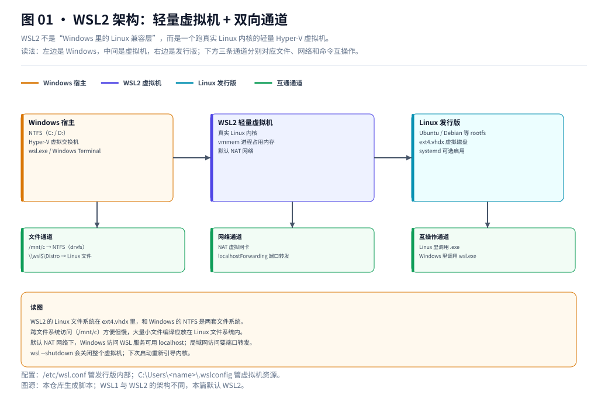
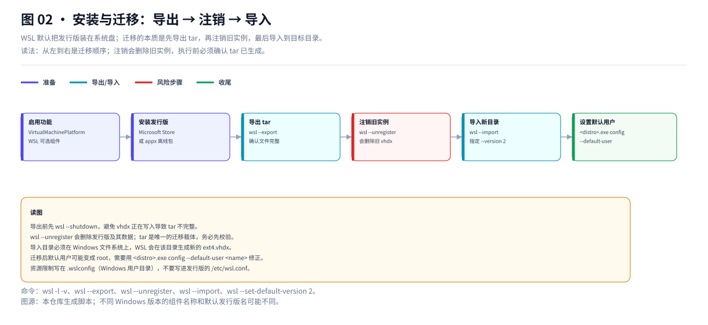

# WSL2 架构与安装迁移

一句话结论：WSL2 不是“Windows 上的 Linux 兼容层”，而是**一台轻量虚拟机里跑真实 Linux 内核，每个发行版是这个 VM 里的一个容器**；理解 VM、发行版、VHDX 和两套配置文件的边界，才能解释安装、迁移和资源限制问题。

> 本篇定位：WSL1/WSL2 差异、utility VM 与发行版的关系、`.wslconfig` 与 `/etc/wsl.conf`、安装/导出/导入/迁移、systemd。文件系统与网络见 [01-文件系统与网络互通](./01-文件系统与网络互通.md)，USB/串口与桌面见 [02-USB串口与桌面GUI](./02-USB串口与桌面GUI.md)。

## 目录

- [1 一句话模型](#s1)
- [2 速览](#s2)
- [3 架构与配置字段](#s3)
- [4 安装、启动与迁移流程](#s4)
- [5 状态机与定时器](#s5)
- [6 设计取舍与边界](#s6)
- [7 与相邻主题的关系](#s7)
- [名词解释](#名词解释)
- [8 参考与关联](#s8)

## 1 · 一句话模型

```text
Windows 主机
  └─ WSL2 utility VM（轻量虚拟机，共享/动态内存）
       ├─ 发行版 A（容器式 rootfs，ext4.vhdx）
       ├─ 发行版 B
       └─ 9p/drvfs ──► C:\ / D:\ 等 Windows 盘
```

三个关键认知：

1. **WSL2 的内核是真的 Linux 内核**，系统调用不再翻译；代价是要经过虚拟化边界。
2. **发行版不是虚拟机**：多个发行版共享同一个 utility VM，`wsl --shutdown` 关的是整个 VM。
3. **两套配置各管一层**：`.wslconfig` 管 VM 全局，`/etc/wsl.conf` 管单个发行版。

## 2 · 速览

| 项 | 内容 |
| --- | --- |
| 所属层/领域 | Windows 上的 Linux 开发环境 |
| 核心对象 | utility VM、发行版、VHDX、`.wslconfig`、`wsl.conf` |
| 关键参数 | `memory`、`processors`、`swap`、`networkingMode`、`systemd` |
| 典型场景 | Linux 工具链、Docker、交叉编译、串口调试、GUI 工具 |
| 主要标准 | Windows Hyper-V 虚拟化、Linux 内核、ext4 |

## 3 · 架构与配置字段

### 3.1 WSL1 与 WSL2

| 维度 | WSL1 | WSL2 |
| --- | --- | --- |
| 实现 | 系统调用翻译层 | 轻量 VM + 真实 Linux 内核 |
| 文件性能 | Windows 盘上较接近原生 | Linux 盘快，跨 `/mnt/c` 慢 |
| 兼容性 | 部分 syscall/驱动不支持 | 接近完整 Linux |
| 网络 | 与 Windows 共享网络栈 | 默认 NAT，独立 IP |
| Docker | 基本不可用 | 可用（Docker Desktop 或原生 Engine） |
| 典型用途 | 轻量命令、老机器 | 现代开发环境 |

### 3.2 两个配置文件

`.wslconfig` 放在 Windows 用户目录（`%UserProfile%\.wslconfig`），影响整个 WSL2 VM：

| 配置项 | 作用 | 边界 |
| --- | --- | --- |
| `[wsl2] memory=` | VM 最大内存 | 不是“预留”，是上限；Windows 仍会动态回收 |
| `processors=` | VM 可用 CPU 数 | 超过物理核心数没有意义 |
| `swap=` | 交换空间大小 | `0` 表示不启用 |
| `localhostForwarding=` | Windows 访问 WSL 的 localhost 转发 | 默认开启；mirrored 模式下语义不同 |
| `networkingMode=mirrored` | 与 Windows 共享网络接口 | 需要较新 Windows 11；VPN/局域网访问更自然 |
| `dnsTunneling=` | DNS 查询经 Windows 转发 | 解决部分 VPN DNS 问题 |
| `autoProxy=` | 继承 Windows 代理 | 与公司代理环境配合 |
| `nestedVirtualization=` | 允许 VM 内再虚拟化 | 跑 KVM/Hyper-V 时需要 |
| `kernelCommandLine=` | 追加内核参数 | 写错可能导致 VM 起不来 |

`/etc/wsl.conf` 在发行版内部，影响该发行版的挂载、网络、用户和启动：

| 段/键 | 作用 | 边界 |
| --- | --- | --- |
| `[automount] enabled/root/options` | 自动挂载 Windows 盘 | `metadata` 影响权限位；`fmask/dmask` 影响默认权限 |
| `[network] generateHosts/generateResolvConf/hostname` | 生成 hosts、DNS、主机名 | 手改 `/etc/hosts` 可能被覆盖 |
| `[interop] enabled/appendWindowsPath` | 是否调用 Windows 程序、是否追加 PATH | 追加 PATH 会拖慢命令查找 |
| `[user] default=` | 默认登录用户 | 导入的发行版默认是 root，需显式设置 |
| `[boot] systemd=true` | 启用 systemd | 需要较新 WSL 版本；旧版本不识别 |

修改 `wsl.conf` 后需要 `wsl --shutdown` 或重启发行版；修改 `.wslconfig` 后同样要 `wsl --shutdown` 才生效。

### 3.3 磁盘与文件位置

- 发行版 rootfs 是一个 `ext4.vhdx`，通常位于 `%LOCALAPPDATA%\Packages\<发行版包名>\LocalState\`。
- VHDX 会随写入增长，但删除文件后不会自动缩小；需要 `diskpart`/`Optimize-VHD` 或 `wsl --manage --set-sparse`（新版本）压缩。
- `\\wsl$\<distro>` 或 `\\wsl.localhost\<distro>` 是 Windows 访问 Linux 文件的 UNC 路径。

## 4 · 安装、启动与迁移流程

### 4.1 架构与启动



**读图**：三列分别是 Windows 宿主、WSL2 轻量虚拟机、Linux 发行版；下方三条通道对应文件（`/mnt/c` 与 `\\wsl$`）、网络（NAT/localhost 转发）和互操作（Linux 调 `.exe`、Windows 调 `wsl.exe`）。发行版 rootfs 在 VHDX 里，Windows 盘不是 ext4。

> 图源：`images/图01-WSL2架构.svg`

正常启动路径：

1. `wsl -d Ubuntu` 触发 utility VM 启动（若未运行）。
2. VM 启动 Linux 内核，挂载该发行版的 ext4.vhdx。
3. 执行发行版 init；若启用 systemd，则由 systemd 接管服务。
4. 按 `wsl.conf` 挂载 Windows 盘、生成 hosts/resolv.conf、设置默认用户。
5. 启动用户 shell，并建立与 Windows 的 localhost 转发/终端通道。

异常分支：

- **`wsl --shutdown` 后 Docker 容器全没了**：容器进程属于 VM，VM 停止即全部退出；数据要靠 volume 持久化。
- **导入后默认是 root**：`wsl --import` 不会继承原发行版的默认用户，需要在 `/etc/wsl.conf` 配 `[user] default=`。
- **VHDX 越来越大**：删除文件只释放 ext4 内部块，虚拟磁盘文件不会自动收缩。
- **systemd 不生效**：WSL 版本过旧，或 `wsl.conf` 写了但没重启发行版。

### 4.2 安装与迁移命令



**读图**：从左到右是迁移顺序：先确认虚拟化组件和发行版可用，再 `wsl --export` 生成 tar；`--unregister` 会删除旧实例，必须先确认 tar 完整；最后 `--import` 到新目录并修正默认用户。

> 图源：`images/图02-安装与迁移.svg`

```powershell
# 安装与版本
wsl --install -d Ubuntu
wsl --set-default-version 2
wsl --update
wsl --list --verbose

# 导出 / 导入（迁移到其他盘）
wsl --export Ubuntu D:\backup\ubuntu.tar
wsl --import Ubuntu D:\WSL\Ubuntu D:\backup\ubuntu.tar --version 2
wsl --unregister Ubuntu   # 危险：删除该发行版及其 VHDX
```

迁移要点：

- `--export` 生成的是 tar，包含 rootfs；不包含 Windows 侧的快捷方式和注册信息。
- 导入路径不要放在网络盘或大小写敏感/不支持稀疏文件的文件系统上。
- 导入后检查默认用户、`/etc/wsl.conf`、SSH 主机密钥和 Docker 数据目录。
- 原发行版确认可用后再 `--unregister`，否则不可逆。

## 5 · 状态机与定时器

| 对象 | 状态 | 说明 |
| --- | --- | --- |
| utility VM | stopped → running → stopped | `wsl --shutdown` 立即停止所有发行版 |
| 发行版 | installed → running → stopped | 单个发行版停止不影响 VM 内其他发行版 |
| 服务 | 由 init/systemd 管理 | 没有 systemd 时需手动启动 sshd/docker |
| VHDX | 增长/待压缩 | 不会因删文件自动缩小 |

WSL 没有连接状态机。相关定时器主要是 VM 空闲回收（Windows 侧的动态内存）和 systemd 服务超时；`wsl --shutdown` 不等待服务优雅退出，长事务要做好幂等和恢复。

## 6 · 设计取舍与边界

- **为什么用 VM 而不是翻译层**：完整内核带来兼容性和文件性能；代价是独立网络、内存占用和跨系统文件访问变慢。
- **为什么多发行版共享一个 VM**：启动快、资源省；代价是一个发行版把 VM 搞崩会影响其他发行版。
- **`.wslconfig` 的内存不是硬预留**：它限制上限，Windows 仍会根据压力回收；不要把 `memory` 设得超过物理内存。
- **WSL2 不适合直接跑生产服务**：VM 生命周期跟随用户会话，Windows 更新/休眠/关机都会中断。
- **跨文件系统是最大性能陷阱**：源码、Git 仓库、`node_modules` 放在 Linux 文件系统内；只有需要 Windows 工具处理的文件才放 `/mnt/c`。
- **常见误判**：`wsl --shutdown` 不是“重启某个发行版”，它关闭整个 VM；`wsl --terminate <distro>` 才是单发行版。

## 7 · 与相邻主题的关系

| 相邻对象 | 关系 |
| --- | --- |
| [文件系统与网络互通](./01-文件系统与网络互通.md) | 本篇的 VM/发行版模型决定了 `/mnt/c` 与 NAT 的行为 |
| [USB 串口与桌面 GUI](./02-USB串口与桌面GUI.md) | USB/IP 与 WSLg 都建立在 utility VM 之上 |
| [镜像分层与构建](../62-Docker/01-镜像分层与构建.md) | WSL2 内可跑 Docker Engine，容器生命周期受 VM 影响 |
| [Linux 启动链](../../20-平台与系统/21-Linux/03-启动与根文件系统/00-启动链.md) | 发行版 init/systemd 的启动过程与常规 Linux 一致 |

一句话边界：本篇讲“WSL2 是什么、怎么装和迁”；跨系统文件与网络细节在下一篇。

## 名词解释

> 缩写给出英文全称；非缩写用“—”表示。

| 术语 | 英文全称 | 解释 |
| --- | --- | --- |
| WSL | Windows Subsystem for Linux | Windows 上的 Linux 子系统。 |
| VM | Virtual Machine | 虚拟机，WSL2 的运行载体。 |
| utility VM | — | 轻量级虚拟机，专门承载 WSL2 发行版。 |
| VHDX | Virtual Hard Disk v2 | Hyper-V 虚拟磁盘格式，WSL2 rootfs 的载体。 |
| ext4 | Fourth Extended Filesystem | Linux 常用文件系统。 |
| 9P | 9P2000.L | 用于跨 VM 文件共享的协议，WSL 访问 Windows 盘时使用。 |
| drvfs | — | WSL 中挂载 Windows 文件系统的驱动。 |
| systemd | — | Linux 初始化系统和服务管理器。 |
| NAT | Network Address Translation | 网络地址转换，WSL2 默认网络模式。 |
| DNS | Domain Name System | 域名系统。 |
| rootfs | Root File System | 根文件系统。 |
| Hyper-V | — | Windows 虚拟化平台，WSL2 依赖其能力。 |

## 8 · 参考与关联

**标准**

- Microsoft Learn：WSL 文档、`.wslconfig`、`wsl.conf`
- Linux 内核文档（ext4、9p）
- Hyper-V 虚拟磁盘格式说明

**关联**

- [01-文件系统与网络互通](./01-文件系统与网络互通.md)
- [02-USB串口与桌面GUI](./02-USB串口与桌面GUI.md)
- [Linux 启动链](../../20-平台与系统/21-Linux/03-启动与根文件系统/00-启动链.md)

---

> **本篇定位**：WSL2 架构、配置分层与安装迁移。
> **素材来源**：`studyspace/4.其他技能/5.wsl/WSL2 开发环境搭建 新.md`、`WSL做开发工具.md`、`studyspace-v2/10.工程方法/3.开发环境/02-WSL2.md`（安装、迁移、配置片段）。
> **待验证**：`mirrored` 网络模式与 `--set-sparse` 等能力依赖 Windows 11 与 WSL 版本。
