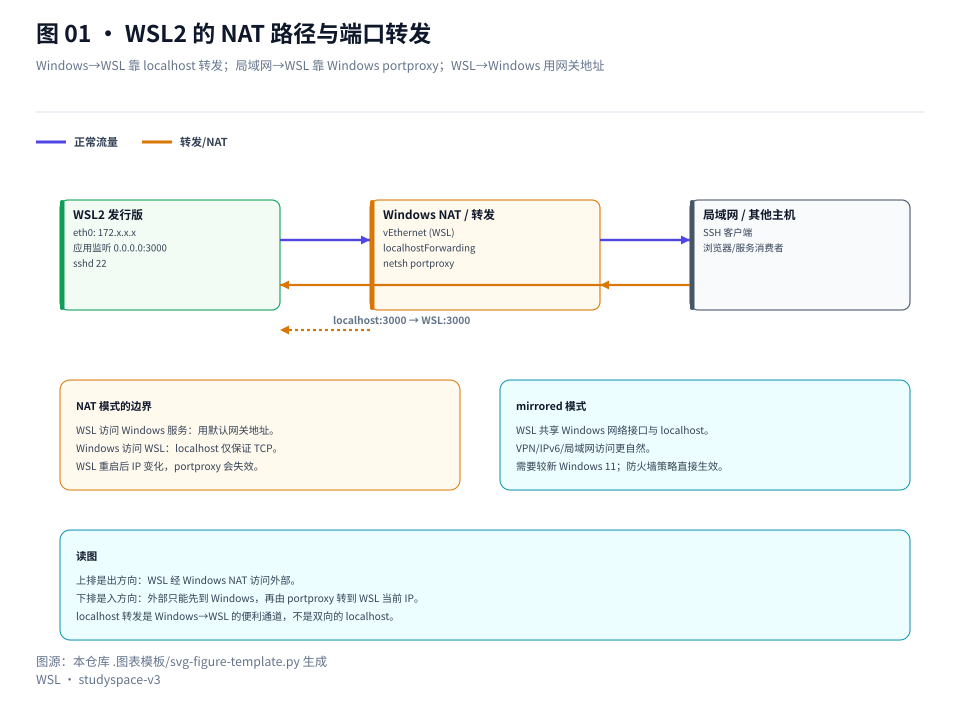

# WSL 文件系统与网络互通

一句话结论：WSL2 里有两套文件系统和两套网络语义——**Linux 文件系统走 ext4，Windows 盘走 9p/drvfs；默认网络是 NAT，Windows 访问 WSL 靠 localhost 转发，局域网访问 WSL 要在 Windows 上做端口转发**。

> 本篇定位：`/mnt/c` 的权限/大小写/换行/监听限制、NAT 与 mirrored 两种网络模式、从局域网 SSH 进 WSL 的完整链路。WSL2 架构见 [00-WSL2架构与安装](./00-WSL2架构与安装.md)，USB 与 GUI 见 [02-USB串口与桌面GUI](./02-USB串口与桌面GUI.md)。

## 目录

- [1 一句话模型](#s1)
- [2 速览](#s2)
- [3 文件系统与网络字段](#s3)
- [4 数据路径与流程](#s4)
- [5 状态机与定时器](#s5)
- [6 设计取舍与边界](#s6)
- [7 与相邻主题的关系](#s7)
- [名词解释](#名词解释)
- [8 参考与关联](#s8)

## 1 · 一句话模型

```text
文件：Linux ext4（快）  ←→  /mnt/c（9p/drvfs，慢，Windows 语义）
网络：WSL ──NAT──► Windows ──► 局域网
      Windows ──localhost 转发──► WSL（仅 TCP）
      局域网 ──► Windows:端口 ──portproxy──► WSL_IP:端口
```

三个关键认知：

1. **`/mnt/c` 不是 ext4**：它由 Windows 文件系统通过 9p 暴露，权限、大小写、inotify、性能都与 Linux 盘不同。
2. **NAT 模式下 WSL 有独立 IP**：Windows 能用 `localhost` 访问 WSL，但 WSL 不能用 `localhost` 访问 Windows 服务。
3. **端口转发是 Windows 侧的事**：局域网要访问 WSL 的 sshd，靠 `netsh portproxy` 把 Windows 端口转到 WSL 当前 IP。

## 2 · 速览

| 项 | 内容 |
| --- | --- |
| 所属层/领域 | WSL 文件系统与网络 |
| 核心对象 | drvfs、9p、ext4、vEthernet、portproxy、sshd |
| 关键参数 | `metadata`、`umask`、`fmask`、`networkingMode`、`localhostForwarding` |
| 典型场景 | 源码放哪、Git 换行、前端热更新、局域网 SSH、WSL 访问 Windows 服务 |
| 主要标准 | 9P2000.L、TCP/IP、RFC 3022（NAT） |

## 3 · 文件系统与网络字段

### 3.1 文件系统对比

| 维度 | Linux 文件系统（`~/`、`/`） | Windows 盘（`/mnt/c`） |
| --- | --- | --- |
| 实现 | ext4 + VHDX | 9p 协议 + drvfs |
| 性能 | 接近原生 | 大量小文件明显慢 |
| 权限 | 完整 POSIX 权限 | 默认模拟，需 `metadata` 才持久化 |
| 大小写 | 大小写敏感 | 默认不敏感，可按目录开启 |
| inotify | 正常 | 部分场景不触发或延迟 |
| 符号链接 | 正常 | 受 Windows 开发者模式/权限限制 |
| 适用 | 源码、Git、构建产物 | 与 Windows 工具交换的文件 |

`/etc/wsl.conf` 中与文件系统相关的配置：

```ini
[automount]
enabled = true
root = /mnt/
options = "metadata,umask=22,fmask=11,case=off"
```

| 选项 | 作用 | 边界 |
| --- | --- | --- |
| `metadata` | 把 Linux 权限位存到 Windows 扩展属性 | 会让所有文件操作变慢；不需要 `chmod` 时别开 |
| `umask`/`fmask`/`dmask` | 控制默认权限 | 与 `metadata` 同时存在时行为需实测 |
| `case=off` | 目录默认大小写不敏感 | 需要区分 `File.c`/`file.c` 的项目会出错 |
| `case=dir` | 按目录的扩展属性决定 | 需配合 `fsutil file setCaseSensitiveInfo` |

### 3.2 网络模式与关键参数

| 模式/参数 | 行为 | 适用与边界 |
| --- | --- | --- |
| NAT（默认） | WSL 在独立网段，出网经 Windows NAT | 隔离好；局域网访问需端口转发 |
| mirrored | WSL 共享 Windows 网络接口 | 局域网/VPN/IPv6 更自然；需要较新 Windows 11 |
| `localhostForwarding=true` | Windows 的 `localhost:port` 转发到 WSL | 只保证 TCP；UDP 不适用 |
| `generateResolvConf=false` | 不自动生成 `/etc/resolv.conf` | 自定义 DNS/VPN 时用，需自己维护 |
| `dnsTunneling=true` | DNS 经 Windows 解析 | 解决 VPN 下 DNS 泄漏/失败 |
| `hostAddressLoopback` | mirrored 下允许回环访问 | 版本相关，需实测 |

## 4 · 数据路径与流程

### 4.1 两种网络模式与 SSH 入口



**读图**：左边是 default NAT：WSL 出网经 Windows NAT，Windows 访问 WSL 走 localhost 转发；右边是局域网 SSH：客户端访问 Windows 的 2222，portproxy 再转到 WSL 的 22。底部是 mirrored 模式，WSL 直接共享 Windows 接口。

> 图源：`images/图01-文件与网络.svg`

### 4.2 Windows → WSL 的 localhost 转发

正常路径：

1. WSL 内服务监听 `0.0.0.0:3000`。
2. Windows 访问 `http://localhost:3000`。
3. WSL 的 localhost 转发把连接送到 WSL 内对应端口。

边界：

- 服务只监听 `127.0.0.1` 时，转发可能仍然可用（取决于实现），但不要依赖；监听 `0.0.0.0` 最稳。
- UDP、ICMP 不保证转发；需要 UDP 时用 mirrored 或显式端口转发。
- 端口冲突：Windows 上已有进程占用同端口，localhost 会命中 Windows 进程而不是 WSL。

### 4.3 局域网 → WSL 的 SSH

```powershell
# 1) 查 WSL 当前 IP（在 WSL 内执行）
ip -4 addr show eth0

# 2) Windows 管理员 PowerShell：端口转发
netsh interface portproxy add v4tov4 `
  listenport=2222 listenaddress=0.0.0.0 `
  connectport=22 connectaddress=172.20.10.5

# 3) 放行 Windows 防火墙
New-NetFirewallRule -DisplayName "WSL SSH 2222" `
  -Direction Inbound -Protocol TCP -LocalPort 2222 -Action Allow

# 4) 查看/删除
netsh interface portproxy show v4tov4
netsh interface portproxy delete v4tov4 listenport=2222 listenaddress=0.0.0.0
```

WSL 内准备 sshd：

```bash
sudo apt install openssh-server
sudo sed -i 's/^#\?Port .*/Port 22/' /etc/ssh/sshd_config
sudo sed -i 's/^#\?PasswordAuthentication .*/PasswordAuthentication yes/' /etc/ssh/sshd_config
sudo systemctl enable --now ssh   # 没有 systemd 时用 sudo service ssh start
```

异常分支：

- **重启后 SSH 不通**：WSL IP 变了，portproxy 还指向旧地址；重新执行第 2 步，或改用 mirrored 模式。
- **Windows 本机 `ssh localhost -p 2222` 通，局域网不通**：防火墙没放行，或 `listenaddress` 写成了 `127.0.0.1`。
- **sshd 起来了但连不上**：`sshd_config` 里 `ListenAddress` 限制在回环，或 WSL 内防火墙/nftables 拦截。
- **公司 VPN 下异常**：NAT 与 VPN 路由冲突；优先尝试 mirrored + `dnsTunneling`。

### 4.4 WSL → Windows 服务

NAT 模式下，WSL 里访问 Windows 服务要用 Windows 在 vEthernet (WSL) 上的地址，通常是默认网关：

```bash
ip route show default | awk '{print $3}'
# 然后访问 http://<该地址>:<端口>
```

Windows 服务还必须监听 `0.0.0.0` 或该虚拟网卡地址；只监听 `127.0.0.1` 时 WSL 访问不到。mirrored 模式下可以直接用 `localhost`。

## 5 · 状态机与定时器

没有协议状态机，但有几类会“过期”的状态：

| 状态 | 生命周期 | 说明 |
| --- | --- | --- |
| WSL IP 租约 | VM 启动时分配 | VM 重启后可能变化，portproxy 随之失效 |
| portproxy 表项 | 持久化到 Windows 配置 | 不随 WSL 重启自动更新 |
| localhost 转发 | WSL 服务运行期间 | 服务退出后连接被拒绝 |
| inotify watch | 进程生命周期 | `/mnt/c` 上可能漏事件；超限会报 `ENOSPC` |
| DNS 配置 | 发行版启动时生成 | `wsl --shutdown` 后重新生成，手改会丢 |

相关定时器：TCP keepalive、conntrack 超时、Windows 防火墙规则生效延迟；WSL 本身没有“网络保活”机制。

## 6 · 设计取舍与边界

- **源码放 Linux 盘**：构建、Git、文件监听都快；需要 Windows 工具处理的文件再放 `/mnt/c`，不要整个仓库跨系统。
- **`metadata` 的取舍**：能持久化 `chmod`，但所有文件操作都多一层转换；只在确实需要权限位时开启。
- **NAT 的取舍**：隔离好、配置简单；代价是局域网访问要 portproxy，IP 变化要维护。
- **mirrored 的取舍**：网络行为最接近原生 Windows，VPN/IPv6 友好；代价是版本要求高，且 Windows 防火墙策略会直接影响 WSL。
- **不要把 portproxy 当永久方案**：它绑定 IP，不是服务名；生产化脚本应在 WSL 启动时自动更新。
- **换行问题不是 WSL 独有**：Git 的 `core.autocrlf`、`.gitattributes` 要和编辑器/构建脚本一起定；跨系统仓库建议显式声明 `text=auto`。
- **常见误判**：`/mnt/c` 上“能跑”不代表性能可接受；前端热更新、数据库、大量小文件构建通常会暴露问题。

## 7 · 与相邻主题的关系

| 相邻对象 | 关系 |
| --- | --- |
| [WSL2 架构与安装](./00-WSL2架构与安装.md) | NAT/VHDX/发行版模型是本篇行为的前提 |
| [USB 串口与桌面 GUI](./02-USB串口与桌面GUI.md) | 串口设备与 GUI 转发同样受 VM 边界影响 |
| [Git 对象模型与引用](../61-Git/00-Git对象模型与引用.md) | 跨系统仓库的换行、权限、大小写问题 |
| [镜像分层与构建](../62-Docker/01-镜像分层与构建.md) | Docker bind mount 从 `/mnt/c` 挂载时性能明显下降 |
| [netfilter 框架入门](../../20-平台与系统/21-Linux/06-网络子系统/01-netfilter/netfilter框架入门.md) | 端口转发/NAT 的底层规则 |

一句话边界：本篇讲 WSL 与 Windows 之间的文件/网络边界；Linux 网络栈和防火墙机制不在这里展开。

## 名词解释

> 缩写给出英文全称；非缩写用“—”表示。

| 术语 | 英文全称 | 解释 |
| --- | --- | --- |
| WSL | Windows Subsystem for Linux | Windows 上的 Linux 子系统。 |
| drvfs | — | WSL 挂载 Windows 文件系统的驱动。 |
| 9P | 9P2000.L | 跨 VM 文件共享协议。 |
| ext4 | Fourth Extended Filesystem | Linux 常用文件系统。 |
| NAT | Network Address Translation | 网络地址转换。 |
| portproxy | Port Proxy | Windows `netsh` 的端口转发功能。 |
| SSH | Secure Shell | 安全远程登录协议。 |
| sshd | SSH Daemon | SSH 服务端进程。 |
| TCP | Transmission Control Protocol | 传输控制协议。 |
| UDP | User Datagram Protocol | 用户数据报协议。 |
| DNS | Domain Name System | 域名系统。 |
| inotify | — | Linux 文件事件通知机制。 |
| VPN | Virtual Private Network | 虚拟专用网络。 |
| MTU | Maximum Transmission Unit | 最大传输单元。 |

## 8 · 参考与关联

**标准**

- Microsoft Learn：WSL 网络、`netsh interface portproxy`、`.wslconfig`
- 9P2000.L 协议说明
- RFC 3022（NAT）

**关联**

- [00-WSL2架构与安装](./00-WSL2架构与安装.md)
- [02-USB串口与桌面GUI](./02-USB串口与桌面GUI.md)
- [Git 对象模型与引用](../61-Git/00-Git对象模型与引用.md)
- [netfilter 框架入门](../../20-平台与系统/21-Linux/06-网络子系统/01-netfilter/netfilter框架入门.md)

---

> **本篇定位**：WSL 文件系统语义、NAT/mirrored 网络与端口转发。
> **素材来源**：`studyspace/4.其他技能/5.wsl/WSL进行ssh连接.md`（端口转发步骤）、`WSL2 挂载U盘.md`、`studyspace-v2/10.工程方法/3.开发环境/02-WSL2.md`（网络/配置片段）。
> **待验证**：localhost 转发对 UDP 的支持、mirrored 模式的具体可用版本，随 WSL 版本变化。
