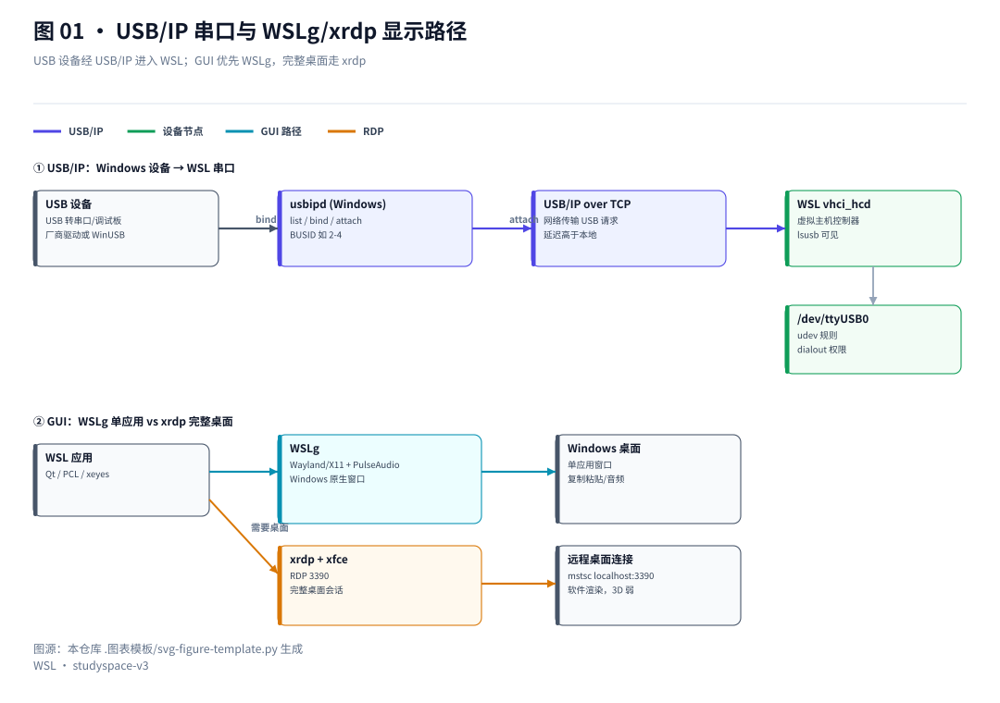

# WSL USB 串口与桌面 GUI

一句话结论：WSL2 的 VM 边界挡住了物理 USB 和显示设备，**USB 设备要靠 USB/IP 从 Windows“远程接入”，GUI 则优先用内置 WSLg，只有需要完整桌面时才上 xrdp**。

> 本篇定位：usbipd-win 的绑定/接入流程、串口权限与 udev、WSLg 与 xrdp 两条 GUI 路径、Qt/PCL 这类工具链的落点。WSL2 架构见 [00-WSL2架构与安装](./00-WSL2架构与安装.md)，文件与网络见 [01-文件系统与网络互通](./01-文件系统与网络互通.md)。

## 目录

- [1 一句话模型](#s1)
- [2 速览](#s2)
- [3 设备与显示字段](#s3)
- [4 接入与显示流程](#s4)
- [5 状态机与定时器](#s5)
- [6 设计取舍与边界](#s6)
- [7 与相邻主题的关系](#s7)
- [名词解释](#名词解释)
- [8 参考与关联](#s8)

## 1 · 一句话模型

```text
USB：设备 ──Windows usbipd──USB/IP──► WSL vhci_hcd ──► /dev/ttyUSB0
GUI：WSL 应用 ──Wayland/X11──► WSLg ──► Windows 窗口
     或 WSL 应用 ──X11/RDP──► xrdp ──► Windows 远程桌面
```

三个关键认知：

1. **USB 不是“自动透传”**：Windows 先把设备从宿主驱动手里拿出来，再通过 USB/IP 挂到 WSL；绑定（bind）和接入（attach）是两步。
2. **串口权限是 Linux 侧问题**：设备节点出现后，还需要 `dialout` 组或 udev 规则，否则普通用户打不开。
3. **GUI 有两条路**：WSLg 是单应用窗口，开箱即用；xrdp 是完整桌面，适合 xfce 这类传统桌面环境。

## 2 · 速览

| 项 | 内容 |
| --- | --- |
| 所属层/领域 | WSL 设备接入与图形显示 |
| 核心对象 | usbipd、VHCI、`/dev/ttyUSB*`、udev、WSLg、xrdp |
| 关键参数 | BUSID、`--auto-attach`、baudrate、`DISPLAY`、RDP 端口 |
| 典型场景 | 路由器/CPE 串口调试、USB 转串口、Qt/PCL 图形工具、远程桌面 |
| 主要标准 | USB/IP、USB 2.0/3.x、X11、Wayland、RDP |

## 3 · 设备与显示字段

### 3.1 USB/IP 角色

| 组件 | 位置 | 作用 | 边界 |
| --- | --- | --- | --- |
| `usbipd` | Windows | 把 USB 设备导出为 USB/IP 服务 | 需要管理员权限执行 `bind` |
| `vhci_hcd` | WSL 内核 | 虚拟主机控制器，接收远程 USB 设备 | 内核模块未加载时看不到设备 |
| BUSID | Windows | 设备在 usbipd 中的标识，如 `2-4` | 换 USB 口会变化 |
| WinUSB 驱动 | Windows | usbipd 能绑定的前提 | 厂商驱动占用的设备需替换驱动 |
| `/dev/ttyUSB0` | WSL | USB 转串口生成的 TTY 节点 | 编号可能因插入顺序变化 |

### 3.2 串口权限与 udev

| 方式 | 命令/文件 | 作用 | 边界 |
| --- | --- | --- | --- |
| 加入 dialout 组 | `sudo usermod -aG dialout $USER` | 允许普通用户访问串口 | 需要重新登录生效 |
| 临时改权限 | `sudo chmod 666 /dev/ttyUSB0` | 立即可用 | 重新插拔后失效 |
| udev 规则 | `/etc/udev/rules.d/99-usb-serial.rules` | 按 VID/PID 固定权限/别名 | 规则写错会静默不生效 |
| 固定别名 | `SYMLINK+="ttyCPE"` | 避免 ttyUSB 编号漂移 | 需要唯一 VID/PID 或序列号 |

udev 规则示例：

```udev
SUBSYSTEM=="tty", ATTRS{idVendor}=="0403", ATTRS{idProduct}=="6001", \
  MODE="0666", GROUP="dialout", SYMLINK+="ttyFTDI"
```

重新加载：`sudo udevadm control --reload-rules && sudo udevadm trigger`。

### 3.3 GUI 路径对比

| 路径 | 原理 | 优点 | 代价 |
| --- | --- | --- | --- |
| WSLg | Windows 内置 Wayland/X11/PulseAudio 桥 | 开箱即用、单应用窗口、支持音频 | 需要较新 Windows/WSL；老版本没有 |
| 外部 X Server | WSL 通过 TCP/Unix socket 连 Windows 上的 VcXsrv 等 | 兼容老环境 | 配置 `DISPLAY`、防火墙、无音频 |
| xrdp + xfce | WSL 内跑 RDP 服务，Windows 用远程桌面连接 | 完整桌面、接近传统 Linux | 占资源、端口/会话配置多、3D 弱 |

## 4 · 接入与显示流程

### 4.1 USB/IP：从 Windows 到 `/dev/ttyUSB0`



**读图**：上半部分是 USB 设备从 Windows 驱动解绑，经 USB/IP 进入 WSL 的 VHCI，最终生成 `/dev/ttyUSB*`；下半部分是两条 GUI 路径：WSLg 直接出窗口，xrdp 走 RDP。

> 图源：`images/图01-USB与GUI.svg`

正常路径：

```powershell
winget install usbipd
usbipd list
usbipd bind --busid 2-4        # 管理员，一次即可
usbipd attach --wsl --busid 2-4
```

```bash
lsusb
dmesg | tail
ls -l /dev/ttyUSB*
sudo usermod -aG dialout "$USER"   # 首次
picocom -b 115200 /dev/ttyUSB0
```

异常分支：

- **`usbipd bind` 报设备被占用**：厂商驱动没有释放设备；在设备管理器里替换为 WinUSB（可用 Zadig），或先卸载厂商驱动。
- **attach 成功但 WSL 没有 `/dev/ttyUSB0`**：`vhci_hcd` 没加载，`sudo modprobe vhci-hcd`；再看 `dmesg` 是否有枚举失败。
- **`Permission denied`**：当前用户不在 `dialout` 组，或 udev 规则没生效。
- **串口乱码**：波特率/校验/流控不匹配；用 `stty -F /dev/ttyUSB0 115200 cs8 -cstopb -parenb` 固定参数。
- **重启后设备消失**：USB/IP 接入不是永久的；用 `usbipd attach --auto-attach` 或每次手动 attach。

### 4.2 GUI：WSLg 优先，xrdp 兜底

WSLg 路径：

1. 确认 WSL 版本较新（`wsl --update`）。
2. WSL 内直接运行 GUI 程序，例如 `xeyes`、`qtcreator`。
3. `echo $DISPLAY` 应指向 WSLg 的 Wayland/X11 socket；`/mnt/wslg` 可见。
4. 音频由 PulseAudio 桥接，Windows 侧选择正确输出设备。

xrdp 路径（需要完整桌面时）：

```bash
sudo apt update
sudo apt install -y xfce4 xfce4-goodies xrdp
sudo sed -i 's/^port=3389/port=3390/' /etc/xrdp/xrdp.ini
echo "startxfce4" > ~/.xsession
sudo systemctl enable --now xrdp
```

Windows 用“远程桌面连接”连 `localhost:3390`。WSL2 的 localhost 转发通常能直接把该端口带到 Windows；不通时按 [01-文件系统与网络互通](./01-文件系统与网络互通.md) 的端口转发思路排查。

异常分支：

- **GUI 程序报 `cannot open display`**：`DISPLAY` 为空或指向了不存在的 X server；先确认 WSLg 是否工作，再考虑外部 X Server。
- **xrdp 登录后黑屏**：`~/.xsession` 没写、xfce 没装全，或 session 类型不匹配；查看 `~/.xsession-errors` 和 `/var/log/xrdp.log`。
- **端口冲突**：Windows 本机已有 RDP 占用 3389，所以 xrdp 改 3390；同时注意 Windows 防火墙。
- **3D/视频卡顿**：WSLg 的 GPU 加速依赖驱动；xrdp 基本是软件渲染，不适合 3D。

### 4.3 Qt/PCL 这类工具链

- Qt 官方安装器需要图形界面，优先在 WSLg 下运行；缺库时按报错补 `libxcb-*`、`libxkbcommon-*` 等。
- PCL 这类点云库通常源码编译，依赖 Boost/Eigen/FLANN/VTK；编译产物放 Linux 文件系统，不要放 `/mnt/c`。
- 图形程序的数据文件如果必须与 Windows 共享，放 `/mnt/c` 只做交换，不做构建目录。

## 5 · 状态机与定时器

| 对象 | 状态 | 说明 |
| --- | --- | --- |
| USB 设备（usbipd） | listed → bound → attached → detached | `bind` 是共享许可，`attach` 是本次接入 |
| WSL 设备节点 | 枚举 → `/dev/ttyUSB*` → 移除 | 断开后节点消失，编号可能复用 |
| udev | 规则加载 → 事件触发 → 应用权限 | 规则变更后需 reload/trigger |
| WSLg | 随 WSL 启动/停止 | `wsl --shutdown` 后重新建立 socket |
| xrdp | 服务启动 → 会话建立 → 断开 | 会话可能残留，需清理 |

没有协议状态机；USB/IP 的 attach 不会在重启后自动恢复（除非配置 auto-attach），xrdp 会话超时由 RDP/桌面环境控制。

## 6 · 设计取舍与边界

- **USB/IP 的取舍**：让 WSL 直接操作真实设备，适合串口/烧录；代价是延迟、驱动替换和重插后重新 attach。
- **不要 `usbipd bind --all`**：把所有 USB 设备暴露给 WSL 会连键盘鼠标一起抢走；只绑定调试设备。
- **串口别名优于固定 ttyUSB 编号**：用 udev `SYMLINK` 按 VID/PID/序列号命名，脚本才稳定。
- **WSLg 优先**：单应用窗口、复制粘贴、音频都更顺；只有需要完整桌面/多窗口管理时才用 xrdp。
- **xrdp 不是远程开发的唯一选择**：VS Code Remote-WSL 只传编辑器协议，比整个桌面轻得多，见 [VSCode 远程开发](../64-VSCode/00-VSCode远程开发与配置.md)。
- **GUI 性能边界**：WSLg 的 3D 依赖 GPU 驱动；xrdp 不适合视频/3D；跨系统文件系统会拖慢大型工程加载。
- **常见误判**：`lsusb` 能看到设备不代表串口可用——还要有对应的 tty 节点、权限和正确的波特率。

## 7 · 与相邻主题的关系

| 相邻对象 | 关系 |
| --- | --- |
| [WSL2 架构与安装](./00-WSL2架构与安装.md) | VM 边界是 USB/显示必须转发的原因 |
| [文件系统与网络互通](./01-文件系统与网络互通.md) | xrdp 端口、WSLg socket、跨系统文件性能 |
| [VSCode 远程开发](../64-VSCode/00-VSCode远程开发与配置.md) | 比 xrdp 更轻的远程开发路径 |
| [字符设备驱动](../../20-平台与系统/21-Linux/02-驱动与设备树/03-字符设备驱动.md) | `/dev/ttyUSB*` 背后的驱动模型 |
| [USB 驱动](../../20-平台与系统/21-Linux/02-驱动与设备树/07-USB驱动.md) | USB 枚举与设备驱动匹配 |

一句话边界：本篇讲“设备怎么进 WSL、窗口怎么出 WSL”；Linux 驱动内部和桌面环境配置不展开。

## 名词解释

> 缩写给出英文全称；非缩写用“—”表示。

| 术语 | 英文全称 | 解释 |
| --- | --- | --- |
| WSL | Windows Subsystem for Linux | Windows 上的 Linux 子系统。 |
| USB | Universal Serial Bus | 通用串行总线。 |
| USB/IP | USB over IP | 通过 IP 网络传输 USB 流量的协议。 |
| usbipd | USB/IP Daemon | Windows 侧导出 USB 设备的服务/工具。 |
| VHCI | Virtual Host Controller Interface | Linux 侧虚拟 USB 主机控制器。 |
| TTY | Teletype | 终端设备抽象，串口对应 `/dev/tty*`。 |
| UART | Universal Asynchronous Receiver/Transmitter | 通用异步收发器，串口硬件基础。 |
| udev | — | Linux 设备管理器，负责设备节点和权限规则。 |
| VID | Vendor ID | USB 厂商标识。 |
| PID | Product ID | USB 产品标识。 |
| WSLg | Windows Subsystem for Linux GUI | WSL 的内置图形/音频桥。 |
| X11 | X Window System Version 11 | 传统 Linux 图形显示协议。 |
| Wayland | — | 现代 Linux 显示协议。 |
| RDP | Remote Desktop Protocol | 微软远程桌面协议。 |
| xrdp | — | Linux 上的 RDP 服务端。 |
| GPU | Graphics Processing Unit | 图形处理器。 |

## 8 · 参考与关联

**标准**

- USB/IP 协议说明
- USB 2.0/3.x 规范
- Microsoft Learn：WSLg、USB 设备接入
- X11 / Wayland / RDP 协议文档

**关联**

- [00-WSL2架构与安装](./00-WSL2架构与安装.md)
- [01-文件系统与网络互通](./01-文件系统与网络互通.md)
- [VSCode 远程开发](../64-VSCode/00-VSCode远程开发与配置.md)
- [USB 驱动](../../20-平台与系统/21-Linux/02-驱动与设备树/07-USB驱动.md)

---

> **本篇定位**：WSL 的 USB/IP 串口接入与 WSLg/xrdp 图形路径。
> **素材来源**：`studyspace/4.其他技能/5.wsl/WSL2 挂载U盘.md`、`WSL2 桌面设置.md`、`WSL2 Qt安装.md`、`WSL2 PCL环境搭建.md`、`WSL2 谷歌浏览器安装.md`、`studyspace-v2/10.工程方法/3.开发环境/02-WSL2.md`（相关章节）。
> **待验证**：usbipd 的 `--auto-attach` 参数、WSLg 的 GPU 支持范围随版本变化；xrdp 端口与 session 配置因发行版而异。
