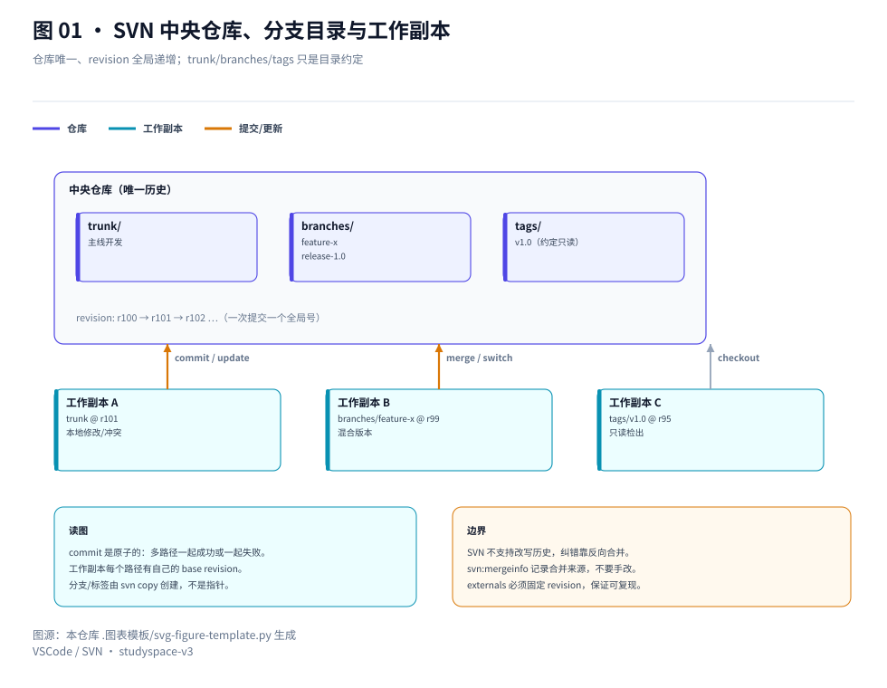

# SVN 工作流与脚本化

一句话结论：SVN 是**集中式版本控制**：仓库只有一份，提交产生全局递增的 revision，工作副本记录每个文件的基线版本；trunk/branches/tags 只是目录约定，不是 Git 那样的引用对象。

> 本篇定位：仓库/工作副本模型、revision 与混合版本、update/commit/merge、属性与冲突、凭据与批量脚本。Git 的对象模型见 [Git 对象模型与引用](../61-Git/00-Git对象模型与引用.md)，脚本工程化见 [脚本工程化与自动化案例](../../50-软件开发/53-Shell/02-脚本工程化与自动化案例.md)。

## 目录

- [1 一句话模型](#s1)
- [2 速览](#s2)
- [3 仓库、工作副本与字段](#s3)
- [4 提交、更新与合并流程](#s4)
- [5 状态机与定时器](#s5)
- [6 设计取舍与边界](#s6)
- [7 与相邻主题的关系](#s7)
- [名词解释](#名词解释)
- [8 参考与关联](#s8)

## 1 · 一句话模型

```text
中央仓库（唯一历史，全局 revision）
   ├─ trunk/      主线
   ├─ branches/   分支（目录复制）
   └─ tags/       标签（目录复制，约定只读）
        ▲  commit / update
        │
   工作副本（.svn 元数据 + 每个文件的 base revision）
```

三个关键认知：

1. **提交是全局的**：一次 commit 原子地提交多个路径，仓库 revision 加一；没有“每个文件各自的历史链”。
2. **工作副本是混合版本**：不同文件可以停在不同 revision，`svn update` 才把它们拉到目标版本。
3. **分支/标签是复制出来的目录**：服务端用廉价复制实现，但语义靠团队约定；没有 Git 的“指针”概念。

## 2 · 速览

| 项 | 内容 |
| --- | --- |
| 所属层/领域 | 集中式版本控制 |
| 核心对象 | repository、revision、working copy、trunk/branches/tags |
| 关键参数 | `-r`、`--depth`、`--set-depth`、`svn:mergeinfo`、`svn:externals` |
| 典型场景 | 传统企业仓库、嵌入式大仓、需要目录级权限的团队 |
| 主要标准 | Subversion 官方手册、WebDAV/DeltaV（HTTP 访问） |

## 3 · 仓库、工作副本与字段

### 3.1 仓库布局与访问方式

| 访问方式 | 服务端 | 特点 | 边界 |
| --- | --- | --- | --- |
| `file://` | 无 | 本地直接访问仓库 | 只适合本机/共享盘，不适合多人 |
| `svn://` | `svnserve` | 轻量，默认 3690 端口 | 认证/授权能力较简单 |
| `http(s)://` | Apache + mod_dav_svn | 穿越代理/防火墙方便，支持细粒度权限 | 配置复杂，依赖 Web 服务器 |
| `svn+ssh://` | SSH | 复用系统账号 | 权限模型受 SSH 限制 |

仓库布局约定：

```text
repo/
├── trunk/          主线开发
├── branches/       功能/发布分支
└── tags/           发布快照（约定只读）
```

SVN 不会强制这些名字；`tags/` 也可以被提交，所以“标签不可变”靠权限或流程保证。

### 3.2 工作副本与状态码

| 状态码 | 含义 | 处理 |
| --- | --- | --- |
| ` ` | 无变化 | — |
| `A` | 计划新增 | commit 后进入仓库 |
| `D` | 计划删除 | commit 后从仓库删除 |
| `M` | 内容/属性修改 | diff 后 commit |
| `R` | 替换（删后加） | 注意历史是否连续 |
| `C` | 冲突 | 解决后 `svn resolve` |
| `?` | 未受控 | `svn add` 或加入 ignore |
| `!` | 受控但本地丢失 | `svn revert` 或 `svn delete` |
| `~` | 类型冲突（文件变目录等） | 手工处理 |

### 3.3 常用属性

| 属性 | 作用 | 边界 |
| --- | --- | --- |
| `svn:ignore` | 目录级忽略模式 | 不是全局 ignore；只影响当前目录 |
| `svn:externals` | 把其他仓库/路径挂进来 | 版本要固定，否则构建不可复现 |
| `svn:needs-lock` | 提示先加锁再编辑 | 只是约定，服务端仍可能允许强写 |
| `svn:executable` | 可执行位 | 跨平台/文件系统可能丢失 |
| `svn:mime-type` | 内容类型 | 影响 diff/合并策略 |
| `svn:eol-style` | 换行风格 | 跨 Windows/Linux 仓库必须统一 |
| `svn:mergeinfo` | 合并追踪 | 手工改容易破坏合并历史 |

## 4 · 提交、更新与合并流程

### 4.1 中央仓库与工作副本



**读图**：上方是唯一的中央仓库，trunk/branches/tags 都是目录；下方多个工作副本各自记录 base revision。commit 把本地变更原子写回仓库并生成新 revision，update 把仓库变更合进工作副本。

> 图源：`images/图01-SVN模型.svg`

### 4.2 日常提交路径

```bash
svn checkout https://svn.example.com/repo/trunk myproj
cd myproj
svn status
svn diff
svn add new_file.c
svn delete old_file.c
svn commit -m "feat: add new_file"
svn update
```

顺序要点：

1. 提交前先 `svn update`，减少过期（out-of-date）失败。
2. `svn status` 区分 `?`（未受控）和 `!`（丢失）；前者 add，后者 revert/delete。
3. `svn commit` 是原子的：任何一个路径失败，整次提交不生效。
4. 提交后 revision 全局递增；记录 revision 比记录时间更可靠。

异常分支：

- **`svn: E155011: File is out of date`**：别人先提交了同一路径；先 update，解决冲突后再 commit。
- **冲突文件**：SVN 生成 `.mine`、`.rOLD`、`.rNEW` 三个版本；编辑冲突标记后 `svn resolve --accept=working <file>`。
- **误删本地文件**：`svn revert <file>` 从 base revision 恢复；已经 commit 的删除要用反向合并。
- **提交了错误文件**：`svn merge -c -rN .` 反向合并该 revision，再提交；不要直接改历史（SVN 不支持重写）。

### 4.3 分支与合并

```bash
# 从 trunk 创建分支（服务端廉价复制）
svn copy ^/trunk ^/branches/feature-x -m "create feature branch"

# 在分支工作副本里同步 trunk 的变更
svn merge ^/trunk
svn commit -m "merge trunk into feature-x"

# 功能完成后合回 trunk
svn switch ^/trunk
svn merge ^/branches/feature-x
svn commit -m "merge feature-x"
```

合并要点：

- `svn merge` 会把合并来源记录到 `svn:mergeinfo`，用于避免重复合并；不要手工编辑该属性。
- 合并冲突的解决方式与 update 冲突相同；合并后要本地构建/测试再提交。
- 老版本（1.8 之前）需要 `--reintegrate` 做“回流合并”；新版本已统一，具体以 `svn help merge` 为准。
- 分支之间长期不同步会让合并越来越痛；定期把 trunk 合到分支，而不是最后一次性合并。

### 4.4 凭据与免密

| 方式 | 做法 | 风险/边界 |
| --- | --- | --- |
| 交互输入 | 首次 `svn up --username ...` | 每次输入，适合临时操作 |
| 凭据缓存 | `~/.subversion/auth/` 保存 | 明文/简单加密，注意主机安全 |
| `--password` | 命令行传参 | 会进入 shell history/进程列表，不推荐 |
| `--password-from-stdin` | 从标准输入读 | 较新版本支持；脚本里更安全 |
| SSH 密钥 | `svn+ssh://` | 复用系统账号，权限粒度粗 |

不要把密码写进脚本、仓库或 CI 日志；需要自动化时用凭据管理器/环境变量注入，并限制文件权限。

### 4.5 批量脚本的模式

源仓库里的脚本大致分四类，可以抽象成通用模式：

| 脚本 | 作用 | 关键点 |
| --- | --- | --- |
| 下载/检出 | 按 URL、目录、账号拉代码 | 参数校验、超时、重试退避 |
| 新增/删除 | 扫描 `svn status` 的 `?`/`!` 并批量 add/delete | 排除日志文件自身，避免递归 |
| 上传 | `svn commit` 失败重试 | 幂等、锁、错误分类 |
| 清理/回滚 | revert 丢失文件、清理未受控文件 | `--force` 前必须 dry-run |

脚本化原则：

- 先 `svn status --xml` 或固定列解析，别用 `awk '{print $2}'` 硬切含空格路径。
- 批量 add/delete 要排除脚本自己生成的日志文件。
- commit 重试要区分“网络超时”和“冲突/权限拒绝”；后者重试无意义。
- 清理类脚本默认 dry-run，`--force` 才真正删除。

## 5 · 状态机与定时器

| 对象 | 状态 | 说明 |
| --- | --- | --- |
| 工作副本路径 | base revision → 修改 → 冲突 → 已解决 | 每个路径独立记录 revision |
| 合并 | 未合并 → 合并中 → 冲突 → 已解决/已提交 | `svn:mergeinfo` 记录来源 |
| 锁 | 未锁 → 加锁 → 释放/过期 | `svn:needs-lock` 只是提示 |
| 提交 | 准备 → 传输 → 成功/失败 | 原子提交，失败不留半成品 |

定时器/超时：`svn` 客户端的网络超时、锁的过期（服务端钩子/管理员策略）、凭据缓存有效期。SVN 没有 Git reflog 那样的本地恢复机制，误操作要靠反向合并或备份。

## 6 · 设计取舍与边界

- **集中式的取舍**：权限、目录级控制、大二进制仓库更直观；代价是强依赖网络和中央服务器，离线历史能力弱。
- **全局 revision 的取舍**：定位简单（`-c r12345`），但每次提交都会推进全局号，不能像 Git 那样按分支独立演进。
- **分支是目录复制**：理解成本低，但分支多了会占仓库空间/管理成本；没有 Git 的轻量指针。
- **混合版本是双刃剑**：允许局部更新，适合大仓库；但构建/测试时要明确“我到底在哪个 revision”。
- **`svn:externals` 谨慎使用**：方便复用，但会把依赖版本藏进属性里；必须固定 revision，避免“今天能编、明天不能编”。
- **二进制文件**：SVN 能存，但每次都存整份差异，仓库会膨胀；大产物放制品库。
- **常见误判**：`svn update` 成功不代表工作副本干净；`svn status` 仍可能显示本地修改。`svn revert` 只恢复受控文件，不会删除未跟踪文件。

## 7 · 与相邻主题的关系

| 相邻对象 | 关系 |
| --- | --- |
| [Git 对象模型与引用](../61-Git/00-Git对象模型与引用.md) | 分布式内容寻址 vs 集中式全局 revision |
| [Git 分支与历史重写](../61-Git/01-分支与历史重写.md) | SVN 不支持改写历史，只能用反向合并修正 |
| [脚本工程化与自动化案例](../../50-软件开发/53-Shell/02-脚本工程化与自动化案例.md) | 批量 add/commit/clean 的参数、锁、重试模式 |
| [WSL 文件系统与网络互通](../63-WSL/01-文件系统与网络互通.md) | 跨系统换行/权限会影响 `svn:eol-style` 与可执行位 |

一句话边界：本篇讲 SVN 的仓库/工作副本模型和脚本化；Git 的分布式模型不在这里重复。

## 名词解释

> 缩写给出英文全称；非缩写用“—”表示。

| 术语 | 英文全称 | 解释 |
| --- | --- | --- |
| SVN | Subversion | 集中式版本控制系统。 |
| VCS | Version Control System | 版本控制系统。 |
| repository | — | 中央仓库，保存全部受控历史和目录树。 |
| revision | — | 全局递增的版本号，一次提交一个号。 |
| working copy | — | 本地工作副本，含 `.svn` 元数据和文件。 |
| trunk | — | 主线目录约定。 |
| branch | — | 分支目录，通常由 `svn copy` 创建。 |
| tag | — | 标签目录，约定只读的快照。 |
| mergeinfo | — | `svn:mergeinfo` 属性，记录已合并的来源范围。 |
| externals | — | `svn:externals` 属性，把外部路径挂进当前目录。 |
| base revision | — | 工作副本中某文件上次更新到的版本。 |
| out-of-date | — | 工作副本路径落后于仓库，提交会被拒绝。 |
| RA | Repository Access | SVN 的仓库访问层（HTTP/SSH/svn/file）。 |
| WebDAV | Web Distributed Authoring and Versioning | HTTP 扩展协议，SVN over HTTP 的基础。 |
| FSFS | Fast Secure File System | SVN 常用仓库后端之一。 |

## 8 · 参考与关联

**标准**

- Apache Subversion 官方手册（`svn help`、`svnbook`）
- WebDAV/DeltaV（HTTP 访问）
- Subversion 1.8+ 合并追踪说明

**关联**

- [Git 对象模型与引用](../61-Git/00-Git对象模型与引用.md)
- [Git 分支与历史重写](../61-Git/01-分支与历史重写.md)
- [脚本工程化与自动化案例](../../50-软件开发/53-Shell/02-脚本工程化与自动化案例.md)
- [WSL 文件系统与网络互通](../63-WSL/01-文件系统与网络互通.md)

---

> **本篇定位**：SVN 集中式模型、日常提交/合并与批量脚本模式。
> **素材来源**：`studyspace-v2/10.工程方法/3.开发环境/05-svn.md`、`studyspace/4.其他技能/2.shell/svn相关/*.sh`（脚本模式，已去除账号与密码）。
> **待验证**：`--password-from-stdin`、`--reintegrate` 等参数随 SVN 版本变化，使用前以本机 `svn help` 为准。
