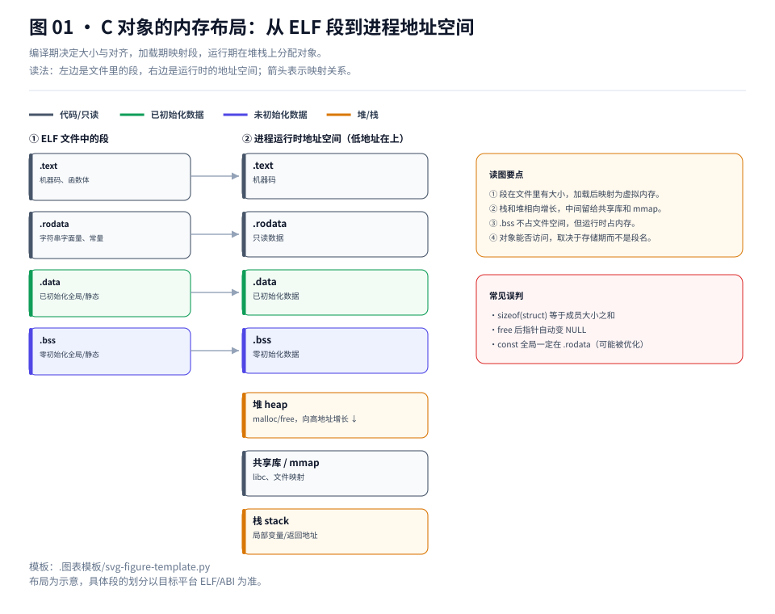

# C 语言对象与内存模型

一句话结论：C 程序里的一切都是**对象**（一块有类型、有存储期的内存），指针只是“带类型的地址”；把「存储期 + 作用域 + 链接属性 + 对象表示」四件事分开看，绝大多数内存问题都能定位到具体一层。

> 本篇定位：讲 C 的对象、存储期、进程内存布局、对齐与字节序。指针运算与数组退化见 [01-指针数组与字符串](./01-指针数组与字符串.md)，结构体布局见 [02-结构体联合与位域](./02-结构体联合与位域.md)，工具链与链接细节见 [65-构建与调试](./../65-构建与调试/00-从源码到可执行文件.md)。

## 目录

- [1 一句话模型](#s1)
- [2 速览](#s2)
- [3 类型、存储期与对象表示](#s3)
- [4 进程内存布局与对象生命周期](#s4)
- [5 状态机与定时器](#s5)
- [6 设计取舍与边界](#s6)
- [7 与相邻主题的关系](#s7)
- [名词解释](#名词解释)
- [8 参考与关联](#s8)

## 1 · 一句话模型

```text
源代码（类型/作用域/链接属性）
   │ 编译期：决定“谁能看见谁”“对象多大、怎么对齐”
   ▼
目标文件（.text/.rodata/.data/.bss + 符号表）
   │ 链接期：决定“符号落到哪个地址”
   ▼
进程（代码段 + 数据段 + 堆 ↑ + 栈 ↓ + 共享库/线程栈）
```

三个关键认知：

1. **类型决定解释方式，不决定存储位置**：同一个地址按 `int` 读和按 `float` 读，结果由对象表示和 ABI 决定。
2. **存储期决定“什么时候有效”**：栈对象随函数返回失效，`static` 对象活到进程结束，`malloc` 对象活到 `free`。
3. **对齐是 ABI 的一部分**：结构体大小、`sizeof`、跨模块传参都依赖它，不能用“我这边算出来是 12”去假设对方。

## 2 · 速览

| 项 | 内容 |
| --- | --- |
| 所属层/领域 | C 语言运行时模型 |
| 核心对象 | 变量（对象）、指针、函数、翻译单元 |
| 关键参数 | 存储期、作用域、链接属性、`sizeof`、对齐、字节序 |
| 典型场景 | 内存踩踏、悬垂指针、跨平台解析二进制、结构体跨模块传参 |
| 主要标准 | ISO C11/C17（N1570） |

## 3 · 类型、存储期与对象表示

### 3.1 三个正交属性

| 属性 | 取值 | 决定什么 | 典型写法 |
| --- | --- | --- | --- |
| 存储期 | 自动 / 静态 / 线程 / 动态分配 | 对象何时创建、何时失效 | 局部变量、`static`、`_Thread_local`、`malloc` |
| 作用域 | 块 / 文件 / 函数原型 / 函数 | 名字在源码哪里可见 | `{}`、文件顶层、参数列表 |
| 链接属性 | 无链接 / 内部 / 外部 | 符号能否跨翻译单元解析 | 局部变量 / `static` 全局 / 普通全局 |

三者互不绑定：`static` 在函数内表示“静态存储期 + 块作用域”，在文件层表示“静态存储期 + 内部链接”。**“static 就是全局变量”是常见误读**。

### 3.2 基本类型的最小保证

| 类型 | 最小宽度 | 常见宽度（32/64 位） | 边界 |
| --- | --- | --- | --- |
| `char` | 8 bit | 8 | 是否有符号由实现决定，存字节用 `unsigned char`/`uint8_t` |
| `short` | 16 bit | 16 | 跨平台协议字段不要直接用 |
| `int` | 16 bit | 32 | 标准只保证 ≥16 位 |
| `long` | 32 bit | 32（ILP32）/ 64（LP64） | Windows LLP64 下仍是 32 位 |
| `long long` | 64 bit | 64 | 需要固定 64 位时优先 `<stdint.h>` |
| 指针 | 未规定 | 4 / 8 | 不能假定与 `int` 同宽，转整数用 `uintptr_t` |

需要“确定宽度”的场合（协议字段、寄存器、文件格式）只用 `stdint.h` 的 `uint8_t/uint16_t/uint32_t/uint64_t`；需要“至少 N 位”时用 `uint_leastN_t`。

### 3.3 对象表示：对齐、填充、字节序

| 概念 | 规则 | 影响 | 边界 |
| --- | --- | --- | --- |
| 对齐（alignment） | 对象地址通常是其对齐值的整数倍 | 未对齐访问在 x86 上变慢、在部分 ARM 上触发异常 | 用 `_Alignof`/`alignof` 查，不要手算 |
| 填充（padding） | 成员之间和结构体尾部可能插入空洞 | `sizeof(struct)` 大于成员之和 | 比较结构体不能用 `memcmp` |
| 字节序 | 多字节对象的字节排列顺序 | 跨平台/网络解析出错 | 单字节无字节序问题 |

以 `0x12345678` 存到地址 `0x00..0x03` 为例：

| 地址 | 大端（Big-endian） | 小端（Little-endian） |
| --- | --- | --- |
| 0x00 | 0x12（高位） | 0x78（低位） |
| 0x01 | 0x34 | 0x56 |
| 0x02 | 0x56 | 0x34 |
| 0x03 | 0x78（低位） | 0x12（高位） |

网络字节序固定为大端，转换用 `htons/htonl/ntohs/ntohl`。判断主机字节序可用 `union { uint32_t v; uint8_t b[4]; }`，不要用“指针强转 + 解引用”的写法（违反严格别名规则）。

```c
static int host_is_little_endian(void)
{
    union { uint32_t v; uint8_t b[4]; } u = { .v = 0x01020304u };
    return u.b[0] == 0x04u;
}
```

## 4 · 进程内存布局与对象生命周期



**读图**：左侧是 ELF 文件里的段，右侧是进程运行时的地址空间。`.data/.bss` 在加载时映射，堆向上长、栈向下长，中间是共享库和 `mmap` 区。箭头表示“文件里的段 → 运行时的内存”。

> 图源：`images/图01-C对象内存布局.svg`

### 4.1 各区域职责

| 区域 | 内容 | 存储期 | 可写 | 典型问题 |
| --- | --- | --- | --- | --- |
| `.text` | 机器码、只读常量池 | 进程 | 否 | 写代码段直接段错误 |
| `.rodata` | 字符串字面量、`const` 全局 | 进程 | 否 | 修改字面量是 UB |
| `.data` | 已初始化且非零的全局/静态 | 进程 | 是 | 跨模块重复定义 |
| `.bss` | 未初始化或零初始化的全局/静态 | 进程 | 是 | 误以为“不占空间”就没有成本 |
| 堆 | `malloc/calloc/realloc` | 到 `free` | 是 | 泄漏、双重释放、越界 |
| 栈 | 自动变量、返回地址、寄存器保存 | 到函数返回 | 是 | 返回局部变量地址、栈溢出 |
| 共享库/`mmap` | 动态库、文件映射、大块分配 | 到 `munmap` | 视映射 | 权限与生命周期不匹配 |

### 4.2 正常路径

1. **编译期**：每个翻译单元独立编译，类型和 `static` 对象布局在此确定。
2. **链接期**：外部符号解析，`.data/.bss/.text` 合并，生成虚拟地址。
3. **加载期**：loader 映射段，把 `.bss` 清零，重定位动态符号。
4. **运行期**：函数调用在栈上分配帧；`malloc` 在堆上分配块；`static` 对象在首次进入作用域前已就绪（C 中不做动态初始化）。
5. **退出期**：`main` 返回或 `exit()` 触发 `atexit`，进程整体回收；堆上未 `free` 的块由操作系统回收，但**长期运行的程序不能依赖这一点**。

### 4.3 异常分支

| 现象 | 优先检查 | 说明 |
| --- | --- | --- |
| 函数返回后数据变成随机值 | 是否返回了局部数组/局部变量地址 | 栈帧已被复用，属于悬垂指针 |
| 结构体跨模块大小不一致 | 头文件版本、编译宏、`#pragma pack` | ABI 不一致，链接器不会报错 |
| 解析出的整数明显颠倒 | 字节序转换是否遗漏 | 协议字段统一按网络序处理 |
| 只有优化后才出错 | 严格别名、未定义行为、数据竞争 | `-O0` 能跑不代表代码正确 |
| 大数组导致崩溃 | 栈大小限制（`ulimit -s`） | 大缓冲区改用堆或静态区 |

## 5 · 状态机与定时器

没有协议状态机。对象只有**生命周期状态**：

```text
未分配 → 已分配（有效） → 已释放（失效）
              ↑                │
              └── realloc ─────┘（旧地址可能失效）
```

没有定时器；对象的“过期”完全由代码路径决定。需要引用计数或超时回收时，由上层（连接管理、缓存）实现，不属于 C 语言模型。

## 6 · 设计取舍与边界

- **为什么允许未定义行为**：编译器需要假设“程序员不会写越界、不会别名冲突”，才能做向量化和重排；代价是错误可能延迟到很远的地方才暴露。
- **为什么栈分配快**：只移动栈指针，不需要找空闲块；代价是大小固定、生命周期受函数边界约束，大对象会撞栈上限。
- **为什么堆分配灵活但有成本**：需要管理元数据和碎片；实时性要求高的路径应使用**预分配内存池**，而不是在中断或收包路径 `malloc`。
- **对齐的取舍**：更大对齐提升访问效率，但增加内存占用；协议结构体常用 `#pragma pack(1)` 换取紧凑布局，代价是访问变慢甚至总线异常，且结构体不能再直接按成员访问未对齐字段。
- **常见误判**：`free(p)` 只释放内存，不会把 `p` 置空；`memset` 清零不能修复悬垂指针；`sizeof(数组参数)` 得到的是指针大小。

## 7 · 与相邻主题的关系

| 相邻对象 | 关系 |
| --- | --- |
| [01-指针数组与字符串](./01-指针数组与字符串.md) | 讲地址运算、数组退化、字符串边界 |
| [02-结构体联合与位域](./02-结构体联合与位域.md) | 讲对象布局的具体规则 |
| [04-嵌入式C工程实践](./04-嵌入式C工程实践.md) | 讲这些规则在中断、并发、内存池里的落地 |
| [65-构建与调试/00-从源码到可执行文件](../65-构建与调试/00-从源码到可执行文件.md) | 讲段、符号、链接器和 ELF 的工具视角 |
| [62-数据结构与算法](../62-数据结构与算法/00-复杂度与结构选型.md) | 讲堆/栈之外的容器选择 |

一句话边界：本篇讲“对象在哪里、活多久、怎么表示”，不讲“怎么编译链接”。

## 名词解释

> 缩写给出英文全称；非缩写用“—”表示。

| 术语 | 英文全称 | 解释 |
| --- | --- | --- |
| 对象 | Object | 一块有类型、有存储期的内存区域；变量、数组元素都是对象。 |
| 存储期 | Storage Duration | 对象保持有效的时间段，分为自动、静态、线程和动态分配。 |
| 链接属性 | Linkage | 符号能否跨翻译单元解析，分为外部、内部和无链接。 |
| 翻译单元 | Translation Unit | 一个 `.c` 文件连同其 `#include` 展开后的完整编译输入。 |
| 对齐 | Alignment | 对象地址必须是某个值的整数倍；由 ABI 规定。 |
| 填充 | Padding | 为满足对齐在成员之间或末尾插入的无名字节。 |
| 字节序 | Endianness | 多字节对象在内存中的字节排列顺序，分大端和小端。 |
| UB | Undefined Behavior | 标准未规定结果的行为，编译器可假设其不发生。 |
| ABI | Application Binary Interface | 二进制层面的调用约定、类型布局和符号规则。 |
| ELF | Executable and Linkable Format | Linux 下可执行文件、目标文件和共享库的格式。 |
| BSS | Block Started by Symbol | 存放未初始化/零初始化全局与静态对象的段。 |
| TLS | Thread-Local Storage | 线程私有存储，对应 `_Thread_local` 对象。 |

## 8 · 参考与关联

**标准**

- ISO/IEC 9899:2018（C17），对象、存储期、对齐与类型表示章节。
- System V ABI / AAPCS：具体平台的类型布局与调用约定。

**关联**

- [01-指针数组与字符串](./01-指针数组与字符串.md)
- [02-结构体联合与位域](./02-结构体联合与位域.md)
- [04-嵌入式C工程实践](./04-嵌入式C工程实践.md)
- [65-构建与调试/00-从源码到可执行文件](../65-构建与调试/00-从源码到可执行文件.md)

---

> **本篇定位**：C 语言层的对象与内存模型，是后续指针、结构体、嵌入式实践的地基。
> **素材来源**：`studyspace/2.编程技能/1.C语言/大小端.md`、`结构体.md`（已重写并补齐模型）。
> **待验证**：具体平台的 `long` 宽度、默认对齐和栈上限以目标工具链为准。
