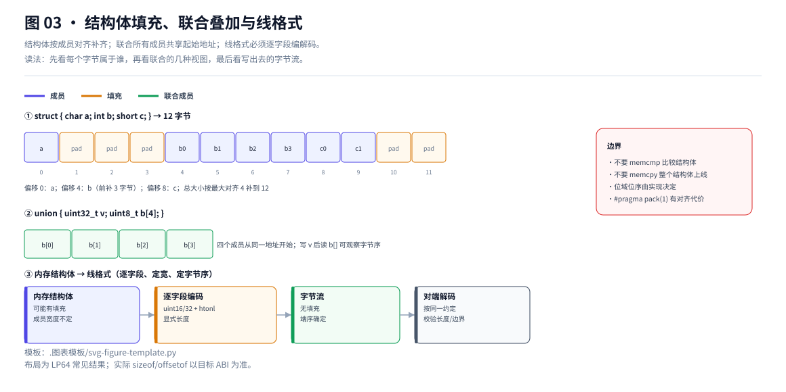

# 结构体、联合与位域

一句话结论：结构体是**按成员顺序排列、按最大对齐要求补齐**的对象；联合是**所有成员共享起始地址**；位域是“用位宽描述的整数成员”，布局由实现决定。跨模块、跨平台传结构体之前，先确认布局规则是否一致。

> 本篇定位：讲结构体布局、填充、柔性数组、联合的类型双关和位域的可移植性。对齐与字节序的基础见 [00-C语言对象与内存模型](./00-C语言对象与内存模型.md)，指针与数组见 [01-指针数组与字符串](./01-指针数组与字符串.md)。

## 目录

- [1 一句话模型](#s1)
- [2 速览](#s2)
- [3 布局规则与字段表](#s3)
- [4 序列化与访问流程](#s4)
- [5 状态机与定时器](#s5)
- [6 设计取舍与边界](#s6)
- [7 与相邻主题的关系](#s7)
- [名词解释](#名词解释)
- [8 参考与关联](#s8)

## 1 · 一句话模型

```text
struct S { char a; int b; short c; };
偏移:  0        4        8      10    (尾部补到 12)
       [a][pad][  b  ][ c ][pad]
```

三个关键认知：

1. **偏移由“当前偏移按成员对齐向上取整”决定**，结构体总大小再按“最大成员对齐”向上取整。
2. **联合的大小 = 最大成员大小（再按最大对齐补齐）**，所有成员从同一地址开始解释。
3. **位域的位序、跨存储单元规则、是否能跨越类型边界，标准都没有完全规定**，只适合“本编译器内部使用”，不适合直接作为线格式。

## 2 · 速览

| 项 | 内容 |
| --- | --- |
| 所属层/领域 | C 语言复合类型与 ABI |
| 核心对象 | `struct`、`union`、位域、柔性数组 |
| 关键参数 | 成员顺序、对齐、`sizeof`、`offsetof`、位宽 |
| 典型场景 | 协议头、寄存器映射、配置结构、变长消息 |
| 主要标准 | ISO C11/C17 6.7.2.1（结构与联合）、6.7.2.1p4（位域） |

## 3 · 布局规则与字段表

### 3.1 布局计算规则

| 规则 | 说明 | 示例 |
| --- | --- | --- |
| 成员顺序固定 | 按声明顺序排列，编译器不能随意重排 | 调整顺序可减少填充 |
| 成员对齐 | 成员偏移必须是其对齐值的倍数 | `char` 后接 `int` 会补 3 字节 |
| 结构体对齐 | 等于成员中最大对齐值 | 含 `double` 的结构体按 8 对齐 |
| 尾部补齐 | 总大小必须是结构体对齐的倍数 | 便于数组连续存放 |
| 位域打包 | 相邻同类型位域可能共享存储单元 | 具体位序由 ABI 决定 |

```c
#include <stddef.h>

struct sample {
    char  a;    /* 偏移 0 */
    int   b;    /* 偏移 4，前面补 3 字节 */
    short c;    /* 偏移 8 */
};              /* sizeof = 12，alignof = 4 */

/* 编译期断言，布局变化会直接报错 */
_Static_assert(sizeof(struct sample) == 12, "layout changed");
_Static_assert(offsetof(struct sample, b) == 4, "layout changed");
```

`offsetof` 定义在 `<stddef.h>`，用于 C 结构体/联合成员；含虚函数或复杂继承的 C++ 类型不要使用。

### 3.2 成员类型与边界

| 成员形式 | 作用 | 边界与误判 |
| --- | --- | --- |
| 普通成员 | 按值存储 | 结构体赋值是浅拷贝，指针成员仍共享 |
| 指针成员 | 引用外部对象 | 生命周期不由结构体管理，需明确“谁释放” |
| 柔性数组成员 `data[]` | 结构体尾部跟变长数据 | 必须是最后一个成员；`sizeof` 只算头部，不含变长数据 |
| 匿名联合/结构体 | 提供多种视图 | C11 支持，C99 需编译器扩展 |
| 位域 `unsigned x:3` | 节省空间、映射寄存器 | 不能取地址，位序和符号性依实现 |

柔性数组示例：

```c
struct msg {
    uint16_t len;
    uint8_t  type;
    uint8_t  data[];   /* 不占 sizeof，实际长度由分配决定 */
};

struct msg *m = malloc(sizeof(*m) + payload_len);
if (m) {
    m->len = payload_len;
    memcpy(m->data, payload, payload_len);
}
```

边界：`sizeof(struct msg)` 通常为 4（含 1 字节尾部填充），分配时必须用 `sizeof(*m) + n`，不能假设 `data` 紧跟 `type`。

### 3.3 联合的两种用法

| 用法 | 写法 | 是否推荐 | 说明 |
| --- | --- | --- | --- |
| 共享存储、互斥字段 | `union { int i; float f; }` | 推荐 | 同一时刻只用一个成员 |
| 类型双关（type punning） | 写 `u.i` 读 `u.f` | 不推荐 | C 标准只对结构体“公共初始序列”有明确保证，跨类型读多为实现定义/未指定 |
| 按字节观察对象 | `union { uint32_t v; uint8_t b[4]; }` | 推荐 | 用于字节序检测，合法且常见 |
| 安全的位模式转换 | `memcpy(&f, &i, sizeof f)` | 推荐 | 不违反严格别名规则 |

## 4 · 序列化与访问流程



**读图**：上半部分是 `char/int/short` 的填充过程；中间是联合所有成员从同一地址开始；下半部分是“内存结构体 → 字节流”的序列化路径，必须逐字段按约定宽度和字节序写入。

> 图源：`images/图03-结构体联合位域.svg`

### 4.1 正常路径

1. **定义布局**：按“大对齐成员在前、小成员在后”排列，减少填充。
2. **编译期校验**：用 `_Static_assert` 固定 `sizeof` 和关键偏移，布局变化在编译期暴露。
3. **访问成员**：编译器按“基址 + 偏移”生成访问指令；未对齐访问在部分架构上需要特殊指令。
4. **跨模块传递**：所有模块包含同一份头文件，且编译宏（如 `#pragma pack`）一致。
5. **序列化**：按字段逐个写入固定宽度整数，显式做字节序转换；不直接 `memcpy` 整个结构体。

### 4.2 异常分支

| 现象 | 优先检查 | 说明 |
| --- | --- | --- |
| 两端 `sizeof` 不同 | 编译宏、`#pragma pack`、编译器版本 | 链接器不校验结构体布局 |
| 结构体比较总是不相等 | 填充字节内容未初始化 | 用逐字段比较，不用 `memcmp` |
| 位域读写值与预期相反 | 位序（MSB/LSB first） | 不要用位域直接解析网络协议 |
| 读取寄存器值异常 | volatile、访问宽度、对齐 | 寄存器映射需 `volatile` 且宽度匹配 |
| 变长消息越界 | 柔性数组分配长度 | 校验 `len` 与总分配大小 |

### 4.3 线格式的三条规则

1. **固定宽度**：只用 `uint8_t/uint16_t/uint32_t`，不用 `int/long`。
2. **固定字节序**：多字节字段统一转网络序，或明确规定小端。
3. **逐字段编解码**：不要 `memcpy` 整个结构体，填充字节和位域布局不可移植。

## 5 · 状态机与定时器

没有状态机，也没有定时器。结构体只是**被动布局**；如果结构体里带状态字段（如 `state`、`retry`），状态迁移由上层逻辑驱动，布局本身不约束迁移。

## 6 · 设计取舍与边界

- **为什么有填充**：让每个成员按自然边界对齐，换取访问效率；代价是空间浪费和“不能按字节比较”。
- **为什么允许柔性数组**：一次分配“头 + 变长数据”，减少内存碎片和二次分配；代价是长度字段必须自己维护，且不能按值复制。
- **为什么位域不适合协议**：标准只规定“至少能表示给定位宽”，位序、跨单元、是否压缩都留给实现；协议解析应使用显式移位和掩码。
- **`#pragma pack(1)` 的代价**：结构体变紧凑，但成员可能未对齐，部分架构访问会异常或显著变慢；只在“必须匹配外部格式且只做字节拷贝”时使用。
- **常见误判**：`sizeof(struct)` 等于成员大小之和；联合可以“随便读另一个成员”；结构体赋值会深拷贝指针成员。

## 7 · 与相邻主题的关系

| 相邻对象 | 关系 |
| --- | --- |
| [00-C语言对象与内存模型](./00-C语言对象与内存模型.md) | 对齐、填充、字节序的通用规则 |
| [01-指针数组与字符串](./01-指针数组与字符串.md) | 结构体指针、成员访问、回调表 |
| [03-宏预处理与编译链接](./03-宏预处理与编译链接.md) | 用宏做布局断言、条件编译不同 ABI |
| [04-嵌入式C工程实践](./04-嵌入式C工程实践.md) | 寄存器映射、消息结构、内存池对象头 |

一句话边界：本篇讲“内存怎么排”，不讲“协议字段怎么定义”。

## 名词解释

> 缩写给出英文全称；非缩写用“—”表示。

| 术语 | 英文全称 | 解释 |
| --- | --- | --- |
| 结构体 | Structure | 按声明顺序把多个成员组合成一个对象。 |
| 联合 | Union | 所有成员共享同一块存储，大小取最大成员。 |
| 位域 | Bit-field | 用位宽声明的整数成员，布局由实现决定。 |
| 填充 | Padding | 为满足对齐插入的无名字节。 |
| 柔性数组成员 | Flexible Array Member | 结构体末尾长度未定的数组，需额外分配空间。 |
| 偏移 | Offset | 成员地址相对结构体起始地址的字节数。 |
| 类型双关 | Type Punning | 用另一种类型解释同一块内存的位模式。 |
| 严格别名 | Strict Aliasing | 编译器假设不同类型的指针不指向同一对象，从而提高优化。 |
| ABI | Application Binary Interface | 二进制层面的类型布局、对齐和调用约定。 |
| 线格式 | Wire Format | 实际在链路上传输的字节布局，必须与内存布局解耦。 |

## 8 · 参考与关联

**标准**

- ISO/IEC 9899:2018，6.7.2.1（结构与联合说明符）、6.7.2.1p4（位域）。
- 目标平台 ABI 文档：结构体传参、位域位序、对齐规则。

**关联**

- [00-C语言对象与内存模型](./00-C语言对象与内存模型.md)
- [01-指针数组与字符串](./01-指针数组与字符串.md)
- [03-宏预处理与编译链接](./03-宏预处理与编译链接.md)
- [04-嵌入式C工程实践](./04-嵌入式C工程实践.md)

---

> **本篇定位**：把“结构体大小为什么是 12 不是 7”讲成可计算的规则，并给出线格式的正确做法。
> **素材来源**：`studyspace/2.编程技能/1.C语言/结构体.md`、`链表申请空间.md`（已重写并补齐布局规则）。
> **待验证**：位域位序、`#pragma pack` 的支持粒度以目标编译器和 ABI 为准。
