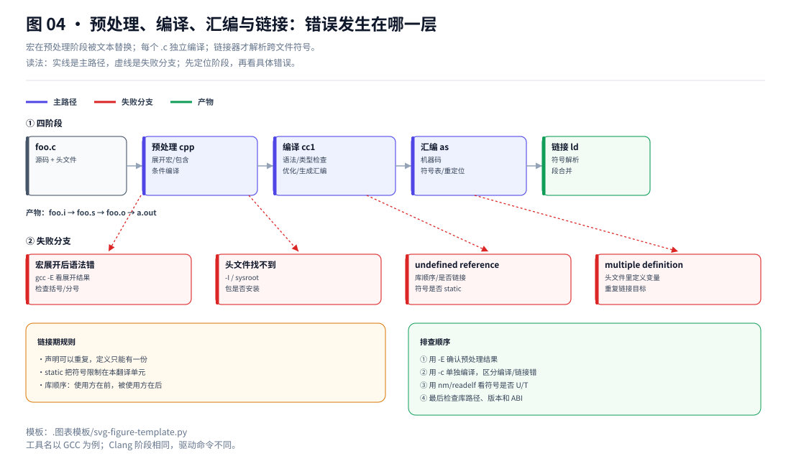

# 宏、预处理与编译链接

一句话结论：预处理是**编译前的纯文本替换**，不理解类型和作用域；编译把每个 `.c` 变成独立目标文件，链接再把符号拼起来。宏用得好是“零开销抽象”，用不好就是“编译器看不见的 bug”。

> 本篇定位：讲宏的展开规则、条件编译、头文件组织，以及 C 语言层的声明/定义/链接属性。工具链参数、ELF 和库的细节见 [65-构建与调试/00-从源码到可执行文件](../65-构建与调试/00-从源码到可执行文件.md)。

## 目录

- [1 一句话模型](#s1)
- [2 速览](#s2)
- [3 宏与预处理规则](#s3)
- [4 从源文件到符号的流程](#s4)
- [5 状态机与定时器](#s5)
- [6 设计取舍与边界](#s6)
- [7 与相邻主题的关系](#s7)
- [名词解释](#名词解释)
- [8 参考与关联](#s8)

## 1 · 一句话模型

```text
.c + .h ──预处理──► 展开后的 .i ──编译──► .o（符号表）──链接──► 可执行文件
            文本替换              类型检查/生成代码        符号解析/重定位
```

三个关键认知：

1. **宏没有类型、没有作用域、没有调试信息**：展开后出错，报错位置往往指向调用点。
2. **声明可以重复，定义只能有一份**：头文件放声明，`.c` 放定义；`static` 把符号限制在本翻译单元。
3. **链接错误和编译错误是两类问题**：`undefined reference` 是链接期符号找不到，不是语法错。

## 2 · 速览

| 项 | 内容 |
| --- | --- |
| 所属层/领域 | C 预处理与程序构建 |
| 核心对象 | 宏、`#include`、条件编译、符号、目标文件 |
| 关键参数 | `-D`、`-I`、`-include`、`static`、`extern`、`inline` |
| 典型场景 | 日志宏、错误码、平台差异、库接口导出 |
| 主要标准 | ISO C11/C17 第 6.10 节（预处理指令） |

## 3 · 宏与预处理规则

### 3.1 常用指令

| 指令 | 作用 | 边界与误判 |
| --- | --- | --- |
| `#define` | 定义对象宏或函数宏 | 只做文本替换，不计算、不检查类型 |
| `#undef` | 取消宏 | 第三方头文件可能依赖同名宏 |
| `#include` | 插入头文件内容 | `< >` 与 `" "` 的搜索路径不同 |
| `#if/#ifdef/#ifndef` | 条件编译 | 未定义宏在 `#if` 中按 0 处理 |
| `#pragma once` | 头文件只包含一次 | 非标准，但主流编译器都支持 |
| `#error` | 编译期报错 | 适合“配置组合不合法”时立即失败 |
| `#line` | 改变行号/文件名 | 代码生成器常用 |

### 3.2 函数宏的四条纪律

| 纪律 | 错误写法 | 正确写法 | 原因 |
| --- | --- | --- | --- |
| 参数加括号 | `#define SQ(x) x*x` | `#define SQ(x) ((x)*(x))` | 防止 `SQ(a+1)` 展开成 `a+1*a+1` |
| 整体加括号 | `#define NEG(x) -x` | `#define NEG(x) (-(x))` | 防止参与更高优先级运算 |
| 多语句用 `do {} while (0)` | `#define LOG() a(); b()` | `#define LOG() do { a(); b(); } while (0)` | 保证在 `if/else` 中作为单条语句 |
| 避免重复求值 | `#define MAX(a,b) ((a)>(b)?(a):(b))` | 用 `inline` 函数或先存临时变量 | `MAX(i++, j++)` 会自增两次 |

字符串化与拼接：

```c
#define STR(x)        #x          /* 把参数变成字符串字面量 */
#define CAT(a, b)     a##b        /* 预处理期拼接标识符 */
#define ARRAY_LEN(a)  (sizeof(a) / sizeof((a)[0]))

#define LOG(fmt, ...) \
    printf("[%s:%d] " fmt "\n", __FILE__, __LINE__, ##__VA_ARGS__)
```

`##__VA_ARGS__` 是 GNU 扩展，用于“可变参数为空时去掉前面的逗号”；严格 C 标准写法需要 `__VA_OPT__`（C23）或额外设计。

### 3.3 头文件组织

| 内容 | 放哪里 | 说明 |
| --- | --- | --- |
| 函数声明、类型定义、宏 | `.h` | 多个翻译单元共享 |
| 全局变量定义 | `.c` | 头文件里用 `extern` 声明 |
| `static` 函数/变量 | `.c` | 内部链接，避免符号冲突 |
| `static inline` 函数 | `.h` | 每个翻译单元生成一份，适合短小工具函数 |
| 平台相关宏 | 独立 `config.h` | 避免散落在业务头文件 |

```c
#ifndef MODULE_CONFIG_H
#define MODULE_CONFIG_H

#ifdef __cplusplus
extern "C" {
#endif

/* 声明 */
int module_init(void);

#ifdef __cplusplus
}
#endif

#endif /* MODULE_CONFIG_H */
```

`extern "C"` 只影响 C++ 编译时的符号命名，不改变 C 的语义；C 代码里用 `#ifdef __cplusplus` 包住即可。

## 4 · 从源文件到符号的流程



**读图**：宏在预处理阶段被替换；每个 `.c` 独立编译成 `.o`，未解析符号留到链接阶段；链接器按“强符号/弱符号”规则选择定义。右侧是三类典型错误分别发生在哪一层。

> 图源：`images/图04-宏预处理与链接.svg`

### 4.1 正常路径

1. **预处理**：展开 `#include`、宏、条件编译，生成 `.i`。
2. **编译**：语法/类型检查，生成汇编或目标文件；此时只检查“声明是否存在”。
3. **汇编**：生成机器码和符号表，未定义符号标记为 `U`。
4. **链接**：合并目标文件和库，解析符号，完成重定位。
5. **加载**：动态链接器解析共享库符号，必要时延迟绑定。

### 4.2 异常分支

| 现象 | 发生阶段 | 优先检查 |
| --- | --- | --- |
| 宏展开后语法错误 | 预处理/编译 | 用 `gcc -E` 看展开结果，检查括号 |
| `implicit declaration of function` | 编译 | 是否漏包含头文件；C99 起不再隐式声明 |
| `undefined reference to ...` | 链接 | 是否漏链接库、库顺序、符号被 `static` 限制 |
| `multiple definition of ...` | 链接 | 头文件里定义了变量/非 `inline` 函数 |
| 运行时报符号版本不匹配 | 加载 | 共享库版本、`SONAME`、ABI 变化 |
| 改了头文件但没重编 | 构建 | 依赖关系缺失，见 [65/01-Make与CMake](../65-构建与调试/01-Make与CMake.md) |

### 4.3 符号与链接属性

| 写法 | 链接属性 | 多文件可见 | 典型用途 |
| --- | --- | --- | --- |
| `int g;`（文件层） | 外部 | 是 | 全局变量定义 |
| `extern int g;` | 外部 | 是 | 头文件声明 |
| `static int g;` | 内部 | 否 | 模块私有状态 |
| `static void f(void)` | 内部 | 否 | 模块私有函数 |
| `static inline` | 内部 | 否（每单元一份） | 头文件工具函数 |
| `inline`（C99） | 特殊 | 视定义 | 需要配合 `extern` 定义，易踩坑 |

## 5 · 状态机与定时器

没有状态机，也没有定时器。构建过程只有**阶段推进**：预处理 → 编译 → 汇编 → 链接 → 加载；任一阶段失败，后续阶段不会执行。

## 6 · 设计取舍与边界

- **为什么宏仍然必要**：条件编译、日志中的 `__FILE__/__LINE__`、编译期断言、跨平台常量，函数替代不了。
- **为什么宏危险**：它绕过类型系统和调试器；能用 `static inline`、`enum`、`const` 表达的，优先不用宏。
- **为什么头文件只放声明**：避免重复定义和 ABI 耦合；代价是每个使用方都要链接到实现。
- **`static` 的取舍**：减少符号冲突、便于内联，但每个翻译单元一份副本，代码体积可能增大。
- **常见误判**：`#include` 不是“导入模块”，只是文本插入；`#ifdef` 判断的是“是否定义”，不是“值是否为真”。

## 7 · 与相邻主题的关系

| 相邻对象 | 关系 |
| --- | --- |
| [00-C语言对象与内存模型](./00-C语言对象与内存模型.md) | 静态对象、存储期与链接属性的关系 |
| [02-结构体联合与位域](./02-结构体联合与位域.md) | 用宏做布局断言、条件编译不同结构 |
| [04-嵌入式C工程实践](./04-嵌入式C工程实践.md) | 日志宏、错误码宏、模块导出宏 |
| [65-构建与调试/00-从源码到可执行文件](../65-构建与调试/00-从源码到可执行文件.md) | 编译参数、ELF、静态/动态库 |
| [65-构建与调试/01-Make与CMake](../65-构建与调试/01-Make与CMake.md) | 头文件依赖与增量构建 |

一句话边界：本篇讲“宏和符号的语言规则”，不讲“构建系统怎么写”。

## 名词解释

> 缩写给出英文全称；非缩写用“—”表示。

| 术语 | 英文全称 | 解释 |
| --- | --- | --- |
| 预处理 | Preprocessing | 编译前的文本替换阶段，处理宏、包含和条件编译。 |
| 翻译单元 | Translation Unit | 一个源文件及其所有包含内容展开后的编译单位。 |
| 宏展开 | Macro Expansion | 用宏体替换宏调用的过程，不进行类型检查。 |
| 字符串化 | Stringification | 用 `#` 把宏参数转成字符串字面量。 |
| 记号拼接 | Token Pasting | 用 `##` 在预处理期拼接两个记号。 |
| 符号 | Symbol | 目标文件中代表函数或变量的名字及其地址信息。 |
| 重定位 | Relocation | 链接/加载时把符号引用修正为最终地址。 |
| 强符号 | Strong Symbol | 函数和已初始化全局变量，链接时不允许重复定义。 |
| 弱符号 | Weak Symbol | 可被覆盖的定义，常用于默认实现或平台钩子。 |
| ABI | Application Binary Interface | 二进制层面的调用约定、布局和符号规则。 |
| SONAME | Shared Object Name | 共享库的版本化逻辑名称，用于运行时查找。 |

## 8 · 参考与关联

**标准**

- ISO/IEC 9899:2018，6.10（预处理指令）、6.2.2（链接）、6.7.4（函数说明符）。
- GNU C 预处理器手册：可变参数宏与扩展语法。

**关联**

- [00-C语言对象与内存模型](./00-C语言对象与内存模型.md)
- [02-结构体联合与位域](./02-结构体联合与位域.md)
- [04-嵌入式C工程实践](./04-嵌入式C工程实践.md)
- [65-构建与调试/00-从源码到可执行文件](../65-构建与调试/00-从源码到可执行文件.md)

---

> **本篇定位**：把“宏展开”和“符号解析”分开理解，避免把所有构建错误都归因于语法。
> **素材来源**：`studyspace/2.编程技能/1.C语言/宏函数.md`（已重写并补齐链接模型）。
> **待验证**：`##__VA_ARGS__`、`#pragma once` 等扩展在不同编译器上的支持程度。
