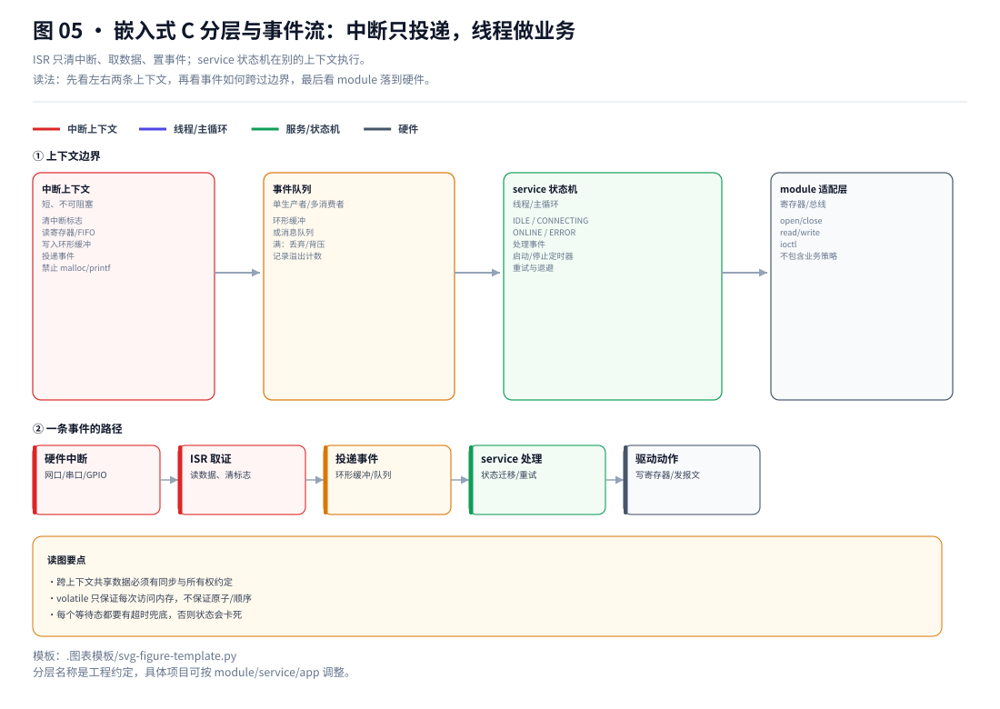

# 嵌入式 C 工程实践

一句话结论：嵌入式 C 的难点不在语法，而在**边界**——中断与线程的边界、所有权与生命周期的边界、硬件寄存器与业务逻辑的边界。把这三条边界画清楚，`volatile`、锁、内存池、状态机才有明确的使用位置。

> 本篇定位：讲中断上下文、`volatile`、可重入、错误码、内存池/侵入式链表、分层与状态机定时器。C 语言规则见 [00-C语言对象与内存模型](./00-C语言对象与内存模型.md) 与 [03-宏预处理与编译链接](./03-宏预处理与编译链接.md)。

## 目录

- [1 一句话模型](#s1)
- [2 速览](#s2)
- [3 上下文、关键字与所有权](#s3)
- [4 事件驱动的分层与执行流程](#s4)
- [5 状态机与定时器](#s5)
- [6 设计取舍与边界](#s6)
- [7 与相邻主题的关系](#s7)
- [名词解释](#名词解释)
- [8 参考与关联](#s8)

## 1 · 一句话模型

```text
中断上下文（短、不可阻塞）        线程/主循环上下文（可阻塞、可分配）
   ISR ──置标志/投递消息──► 事件队列 ──► service 状态机 ──► module 驱动
        └──────── 共享数据必须有明确的同步与所有权 ────────┘
```

三个关键认知：

1. **ISR 只做“必须现在做”的事**：清中断、取数据、置标志；解析、打印、分配内存都推迟到线程上下文。
2. **`volatile` 只保证“每次从内存读写”**，不保证原子性、不保证顺序、不能替代锁或内存屏障。
3. **谁分配谁释放、谁注册谁注销**：把所有权写进接口注释，比事后查泄漏更有效。

## 2 · 速览

| 项 | 内容 |
| --- | --- |
| 所属层/领域 | 嵌入式/网络设备 C 工程 |
| 核心对象 | ISR、线程、消息队列、内存池、模块接口 |
| 关键参数 | 上下文、优先级、临界区、超时、水位 |
| 典型场景 | 设备管理、拨号/链路状态机、LED/按键、日志与告警 |
| 主要标准 | POSIX 线程/信号语义 + 目标 RTOS/内核 API |

## 3 · 上下文、关键字与所有权

### 3.1 两种上下文的约束

| 能力 | 中断上下文 | 线程/主循环上下文 |
| --- | --- | --- |
| 阻塞等待 | 不可以 | 可以（带超时） |
| `malloc/free` | 不建议/通常禁止 | 可以，但实时路径建议用池 |
| 打印日志 | 仅限无锁环形缓冲 | 可以 |
| 睡眠/延时 | 不可以 | 可以 |
| 访问共享数据 | 需关中断或原子操作 | 需锁/无锁结构 |
| 执行时间 | 越短越好 | 可较长，但要可抢占 |

### 3.2 关键字与语义

| 关键字/机制 | 保证 | 不保证 | 常见误用 |
| --- | --- | --- | --- |
| `volatile` | 每次访问都从内存读/写 | 原子性、顺序、可见性 | 用它保护多字节计数器 |
| `_Atomic` / 原子指令 | 单次读改写原子 | 复合操作的整体原子性 | 用两次原子读实现“检查后使用” |
| 内存屏障 | 编译器和 CPU 的访问顺序 | 不替代锁 | 以为 `volatile` 就是屏障 |
| 临界区（关中断/自旋锁） | 互斥 | 不保证不睡眠 | 临界区内调用可能睡眠的函数 |
| `static` 局部缓冲 | 生命周期到进程结束 | 不可重入 | 多线程共用同一缓冲 |

`volatile` 的边界示例：

```c
/* 硬件寄存器：必须 volatile，防止编译器把多次读合并 */
#define REG_STATUS (*(volatile uint32_t *)0x40001000u)

/* 共享计数器：volatile 不够，读改写不是原子操作 */
_Atomic uint32_t rx_packets;
```

### 3.3 可重入与错误处理

| 主题 | 规则 | 反例 |
| --- | --- | --- |
| 可重入 | 不依赖静态/全局可变状态，不返回静态缓冲 | `char *get_name(void) { static char b[32]; ... }` |
| 线程安全 | 共享状态加锁或用线程私有数据 | 共用 `errno` 之外的全局错误变量 |
| 错误码 | 返回负 `errno` 或统一 `int` 状态，0 表示成功 | 用 `-1` 表示所有错误，丢失原因 |
| 资源清理 | 单一出口 + `goto cleanup`，按申请逆序释放 | 每个分支各写一遍 `free` |
| 参数校验 | 公共接口先校验空指针、长度、枚举范围 | 只在下游断言 |

```c
int link_open(struct link *l, const struct link_cfg *cfg)
{
    int ret;

    if (!l || !cfg)
        return -EINVAL;

    ret = link_hw_init(l, cfg);
    if (ret)
        return ret;

    ret = link_timer_start(l);
    if (ret)
        goto err_hw;

    return 0;

err_hw:
    link_hw_deinit(l);
    return ret;
}
```

## 4 · 事件驱动的分层与执行流程



**读图**：左侧是中断/线程两条上下文；中间是事件队列与 service 状态机；右侧是 module 层对硬件和总线的访问。实线是数据/事件流，虚线是注册回调和定时器。关键是：ISR 不直接调用业务逻辑。

> 图源：`images/图05-嵌入式C分层与事件流.svg`

### 4.1 推荐分层

| 层 | 职责 | 不应包含 | 典型接口 |
| --- | --- | --- | --- |
| module（驱动/适配） | 寄存器、总线、设备初始化 | 业务策略 | `xxx_open/close/read/write` |
| service（业务服务） | 状态机、重试、超时、告警 | 直接操作寄存器 | `xxx_service_start/stop/event` |
| app（应用/编排） | 组合服务、对外接口 | 细节实现 | `app_init/app_poll` |
| common | 日志、链表、定时器、错误码 | 业务语义 | `log_*`、`timer_*`、`list_*` |

### 4.2 正常流程

1. **初始化**：app 按依赖顺序初始化 common → module → service，注册回调。
2. **中断到达**：ISR 读取硬件数据，放入无锁环形缓冲，置事件标志，退出。
3. **事件分发**：主循环/线程从队列取出事件，调用对应 service 的 `on_event`。
4. **状态机处理**：service 根据当前状态和事件执行动作，可能启动/停止定时器。
5. **超时处理**：定时器到期投递 `TIMEOUT` 事件，service 执行重试或失败迁移。
6. **清理**：app 退出时按逆序 `stop` service、`close` module，释放池。

### 4.3 异常分支

| 现象 | 优先检查 | 说明 |
| --- | --- | --- |
| 偶发丢事件 | 环形缓冲是否满、ISR 是否覆盖旧数据 | 需要溢出计数和背压策略 |
| 死机在中断里 | ISR 是否调用 `printf/malloc/锁` | 中断上下文不能阻塞 |
| 加了 `volatile` 仍丢计数 | 读改写非原子 | 用原子操作或临界区 |
| 内存缓慢下降 | 每条错误分支是否释放 | 用池 + 水位监控定位 |
| 状态卡死 | 是否漏投超时事件、定时器是否被覆盖 | 每个等待态必须有超时兜底 |
| 重启后配置丢失 | 是否在正确时机持久化 | 写入频率与 flash 寿命权衡 |

## 5 · 状态机与定时器

嵌入式服务几乎都遵循同一个骨架：**状态 + 事件 + 定时器**。

```text
IDLE ──START──► CONNECTING ──OK──► ONLINE
  ▲                 │                 │
  └────FAIL/TIMEOUT─┘                 │
  ◄──────────────STOP/ERROR───────────┘
```

| 定时器 | 作用 | 边界 |
| --- | --- | --- |
| 连接超时 | 防止永久停在 CONNECTING | 超时后必须回到可重试状态 |
| 重试退避 | 避免故障时高频重连 | 设置最大次数和上限间隔 |
| 保活/心跳 | 检测对端失效 | 与业务超时分开，避免互相覆盖 |
| 去抖 | 按键/告警抑制 | 去抖窗口内只保留最后一次事件 |

实现要点：

- **单一定时器源**：统一 tick 或定时器轮，避免每个模块各起线程。
- **定时器回调只投事件**：不在定时器上下文做重活。
- **状态迁移集中**：用表驱动或 `switch` 集中处理，禁止在多个函数里零散改 `state`。
- **可观测**：记录当前状态、上次事件、迁移次数，现场问题才有依据。

## 6 · 设计取舍与边界

- **为什么 ISR 要短**：中断会屏蔽同优先级/低优先级中断，时间长会丢中断、增加抖动；代价是引入队列和延迟处理。
- **为什么用内存池**：固定大小块分配时间可预测、无碎片；代价是块大小和数量需要预估，必须监控水位。
- **为什么用侵入式链表**：节点内嵌 `next` 指针，不需要额外分配节点，适合消息/定时器；代价是对象只能属于一个链表，删除时要知道头指针。
- **为什么错误码比异常好**：C 没有异常，错误码迫使调用者处理；代价是每条路径都要检查，容易漏。
- **不适用**：极短生命周期的临时字符串仍可用栈缓冲；硬实时路径不要引入动态分配和递归。
- **常见误判**：`volatile` 能解决并发；`printf` 在中断里“偶尔能用”；`free` 后指针自动变 `NULL`。

## 7 · 与相邻主题的关系

| 相邻对象 | 关系 |
| --- | --- |
| [00-C语言对象与内存模型](./00-C语言对象与内存模型.md) | 栈/堆/静态对象的生命周期 |
| [01-指针数组与字符串](./01-指针数组与字符串.md) | 回调表、缓冲区游标 |
| [02-结构体联合与位域](./02-结构体联合与位域.md) | 消息结构、寄存器映射 |
| [62-数据结构与算法/01-线性表栈与队列](../62-数据结构与算法/01-线性表栈与队列.md) | 侵入式链表、环形队列 |
| [20-平台与系统/21-Linux](../../20-平台与系统/21-Linux/.readme.md) | 内核态并发、驱动模型 |

一句话边界：本篇讲“C 工程怎么组织”，不讲具体芯片寄存器和 RTOS API。

## 名词解释

> 缩写给出英文全称；非缩写用“—”表示。

| 术语 | 英文全称 | 解释 |
| --- | --- | --- |
| ISR | Interrupt Service Routine | 中断服务程序，运行在中断上下文，要求短且不可阻塞。 |
| 上下文 | Context | 代码运行的环境，如中断上下文、线程上下文。 |
| 可重入 | Reentrant | 函数可被多个执行流同时进入而不互相破坏。 |
| 临界区 | Critical Section | 禁止并发访问共享数据的代码区间。 |
| 内存屏障 | Memory Barrier | 约束编译器和 CPU 的内存访问顺序。 |
| 原子操作 | Atomic Operation | 不可被中断的读改写操作。 |
| 内存池 | Memory Pool | 预分配固定大小块，按块分配释放，避免碎片。 |
| 侵入式链表 | Intrusive List | 把链接指针内嵌在对象里的链表，不额外分配节点。 |
| 背压 | Backpressure | 下游处理不过来时，向上游施加的限流/丢弃策略。 |
| 去抖 | Debounce | 抑制输入信号在短时间内的重复跳变。 |
| 水位 | Watermark | 池/队列的使用量阈值，用于监控和告警。 |

## 8 · 参考与关联

**标准**

- ISO/IEC 9899:2018（`volatile`、`_Atomic`、信号与执行环境）。
- POSIX.1：线程、互斥锁、条件变量、`errno` 语义。

**关联**

- [00-C语言对象与内存模型](./00-C语言对象与内存模型.md)
- [01-指针数组与字符串](./01-指针数组与字符串.md)
- [02-结构体联合与位域](./02-结构体联合与位域.md)
- [62-数据结构与算法/01-线性表栈与队列](../62-数据结构与算法/01-线性表栈与队列.md)

---

> **本篇定位**：把 C 语言规则落到“中断 + 线程 + 状态机”的工程骨架上。
> **素材来源**：`studyspace/2.编程技能/1.C语言/链表申请空间.md`、`mobile-mngr/` 的 module/service 分层（只提炼模式，不复制源码）。
> **待验证**：具体平台的原子指令、关中断 API、内存池实现与实时性指标。
