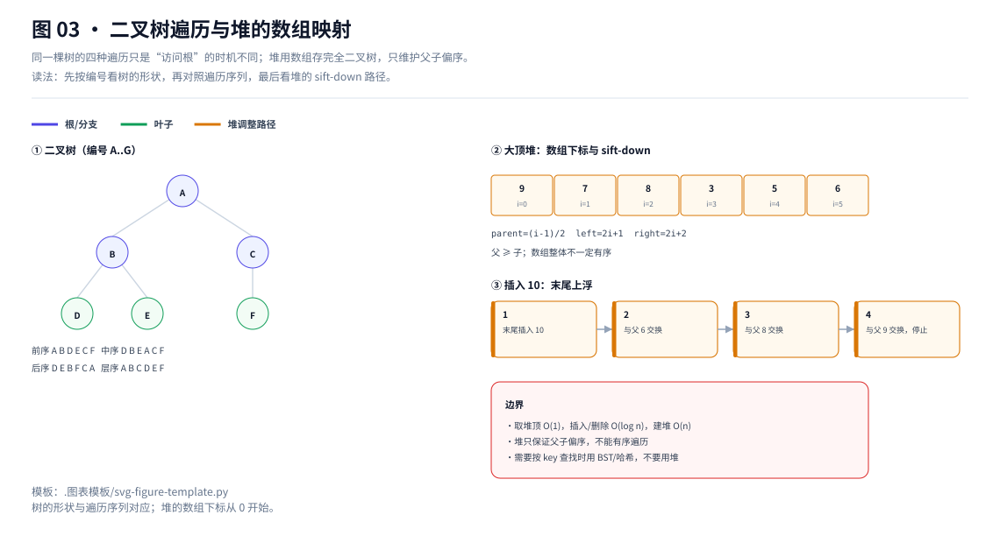

# 树与堆

一句话结论：树用**层次关系**换取有序查找和表达结构；堆是“只维护偏序”的完全二叉树，用 O(log n) 的插入删除换 O(1) 取极值。二叉搜索树解决“按 key 找”，堆解决“找最大/最小”，两者不要混用。

> 本篇定位：讲树的定义与存储、二叉树性质与遍历、树/森林转换、BST 与平衡树、堆与优先队列、哈夫曼树。图结构见 [03-图](./03-图.md)，查找与排序算法见 [04-查找与排序](./04-查找与排序.md)。

## 目录

- [1 一句话模型](#s1)
- [2 速览](#s2)
- [3 树的结构与性质](#s3)
- [4 遍历、堆调整与转换流程](#s4)
- [5 状态机与定时器](#s5)
- [6 设计取舍与边界](#s6)
- [7 与相邻主题的关系](#s7)
- [名词解释](#名词解释)
- [8 参考与关联](#s8)

## 1 · 一句话模型

```text
树：根 → 子节点 → 叶子        层次关系，无环
BST：左 < 根 < 右            中序遍历 = 升序
堆： 父 ≥ 子（大顶堆）        数组存储，只保证堆序，不保证全局有序
```

三个关键认知：

1. **二叉树不是“每个节点最多两个孩子”这么简单**：左右子树有顺序，只有一棵子树也要区分左右。
2. **遍历顺序决定用途**：中序出有序序列，前序适合复制/序列化，后序适合释放/求值，层序适合按层处理。
3. **堆的数组下标关系**：`parent = (i-1)/2`，`left = 2i+1`，`right = 2i+2`（从 0 开始编号）。

## 2 · 速览

| 项 | 内容 |
| --- | --- |
| 所属层/领域 | 基础数据结构 |
| 核心对象 | 节点、根、叶子、子树、堆顶 |
| 关键参数 | 深度、高度、度、节点数、堆大小 |
| 典型场景 | 目录结构、表达式树、有序索引、定时器、哈夫曼编码 |
| 主要标准 | —（计算机科学基础） |

## 3 · 树的结构与性质

### 3.1 基本概念

| 概念 | 定义 | 边界 |
| --- | --- | --- |
| 树 | n 个节点的有限集合，n=0 为空树；有唯一根，子树互不相交 | 不能有环 |
| 度 | 节点拥有的子树数 | 树的度是各节点度的最大值 |
| 叶子 | 度为 0 的节点 | 也叫终端节点 |
| 层次/深度 | 根为第 1 层，树的最大层次为高度 | 有的教材从 0 开始，读题先确认 |
| 森林 | m 棵互不相交的树的集合 | 删除根即得森林 |

### 3.2 二叉树性质

| 性质 | 公式 | 用途 |
| --- | --- | --- |
| 第 i 层最多节点 | `2^(i-1)` | 估算满二叉树规模 |
| 深度 k 最多节点 | `2^k - 1` | 容量规划 |
| 叶子与度为 2 的节点 | `n0 = n2 + 1` | 选择题/推导 |
| 完全二叉树深度 | `floor(log2 n) + 1` | 数组存储下标范围 |
| 完全二叉树父子下标 | 父 `i/2`，左 `2i`，右 `2i+1`（从 1 编号） | 堆实现 |

### 3.3 存储结构

| 方式 | 结构 | 适用 | 边界 |
| --- | --- | --- | --- |
| 双亲表示法 | 每个节点存父下标 | 查父方便 | 查子要遍历 |
| 孩子表示法 | 每个节点挂孩子链表 | 查子方便 | 查父不方便 |
| 孩子兄弟表示法 | `first_child + next_sibling` | 任意树转二叉树 | 查父需额外指针 |
| 顺序存储 | 数组按下标存 | 完全二叉树/堆 | 稀疏树浪费空间 |
| 二叉链表 | `left + right` | 通用二叉树 | 空指针多 |

孩子兄弟表示法的核心：**左指针指向第一个孩子，右指针指向下一个兄弟**，任意树都能转成二叉树。

## 4 · 遍历、堆调整与转换流程



**读图**：上半部分是同一棵二叉树的四种遍历访问顺序；下半部分是堆的数组表示，`sift-up/sift-down` 只沿着一条根到叶的路径交换。注意堆的数组有序性只是“父子偏序”，不是整体排序。

> 图源：`images/图03-树与堆.svg`

### 4.1 四种遍历

| 遍历 | 顺序 | 递归骨架 | 典型用途 |
| --- | --- | --- | --- |
| 前序 | 根 → 左 → 右 | 访问、递归左、递归右 | 复制树、序列化 |
| 中序 | 左 → 根 → 右 | 递归左、访问、递归右 | BST 输出升序 |
| 后序 | 左 → 右 → 根 | 递归左、递归右、访问 | 释放树、表达式求值 |
| 层序 | 逐层从左到右 | 队列 + BFS | 按层打印、最短层数 |

```c
void inorder(const struct node *n, void (*visit)(const struct node *))
{
    if (!n)
        return;
    inorder(n->left, visit);
    visit(n);
    inorder(n->right, visit);
}
```

递归深度等于树高：退化树（链表）深度 O(n)，可能栈溢出；工程上用显式栈或 Morris 遍历。

### 4.2 由遍历序列还原树

| 已知序列 | 能否唯一确定 | 方法 |
| --- | --- | --- |
| 前序 + 中序 | 能 | 前序首元素是根，在中序中切分左右子树 |
| 后序 + 中序 | 能 | 后序末元素是根，在中序中切分 |
| 前序 + 后序 | 不能 | 无法区分只有一个孩子时的左右 |
| 层序 + 中序 | 能 | 层序首元素是根，递归切分 |

### 4.3 堆的操作

| 操作 | 步骤 | 复杂度 | 边界 |
| --- | --- | --- | --- |
| 取堆顶 | 返回 `a[0]` | O(1) | 堆空要判 |
| 插入 | 放到末尾 → `sift-up` | O(log n) | 数组扩容 |
| 删除堆顶 | 末尾移到堆顶 → `sift-down` | O(log n) | 堆大小减一 |
| 建堆 | 从最后一个非叶节点向前 `sift-down` | O(n) | 不是 O(n log n) |
| 堆排序 | 反复取堆顶/交换末尾 | O(n log n) | 不稳定 |

```c
static void sift_down(int *a, int n, int i)
{
    for (;;) {
        int l = 2 * i + 1, r = l + 1, m = i;
        if (l < n && a[l] > a[m]) m = l;
        if (r < n && a[r] > a[m]) m = r;
        if (m == i) break;
        int t = a[i]; a[i] = a[m]; a[m] = t;
        i = m;
    }
}
```

### 4.4 树、森林与二叉树转换

1. **树 → 二叉树**：兄弟之间加线；每个节点只保留与第一个孩子的连线；以根为轴旋转。
2. **二叉树 → 树**：某节点左孩子的所有右孩子都挂回该节点；删除所有右孩子连线。
3. **森林 → 二叉树**：各树先转二叉树，再把后一棵的根作为前一棵根的右孩子。
4. **二叉树 → 森林**：反复断开根与右孩子的连线，得到多棵二叉树，再各自转树。

## 5 · 状态机与定时器

没有状态机，也没有定时器。堆可用于实现**定时器堆**：按到期时间组织最小堆，取堆顶即最近到期任务；这属于堆的应用，不是树结构本身的状态。

## 6 · 设计取舍与边界

- **为什么 BST 会退化**：有序插入时退化成链表，查找 O(n)；解决方法是 AVL/红黑树/跳表等平衡机制。
- **为什么堆只保证偏序**：换取 O(1) 取极值和 O(log n) 更新；代价是不能有序遍历，也不能按任意 key 查找。
- **为什么完全二叉树适合数组**：下标关系直接计算，无指针开销、缓存友好；代价是非完全树会浪费空间。
- **为什么线索二叉树存在**：利用空指针存前驱/后继，节省遍历栈；代价是插入删除维护复杂，工程中较少手写。
- **哈夫曼树的取舍**：按频率构造最优前缀码，压缩率高；代价是需要先统计频率并传输码表。
- **常见误判**：堆顶是最大值就以为整个数组有序；BST 的中序有序就以为树是平衡的；递归遍历不会栈溢出。

## 7 · 与相邻主题的关系

| 相邻对象 | 关系 |
| --- | --- |
| [01-线性表栈与队列](./01-线性表栈与队列.md) | 层序遍历用队列，递归用栈 |
| [03-图](./03-图.md) | 图的最小生成树是“生成树”，但算法不同 |
| [04-查找与排序](./04-查找与排序.md) | BST/AVL/B 树用于查找，堆排序用于排序 |
| [61-C语言/02-结构体联合与位域](../61-C语言/02-结构体联合与位域.md) | 树节点结构体与内存布局 |

一句话边界：本篇讲“层次与偏序”，不讲“任意顶点间的网络关系”。

## 名词解释

> 缩写给出英文全称；非缩写用“—”表示。

| 术语 | 英文全称 | 解释 |
| --- | --- | --- |
| 二叉树 | Binary Tree | 每个节点最多两个有序子树的树。 |
| 完全二叉树 | Complete Binary Tree | 除最后一层外都填满，最后一层从左到右连续。 |
| 满二叉树 | Full Binary Tree | 所有分支节点都有左右孩子且叶子同层。 |
| 遍历 | Traversal | 按某种顺序访问树中每个节点一次。 |
| 前序遍历 | Preorder Traversal | 根、左、右的访问顺序。 |
| 中序遍历 | Inorder Traversal | 左、根、右的访问顺序，BST 下得到升序。 |
| 后序遍历 | Postorder Traversal | 左、右、根的访问顺序。 |
| 层序遍历 | Level-order Traversal | 按层从上到下、每层从左到右访问。 |
| 线索二叉树 | Threaded Binary Tree | 用空指针保存前驱/后继的二叉树。 |
| BST | Binary Search Tree | 二叉搜索树，左子树小于根、右子树大于根。 |
| AVL 树 | Adelson-Velsky and Landis Tree | 通过旋转保持左右子树高度差不超过 1 的平衡 BST。 |
| 堆 | Heap | 满足父子偏序的完全二叉树，分大顶堆和小顶堆。 |
| 优先队列 | Priority Queue | 按优先级取元素的抽象数据类型，常用堆实现。 |
| 哈夫曼树 | Huffman Tree | 按权值构造的最优前缀编码二叉树。 |

## 8 · 参考与关联

**标准**

- —（基础数据结构，无协议标准）。

**关联**

- [01-线性表栈与队列](./01-线性表栈与队列.md)
- [03-图](./03-图.md)
- [04-查找与排序](./04-查找与排序.md)
- [61-C语言/02-结构体联合与位域](../61-C语言/02-结构体联合与位域.md)

---

> **本篇定位**：把树讲成“层次 + 遍历 + 偏序”三件事，区分 BST 与堆的适用场景。
> **素材来源**：`studyspace/2.编程技能/3.数据结构/6-树.md`（已重写并补齐堆与工程边界）。
> **待验证**：递归深度限制、红黑树实现细节以目标库/平台为准。
