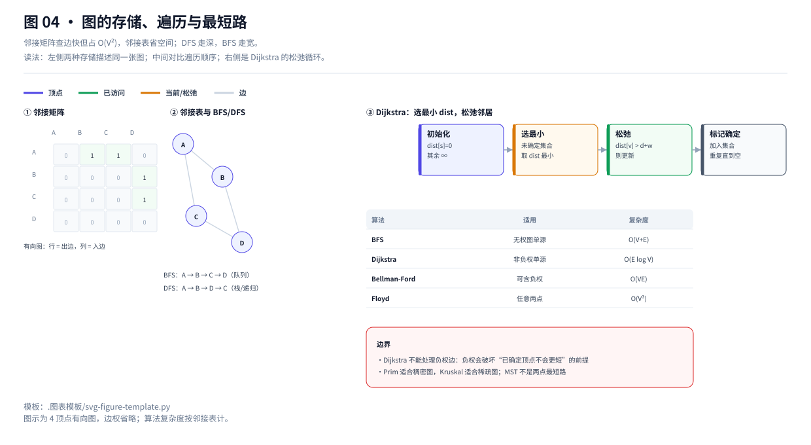

# 图

一句话结论：图用**顶点 + 边**表达任意关系；存储结构决定遍历和算法代价，遍历（DFS/BFS）是所有图算法的骨架，最小生成树、最短路径、拓扑排序都是在遍历基础上加约束。

> 本篇定位：讲图的定义、五种存储结构、DFS/BFS、最小生成树、最短路径、拓扑排序与关键路径。树结构见 [02-树与堆](./02-树与堆.md)，查找与排序见 [04-查找与排序](./04-查找与排序.md)。

## 目录

- [1 一句话模型](#s1)
- [2 速览](#s2)
- [3 图的分类与存储](#s3)
- [4 遍历与算法流程](#s4)
- [5 状态机与定时器](#s5)
- [6 设计取舍与边界](#s6)
- [7 与相邻主题的关系](#s7)
- [名词解释](#名词解释)
- [8 参考与关联](#s8)

## 1 · 一句话模型

```text
G = (V, E)
存储：邻接矩阵（稠密） / 邻接表（稀疏）
遍历：DFS（栈/递归） / BFS（队列）
算法：MST（Prim/Kruskal） · 最短路（Dijkstra/Bellman-Ford/Floyd） · 拓扑（入度）
```

三个关键认知：

1. **图与树的区别是“有没有环、有没有多前驱”**：树是连通无环图，图允许任意连接。
2. **存储结构决定复杂度**：邻接矩阵查边 O(1) 但占 O(V²)；邻接表省空间但查边 O(度)。
3. **DFS/BFS 不是目的，是框架**：加上访问标记、距离数组、入度数组，才变成具体算法。

## 2 · 速览

| 项 | 内容 |
| --- | --- |
| 所属层/领域 | 基础数据结构 |
| 核心对象 | 顶点、边/弧、权、邻接点 |
| 关键参数 | 顶点数 V、边数 E、入度/出度、权值 |
| 典型场景 | 网络拓扑、依赖关系、路由、任务调度、社交关系 |
| 主要标准 | —（计算机科学基础） |

## 3 · 图的分类与存储

### 3.1 分类

| 分类 | 含义 | 边界 |
| --- | --- | --- |
| 无向图/有向图 | 边是否有方向 | 有向边称弧，分弧头/弧尾 |
| 简单图 | 无自环、无重边 | 多数算法假设简单图 |
| 完全图 | 任意两顶点间都有边 | 无向 `n(n-1)/2` 条，有向 `n(n-1)` 条 |
| 稀疏图/稠密图 | 边数相对顶点数 | 没有严格阈值，按存储代价判断 |
| 带权图（网） | 边有权值 | 权可为负，但最短路算法受限 |
| 连通图/强连通图 | 无向任意两点可达 / 有向任意两点互相可达 | 非连通图要多次启动遍历 |

### 3.2 存储结构

| 结构 | 空间 | 查边 | 遍历邻接点 | 适用 |
| --- | --- | --- | --- | --- |
| 邻接矩阵 | O(V²) | O(1) | O(V) | 稠密图、需要快速判边 |
| 邻接表 | O(V+E) | O(度) | O(度) | 稀疏图、遍历为主 |
| 逆邻接表 | O(V+E) | O(入度) | O(入度) | 需要查入边/入度 |
| 十字链表 | O(V+E) | O(度) | O(度) | 有向图，同时查出入边 |
| 邻接多重表 | O(V+E) | O(度) | O(度) | 无向图，边只存一份 |
| 边集数组 | O(V+E) | O(E) | O(E) | Kruskal 等按边处理的算法 |

邻接矩阵的度数关系：

| 图类型 | 出度 | 入度 | 度 |
| --- | --- | --- | --- |
| 无向图 | — | — | 第 i 行（或列）非零元素个数 |
| 有向图 | 第 i 行非零个数 | 第 i 列非零个数 | 出度 + 入度 |

邻接表节点：

```c
struct edge {
    int to;
    int weight;
    struct edge *next;
};

struct vertex {
    int id;
    struct edge *head;
};
```

### 3.3 关键概念

| 概念 | 定义 | 用途 |
| --- | --- | --- |
| 路径长度 | 路径上边/弧的数目 | 无权图的最短路径 |
| 简单路径 | 顶点不重复的路径 | 避免环 |
| 回路/环 | 首尾顶点相同 | 拓扑排序要求无环 |
| 连通分量 | 无向图的极大连通子图 | 非连通图遍历 |
| 强连通分量 | 有向图互相可达的极大子图 | Tarjan/Kosaraju |
| 生成树 | 连通图的极小连通子图，V-1 条边 | 最小生成树 |

## 4 · 遍历与算法流程



**读图**：左侧是同一张图的邻接矩阵与邻接表；中间 DFS 走深、BFS 走宽，虚线表示回边/已访问节点；右侧是 Dijkstra 的“选最小距离 → 松弛邻居”循环。颜色区分已访问、待访问和当前节点。

> 图源：`images/图04-图算法.svg`

### 4.1 DFS 与 BFS

| 算法 | 数据结构 | 顺序特征 | 复杂度（邻接表） | 典型用途 |
| --- | --- | --- | --- | --- |
| DFS | 栈/递归 | 一条路走到底再回退 | O(V+E) | 连通性、环检测、拓扑、割点 |
| BFS | 队列 | 按层扩展 | O(V+E) | 无权最短路、层序、二分图判定 |

```c
void bfs(int start, const struct graph *g, int *dist)
{
    int q[g->n], head = 0, tail = 0;
    for (int i = 0; i < g->n; i++) dist[i] = -1;
    dist[start] = 0;
    q[tail++] = start;

    while (head < tail) {
        int u = q[head++];
        for (struct edge *e = g->v[u].head; e; e = e->next) {
            if (dist[e->to] != -1) continue;
            dist[e->to] = dist[u] + 1;
            q[tail++] = e->to;
        }
    }
}
```

非连通图需要对每个未访问顶点重新启动一次遍历；每次启动对应一个连通分量。

### 4.2 最小生成树

| 算法 | 思路 | 复杂度 | 适用 |
| --- | --- | --- | --- |
| Prim | 从一点出发，每次选连接已选集合的最小边 | O(V²) 或 O(E log V)（堆） | 稠密图 |
| Kruskal | 按边权排序，用并查集判断是否成环 | O(E log E) | 稀疏图 |

两者都要求**无向连通带权图**；不连通时得到最小生成森林。

### 4.3 最短路径

| 算法 | 适用 | 复杂度 | 边界 |
| --- | --- | --- | --- |
| BFS | 无权图单源 | O(V+E) | 只适用于边权相同 |
| Dijkstra | 非负权单源 | O(E log V)（堆） | 负权边会失效 |
| Bellman-Ford | 可含负权单源 | O(VE) | 可检测负环 |
| Floyd-Warshall | 任意两点 | O(V³) | 适合小图/稠密图 |

Dijkstra 的核心循环：

1. 从未确定集合中选 `dist` 最小的顶点 u。
2. 把 u 标记为已确定。
3. 对 u 的每个邻居 v 做松弛：`dist[v] = min(dist[v], dist[u] + w(u,v))`。
4. 重复直到所有可达顶点确定。

负权边会破坏“已确定顶点不会更短”的前提，所以 Dijkstra 不能用；改用 Bellman-Ford。

### 4.4 拓扑排序与关键路径

| 主题 | 前提 | 方法 | 输出 |
| --- | --- | --- | --- |
| 拓扑排序 | 有向无环图 DAG | 反复取入度为 0 的顶点，删除其出边 | 一个线性序 |
| 环检测 | 有向图 | 拓扑结束后仍有顶点未输出 | 存在环 |
| 关键路径 | 带权 DAG（AOE 网） | 拓扑序求最早开始/最晚开始，差为 0 的为关键活动 | 项目最短工期 |

拓扑排序的工程意义：依赖解析、编译顺序、任务调度。若输出数量小于顶点数，说明存在循环依赖。

## 5 · 状态机与定时器

没有状态机，也没有定时器。遍历中的“未访问/已访问/在栈中”是**算法内部标记**，不是协议状态；需要记录路径时，额外维护 `parent` 数组。

## 6 · 设计取舍与边界

- **邻接矩阵 vs 邻接表**：矩阵查边快、实现简单，但 O(V²) 空间；表省空间，适合稀疏图和遍历。
- **Prim vs Kruskal**：Prim 适合稠密图、增量扩展；Kruskal 适合稀疏图、按边排序 + 并查集。
- **Dijkstra vs Bellman-Ford**：Dijkstra 快但不能有负权；Bellman-Ford 慢但能检测负环。
- **Floyd 的取舍**：实现极简、能处理负权（无负环），但 O(V³) 只适合小图。
- **不适用**：边权动态变化、超大规模图（社交网络）需要专门算法/分布式框架，不在基础数据结构范围。
- **常见误判**：BFS 能求带权最短路；拓扑排序能处理有环图；最小生成树能求两点最短路（不是一回事）。

## 7 · 与相邻主题的关系

| 相邻对象 | 关系 |
| --- | --- |
| [01-线性表栈与队列](./01-线性表栈与队列.md) | DFS 用栈，BFS 用队列 |
| [02-树与堆](./02-树与堆.md) | 树是图的特例；生成树是图的子图 |
| [04-查找与排序](./04-查找与排序.md) | Kruskal 需要排序，Dijkstra 可用堆优化 |
| [10-基础理论/11-网络科学](../../10-基础理论/11-网络科学/.readme.md) | 网络拓扑是图论的具体应用 |

一句话边界：本篇讲“任意关系的存储与算法”，不讲具体网络协议的路由实现。

## 名词解释

> 缩写给出英文全称；非缩写用“—”表示。

| 术语 | 英文全称 | 解释 |
| --- | --- | --- |
| 图 | Graph | 由顶点集合和边集合组成的结构。 |
| 顶点 | Vertex | 图中的数据元素。 |
| 边/弧 | Edge/Arc | 顶点之间的关系，有向时称弧。 |
| 度 | Degree | 与顶点关联的边数；有向图分出度和入度。 |
| 邻接矩阵 | Adjacency Matrix | 用二维数组表示顶点间是否有边及权值。 |
| 邻接表 | Adjacency List | 每个顶点挂一个邻接点链表。 |
| DFS | Depth-First Search | 深度优先搜索，沿一条路径走到底再回退。 |
| BFS | Breadth-First Search | 广度优先搜索，按层扩展。 |
| MST | Minimum Spanning Tree | 连通带权图的总权值最小的生成树。 |
| DAG | Directed Acyclic Graph | 有向无环图。 |
| 拓扑排序 | Topological Sort | 把 DAG 顶点排成满足所有依赖方向的线性序。 |
| 关键路径 | Critical Path | AOE 网中决定总工期的最长路径。 |
| 松弛 | Relaxation | 用当前最短距离尝试更新邻居距离的操作。 |
| 并查集 | Disjoint Set Union | 维护不相交集合合并与查询的结构。 |

## 8 · 参考与关联

**标准**

- —（基础数据结构，无协议标准）。

**关联**

- [01-线性表栈与队列](./01-线性表栈与队列.md)
- [02-树与堆](./02-树与堆.md)
- [04-查找与排序](./04-查找与排序.md)
- [10-基础理论/11-网络科学](../../10-基础理论/11-网络科学/.readme.md)

---

> **本篇定位**：把图算法统一到“存储 + 遍历 + 约束”的框架里，避免逐个背算法。
> **素材来源**：`studyspace/2.编程技能/3.数据结构/7-图.md`（已重写并补齐 MST/最短路/拓扑）。
> **待验证**：大规模图算法的工程实现与复杂度常数依具体场景而定。
