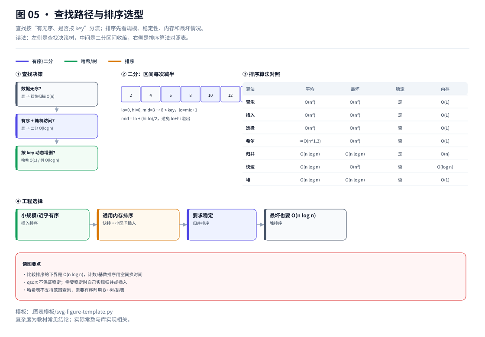

# 查找与排序

一句话结论：查找的核心是**用额外结构换定位速度**（有序、哈希、索引、树）；排序的核心是**用比较和移动换有序**，工程上先看数据规模、稳定性、内存和是否近乎有序，再选算法。

> 本篇定位：讲顺序/二分/索引查找、BST/AVL/B 树、哈希表、常见排序算法对比与工程选择。树和堆的结构见 [02-树与堆](./02-树与堆.md)。

## 目录

- [1 一句话模型](#s1)
- [2 速览](#s2)
- [3 查找结构与排序字段表](#s3)
- [4 查找与排序流程](#s4)
- [5 状态机与定时器](#s5)
- [6 设计取舍与边界](#s6)
- [7 与相邻主题的关系](#s7)
- [名词解释](#名词解释)
- [8 参考与关联](#s8)

## 1 · 一句话模型

```text
查找：无序 → 线性 O(n)；有序 → 二分 O(log n)；按 key → 哈希 O(1)/树 O(log n)
排序：比较类下限 O(n log n)；非比较类用空间/范围换 O(n)
```

三个关键认知：

1. **二分查找的前提是有序且可随机访问**，链表上二分的“定位”仍是 O(n)。
2. **哈希表平均 O(1) 依赖均匀哈希和负载因子**，最坏会退化成 O(n)。
3. **排序的稳定性只在“相等元素的原始顺序有意义”时才重要**，比如多关键字排序。

## 2 · 速览

| 项 | 内容 |
| --- | --- |
| 所属层/领域 | 基础算法 |
| 核心对象 | 关键字、比较函数、哈希桶、有序序列 |
| 关键参数 | n、比较次数、冲突率、稳定性、额外空间 |
| 典型场景 | 配置查找、会话表、日志排序、排行榜、去重 |
| 主要标准 | —（计算机科学基础） |

## 3 · 查找结构与排序字段表

### 3.1 查找结构

| 结构 | 平均查找 | 最坏 | 前提 | 边界 |
| --- | --- | --- | --- | --- |
| 顺序查找 | O(n) | O(n) | 无 | 小数据/无序 |
| 二分查找 | O(log n) | O(log n) | 有序 + 随机访问 | 插入删除要搬移 |
| 插值查找 | O(log log n)（均匀分布） | O(n) | 有序 + 分布均匀 | 分布不均时退化 |
| 分块查找 | O(√n) | O(√n) | 块间有序、块内无序 | 需要索引表 |
| BST | O(log n)（平衡时） | O(n) | 动态插入 | 有序插入会退化 |
| AVL/红黑树 | O(log n) | O(log n) | 平衡维护 | 实现复杂，旋转开销 |
| B 树/B+ 树 | O(log n) | O(log n) | 磁盘页对齐 | 适合外存/数据库索引 |
| 哈希表 | O(1) | O(n) | 哈希函数 + 冲突处理 | 不支持范围查询/有序遍历 |

### 3.2 哈希冲突处理

| 方法 | 做法 | 优点 | 边界 |
| --- | --- | --- | --- |
| 开放定址（线性探测） | 冲突后顺序找下一个空槽 | 缓存友好、无指针 | 易聚集，删除需墓碑标记 |
| 二次探测 | 按平方步长找空槽 | 减少一次聚集 | 可能探测不到所有槽 |
| 双重哈希 | 用第二个哈希函数定步长 | 分布更均匀 | 计算开销大 |
| 链地址法 | 每个桶挂链表/红黑树 | 删除简单、负载因子可高 | 指针开销、缓存不友好 |
| 再哈希 | 冲突时换哈希函数 | 适合固定关键字集 | 需要预知关键字 |

负载因子 `α = 元素数 / 桶数`。链地址法通常 `α` 控制在 0.75~1，开放定址法建议 ≤0.7；超过阈值就扩容并重排。

### 3.3 排序算法对比

| 算法 | 平均 | 最坏 | 最好 | 空间 | 稳定 | 适用 |
| --- | --- | --- | --- | --- | --- | --- |
| 冒泡 | O(n²) | O(n²) | O(n) | O(1) | 是 | 教学/近乎有序（加标志） |
| 简单选择 | O(n²) | O(n²) | O(n²) | O(1) | 否 | 交换次数少 |
| 直接插入 | O(n²) | O(n²) | O(n) | O(1) | 是 | 小规模/近乎有序 |
| 希尔 | O(n^1.3) 左右 | O(n²) | — | O(1) | 否 | 中等规模、实现简单 |
| 堆排序 | O(n log n) | O(n log n) | O(n log n) | O(1) | 否 | 内存紧、要最坏保证 |
| 归并 | O(n log n) | O(n log n) | O(n log n) | O(n) | 是 | 稳定、外存排序 |
| 快速 | O(n log n) | O(n²) | O(n log n) | O(log n) 栈 | 否 | 通用最快，需防退化 |
| 计数 | O(n+k) | O(n+k) | O(n+k) | O(k) | 是 | 小范围整数 |
| 基数 | O(d(n+k)) | O(d(n+k)) | O(d(n+k)) | O(n+k) | 是 | 定长整数/字符串 |

稳定性定义：相等关键字在排序后保持原相对顺序。多关键字排序常“先按次关键字稳定排序，再按主关键字稳定排序”。

## 4 · 查找与排序流程



**读图**：左侧是查找决策：无序线性、有序二分、按 key 哈希/树；中间是二分查找的区间收缩；右侧是排序选型：小规模用插入，通用用快排，要稳定用归并，要最坏保证用堆排。

> 图源：`images/图05-查找与排序.svg`

### 4.1 二分查找

```c
int bsearch_int(const int *a, int n, int key)
{
    int lo = 0, hi = n - 1;
    while (lo <= hi) {
        int mid = lo + (hi - lo) / 2;   /* 避免 lo+hi 溢出 */
        if (a[mid] == key) return mid;
        if (a[mid] < key)  lo = mid + 1;
        else               hi = mid - 1;
    }
    return -1;
}
```

边界：`lo <= hi` 与 `lo < hi` 对应不同的区间语义；`mid` 用 `lo + (hi-lo)/2` 防止溢出。查找“第一个 ≥ key”的位置时，把条件改成 `a[mid] < key` 并返回 `lo`。

### 4.2 快速排序

1. 选基准（pivot），常用三数取中或随机。
2. 分区：小于基准放左，大于基准放右。
3. 递归处理左右子区间。
4. 小区间（如 <16）改用插入排序，减少递归开销。

最坏 O(n²) 出现在每次划分极不均衡（已排序 + 固定取首元素）。工程上用随机基准、三数取中或 introsort（快排 + 堆排兜底）。

### 4.3 归并排序

1. 递归拆成两半，直到长度 1。
2. 合并两个有序子数组，用额外缓冲。
3. 稳定，适合链表排序（可以做到 O(1) 额外空间）和外存排序。

### 4.4 异常分支

| 现象 | 优先检查 | 说明 |
| --- | --- | --- |
| 二分查找死循环 | `lo/hi` 更新是否有一侧不变 | 区间不收缩 |
| 快排对有序数据极慢 | 基准选择 | 退化为 O(n²) |
| 排序后相等元素顺序变了 | 算法是否稳定 | 需要稳定时选归并/插入 |
| 哈希表查找变慢 | 负载因子、哈希函数 | 冲突链过长 |
| 浮点数排序结果反常 | NaN、比较函数不满足全序 | 比较函数必须严格弱序 |
| 大文件排序内存爆 | 是否全量载入 | 用外部归并/分块 |

## 5 · 状态机与定时器

没有状态机，也没有定时器。排序和查找都是**无状态函数**（除了原地排序会修改输入）；并发场景下需要保证“排序期间数据不被修改”，这属于同步问题，不是算法状态。

## 6 · 设计取舍与边界

- **为什么比较排序下界是 O(n log n)**：决策树有 n! 个叶子，深度至少 log(n!) = Θ(n log n)；计数/基数排序绕过比较，但依赖关键字范围。
- **为什么快排常用**：常数小、缓存友好、原地；代价是最坏 O(n²) 和不确定的递归深度。
- **为什么归并稳定**：合并时相等元素优先取左边；代价是 O(n) 额外空间。
- **为什么哈希表不能范围查询**：哈希打散了顺序；需要范围/排序时用 B+ 树或跳表。
- **为什么数据库索引用 B+ 树**：一个节点对应一个磁盘页，降低树高和 I/O 次数；二叉树 I/O 次数太多。
- **常见误判**：哈希表永远 O(1)；快排永远比归并快；`qsort` 是稳定排序（C 标准未保证）。

## 7 · 与相邻主题的关系

| 相邻对象 | 关系 |
| --- | --- |
| [00-复杂度与结构选型](./00-复杂度与结构选型.md) | 复杂度与选型框架 |
| [02-树与堆](./02-树与堆.md) | BST/AVL/B 树、堆排序 |
| [03-图](./03-图.md) | Kruskal 依赖排序，Dijkstra 依赖优先队列 |
| [61-C语言/01-指针数组与字符串](../61-C语言/01-指针数组与字符串.md) | `qsort` 比较函数与 `void *` |
| [20-平台与系统/21-Linux](../../20-平台与系统/21-Linux/.readme.md) | 内核排序、哈希表实现 |

一句话边界：本篇讲“怎么找、怎么排”，不讲“数据放在哪种容器里”（见选型篇）。

## 名词解释

> 缩写给出英文全称；非缩写用“—”表示。

| 术语 | 英文全称 | 解释 |
| --- | --- | --- |
| 查找 | Search | 在数据集合中定位满足条件元素的过程。 |
| 二分查找 | Binary Search | 在有序序列中每次折半缩小范围的查找。 |
| 插值查找 | Interpolation Search | 按关键字分布估计位置的二分变体。 |
| 哈希表 | Hash Table | 用哈希函数把关键字映射到桶的查找结构。 |
| 哈希冲突 | Hash Collision | 不同关键字映射到同一桶的情况。 |
| 负载因子 | Load Factor | 元素数与桶数之比，衡量哈希表拥挤程度。 |
| 开放定址 | Open Addressing | 冲突时在表内寻找其他空槽的策略。 |
| 链地址法 | Separate Chaining | 每个桶挂链表或树处理冲突。 |
| 稳定性 | Stability | 排序后相等元素的相对顺序保持不变。 |
| 原地排序 | In-place Sort | 只用 O(1) 或 O(log n) 额外空间的排序。 |
| 外部排序 | External Sort | 数据大于内存、需要分块归并的排序。 |
| 严格弱序 | Strict Weak Ordering | 比较函数必须满足的数学性质，`qsort` 等依赖它。 |

## 8 · 参考与关联

**标准**

- ISO/IEC 9899:2018，7.22.5（`qsort`/`bsearch`）。

**关联**

- [00-复杂度与结构选型](./00-复杂度与结构选型.md)
- [02-树与堆](./02-树与堆.md)
- [03-图](./03-图.md)
- [61-C语言/01-指针数组与字符串](../61-C语言/01-指针数组与字符串.md)

---

> **本篇定位**：把查找/排序讲成“前提 + 代价 + 稳定性”的选择问题。
> **素材来源**：`studyspace/2.编程技能/3.数据结构/8-查找.md`、`9-排序.md`（原为提纲，已扩写）。
> **待验证**：具体实现的常数、缓存表现和库排序算法（如 glibc `qsort` 实现）以目标环境为准。
