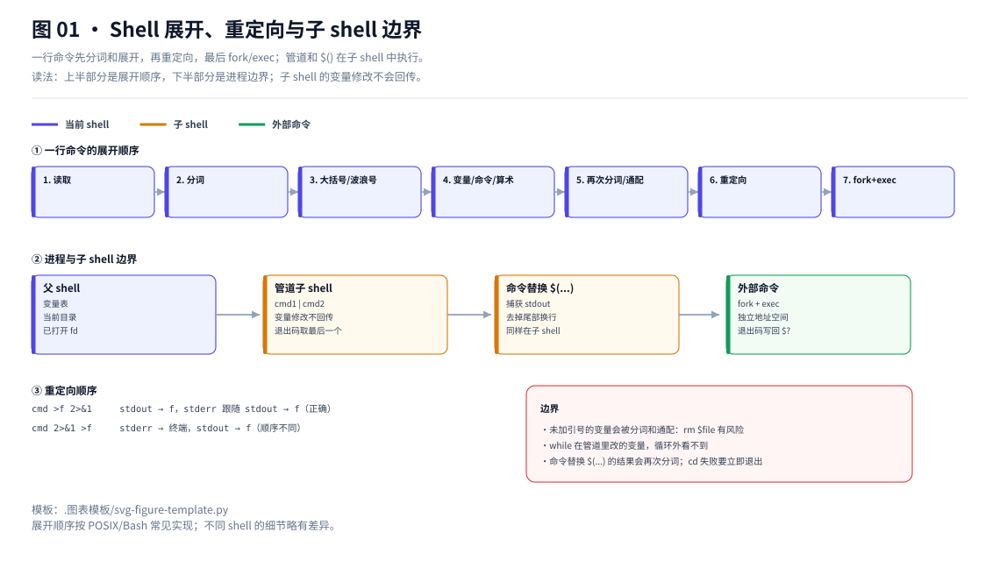

# Shell 执行模型与语法

一句话结论：Shell 是**命令解释器 + 进程编排器**：它先做分词、展开、重定向，再 `fork/exec` 外部命令并等待退出码。理解“展开顺序”和“子 shell 边界”，比背语法更能避免脚本事故。

> 本篇定位：讲变量与引用、展开顺序、重定向、管道、条件/循环/函数和退出码。文本处理工具见 [01-文本处理](./01-文本处理.md)，工程化写法见 [02-脚本工程化与自动化案例](./02-脚本工程化与自动化案例.md)。

## 目录

- [1 一句话模型](#s1)
- [2 速览](#s2)
- [3 变量、引用与展开](#s3)
- [4 命令执行流程](#s4)
- [5 状态机与定时器](#s5)
- [6 设计取舍与边界](#s6)
- [7 与相邻主题的关系](#s7)
- [名词解释](#名词解释)
- [8 参考与关联](#s8)

## 1 · 一句话模型

```text
读入一行 → 分词 → 展开（大括号/波浪号/变量/命令/算术/分词/通配）
        → 重定向 → 执行（内建命令 or fork+exec）→ 等待 → 退出码
```

三个关键认知：

1. **引号决定“是否分词/是否展开”**：双引号保留变量展开但阻止分词和通配，单引号阻止一切展开。
2. **管道和 `$(...)` 会创建子 shell**：子 shell 里的变量修改不会带回父 shell。
3. **退出码是脚本的错误通道**：`0` 成功，非 0 失败；`$?` 只保留上一条命令的结果。

## 2 · 速览

| 项 | 内容 |
| --- | --- |
| 所属层/领域 | Shell 编程基础 |
| 核心对象 | 命令、变量、管道、重定向、退出码 |
| 关键参数 | `IFS`、`set` 选项、`$@/$*`、文件描述符 |
| 典型场景 | 构建脚本、批量运维、日志处理、设备初始化 |
| 主要标准 | POSIX Shell（`sh`）+ Bash 扩展 |

## 3 · 变量、引用与展开

### 3.1 变量与引用

| 写法 | 行为 | 边界 |
| --- | --- | --- |
| `var=value` | 赋值，等号两边不能有空格 | 值含空格要加引号 |
| `"$var"` | 展开为一个参数，保留空格 | 推荐默认写法 |
| `'$var'` | 原样输出，不展开 | 需要字面量时用 |
| `${var}` | 明确变量边界 | `$var_suffix` 会被当成另一个变量 |
| `${var:-word}` | 未设置或为空时返回 word，不修改 var | 只读场景 |
| `${var:=word}` | 未设置或为空时赋值 | 会修改 var |
| `${var:?msg}` | 未设置或为空时报错退出 | 必填参数校验 |
| `${var:+word}` | 已设置且非空时返回 word | 可选覆盖 |
| `${#var}` | 字符串长度 | 不是字节数（多字节字符） |
| `${var%pattern}` / `${var%%pattern}` | 从尾部删最短/最长匹配 | 路径处理常用 |
| `${var#pattern}` / `${var##pattern}` | 从头部删最短/最长匹配 | 去前缀 |

### 3.2 特殊变量

| 变量 | 含义 | 边界 |
| --- | --- | --- |
| `$0` | 脚本名/当前 shell | 被 `source` 时是父 shell 名 |
| `$1..$9` | 位置参数 | 第 10 个起用 `${10}` |
| `$#` | 位置参数个数 | 不含 `$0` |
| `$@` | 所有参数，作为独立单词 | **必须加双引号**：`"$@"` |
| `$*` | 所有参数，合并成一个字符串 | 受 `IFS` 影响 |
| `$?` | 上一条命令退出码 | 任何命令都会覆盖 |
| `$$` | 当前 shell 进程号 | 子 shell 中不变（Bash 的 `BASHPID` 才变） |
| `$!` | 最近一个后台进程号 | 用于 `wait` |

`"$@"` 与 `$*` 的区别是脚本传参的经典问题：前者保持每个参数独立，后者会按 `IFS` 合并。

### 3.3 展开顺序

| 顺序 | 展开 | 说明 |
| --- | --- | --- |
| 1 | 大括号展开 | `{a,b}.txt` → `a.txt b.txt` |
| 2 | 波浪号展开 | `~/x` → 家目录 |
| 3 | 参数/变量展开 | `$var`、`${var:-x}` |
| 4 | 命令替换 | `$(cmd)`、`` `cmd` `` |
| 5 | 算术展开 | `$((1+2))` |
| 6 | 分词 | 按 `IFS` 拆分，**未加引号的展开会被拆分** |
| 7 | 通配符展开 | `*`、`?`、`[]` |
| 8 | 引号去除 | 去掉语法引号 |

因此 `rm $file` 在文件名含空格时会拆成多个参数；正确写法是 `rm -- "$file"`。

### 3.4 条件、循环与函数

| 结构 | 写法 | 边界 |
| --- | --- | --- |
| `if` | `if cmd; then ...; elif ...; else ...; fi` | 判断的是命令退出码，不是布尔值 |
| `[ ]` | POSIX test | 变量必须加引号，运算符要转义 |
| `[[ ]]` | Bash 扩展 | 支持 `&&`、`||`、正则 `=~`，不做分词 |
| `(( ))` | 算术判断 | 非 0 为真 |
| `case` | `case "$x" in pat) ...;; esac` | 模式匹配，`;;` 结束分支 |
| `for` | `for x in "$@"; do ...; done` | 遍历列表 |
| `while/until` | `while cmd; do ...; done` | 条件为命令退出码 |
| 函数 | `f() { ...; }` | 返回码用 `return`，输出用 `echo/printf` |

```bash
#!/usr/bin/env bash
set -euo pipefail

usage() { printf 'usage: %s <file>\n' "${0##*/}" >&2; exit 2; }

main() {
    [ "$#" -eq 1 ] || usage
    local file=$1
    [ -f "$file" ] || { printf 'not a file: %s\n' "$file" >&2; exit 1; }
    wc -l -- "$file"
}

main "$@"
```

## 4 · 命令执行流程



**读图**：左侧是一行命令从读入到执行的展开顺序；右侧是管道/命令替换创建子 shell 的边界。子 shell 继承变量副本，但修改不会回传；重定向在 `exec` 前完成。

> 图源：`images/图01-Shell执行模型.svg`

### 4.1 正常路径

1. **读取**：交互式 shell 读一行；脚本按行/复合命令读取。
2. **解析**：识别保留字、管道、列表、重定向。
3. **展开**：按 3.3 的顺序展开。
4. **重定向**：先建立文件描述符，再执行命令。
5. **执行**：内建命令在当前 shell 执行；外部命令 `fork` 后 `exec`。
6. **等待**：前台命令等待结束，保存退出码到 `$?`。
7. **继续**：根据 `;`、`&&`、`||` 决定后续命令是否执行。

### 4.2 重定向

| 写法 | 作用 | 边界 |
| --- | --- | --- |
| `> file` | stdout 覆盖写入 | 先截断文件，再执行 |
| `>> file` | stdout 追加 | 文件不存在则创建 |
| `2> file` | stderr 重定向 | 顺序重要：`>f 2>&1` 与 `2>&1 >f` 不同 |
| `&> file` | stdout + stderr | Bash 扩展，POSIX 用 `>f 2>&1` |
| `< file` | stdin 来自文件 | 与管道冲突时后者优先 |
| `<<'EOF'` | here-doc，不展开变量 | 引号包裹定界符可阻止展开 |
| `3> file` | 打开 fd 3 | 自定义描述符需手动关闭 |
| `exec >file` | 当前 shell 永久重定向 | 影响后续所有命令 |

### 4.3 异常分支

| 现象 | 优先检查 | 说明 |
| --- | --- | --- |
| 变量在 `while` 里改了，循环外没变 | 管道创建子 shell | 改用 `while ... done < <(cmd)` 或进程替换 |
| 文件名含空格时出错 | 变量是否加引号 | `"$file"`、`--` 结束选项 |
| `set -e` 没生效 | 命令在 `if/&&/||/!` 中，或函数调用链 | `errexit` 有例外规则 |
| 脚本在 CI 正常、本地失败 | `sh` 与 `bash` 差异 | shebang 与执行方式要一致 |
| 通配符没展开 | 目录无匹配或引号阻止 | 需要 `nullglob`/`failglob` 策略 |
| `cd` 失败后继续删错目录 | 未检查退出码 | `cd "$dir" || exit 1` |

## 5 · 状态机与定时器

Shell 本身没有协议状态机。作业控制有**进程状态**（运行、停止、后台），用 `jobs/fg/bg/wait` 管理；脚本层的“状态”通常体现为退出码和锁文件，而不是状态机。定时依赖 `sleep`、`timeout`、`at`/`cron`，不在语言层。

## 6 · 设计取舍与边界

- **为什么默认用 `"$var"`**：防止分词和通配，是脚本健壮性的第一道防线。
- **为什么 `[[ ]]` 更安全**：不做分词、支持模式/正则；代价是不可移植到纯 POSIX `sh`。
- **为什么管道要创建子 shell**：每个命令是独立进程，天然并行；代价是变量作用域隔离。
- **为什么 `set -e` 不可靠**：它在条件上下文、命令替换、函数中行为复杂；工程上更推荐显式 `|| exit` 和 `trap`。
- **不适用**：复杂数据结构、跨平台逻辑、需要精细错误处理的场景，应改用 Python/Go 等语言。
- **常见误判**：`[ $a = b ]` 在 `a` 为空时变成 `[ = b ]` 报错；`$?` 在 `echo` 后已被覆盖；`source` 与 `./script` 的变量作用域不同。

## 7 · 与相邻主题的关系

| 相邻对象 | 关系 |
| --- | --- |
| [01-文本处理](./01-文本处理.md) | grep/sed/awk 等管线工具 |
| [02-脚本工程化与自动化案例](./02-脚本工程化与自动化案例.md) | 参数、锁、清理、批量任务 |
| [80-工具与环境/01-Git](../../80-工具与环境/01-Git/.readme.md) | 脚本中调用 git 的边界 |
| [65-构建与调试/01-Make与CMake](../65-构建与调试/01-Make与CMake.md) | 构建脚本与 Makefile 的分工 |

一句话边界：本篇讲“Shell 怎么解释和执行”，不讲“怎么写出可维护的自动化脚本”。

## 名词解释

> 缩写给出英文全称；非缩写用“—”表示。

| 术语 | 英文全称 | 解释 |
| --- | --- | --- |
| Shell | Shell | 命令解释器，负责解析命令并调用系统接口。 |
| Bash | Bourne Again Shell | GNU 的 Shell 实现，兼容 POSIX 并带扩展。 |
| POSIX | Portable Operating System Interface | 可移植操作系统接口标准，定义 `sh` 行为。 |
| Shebang | — | 脚本首行 `#!`，指定解释器路径。 |
| 子 shell | Subshell | 由父 shell 派生、拥有变量副本的执行环境。 |
| 分词 | Word Splitting | 按 `IFS` 把展开结果拆成多个参数。 |
| IFS | Internal Field Separator | Shell 用于分词的内部字段分隔符。 |
| 内建命令 | Builtin | 由 shell 自身执行、不创建进程的命令。 |
| 退出码 | Exit Status | 命令执行结果，0 表示成功。 |
| 重定向 | Redirection | 改变命令的标准输入/输出/错误目标。 |
| 文件描述符 | File Descriptor | 进程内代表打开文件的非负整数。 |
| Here-document | Here-doc | 把一段文本作为命令标准输入的重定向语法。 |
| 通配符展开 | Globbing | 把 `*`、`?` 等模式展开为匹配的文件名。 |

## 8 · 参考与关联

**标准**

- POSIX.1 Shell Command Language（XCU）。
- GNU Bash Reference Manual。

**关联**

- [01-文本处理](./01-文本处理.md)
- [02-脚本工程化与自动化案例](./02-脚本工程化与自动化案例.md)
- [65-构建与调试/01-Make与CMake](../65-构建与调试/01-Make与CMake.md)

---

> **本篇定位**：把 Shell 的“展开顺序 + 子 shell + 退出码”讲成可预测的执行模型。
> **素材来源**：`studyspace/4.其他技能/2.shell/shell.md`、`shell脚本.md`（已重写并补齐执行模型）。
> **待验证**：`/bin/sh` 在不同发行版指向 `dash`/`bash`/`busybox ash`，行为以目标系统为准。
