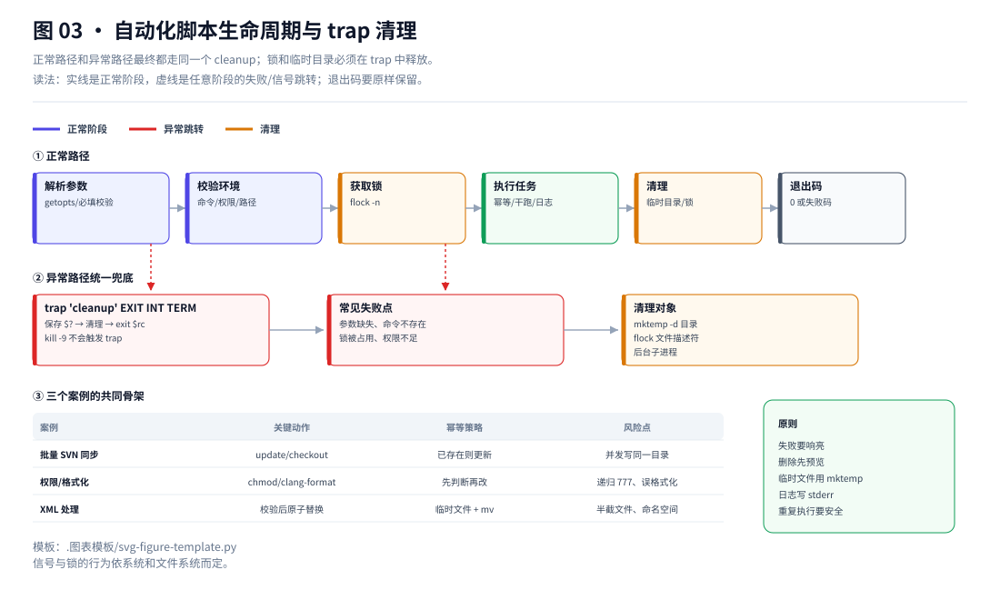

# 脚本工程化与自动化案例

一句话结论：能跑一次的脚本和能维护的脚本差在**边界**：参数怎么校验、失败怎么退出、临时文件怎么清理、并发怎么互斥、重复执行是否安全。把这五件事模板化，脚本才敢放到构建和运维流程里。

> 本篇定位：讲严格模式、参数解析、`trap` 清理、锁、日志、幂等与并行，并给出批量下载/权限/格式化的案例。Shell 语法见 [00-Shell执行模型与语法](./00-Shell执行模型与语法.md)，文本工具见 [01-文本处理](./01-文本处理.md)。

## 目录

- [1 一句话模型](#s1)
- [2 速览](#s2)
- [3 脚本骨架与字段表](#s3)
- [4 生命周期与清理流程](#s4)
- [5 状态机与定时器](#s5)
- [6 设计取舍与边界](#s6)
- [7 与相邻主题的关系](#s7)
- [名词解释](#名词解释)
- [8 参考与关联](#s8)

## 1 · 一句话模型

```text
解析参数 → 校验环境 → 获取锁 → 准备工作目录 → 执行任务 → 清理 → 释放锁 → 返回退出码
              └──────────── trap EXIT/INT/TERM 统一兜底 ────────────┘
```

三个关键认知：

1. **脚本的失败必须“响亮”**：非 0 退出、写 stderr、保留现场；静默失败比报错更难查。
2. **临时资源用 `trap` 清理**：无论正常退出、`Ctrl-C` 还是 `kill`，都走同一条清理路径。
3. **幂等是自动化的前提**：重复执行不应产生重复数据或破坏现场；用“检查再动作”或“覆盖式写入”。

## 2 · 速览

| 项 | 内容 |
| --- | --- |
| 所属层/领域 | Shell 自动化工程 |
| 核心对象 | 参数、锁、临时目录、日志、退出码 |
| 关键参数 | `set -euo pipefail`、`trap`、`flock`、`mktemp`、`getopts` |
| 典型场景 | 代码批量下载/清理、权限修复、格式化、CI 步骤 |
| 主要标准 | POSIX Shell + GNU coreutils/util-linux |

## 3 · 脚本骨架与字段表

### 3.1 推荐骨架

```bash
#!/usr/bin/env bash
set -euo pipefail
IFS=$'\n\t'

readonly SCRIPT_DIR=$(cd -- "$(dirname -- "${BASH_SOURCE[0]}")" && pwd)
readonly LOG_FILE=${LOG_FILE:-/tmp/$(basename -- "$0").log}
WORKDIR=

log()  { printf '%s [%s] %s\n' "$(date '+%F %T')" "$1" "$2" >&2; }
die()  { log ERROR "$*"; exit 1; }

cleanup() {
    local rc=$?
    [ -n "${WORKDIR}" ] && rm -rf -- "$WORKDIR"
    log INFO "exit rc=$rc"
    exit "$rc"
}
trap cleanup EXIT INT TERM

main() {
    WORKDIR=$(mktemp -d) || die "mktemp failed"
    log INFO "workdir=$WORKDIR"
    # 业务逻辑
}

main "$@"
```

### 3.2 关键机制

| 机制 | 作用 | 边界 |
| --- | --- | --- |
| `set -e` | 命令失败即退出 | 在 `if/&&/||/!`、命令替换中有例外 |
| `set -u` | 使用未定义变量报错 | `${var:-default}` 可显式兜底 |
| `set -o pipefail` | 管道任一命令失败即失败 | 只取最后一个命令的退出码会漏错 |
| `trap ... EXIT` | 统一清理 | 不要在清理函数里再触发 `set -e` 退出 |
| `mktemp -d` | 安全创建临时目录 | 不要用固定路径 + `$$` 拼 |
| `flock` | 进程间互斥 | 锁文件路径要稳定；使用前先 `exec 9>lockfile` 打开描述符；NFS 上行为需确认 |
| `getopts` | 解析短选项 | 长选项需手写或 `getopt` |
| `timeout` | 给命令加超时 | 退出码 124 表示超时 |

### 3.3 参数与环境校验

| 检查 | 写法 | 说明 |
| --- | --- | --- |
| 参数个数 | `[ "$#" -eq 2 ] \|\| usage` | 先校验再取值 |
| 必填变量 | `: "${SRC:?SRC is required}"` | 空值也报错 |
| 文件存在 | `[ -f "$file" ] \|\| die` | 目录用 `-d` |
| 命令存在 | `command -v jq >/dev/null \|\| die` | 不要用 `which` |
| 版本 | `awk -v v="$(cmd -V)" ...` | 版本字符串格式因工具而异 |
| 权限 | `[ "$(id -u)" -eq 0 ]` | 明确是否需要 root |

## 4 · 生命周期与清理流程



**读图**：左侧是正常路径：解析 → 校验 → 加锁 → 工作 → 清理 → 释放；右侧是异常路径：任意阶段失败或收到信号，都跳到 `trap` 清理。锁和临时目录必须在 `trap` 中释放，否则下次执行会被自己挡住。

> 图源：`images/图03-脚本生命周期.svg`

### 4.1 案例一：批量下载/清理（SVN）

| 步骤 | 做法 | 边界 |
| --- | --- | --- |
| 读取清单 | 从文件/参数读仓库列表，跳过空行和注释 | 清单编码统一 UTF-8 |
| 校验工具 | `command -v svn` | 无 svn 时明确报错 |
| 加锁 | `flock -n 9` | 防止两个同步任务并发写同一目录 |
| 增量更新 | 已存在则 `svn update`，否则 `svn checkout` | 不要每次全量 checkout |
| 清理 | 删除未版本控制文件前先 `svn status` 预览 | 需要 `--dry-run` 或确认开关 |
| 日志 | 每个仓库记录开始/结束/耗时/退出码 | 失败继续或立即停止要可配置 |
| 汇总 | 统计成功/失败数量，非 0 退出 | CI 才能感知失败 |

关键原则：**删除类操作先预览、再执行、可回滚**；不要用 `rm -rf` 直接拼未校验的变量。

### 4.2 案例二：批量权限与格式化

| 任务 | 做法 | 边界 |
| --- | --- | --- |
| 权限修复 | 目录 `755`、普通文件 `644`、脚本 `755` | 不要递归 `chmod -R 777` |
| 属主修复 | `chown -R user:group` | 需要 root，先确认目标 |
| 格式化 | 只处理白名单后缀，先 `--dry-run` | 格式化工具版本要固定 |
| 编码/换行 | 统一 UTF-8、LF | 二进制文件跳过 |
| 幂等 | 已符合要求则不动文件 | 用 `stat`/`file` 判断 |
| 报告 | 输出改动文件列表 | 便于 code review |

格式化脚本的边界：`clang-format` 只应处理 `.c/.h/.cpp`，不要扫整个仓库；配置文件 `.clang-format` 要和团队一致，否则会产生大量无关 diff。

### 4.3 案例三：XML/配置处理

| 步骤 | 做法 | 边界 |
| --- | --- | --- |
| 校验格式 | `xmllint --noout file.xml` | 没有 xmllint 时给出安装提示 |
| 提取字段 | `xmllint --xpath '...'` | 命名空间要用 `--xpath` 的 local-name 写法 |
| 修改 | 用专用工具或模板重生成 | 不要用 `sed` 硬改 XML |
| 写回 | 先写临时文件，校验通过再 `mv` | 原子替换，避免半截文件 |

### 4.4 异常分支

| 现象 | 优先检查 | 说明 |
| --- | --- | --- |
| 脚本中途退出但临时文件残留 | `trap` 是否覆盖 INT/TERM | 只写 EXIT 可能漏信号 |
| 两个任务同时跑互相覆盖 | 是否加锁 | `flock -n` 拿不到锁应退出 |
| 清理函数把退出码改成 0 | 清理函数最后一条命令 | 保存 `$?` 并 `exit "$rc"` |
| `set -e` 下 `grep` 无匹配就退出 | `grep` 返回 1 | 用 `\|\| true` 或 `if grep -q` |
| 日志泄露密码 | 是否打印完整命令行/环境 | 敏感参数脱敏 |
| CI 上路径不对 | 是否依赖当前目录 | 用 `SCRIPT_DIR` 定位 |

## 5 · 状态机与定时器

脚本层没有协议状态机，但有**执行阶段**：初始化 → 校验 → 加锁 → 执行 → 清理。定时相关机制：

| 机制 | 用途 | 边界 |
| --- | --- | --- |
| `trap` | 捕获 EXIT/INT/TERM/HUP | 信号处理函数要短 |
| `timeout` | 限制单条命令时长 | 子进程可能残留，需要进程组处理 |
| `cron`/`systemd timer` | 周期执行 | 注意并发与上次未完成 |
| `sleep` + 轮询 | 等待条件 | 优先用事件/`inotify`，轮询要设上限 |

## 6 · 设计取舍与边界

- **为什么用严格模式**：尽早暴露未定义变量和管道错误；代价是必须处理 `grep` 无匹配、`[ ]` 假值等正常“非 0”。
- **为什么脚本要加锁**：自动化的真实敌人是并发和重入；代价是锁文件残留需要人工清理策略。
- **为什么先写临时文件再 `mv`**：同目录 `mv` 是原子替换，避免读到半截配置；跨文件系统则不是原子操作。
- **为什么日志写 stderr**：stdout 留给数据输出，便于管道组合；日志和结果混在一起会污染下游。
- **不适用**：超过几百行、需要复杂数据结构或跨平台时，改用 Python/Go；Shell 的优势是“编排已有命令”，不是“实现业务逻辑”。
- **常见误判**：`set -e` 能捕获所有错误；`trap` 一定会执行（`kill -9` 不会）；固定临时文件名安全。

## 7 · 与相邻主题的关系

| 相邻对象 | 关系 |
| --- | --- |
| [00-Shell执行模型与语法](./00-Shell执行模型与语法.md) | 引号、退出码、子 shell |
| [01-文本处理](./01-文本处理.md) | 管线工具与安全分隔 |
| [65-构建与调试/01-Make与CMake](../65-构建与调试/01-Make与CMake.md) | 构建入口脚本与 Make 的分工 |
| [80-工具与环境/01-Git](../../80-工具与环境/01-Git/.readme.md) | 版本控制批量操作 |
| [80-工具与环境/02-Docker](../../80-工具与环境/02-Docker/.readme.md) | 容器内脚本与信号处理 |

一句话边界：本篇讲“脚本怎么可维护、可重入”，不讲“某个命令的全部参数”。

## 名词解释

> 缩写给出英文全称；非缩写用“—”表示。

| 术语 | 英文全称 | 解释 |
| --- | --- | --- |
| 严格模式 | Strict Mode | `set -euo pipefail` 的组合，让脚本尽早失败。 |
| 幂等 | Idempotence | 重复执行产生相同结果、不重复产生副作用。 |
| 信号 | Signal | 操作系统向进程发送的异步事件，如 INT/TERM。 |
| trap | — | Shell 内建命令，用于捕获信号或退出事件并执行处理。 |
| 文件锁 | File Lock | 用锁文件协调多个进程的互斥访问。 |
| 原子替换 | Atomic Replace | 通过同目录重命名，使文件切换对外不可见中间状态。 |
| 临时目录 | Temporary Directory | 由 `mktemp` 创建、仅当前任务使用的目录。 |
| 退出码 | Exit Status | 进程返回给父进程的结果码，0 表示成功。 |
| 干跑 | Dry Run | 只打印将要执行的动作，不实际修改。 |
| 白名单 | Allowlist | 只允许明确列出的对象被处理。 |
| CI | Continuous Integration | 持续集成，自动执行构建、测试和检查。 |

## 8 · 参考与关联

**标准**

- POSIX.1 Shell Command Language。
- GNU coreutils / util-linux（`flock`、`timeout`、`mktemp`）手册。

**关联**

- [00-Shell执行模型与语法](./00-Shell执行模型与语法.md)
- [01-文本处理](./01-文本处理.md)
- [80-工具与环境/01-Git](../../80-工具与环境/01-Git/.readme.md)
- [80-工具与环境/02-Docker](../../80-工具与环境/02-Docker/.readme.md)

---

> **本篇定位**：把“能跑的脚本”提升为“可重入、可观测、可清理”的自动化。
> **素材来源**：`studyspace/4.其他技能/2.shell/svn相关/`、`文件操作相关/`、`process_xml.sh`（只提炼模式，不复制具体业务参数）。
> **待验证**：`flock` 在 NFS/容器环境的行为、`timeout` 对进程组的处理，以目标系统为准。
