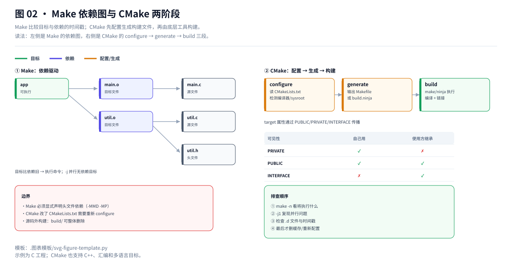

# Make 与 CMake

一句话结论：Make 是**基于时间戳的依赖执行器**，CMake 是**生成构建文件的元构建系统**。Makefile 描述“目标依赖什么、怎么生成”，CMake 描述“工程由哪些目标组成、怎么配置”，后者生成前者（或 Ninja）。

> 本篇定位：讲 Makefile 的规则/变量/依赖生成，以及 CMake 的目标模型、可见性、工具链和常用命令。工具链阶段见 [00-从源码到可执行文件](./00-从源码到可执行文件.md)，调试见 [02-调试与诊断](./02-调试与诊断.md)。

## 目录

- [1 一句话模型](#s1)
- [2 速览](#s2)
- [3 规则、变量与目标属性](#s3)
- [4 依赖解析与配置生成流程](#s4)
- [5 状态机与定时器](#s5)
- [6 设计取舍与边界](#s6)
- [7 与相邻主题的关系](#s7)
- [名词解释](#名词解释)
- [8 参考与关联](#s8)

## 1 · 一句话模型

```text
Make：目标: 依赖...        时间戳比较 → 执行命令 → 递归依赖
CMake：CMakeLists.txt → 配置(configure) → 生成(generate) → make/ninja → 编译链接
```

三个关键认知：

1. **Make 的核心不是“写命令”，而是“声明依赖”**：依赖对了，增量构建才正确。
2. **CMake 的核心是 target**：`add_library/add_executable` 创建目标，`target_*` 给目标加属性，依赖关系自动传递。
3. **配置阶段和执行阶段分离**：CMake 只在 `configure` 时读 `CMakeLists.txt`，改了要重新生成；编译由底层构建工具执行。

## 2 · 速览

| 项 | 内容 |
| --- | --- |
| 所属层/领域 | C/C++ 构建系统 |
| 核心对象 | 目标、依赖、规则、变量、target 属性 |
| 关键参数 | `-j`、`-n`、`-B`、`-DCMAKE_BUILD_TYPE`、`-DCMAKE_TOOLCHAIN_FILE` |
| 典型场景 | 单包构建、多模块工程、交叉编译、CI |
| 主要标准 | GNU Make 手册 + CMake 官方文档 |

## 3 · 规则、变量与目标属性

### 3.1 Makefile 规则

| 组成 | 写法 | 说明 |
| --- | --- | --- |
| 目标 | `app: main.o util.o` | 要生成的文件或伪目标 |
| 依赖 | 冒号右侧 | 比目标新则触发重建 |
| 命令 | Tab 开头的行 | 每条命令独立 shell |
| 伪目标 | `.PHONY: clean` | 避免与同名文件冲突 |
| 模式规则 | `%.o: %.c` | 批量匹配 |
| 静态模式 | `$(OBJS): %.o: %.c` | 限定目标集合 |
| 自动变量 | `$@ $< $^ $?` | 目标、首个依赖、全部依赖、更新的依赖 |
| 多目标 | `a b: c` | 同一规则生成多个目标 |

```make
CC      ?= cc
CFLAGS  ?= -O2 -g -Wall -Wextra -std=c11
CPPFLAGS += -MMD -MP -Isrc
LDFLAGS ?=
LDLIBS  += -lm

TARGET := app
OBJS   := main.o util.o

.PHONY: all clean

all: $(TARGET)

$(TARGET): $(OBJS)
	$(CC) $(LDFLAGS) -o $@ $^ $(LDLIBS)

%.o: %.c
	$(CC) $(CPPFLAGS) $(CFLAGS) -c -o $@ $<

clean:
	$(RM) $(TARGET) $(OBJS) $(OBJS:.o=.d)

-include $(OBJS:.o=.d)
```

### 3.2 Make 变量

| 赋值 | 展开时机 | 用途 |
| --- | --- | --- |
| `=` | 递归展开（使用时） | 值可引用后面定义的变量 |
| `:=` | 立即展开 | 避免递归和意外 |
| `?=` | 未定义时赋值 | 允许外部覆盖默认值 |
| `+=` | 追加 | 保留原展开方式 |
| `override` | 强制覆盖命令行变量 | 关键配置 |
| `export` | 传给子进程 | 递归 make 常用 |

命令行变量优先于 Makefile 中的普通赋值：`make CFLAGS="-O0 -g"` 会覆盖 `CFLAGS = ...`，除非用 `override`。

### 3.3 自动依赖

`-MMD -MP` 让编译器生成 `.d` 文件，记录头文件依赖；`-include` 把 `.d` 引入 Makefile。没有这一步，改头文件不会触发重编，是“改了没生效”的头号原因。

### 3.4 CMake 目标模型

| 命令 | 作用 | 可见性 |
| --- | --- | --- |
| `add_library(foo STATIC ...)` | 创建静态库目标 | — |
| `add_library(foo SHARED ...)` | 创建共享库目标 | — |
| `add_executable(app ...)` | 创建可执行目标 | — |
| `target_include_directories(foo PUBLIC inc)` | 头文件路径 | `PUBLIC` 传递给使用方 |
| `target_link_libraries(app PRIVATE foo)` | 链接库 | `PRIVATE` 不传递 |
| `target_compile_definitions(foo PRIVATE DEBUG)` | 编译宏 | 同上 |
| `target_compile_options(foo PRIVATE -Wall)` | 编译选项 | 同上 |
| `target_sources(foo PRIVATE a.c)` | 追加源文件 | — |

可见性语义：

| 关键字 | 自己用 | 使用方继承 | 典型场景 |
| --- | --- | --- | --- |
| `PRIVATE` | 是 | 否 | 内部实现细节 |
| `PUBLIC` | 是 | 是 | 公共头文件、公共依赖 |
| `INTERFACE` | 否 | 是 | 纯头文件库、接口目标 |

```cmake
cmake_minimum_required(VERSION 3.20)
project(app C)

set(CMAKE_C_STANDARD 11)
set(CMAKE_C_STANDARD_REQUIRED ON)

add_library(util STATIC src/util.c)
target_include_directories(util PUBLIC include)

add_executable(app src/main.c)
target_link_libraries(app PRIVATE util)
```

### 3.5 常用 CMake 命令

| 命令 | 作用 | 边界 |
| --- | --- | --- |
| `cmake -S . -B build` | 配置到 `build/` | 源码外构建，避免污染 |
| `cmake --build build -j` | 调用底层构建工具 | 不重新配置 |
| `cmake -DCMAKE_BUILD_TYPE=Debug` | 选择配置 | 单配置生成器有效 |
| `cmake -DCMAKE_TOOLCHAIN_FILE=...` | 交叉编译 | 工具链文件要设编译器/sysroot |
| `cmake --install build` | 安装 | 需要 `install()` 规则 |
| `ctest --test-dir build` | 运行测试 | 需要 `enable_testing()` |
| `cmake --preset dev` | 使用预设 | `CMakePresets.json` |

## 4 · 依赖解析与配置生成流程



**读图**：左侧是 Make 的依赖图：目标比依赖旧就执行命令，递归向上；右侧是 CMake 的“配置 → 生成 → 构建”三段，配置阶段读 `CMakeLists.txt` 并检查编译器，生成阶段产出 `Makefile`/`build.ninja`，构建阶段才真正编译。

> 图源：`images/图02-Make与CMake.svg`

### 4.1 Make 执行路径

1. 读入 Makefile，展开变量，建立目标/依赖图。
2. 从默认目标（第一个目标）开始，递归检查依赖。
3. 依赖比目标新，或目标不存在，执行规则命令。
4. 命令失败立即停止（除非 `-k`）。
5. `-jN` 并行执行无依赖关系的目标。

### 4.2 CMake 执行路径

1. **配置**：读取顶层 `CMakeLists.txt`，执行 `project()`，检测编译器和平台。
2. **收集目标**：`add_library/add_executable` 建立目标图。
3. **传播属性**：`target_*` 的 `PUBLIC/INTERFACE` 属性沿依赖边传递。
4. **生成**：输出 `Makefile` 或 `build.ninja`。
5. **构建**：`cmake --build` 调用底层工具，按依赖编译链接。
6. **安装/测试**：`install()`、`enable_testing()` 生成对应规则。

### 4.3 异常分支

| 现象 | 优先检查 | 说明 |
| --- | --- | --- |
| 改了头文件不重编 | 是否生成/包含 `.d` | Make 不知道头文件依赖 |
| `make` 说已是最新但产物不对 | 时间戳、并发、命令没改依赖 | 用 `make -n` 看将执行什么 |
| 并行编译随机失败 | 未声明的依赖、共享输出 | 先 `-j1` 复现 |
| CMake 改了 `CMakeLists.txt` 没生效 | 是否重新配置 | `cmake --build` 不一定重跑 configure |
| 找不到库 | `target_link_libraries` 是否写对目标名 | 不要手写 `-lfoo` 绕过目标模型 |
| 交叉编译用了主机头文件 | toolchain 文件、sysroot | 编译器与 sysroot 必须匹配 |
| Debug/Release 混用 | 单配置生成器的 `CMAKE_BUILD_TYPE` | 多配置生成器用 `--config` |

## 5 · 状态机与定时器

没有状态机，也没有定时器。构建系统只有**文件状态**（存在/时间戳）和**配置缓存**（`CMakeCache.txt`、`CMakeFiles/`）；状态不一致时，清理缓存或重新配置是最后手段。

## 6 · 设计取舍与边界

- **为什么 Make 仍然常用**：简单、无额外依赖、贴近命令；代价是手写依赖容易漏，跨平台能力弱。
- **为什么 CMake 用目标而不是全局变量**：属性随目标传播，依赖关系显式；代价是学习曲线和生成器差异。
- **为什么源码外构建**：`build/` 可整体删除，不污染源码；代价是要记住构建目录。
- **为什么用 Ninja**：更快、增量更精确；CMake 只负责生成，不绑定具体构建器。
- **不适用**：超大规模多语言工程可能需要 Bazel/Meson；单文件小工具直接写 `cc` 命令即可。
- **常见误判**：`make clean` 能修复所有问题；CMake 变量就是 Make 变量；`-j` 越大越好。

## 7 · 与相邻主题的关系

| 相邻对象 | 关系 |
| --- | --- |
| [00-从源码到可执行文件](./00-从源码到可执行文件.md) | 编译/链接参数与产物 |
| [02-调试与诊断](./02-调试与诊断.md) | 构建产物用于调试 |
| [63-Shell/02-脚本工程化](../63-Shell/02-脚本工程化与自动化案例.md) | 构建入口脚本 |
| [22-OpenWrt/01-构建与包管理](../../20-平台与系统/22-OpenWrt/01-构建与包管理/.readme.md) | 大型项目的 make 调用链 |
| [80-工具与环境/02-Docker](../../80-工具与环境/02-Docker/.readme.md) | 容器化构建环境 |

一句话边界：本篇讲“怎么组织构建”，不讲“编译器怎么生成代码”。

## 名词解释

> 缩写给出英文全称；非缩写用“—”表示。

| 术语 | 英文全称 | 解释 |
| --- | --- | --- |
| Make | GNU Make | 基于依赖和时间戳执行命令的构建工具。 |
| 目标 | Target | Make 要生成的文件或伪目标。 |
| 依赖 | Prerequisite | 目标所依赖的文件或其他目标。 |
| 规则 | Rule | 目标、依赖和命令的组合。 |
| 伪目标 | Phony Target | 不对应真实文件、总是执行的目标。 |
| 自动变量 | Automatic Variable | Make 在规则中自动设置的变量，如 `$@`、`$<`。 |
| 模式规则 | Pattern Rule | 用 `%` 匹配一类文件的规则。 |
| CMake | — | 生成构建文件的跨平台元构建系统。 |
| 目标模型 | Target Model | 用 target 及其属性描述工程结构的模型。 |
| 工具链文件 | Toolchain File | 描述交叉编译编译器、sysroot 和标志的 CMake 文件。 |
| 生成器 | Generator | CMake 输出的底层构建系统，如 Makefiles、Ninja。 |
| 源码外构建 | Out-of-source Build | 构建产物放在源码目录之外的构建方式。 |
| 预设 | Preset | `CMakePresets.json` 中保存的配置组合。 |

## 8 · 参考与关联

**标准**

- GNU Make Manual。
- CMake Reference Manual（target、toolchain、presets）。

**关联**

- [00-从源码到可执行文件](./00-从源码到可执行文件.md)
- [02-调试与诊断](./02-调试与诊断.md)
- [63-Shell/02-脚本工程化与自动化案例](../63-Shell/02-脚本工程化与自动化案例.md)
- [22-OpenWrt/01-构建与包管理](../../20-平台与系统/22-OpenWrt/01-构建与包管理/.readme.md)

---

> **本篇定位**：把 Make 的“依赖正确性”和 CMake 的“目标属性传播”讲清楚。
> **素材来源**：`studyspace/4.其他技能/4.make/`（原为两个外链 README，已重写）。
> **待验证**：具体 CMake 版本的最低要求、生成器差异和工具链文件写法。
