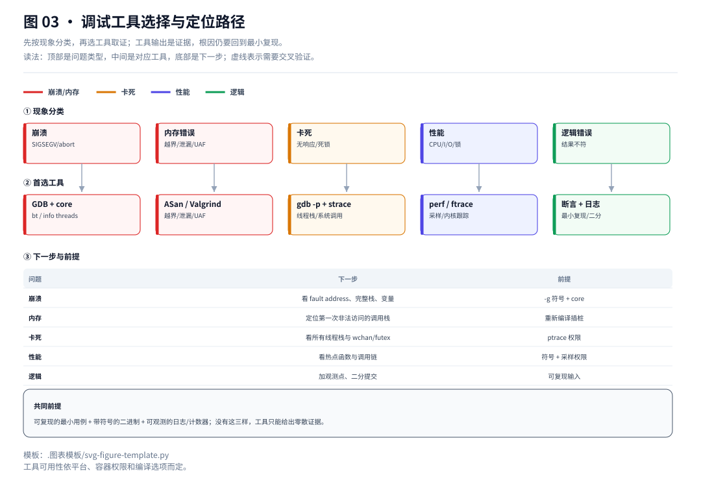

# 调试与诊断

一句话结论：调试不是“随机加打印”，而是**先分类、再选工具**：崩溃看 core/backtrace，内存看 ASan/Valgrind，卡死看 strace/gdb 栈，性能看 perf。工具只负责取证，定位仍然靠“最小复现 + 二分 + 假设验证”。

> 本篇定位：讲编译选项、GDB、core dump、内存/未定义行为检查、系统调用跟踪和性能采样。构建产物见 [00-从源码到可执行文件](./00-从源码到可执行文件.md)，构建组织见 [01-Make与CMake](./01-Make与CMake.md)。

## 目录

- [1 一句话模型](#s1)
- [2 速览](#s2)
- [3 调试信息、工具与观测点](#s3)
- [4 问题分类与诊断流程](#s4)
- [5 状态机与定时器](#s5)
- [6 设计取舍与边界](#s6)
- [7 与相邻主题的关系](#s7)
- [名词解释](#名词解释)
- [8 参考与关联](#s8)

## 1 · 一句话模型

```text
问题 ──分类──► 崩溃/内存/卡死/性能/逻辑
        │        │      │      │      │
        │      core   ASan   strace  perf
        │      gdb    valgrind gdb -p  ftrace
        └── 统一前提：可复现的最小用例 + 带符号的二进制 + 可观测的日志
```

三个关键认知：

1. **符号是调试的前提**：没有 `-g`，栈回溯只有地址；发布版可分离 debug 符号。
2. **先固定复现，再改代码**：不能稳定复现的问题，先加观测点（日志/计数器），不要盲改。
3. **工具输出是证据，不是结论**：ASan 报的是“第一次非法访问”，根因可能在更早的所有权错误。

## 2 · 速览

| 项 | 内容 |
| --- | --- |
| 所属层/领域 | C/C++ 运行期诊断 |
| 核心对象 | 进程、线程、栈帧、core、系统调用、采样 |
| 关键参数 | `-g`、`-O0/-Og`、`ulimit -c`、`ASAN_OPTIONS`、`-p` |
| 典型场景 | 段错误、内存泄漏、死锁、CPU 高、I/O 慢 |
| 主要标准 | POSIX 信号/core + GDB/LLVM/GNU 工具文档 |

## 3 · 调试信息、工具与观测点

### 3.1 编译选项

| 选项 | 作用 | 边界 |
| --- | --- | --- |
| `-g` | 生成 DWARF 调试信息 | 可与优化共存，但变量可能被优化掉 |
| `-g3` | 包含宏定义信息 | 体积更大 |
| `-O0` | 关闭优化，最贴近源码 | 时序/性能问题可能不复现 |
| `-Og` | 兼顾调试的优化 | GCC 推荐调试级别 |
| `-fno-omit-frame-pointer` | 保留帧指针 | 便于栈回溯和 perf |
| `-fsanitize=address` | AddressSanitizer | 需要链接运行时，性能开销大 |
| `-fsanitize=undefined` | UBSan | 只报告，不一定中止 |
| `-fstack-protector-strong` | 栈保护 | 只能检测部分溢出 |

### 3.2 工具矩阵

| 工具 | 观测对象 | 典型命令 | 边界 |
| --- | --- | --- | --- |
| GDB | 进程/线程/栈/变量 | `gdb ./app core`、`bt`、`info threads` | 需要符号；优化后变量可能不可见 |
| core dump | 崩溃现场 | `ulimit -c unlimited`、`coredumpctl` | 受系统配置和磁盘限制 |
| ASan | 越界/悬垂/泄漏 | `-fsanitize=address` | 内存开销约 2-3 倍 |
| UBSan | 未定义行为 | `-fsanitize=undefined` | 只报告，需配合 `-fno-sanitize-recover` |
| Valgrind | 内存错误/泄漏 | `valgrind --leak-check=full ./app` | 极慢（10-50 倍） |
| strace | 系统调用 | `strace -f -tt -s 256 ./app` | 只到系统调用层 |
| ltrace | 库调用 | `ltrace ./app` | 对静态链接/优化有限 |
| perf | CPU 采样/热点 | `perf record -g ./app`、`perf report` | 需要权限和符号 |
| ftrace | 内核函数跟踪 | `trace-cmd`/`/sys/kernel/debug/tracing` | 内核配置相关 |
| `nm/objdump/readelf` | 符号/反汇编/ELF | `nm -C app`、`objdump -d` | 静态分析，不反映运行期 |

### 3.3 关键观测点

| 观测点 | 位置 | 用途 |
| --- | --- | --- |
| 返回值 | 每个可能失败的系统/库调用 | 区分“没执行”和“执行失败” |
| `errno` | 失败后立即保存 | 后续调用会覆盖 |
| 线程 ID/名称 | 日志前缀 | 区分并发路径 |
| 时间戳 | 日志 | 判断超时、抖动、顺序 |
| 计数器 | 收发包、队列水位 | 发现泄漏/背压 |
| 栈回溯 | 断言/致命日志 | 保留现场 |

```c
#include <errno.h>
#include <string.h>

int fd = open(path, O_RDONLY);
if (fd < 0) {
    int saved = errno;
    fprintf(stderr, "open(%s) failed: %s\n", path, strerror(saved));
    return -saved;
}
```

## 4 · 问题分类与诊断流程



**读图**：从“问题现象”出发分五类：崩溃、内存错误、卡死、性能、逻辑错误；每类对应首选工具和下一步。虚线表示“工具只能给出证据，最终要回到最小复现和代码审查”。

> 图源：`images/图03-调试与诊断.svg`

### 4.1 崩溃（段错误/abort）

1. **确认 core 是否生成**：`ulimit -c`、`/proc/sys/kernel/core_pattern`。
2. **GDB 打开 core**：`gdb ./app core`，先 `bt full` 看完整栈和局部变量。
3. **看信号和地址**：`SIGSEGV` 的 fault address，判断空指针、越界、野指针。
4. **多线程**：`info threads`、`thread apply all bt`，确认是否数据竞争。
5. **未复现时**：加断言/日志，或用 ASan 重跑。

常用 GDB 命令：

| 命令 | 作用 |
| --- | --- |
| `run`/`r` | 启动程序 |
| `bt`/`bt full` | 栈回溯（含局部变量） |
| `frame N` | 切换栈帧 |
| `info locals`/`info args` | 查看局部变量/参数 |
| `p expr`/`p *ptr` | 打印表达式/解引用 |
| `x/16xb addr` | 按字节查看内存 |
| `b file:line`/`b func` | 断点 |
| `watch var` | 监视变量变化 |
| `catch signal SIGSEGV` | 捕获信号 |
| `thread apply all bt` | 所有线程栈 |
| `set follow-fork-mode child` | 跟踪子进程 |

### 4.2 内存问题

| 现象 | 首选工具 | 说明 |
| --- | --- | --- |
| 越界读写 | ASan | 报“第一次非法访问”，看 shadow memory |
| 释放后使用 | ASan | `heap-use-after-free` |
| 内存泄漏 | ASan/Valgrind | 需要退出路径干净，注意“仍可达” |
| 未初始化读 | MSan/Valgrind | MSan 需要全量插桩 |
| 双重释放 | ASan/Valgrind | 看两次 `free` 的调用栈 |
| 栈溢出 | `-fstack-protector`/core | 大局部数组、无限递归 |

Valgrind 的“still reachable”不一定是泄漏：全局缓存/池在退出时未释放是常见情况，要结合业务判断。

### 4.3 卡死/无响应

| 步骤 | 命令 | 判断 |
| --- | --- | --- |
| 看进程状态 | `ps -o pid,stat,wchan,cmd -p PID` | `D` 不可中断睡眠、`S` 可中断 |
| 看线程栈 | `gdb -p PID` → `thread apply all bt` | 是否卡在锁/IO |
| 看系统调用 | `strace -f -p PID` | 是否停在 `read/futex/wait` |
| 看锁 | `pstack`、`/proc/PID/stack` | 内核栈 |
| 看资源 | `lsof -p PID`、`ss -tp` | 文件/连接泄漏 |

死锁的典型栈：多个线程停在 `pthread_mutex_lock`/`futex`，需要结合锁顺序分析。

### 4.4 性能问题

| 现象 | 工具 | 说明 |
| --- | --- | --- |
| CPU 高 | `perf top`/`perf record -g` | 看热点函数和调用链 |
| 内存增长 | `pmap`/`smem`/ASan | 区分泄漏、缓存、碎片 |
| I/O 慢 | `iostat`/`strace -T` | 看系统调用耗时 |
| 锁竞争 | `perf lock`/`gdb` | 看 futex 等待 |
| 上下文切换多 | `pidstat -w`/`perf sched` | 线程/中断配置 |

### 4.5 逻辑错误

| 手段 | 做法 | 边界 |
| --- | --- | --- |
| 断言 | 在不变式处 `assert` | 发布版通常关闭，需另设错误处理 |
| 日志分级 | ERROR/WARN/INFO/DEBUG | 生产环境控制级别和频率 |
| 单元测试 | 最小输入覆盖边界 | 需要可注入的依赖 |
| 二分定位 | 注释/回退提交 | 依赖版本控制 |
| 对比实验 | 改一个变量 | 避免同时改多个因素 |

## 5 · 状态机与定时器

没有状态机，也没有定时器。调试过程是**假设-验证循环**：观察现象 → 提出假设 → 设计最小实验 → 确认/否定 → 收敛。日志和断点是观测手段，不改变程序状态机。

## 6 · 设计取舍与边界

- **为什么优化版难调试**：变量被寄存器化、代码被重排、内联导致栈帧消失；调试用 `-O0/-Og`，性能问题用 `-O2 + -g`。
- **为什么 ASan 比 Valgrind 快**：编译期插桩 + 影子内存；代价是需要重新编译，且不能检测所有未初始化读。
- **为什么 strace 不能替代代码审查**：它只看到系统调用，看不到用户态逻辑和内存布局。
- **core dump 的取舍**：能保留完整现场，但文件大、可能含敏感数据；生产环境要控制权限和保留策略。
- **日志的取舍**：可观测性与性能/噪音的平衡；高频路径用采样或计数器，不要每包打印。
- **常见误判**：`printf` 能解决所有问题；ASan 没报就代表没 bug；`gdb` 能看到所有优化后的变量。

## 7 · 与相邻主题的关系

| 相邻对象 | 关系 |
| --- | --- |
| [00-从源码到可执行文件](./00-从源码到可执行文件.md) | `-g`、符号、ELF、动态库路径 |
| [01-Make与CMake](./01-Make与CMake.md) | 调试/发布构建配置 |
| [61-C语言/00-C语言对象与内存模型](../61-C语言/00-C语言对象与内存模型.md) | 内存错误的语言层原因 |
| [20-平台与系统/21-Linux](../../20-平台与系统/21-Linux/.readme.md) | 内核跟踪、系统观测 |
| [80-工具与环境/02-Docker](../../80-工具与环境/02-Docker/.readme.md) | 容器内调试限制 |

一句话边界：本篇讲“怎么取证和定位”，不讲“具体业务逻辑怎么改”。

## 名词解释

> 缩写给出英文全称；非缩写用“—”表示。

| 术语 | 英文全称 | 解释 |
| --- | --- | --- |
| GDB | GNU Debugger | GNU 调试器，支持断点、单步、栈回溯和内存查看。 |
| core dump | Core Dump | 进程崩溃时的内存快照，用于事后分析。 |
| 栈回溯 | Backtrace | 从当前栈帧向上列出函数调用链。 |
| 断点 | Breakpoint | 让程序在指定位置暂停的调试手段。 |
| 观察点 | Watchpoint | 在变量被读写时暂停的调试手段。 |
| ASan | AddressSanitizer | 检测越界、悬垂指针、双重释放等内存错误的工具。 |
| UBSan | UndefinedBehaviorSanitizer | 检测未定义行为的运行时检查器。 |
| MSan | MemorySanitizer | 检测未初始化内存读取的工具。 |
| Valgrind | — | 动态二进制插桩工具，可检测内存错误和泄漏。 |
| strace | System Call Trace | 跟踪进程系统调用的工具。 |
| perf | Performance Events | Linux 性能事件采样与分析工具。 |
| ftrace | Function Tracer | Linux 内核函数跟踪框架。 |
| DWARF | Debugging With Attributed Record Formats | 常用的调试信息格式。 |
| 符号 | Symbol | 函数/变量名与地址的映射，调试和链接都依赖它。 |

## 8 · 参考与关联

**标准**

- GDB Manual、LLVM Sanitizer 文档、Valgrind Manual。
- Linux `perf`/`ftrace` 文档。

**关联**

- [00-从源码到可执行文件](./00-从源码到可执行文件.md)
- [01-Make与CMake](./01-Make与CMake.md)
- [61-C语言/00-C语言对象与内存模型](../61-C语言/00-C语言对象与内存模型.md)
- [20-平台与系统/21-Linux](../../20-平台与系统/21-Linux/.readme.md)

---

> **本篇定位**：把“调试”从经验变成“问题分类 → 工具 → 证据 → 假设验证”的流程。
> **素材来源**：`studyspace/4.其他技能/4.make/`、`2.编程技能/1.C语言/`（仅背景，内容按诊断流程重写）。
> **待验证**：容器/生产环境的 `ptrace`、core pattern、perf 权限限制。
