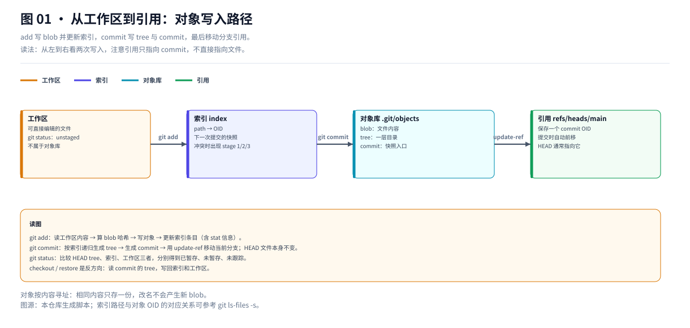
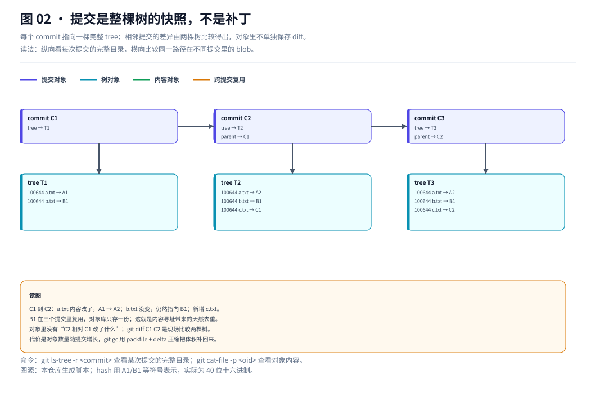
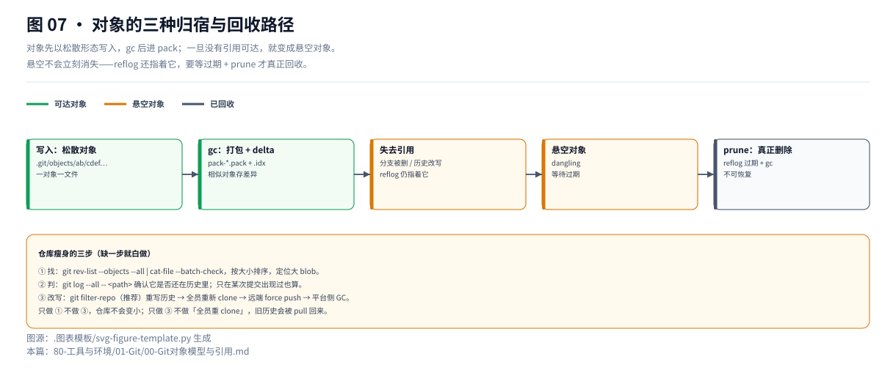

# Git 对象模型与引用

一句话结论：Git 不是"保存补丁的版本库"，而是**内容寻址的对象数据库 + 一组可移动的引用**；提交保存的是整棵目录树的快照，分支只是一个指向提交的指针。

> 本篇定位：讲清 `.git` 里到底存了什么——blob、tree、commit、tag、ref、HEAD、index、packfile，以及对象怎么被回收、仓库怎么瘦身、浅克隆少了什么。分支操作与历史重写见 [01-分支与历史重写](./01-分支与历史重写.md)，远程仓库与 refspec 见 [02-远程协作与多远程仓库](./02-远程协作与多远程仓库.md)。

## 目录

- [1 一句话模型](#s1)
- [2 速览](#s2)
- [3 对象、引用与索引](#s3)
- [4 写入、读取与回收](#s4)
- [5 状态机与定时器](#s5)
- [6 设计取舍与边界](#s6)
- [7 与相邻主题的关系](#s7)
- [名词解释](#名词解释)
- [8 参考与关联](#s8)

## 1 · 一句话模型

```text
工作区 ──git add──► 索引（暂存快照） ──git commit──► commit ──► tree ──► blob
   ▲                                                      │
   └──────────────── git checkout / restore ─────────────┘
                                              引用（branch/tag）指向 commit
```

三个关键认知：

1. **对象按内容寻址**：对象内容一变，哈希就变；相同内容只存一份，天然去重。
2. **提交是全量快照，不是增量**：每个 commit 指向一棵完整 tree，差异是读取时比较出来的。
3. **分支不是目录副本，只是 41 字节左右的引用文件**：`refs/heads/main` 里存的是一个提交哈希。

> **为什么长成这样**：快照模型让"读任意版本"变成一次查树，不用重放补丁；内容寻址让去重、校验、离线比较全部免费。代价是**对象数量爆炸**——所以才有 packfile 和 delta 压缩，也才有 §4.4 的瘦身问题。理解这个取舍，后面的现象都能自己推出来。

## 2 · 速览

| 项 | 内容 |
| --- | --- |
| 所属层/领域 | 版本控制 / 本地对象存储 |
| 核心对象 | blob、tree、commit、tag、ref、index |
| 关键参数 | `core.repositoryformatversion`、`extensions.objectFormat`、`gc.auto` |
| 典型场景 | 解释 `reset`/`checkout`/`rebase` 为何这样动文件；仓库瘦身；恢复误删提交 |
| 主要标准 | Git 内部格式（非 RFC）、SHA-1/SHA-256 |

## 3 · 对象、引用与索引

### 3.1 四类对象

| 对象 | 存什么 | 关键字段 | 作用与边界 |
| --- | --- | --- | --- |
| blob | 文件内容字节流 | 无文件名、无权限 | 相同内容跨文件、跨提交复用；改名不产生新 blob |
| tree | 一层目录 | `mode`、`type`、`object`、`name` | 目录结构靠 tree 递归表达；条目按名称排序 |
| commit | 一次快照 | `tree`、`parent[]`、`author`、`committer`、`message` | 根提交没有 parent；合并提交有多个 parent |
| tag | 附注标签 | `object`、`type`、`tag`、`tagger`、`message` | 轻量标签只是 ref，不产生 tag 对象 |

tree 条目常见 mode：

| mode | 含义 | 容易误判的点 |
| --- | --- | --- |
| `100644` | 普通文件 | Git 不保存完整权限，只区分可执行位 |
| `100755` | 可执行文件 | 跨文件系统拷贝可能丢失执行位 |
| `120000` | 符号链接 | Windows 上需开启 symlink 支持，否则会变成普通文件 |
| `040000` | 子目录（tree） | 不是文件，不能直接 `git show` 成文本 |
| `160000` | gitlink（子模块） | 只记录子模块提交哈希，不记录其文件内容 |

### 3.2 引用与特殊文件

| 名称 | 位置/形式 | 作用 | 边界 |
| --- | --- | --- | --- |
| branch | `refs/heads/<name>` | 指向一个 commit，提交时自动前移 | 不是快照，删除分支不删除对象 |
| remote-tracking branch | `refs/remotes/<remote>/<name>` | 记录上次 fetch 看到的远程状态 | 只读语义，本地提交不会自动更新它 |
| tag | `refs/tags/<name>` | 固定指向某个对象 | 轻量标签与附注标签行为不同 |
| HEAD | `.git/HEAD` | 当前分支或直接指向 commit（detached） | 内容可能是 `ref: refs/heads/main` |
| index | `.git/index` | 暂存区，记录下一次提交的树 | 冲突时同一路径可出现 stage 1/2/3 |
| reflog | `.git/logs/HEAD`、`.git/logs/refs/...` | 引用移动历史 | 默认只保留一段时间，不是永久备份 |

`packed-refs` 是引用的打包形式；`git pack-refs` 后分支文件可能不在 `refs/heads/` 下，但语义不变。

> **一处容易读错**：`packed-refs` 与 packfile 没有关系。前者是**引用**的压缩存储，后者是**对象**的压缩存储；两者都可以单独出现。

### 3.3 对象 ID 与哈希

对象 ID（OID）由 `类型 + 长度 + \0 + 内容` 计算 SHA-1（20 字节，40 位十六进制）；启用 `extensions.objectFormat = sha256` 的仓库改用 SHA-256。OID 只保证"内容相同则 ID 相同"，不保证"ID 相同一定内容相同"在密码学上永远成立。

```bash
printf 'hello\n' | git hash-object --stdin        # 只算不写
printf 'hello\n' | git hash-object -w --stdin     # 写入对象库
git cat-file -t <oid>                              # blob / tree / commit / tag
git cat-file -s <oid>                              # 字节数
```

### 3.4 index 里到底有什么

index 不是"待提交的文件列表"这么简单，它是一张**路径 → 条目**的表，每个条目至少包含：mode、OID、文件 stat（ctime/mtime/dev/ino/uid/gid/size）、stage 号。

| 概念 | 含义 | 为什么重要 |
| --- | --- | --- |
| stage 0 | 无冲突的普通条目 | 正常提交只写 stage 0 |
| stage 1/2/3 | 冲突时的 base / ours / theirs | `checkout --ours` 取的就 stage 2 |
| stat 缓存 | 记录文件元信息加速 `status` | 时间戳相同但内容变了会误判"未修改" |

```bash
git ls-files -s            # 看 mode + OID + stage
git update-index --refresh # 强制重算 stat 缓存
git ls-files -u            # 只看冲突条目（stage 1/2/3）
```

> **推论**：`git status` 快，是因为它先比 stat、只有变了才比内容。所以"刚改的文件没被识别"这类怪现象，多半是 stat 缓存失效，而不是对象坏了——`git add` 或 `--refresh` 即可。

## 4 · 写入、读取与回收

### 4.1 从修改到提交



**读图**：左边是工作区，中间是索引，右边是对象库和引用。`add` 把工作区内容写成 blob 并更新索引；`commit` 把索引写成 tree，再生成 commit，最后移动分支引用。

> 图源：`images/图01-对象模型.svg`

正常路径：

1. `git add file`：对文件内容调用 `hash-object -w` 生成 blob，更新 index 中该路径的 OID 与 stat 信息。
2. `git commit`：`write-tree` 把 index 写成 tree（子目录递归成子树），`commit-tree` 生成 commit，`update-ref` 移动当前分支。
3. `git status`：比较 HEAD tree、index、工作区三者，分别得到"已暂存/未暂存/未跟踪"。

异常分支：

- **索引与工作区时间戳相同但内容变了**：Git 依赖 stat 缓存加速，极端情况下需 `git update-index --refresh` 或 `git add` 强制刷新。
- **提交树为空**：`git commit` 会拒绝；`--allow-empty` 才会生成没有变化的 commit。
- **大小写不敏感文件系统**：`File.c` 与 `file.c` 在 macOS/Windows 上可能互相覆盖，索引里只能保留一个。

### 4.2 读取与检出



**读图**：每个 commit 指向一棵完整 tree；相邻提交的差异不在对象里单独保存，而是比较两棵树得出。

> 图源：`images/图02-提交快照.svg`

- `git checkout <commit>`：读 commit 的 tree，展开到 index 和工作区，HEAD 进入 detached 状态。
- `git cat-file -p <oid>`：按类型打印对象；`-t` 看类型，`-s` 看大小。
- `git ls-tree -r <commit>`：递归列出树内容，适合核对某个提交到底包含哪些文件。

> **detached HEAD 的后果**：此时提交不在任何分支上，切走以后只能靠 reflog 找回。要么 `git switch -c <name>` 立刻固化成分支，要么别在这里提交。

### 4.3 打包、delta 与 GC

松散对象是"一个对象一个文件"，放在 `.git/objects/ab/cdef...`。数量一多，文件系统元数据开销就会超过数据本身，所以 Git 会把它们打成 pack：

| 形态 | 位置 | 特点 |
| --- | --- | --- |
| 松散对象 | `.git/objects/xx/yyyy...` | 一对象一文件，写入快、占用大 |
| packfile | `.git/objects/pack/pack-*.pack` + `.idx` | 多对象合并，按 OID 建索引 |
| delta | pack 内部编码 | 相似对象只存"相对基准的差异"，不是独立文件 |

```bash
git count-objects -vH              # 松散对象数量与占用
git verify-pack -v .git/objects/pack/*.idx | sort -k3 -n | tail
```

> **边界**：delta 是"打包时的编码"，不是"Git 存增量历史"。取某个对象时 Git 会沿 delta 链还原，链深由 `pack.depth` 限制（默认 50）——所以历史再长，读取也不会退化成线性重放。

`git gc` 会把松散对象打包、合并小 pack、删除不可达对象；不可达对象先进悬空状态，超过保留期才真正删除。`git fsck --lost-found` 可以找回部分悬空对象。

### 4.4 仓库瘦身：找出"那个大文件"



**读图**：对象先以松散形态写入，`gc` 后进 pack；一旦没有任何引用可达（提交被改写、分支被删），就变成悬空对象。悬空对象**不会立刻消失**——reflog 还指着它，要等过期 + `gc --prune` 才真正回收。所以"删了文件、仓库没变小"是正常现象，不是没生效。

> 图源：`images/图07-对象回收与瘦身.svg`

**第一步是确认问题真的存在**：

```bash
# 按对象大小排序，找出最大的 blob
git rev-list --objects --all \
  | git cat-file --batch-check='%(objecttype) %(objectname) %(objectsize) %(rest)' \
  | awk '$1=="blob" {print $3, $4}' | sort -rn | head -20
```

**第二步是判断"大文件是否还在历史里"**：

```bash
git log --all --oneline -- path/to/big.bin     # 出现过几次
git count-objects -vH                          # 看 size-pack 是否异常
```

**第三步才是改写历史**。这一步不可逆，必须先备份、先和团队对齐：

| 工具 | 适用 | 边界 |
| --- | --- | --- |
| `git filter-repo` | 当前推荐，支持按路径/大小/内容筛选 | 需单独安装（Python 包） |
| BFG Repo-Cleaner | 只删大文件/敏感串，简单直接 | 功能窄，Java 运行 |
| `git filter-branch` | 老教程常见 | **已不推荐**：慢、易错、官方文档建议改用 filter-repo |

```bash
# 例：从全部历史中移除某路径（filter-repo 会重写所有受影响的提交）
git filter-repo --path path/to/big.bin --invert-paths
```

> **推论**：改写历史会重写**所有后代提交的 hash**，因此：① 所有人必须重新 clone（`pull` 会把旧历史又拉回来）；② 远端要 force push，托管平台的保护分支、PR、tag 都要单独处理；③ 旧对象在远端不会立刻消失，需要平台侧 GC 或重建仓库。
> **边界**：瘦身解决的是"历史里有大文件"，不解决"以后还要放大文件"——后者要用 LFS 或制品库（见 [02 §4.3](./02-远程协作与多远程仓库.md)）。

### 4.5 浅克隆与部分克隆：少了哪些对象

CI 里常见的 `--depth 1` 不是"优化"，而是**换了一种仓库形态**：

| 方式 | 命令 | 少了什么 | 代价 |
| --- | --- | --- | --- |
| 浅克隆 | `git clone --depth 1` | 历史提交与旧对象 | `log` 只能看到边界内；`blame` 退化 |
| 部分克隆 | `git clone --filter=blob:none` | 文件内容（按需拉） | 首次 `diff`/`checkout` 触发下载 |
| 单分支 | `git clone --single-branch` | 其他分支的引用 | 需要时再 `fetch` 补 |

浅克隆的"截断点"记录在 `.git/shallow` 里，那些提交被当作没有父提交。补齐历史用 `git fetch --unshallow`。

> **边界**：从浅克隆推送可能被服务端拒绝（`shallow update not allowed`），所以 CI 里"只读克隆"是安全的，"浅克隆后打 tag 再 push"是不安全的。
> **待验证**：部分克隆的 promisor 行为、`--filter` 的具体粒度随 Git 版本变化，服务端也需要支持。

## 5 · 状态机与定时器

Git 没有网络协议式的连接状态机，但有三个容易混淆的"状态"：

| 状态 | 触发 | 结束方式 |
| --- | --- | --- |
| 正常编辑 | 无进行中的操作 | 继续 add/commit |
| 合并中 | `merge` 产生冲突，生成 `MERGE_HEAD` | 解决后 `commit`，或 `merge --abort` |
| 变基/拣选中 | `rebase`/`cherry-pick` 冲突 | `--continue`、`--skip`、`--abort` |
| detached HEAD | `checkout <commit>` | `switch -c` 固化，或 `switch <branch>` 离开 |

定时/阈值类行为：

- `gc.auto`（默认约 6700 个松散对象）触发自动 gc；`gc.autoPackLimit` 控制 pack 数量。
- reflog 默认保留可达记录 90 天、不可达记录 30 天，过期后 `gc` 才可回收。
- `fetch` 的协商与超时由传输层控制，不属于对象模型。

> **这两个阈值决定了"误删后还能不能救"**：reflog 过期前，悬空提交都还在；过期且 gc 之后，只能靠备份。所以误操作要尽快处理，不要等"下次再说"。

## 6 · 设计取舍与边界

- **为什么用快照而不是增量**：读取任意版本都是 O(log n) 级查树，不依赖重放补丁；代价是对象数量多，需要 pack 和 delta 压缩。
- **为什么用内容哈希**：天然去重、可校验完整性、可离线比较；代价是哈希算法迁移复杂，且大文件每次修改都要存新 blob。
- **权限只保留可执行位**：Git 不记录 owner、完整 mode、mtime；跨平台协作时不要依赖这些属性。
- **重命名是推断出来的**：`git log --follow` 和 `diff -M` 基于相似度，不是元数据；大改后可能识别失败。
- **不适合直接存大二进制**：频繁修改的镜像、视频、设计稿应使用 Git LFS 或外部制品库。
- **reflog 不是备份**：它只在本机、只保留一段时间；误删分支要尽快恢复。
- **常见误判**：
  - `git reset --soft` 不动工作区和索引，`--mixed` 只回退索引，`--hard` 三者一起回退——差别来自"动哪几个区域"，不是"回退多少提交"；
  - "删除文件并提交，仓库就会变小"：旧对象仍在历史里，要靠 §4.4 改写；
  - "浅克隆能省磁盘所以更安全"：它截断了历史，`blame`/`log` 会给出错误结论；
  - "`pack-refs` 之后分支文件不见了，分支丢了"：语义在 `packed-refs` 里。

## 7 · 与相邻主题的关系

| 相邻对象 | 关系 |
| --- | --- |
| [分支与历史重写](./01-分支与历史重写.md) | 分支移动、merge/rebase/reset 都是在本篇的对象与引用之上操作 |
| [远程协作与多远程仓库](./02-远程协作与多远程仓库.md) | fetch/push 传输的是对象，更新的是 remote-tracking ref |
| [WSL 文件系统与网络互通](../03-WSL/01-文件系统与网络互通.md) | 跨 Windows/Linux 文件系统会放大权限、换行、大小写问题 |
| [Shell 执行模型与语法](../../60-软件开发/63-Shell/00-Shell执行模型与语法.md) | 钩子、批量脚本和提交校验都落在 Shell 层 |

一句话边界：本篇解释"东西存在哪、为什么这样存"；怎么改历史、怎么和远程同步，放在后两篇。

## 名词解释

> 缩写给出英文全称；非缩写用“—”表示。

| 术语 | 英文全称 | 解释 |
| --- | --- | --- |
| Git | — | 分布式版本控制系统，核心是内容寻址对象库。 |
| blob | Binary Large Object | 存储文件内容的对象，不含文件名和权限。 |
| tree | — | 存储一层目录结构的对象，条目指向 blob 或子树。 |
| commit | — | 指向一棵 tree 的快照对象，带父提交、作者和说明。 |
| tag | — | 指向对象的固定引用；附注标签本身也是对象。 |
| ref | Reference | 指向对象 ID 的引用，如分支、标签、远程跟踪分支。 |
| HEAD | — | 当前检出的引用；通常指向分支，也可直接指向提交。 |
| index | — | 暂存区，记录下一次提交的树和文件 stat 信息。 |
| stage | — | 索引中的冲突层级，0 为正常，1/2/3 为 base/ours/theirs。 |
| OID | Object Identifier | 对象 ID，SHA-1 为 40 位十六进制。 |
| SHA | Secure Hash Algorithm | 安全哈希算法，Git 用 SHA-1 或 SHA-256 标识对象。 |
| DAG | Directed Acyclic Graph | 有向无环图，提交历史的结构。 |
| packfile | — | 打包后的对象文件，配合 `.idx` 索引和 delta 压缩。 |
| delta | — | 打包时对一个基准对象做的差异编码。 |
| packed-refs | — | 引用（分支/tag）的打包存储，与 packfile 无关。 |
| dangling object | — | 没有任何引用可达的对象，等待 gc 回收。 |
| shallow clone | — | 只取部分历史的克隆，截断点记录在 `.git/shallow`。 |
| promisor | — | 部分克隆中按需向远端索取对象的机制。 |
| LFS | Large File Storage | Git 大文件扩展，仓库里只存指针，内容放外部存储。 |

## 8 · 参考与关联

**标准**

- Git 官方文档：`git help hash-object`、`git help update-index`、`git help rev-parse`、`git help pack-format`
- Git 内部格式：`Documentation/gitformat-*`（对象、索引、packfile）
- FIPS 180-4（SHA-1/SHA-256 定义）

**关联**

- [01-分支与历史重写](./01-分支与历史重写.md)
- [02-远程协作与多远程仓库](./02-远程协作与多远程仓库.md)
- [namespace 与 cgroup](../../20-平台与系统/21-Linux/04-进程与并发/03-namespace与cgroup.md)：理解容器隔离的底层机制

---

> **本篇定位**：Git 本地存储模型与引用语义，含对象回收、仓库瘦身与浅克隆的边界。
> **素材来源**：`studyspace-v2/10.工程方法/3.开发环境/04-git.md`、`studyspace/4.其他技能/3.linux/linux命令/git.md`（命令片段，已重写为模型）。
> **待验证**：不同 Git 版本的默认 gc 阈值与 reflog 保留期可能随发行版配置变化；部分克隆的 promisor 行为随版本与服务端能力变化。
