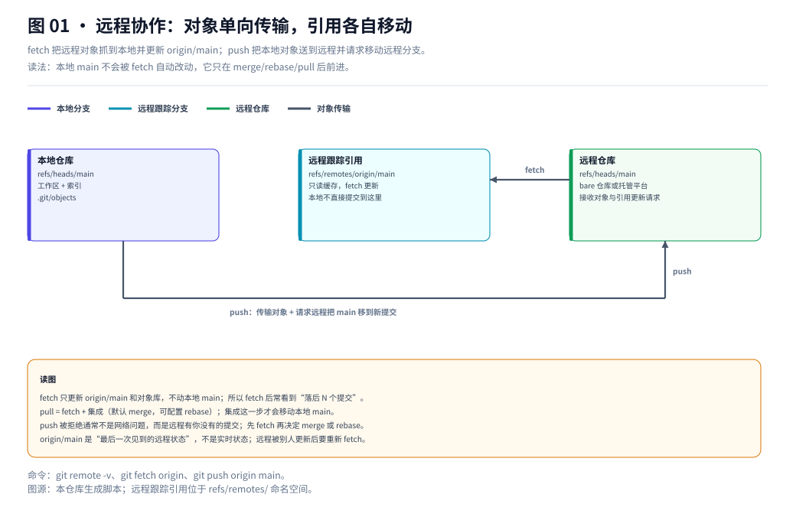
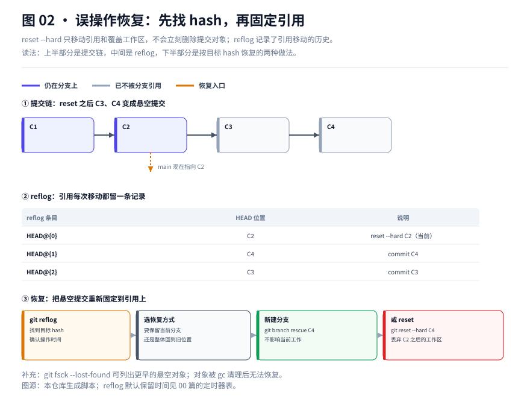

# 远程协作与多远程仓库

一句话结论：远程协作的本质是**交换提交对象、各自移动引用**；本地用 refspec 决定抓哪些、推哪些，误操作则靠 reflog 和悬空对象兜底。

> 本篇定位：remote/refspec、fetch/pull/push、远程跟踪分支、tag、submodule/LFS/worktree，以及多远程（fork/upstream）与 reflog 恢复。对象模型见 [00-Git对象模型与引用](./00-Git对象模型与引用.md)，merge/rebase 细节见 [01-分支与历史重写](./01-分支与历史重写.md)。

## 目录

- [1 一句话模型](#s1)
- [2 速览](#s2)
- [3 远程、refspec 与引用](#s3)
- [4 同步流程与恢复](#s4)
- [5 状态机与临时引用](#s5)
- [6 设计取舍与边界](#s6)
- [7 与相邻主题的关系](#s7)
- [名词解释](#名词解释)
- [8 参考与关联](#s8)

## 1 · 一句话模型：两个仓库各记各的账

远程仓库和本地仓库是两份独立的对象库。`fetch` 把远程对象复制过来，并更新本地的“远程跟踪引用”；`push` 把本地对象送过去，请求远程移动它的分支。两边引用怎么变，由各自的规则决定。

```text
本地 main ──push──► 远程 main
    ▲                   │
    │                   │ fetch
    └── merge/rebase ◄── origin/main（本地缓存的远程位置）
```

三个关键认知：

1. **`origin/main` 不是远程分支**：它是本地 `.git/refs/remotes/origin/main`，只在 fetch 时更新。
2. **fetch 不动本地分支**：fetch 后“落后 N 个提交”是正常的，集成（merge/rebase）才会移动本地分支。
3. **push 是请求，不是命令**：远程可以拒绝非快进更新；被拒绝说明远程有你没有的提交。

## 2 · 速览

| 项 | 内容 |
| --- | --- |
| 所属领域 | 版本控制 / 协作 |
| 核心对象 | remote、refspec、远程跟踪引用、tag |
| 默认远程名 | `origin` |
| 默认 fetch refspec | `+refs/heads/*:refs/remotes/origin/*` |
| 本地分支上游 | `branch.<name>.remote` + `branch.<name>.merge` |
| 常用协议 | HTTPS、SSH、本地路径 |
| 恢复手段 | reflog、ORIG_HEAD、`fsck --lost-found`、stash |
| 扩展机制 | submodule、worktree、LFS |
| 典型场景 | 多人协作、fork/PR、离线开发、误 reset 恢复 |

## 3 · 远程、refspec 与引用

### 3.1 remote 是什么

remote 是“远程仓库地址 + 一组配置”的命名条目，至少包含：

| 配置 | 作用 |
| --- | --- |
| `remote.origin.url` | fetch 地址 |
| `remote.origin.pushurl` | push 地址（可选，默认同 url） |
| `remote.origin.fetch` | fetch 的 refspec，可有多条 |
| `branch.main.remote` | 本地 main 的上游远程名 |
| `branch.main.merge` | 本地 main 对应的远程分支 |

常用命令：

```bash
git remote -v                       # 看 fetch/push 地址
git remote show origin              # 看跟踪关系与分支状态
git remote add upstream <url>       # 增加第二个远程（fork 场景）
git remote set-url origin <url>     # 换地址
git remote rename origin old        # 改名
git remote remove old               # 删除远程配置
```

### 3.2 refspec：从哪抓到哪

refspec 的格式是 `[+]<源>:<目标>`，`+` 表示允许非快进更新（强制）。

| 场景 | refspec | 含义 |
| --- | --- | --- |
| 默认 fetch | `+refs/heads/*:refs/remotes/origin/*` | 所有远程分支映射到 `refs/remotes/origin/` |
| 只抓一个分支 | `refs/heads/main:refs/remotes/origin/main` | 只更新这一个跟踪引用 |
| push 同名分支 | `refs/heads/main:refs/heads/main` | 本地 main 推到远程 main |
| push 改名 | `refs/heads/main:refs/heads/release` | 本地 main 推到远程 release |
| 删除远程分支 | `:refs/heads/old` | 源为空表示删除 |

日常更常用简写：

```bash
git fetch origin main               # 抓 main，更新 FETCH_HEAD 和 origin/main
git push origin main                # 本地 main:远程 main
git push origin HEAD:refs/heads/review   # 当前提交推到远程 review 分支
git push origin :old-branch         # 删除远程 old-branch
```

### 3.3 远程跟踪引用与上游

`refs/remotes/origin/main` 是本地引用，**不能直接提交**。它记录“最后一次 fetch 时远程 main 在哪”。

本地分支的“上游”是另一层配置：

```text
branch.main.remote = origin
branch.main.merge  = refs/heads/main
```

有了上游，`git status` 才能显示 ahead/behind，`git pull` / `git push` 才能省略参数。建立跟踪关系：

```bash
git switch --track origin/main          # 新建本地 main 并跟踪
git branch --set-upstream-to=origin/main main   # 给已有分支设置上游
git branch -vv                          # 查看每个分支的上游与 ahead/behind
```

### 3.4 tag 的同步规则

tag 不是分支，默认行为容易误解：

| 操作 | 默认行为 |
| --- | --- |
| `git fetch` | 抓取“可达的”tag，可能包含新 tag |
| `git fetch --tags` | 抓取所有 tag |
| `git push` | **不推送** tag |
| `git push --tags` | 推送所有 tag |
| `git push --follow-tags` | 推送提交时附带附注 tag |

发布用的 tag 建议用附注标签（`git tag -a v1.0 -m ...`），并显式推送。tag 被移动或删除后，其他人本地不会自动更新，需要 `git fetch --prune --tags` 或手动处理。

## 4 · 同步流程与恢复

### 4.1 fetch、pull 与 push



**读图**：fetch 从远程仓库把对象和 `origin/main` 的新位置带到本地，但不碰本地 `main`；push 从本地把对象送到远程，并请求远程移动它的 `main`。两条路径都只传对象和引用更新请求，不传“工作区”。

> 图源：`images/图01-远程引用与数据流.svg`

| 命令 | 做什么 | 是否移动本地分支 |
| --- | --- | --- |
| `git fetch` | 下载对象，更新远程跟踪引用 | 否 |
| `git pull` | fetch + merge（默认） | 是，可能产生合并提交 |
| `git pull --rebase` | fetch + rebase | 是，历史变线性 |
| `git push` | 上传对象，请求远程更新引用 | 否（移动的是远程） |
| `git push --force-with-lease` | 带远程状态校验的强制更新 | 否 |

`pull` 的默认行为由 `pull.rebase` 配置决定：

```bash
git config --global pull.rebase false   # merge（默认）
git config --global pull.rebase true    # rebase
git config --global pull.ff only        # 只允许快进，分叉就报错
```

工程上更推荐显式两步：先 `fetch` 看清差异，再决定 `merge` 还是 `rebase`。`pull` 一步完成虽然快，但冲突时容易搞不清当前处于哪种状态。

### 4.2 push 被拒绝的三种原因

```text
! [rejected] main -> main (non-fast-forward)
```

| 原因 | 含义 | 处理 |
| --- | --- | --- |
| 非快进 | 远程有你没有的提交 | `fetch` 后 `merge`/`rebase`，再 push |
| 权限不足 | 受保护分支或没有写权限 | 走 PR/MR，或申请权限 |
| 引用已存在 | 推送的 tag/分支名冲突 | 换名，或确认后强制更新 |

不要用 `--force` 解决“非快进”。`--force-with-lease` 会在远程状态与你上次 fetch 不一致时拒绝，避免覆盖别人的提交。

### 4.3 submodule、worktree 与 LFS

**submodule**：父仓库的 tree 里存一个 gitlink（mode `160000`），指向子仓库的某个提交；子仓库内容不在父仓库对象库里。

```bash
git clone --recurse-submodules <url>
git submodule update --init --recursive
git submodule status
```

边界：

- 子模块默认处于 detached HEAD，直接在子模块里提交不会自动更新父仓库指针。
- 父仓库只记录子模块的 commit hash；子模块换远程地址要同步 `.gitmodules` 和 `.git/config`。
- 子模块适合“版本相对独立、需要固定版本”的依赖；频繁变动的代码用包管理器更合适。

**worktree**：同一个对象库挂多个工作区，适合同时修 bug 和跑构建。

```bash
git worktree add ../hotfix main
git worktree list
git worktree remove ../hotfix
```

worktree 共享 `.git/objects` 和引用，但每个工作区有独立索引和 HEAD。同一个分支不能同时检出到两个 worktree。

**LFS**：大文件在 Git 里存指针，真实内容放到 LFS 存储。

```bash
git lfs install
git lfs track "*.bin"
git add .gitattributes
```

clone 时没有 LFS 客户端会只拿到指针文件；LFS 不是制品库，不能替代发布包的版本管理。

### 4.4 误操作恢复



**读图**：`reset --hard` 只把 `main` 移到 C2，C3、C4 仍留在对象库；reflog 记录了引用每次移动。恢复有两条路：新建分支固定旧提交，或把当前分支整体 reset 回去。

> 图源：`images/图02-误操作恢复路径.svg`

| 场景 | 命令 | 说明 |
| --- | --- | --- |
| 刚 reset 错 | `git reset --hard ORIG_HEAD` | ORIG_HEAD 是操作前位置 |
| 想找回几次操作前的提交 | `git reflog` | 找到 hash 后建分支 |
| reflog 也没有 | `git fsck --lost-found` | 列出悬空对象，按时间/内容辨认 |
| 工作区改乱了，未提交 | `git restore <file>` | 用索引覆盖工作区 |
| 想暂时收起改动 | `git stash push -m "..."` | `stash pop` 恢复 |
| 删了未合并分支 | `git branch rescue <hash>` | 用 reflog 里的 hash 重建 |

恢复的前提是对象还没被 gc 清理。对象一旦被 prune，只能从备份、其他 clone 或托管平台的保留策略里找。

### 4.5 fork 与 PR 场景

开源协作常见两个远程：

```text
upstream（原仓库）──fetch──► 本地 main ──push──► origin（自己的 fork）
```

| 步骤 | 命令 |
| --- | --- |
| 添加上游 | `git remote add upstream <原仓库 URL>` |
| 同步主干 | `git fetch upstream` + `git rebase upstream/main` |
| 推送特性分支 | `git push origin feature` |
| 更新 PR | 继续向同一分支 push；不要 rebase 已评审的共享分支 |

## 5 · 状态机与临时引用

远程同步没有网络定时器，但有几类“一次性状态”需要认识：

| 状态/引用 | 产生 | 含义 |
| --- | --- | --- |
| `FETCH_HEAD` | `git fetch` | 本次 fetch 抓到的分支头，`pull` 用它做集成 |
| ahead | 本地有远程没有的提交 | `git status` 显示 `ahead N` |
| behind | 远程有本地没有的提交 | `git status` 显示 `behind N` |
| diverged | 两边都有对方没有的提交 | 必须 merge 或 rebase |
| `ORIG_HEAD` | reset/merge/rebase 前 | 操作前的位置，用于快速回退 |
| `refs/stash` | `git stash` | 暂存的改动，可多条 |

```text
fetch 后
  ├─ ahead      → 直接 push
  ├─ behind     → merge/rebase 后 push
  ├─ diverged   → 先集成，再 push
  └─ 一致       → 无事可做
```

远程跟踪引用不会自动过期，除非 `fetch --prune` 或配置 `fetch.prune=true`。远程分支删除后，本地的 `origin/xxx` 可能还留着，容易误判。

## 6 · 设计取舍与边界

### 6.1 分布式换来了离线能力，也带来了同步成本

每个 clone 有完整历史，离线可提交、可查历史。代价是仓库体积、clone 时间和多人分叉后的集成成本。浅克隆（`--depth`）和部分克隆（`--filter=blob:none`）能减小体积，但会限制历史查询和离线能力。

### 6.2 merge 还是 rebase 同步上游

| 方式 | 优点 | 代价 |
| --- | --- | --- |
| merge | 保留真实分叉，冲突只处理一次 | 历史多出合并提交 |
| rebase | 线性历史，提交清晰 | 每个提交都可能冲突，hash 改变 |
| `pull.ff only` | 强制显式集成，避免误操作 | 多一步命令 |

共享分支不要 rebase；个人分支可以 rebase 后 `--force-with-lease`。

### 6.3 submodule 不是依赖管理的万能解

submodule 固定的是 commit，不是版本范围；它不解决传递依赖、版本冲突和二进制分发。团队没有统一规范时，submodule 很容易变成“clone 后还要手动初始化”的负担。Monorepo、包管理器、制品库往往更合适。

### 6.4 LFS 的边界

LFS 解决的是“大文件不要进 Git 对象库”，不解决“大文件如何发布”。LFS 存储有配额和带宽成本；CI 里没装 LFS 会拿到指针文件。发布产物仍应放制品库。

### 6.5 强制推送的边界

`--force-with-lease` 只校验“远程是否仍在你上次看到的位置”，不能防止所有覆盖。团队应保护主干分支、限制 force push，并在评审流程里明确“已评审分支不 rebase”。

### 6.6 常见误判

- “fetch 后本地代码就更新了”：fetch 只更新引用和对象库，工作区不变。
- “`origin/main` 是远程的实时状态”：它只是上次 fetch 的快照。
- “push 成功就代表别人能立刻看到”：托管平台有缓存/索引延迟，CI 也可能按队列执行。
- “删除远程分支后本地也会消失”：不会，需要 `fetch --prune`。
- “reflog 永久有效”：受 `gc.reflogExpire` 限制，过期后不可依赖。

## 7 · 与相邻主题的关系

| 相邻对象 | 关系 |
| --- | --- |
| Git 对象模型 | fetch/push 传输的是对象；引用是本地/远程各自的名字，见 [00-Git对象模型与引用](./00-Git对象模型与引用.md) |
| 分支与变基 | 同步上游后的集成方式，见 [01-分支与历史重写](./01-分支与历史重写.md) |
| 代码托管平台 | PR/MR、保护分支、fork 流程建立在 remote/refspec 之上 |
| CI/CD | clone/fetch 策略影响构建时间与可复现性 |
| 制品库 | LFS 与制品库分工：前者管源码中的大文件，后者管发布产物 |
| SVN | SVN 是集中式，没有本地完整历史；远程即唯一权威 |

一句话：**Git 把“网络同步”降级成“引用移动”，所以离线也能工作，但必须自己判断何时同步。**

## 名词解释

> 缩写给出英文全称；非缩写用“—”表示。

| 术语 | 英文全称 | 解释 |
| --- | --- | --- |
| remote | — | 远程仓库的命名配置，包含 URL 与 refspec。 |
| origin | — | clone 时默认的远程名。 |
| upstream | — | 上游仓库；fork 场景常指原仓库。 |
| refspec | Reference Specification | 描述“源引用到目标引用”的映射规则。 |
| fetch | — | 下载远程对象并更新远程跟踪引用。 |
| pull | — | fetch 后再 merge 或 rebase。 |
| push | — | 上传对象并请求远程更新引用。 |
| tracking branch | — | 与某个远程分支建立上游关系的本地分支。 |
| ahead / behind | — | 本地相对上游多出 / 缺少的提交数。 |
| diverged | — | 本地与上游各有对方没有的提交。 |
| FETCH_HEAD | — | 记录本次 fetch 抓到的分支头。 |
| ORIG_HEAD | — | 危险操作前的位置，用于回退。 |
| prune | — | 清理已不存在的远程跟踪引用。 |
| submodule | — | 父仓库通过 gitlink 固定子仓库的某个提交。 |
| gitlink | — | tree 中 mode 为 160000 的子模块条目。 |
| worktree | — | 同一对象库挂载的额外工作区。 |
| LFS | Large File Storage | Git 大文件扩展，对象库只存指针。 |
| reflog | Reference Log | 引用移动日志。 |
| dangling commit | — | 没有任何引用可达的提交对象。 |
| PR / MR | Pull Request / Merge Request | 托管平台上的合并请求。 |

## 8 · 参考与关联

**标准与文档**

- Pro Git（第 2 版）：第 4 章 Git on the Server、第 6 章 GitHub、第 7 章 Git Tools
- `git help remote`、`git help fetch`、`git help push`、`git help rev-parse`（refspec 语法）
- `git help submodule`、`git help worktree`、`git help reflog`

**关联**

- [00-Git对象模型与引用](./00-Git对象模型与引用.md)：对象与引用
- [01-分支与历史重写](./01-分支与历史重写.md)：同步上游后的集成
- [80-工具与环境/02-Docker](../02-Docker/.readme.md)：镜像仓库的 push/pull 与 Git 的异同
- [80-工具与环境/03-WSL](../03-WSL/.readme.md)：WSL 中的 SSH 凭据与 Git 配置
- [60-软件开发](../../60-软件开发/.readme.md)：CI 与发布流程

---

> **本篇定位**：讲清远程引用、refspec、同步流程和恢复手段；不展开托管平台的具体操作界面。
> **素材来源**：`studyspace/4.其他技能/3.linux/linux命令/git.md`（remote、push、rebase 片段）、`studyspace-v2/10.工程方法/3.开发环境/04-git.md`（补），原理部分按 Pro Git 与 `git help` 补写。
> **待验证**：不同托管平台对 force push、tag 保护、LFS 配额的政策不同；`fetch` 自动跟随 tag 的行为随版本和配置变化。
