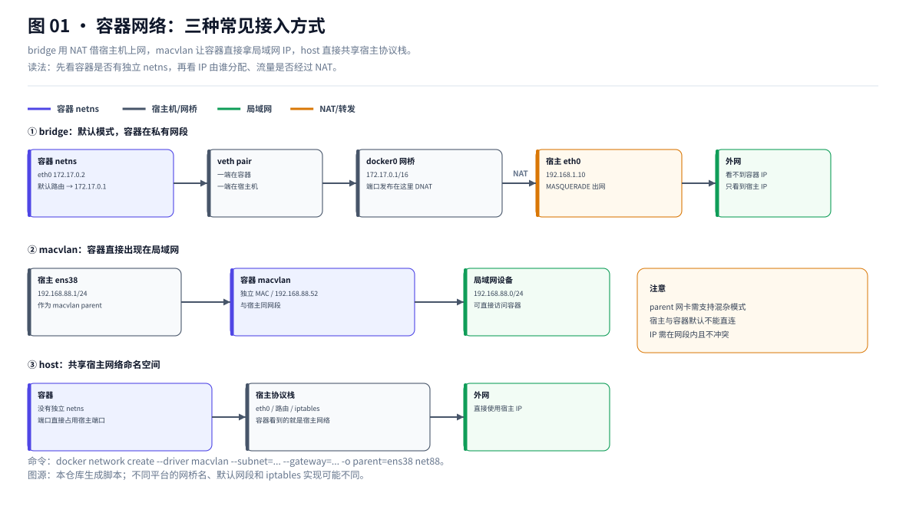
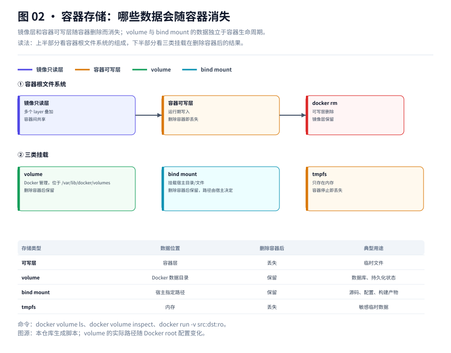

# 容器网络与存储

一句话结论：容器的网络是 **network namespace + veth + 网桥/驱动**拼出来的独立协议栈；存储是**联合文件系统 + 挂载**，容器删了数据还在不在，取决于用的是可写层、volume 还是 bind mount。

> 本篇定位：bridge/host/none/macvlan 等网络模式、端口发布与 DNS，可写层/volume/bind mount/tmpfs 的边界，以及容器生命周期与重启策略。镜像构建见 [01-镜像分层与构建](./01-镜像分层与构建.md)，多容器编排见 [03-Compose与交叉编译环境](./03-Compose与交叉编译环境.md)。

## 目录

- [1 一句话模型](#s1)
- [2 速览](#s2)
- [3 网络模式与字段](#s3)
- [4 存储与挂载流程](#s4)
- [5 状态机与生命周期](#s5)
- [6 设计取舍与边界](#s6)
- [7 与相邻主题的关系](#s7)
- [名词解释](#名词解释)
- [8 参考与关联](#s8)

## 1 · 一句话模型：独立协议栈 + 可选择的挂载

容器默认有自己的 network namespace：独立的网卡、IP、路由表和 iptables 规则。它通过 veth pair 接到宿主网桥，再由 NAT 出网；文件系统则是“镜像只读层 + 容器可写层 + 若干挂载点”。

```text
容器 netns ──veth──► docker0（网桥）──NAT──► 宿主 eth0 ──► 外网

容器根文件系统 = 镜像只读层 + 可写层
数据目录       = volume / bind mount / tmpfs（三选一或组合）
```

三个关键认知：

1. **默认 bridge 是 NAT 网络**：容器有私有 IP，外网看到的是宿主 IP；端口要显式发布。
2. **macvlan 把容器变成局域网设备**：容器拿独立 MAC 和同网段 IP，不再经过宿主 NAT。
3. **删除容器只删可写层**：volume 和 bind mount 的数据独立存在，除非显式删除。

## 2 · 速览

| 项 | 内容 |
| --- | --- |
| 所属领域 | 容器 / 网络与存储 |
| 网络驱动 | bridge、host、none、container、macvlan、ipvlan、overlay |
| 默认网桥 | `docker0`，默认网段通常为 `172.17.0.0/16` |
| 端口发布 | `-p 宿主端口:容器端口`，底层是 DNAT |
| DNS | 用户自定义 bridge 内置 DNS，默认 bridge 不支持名字解析 |
| 存储类型 | 可写层、volume、bind mount、tmpfs |
| volume 位置 | `/var/lib/docker/volumes/`（随 Docker root 配置变化） |
| 生命周期 | created、running、paused、exited、dead |
| 典型场景 | 服务暴露、协议栈实验、持久化数据、跨主机组网 |

## 3 · 网络模式与字段

### 3.1 五种常见模式

| 模式 | 容器网络栈 | IP 来源 | 外部可达性 | 典型用途 |
| --- | --- | --- | --- | --- |
| bridge | 独立 netns | Docker 从网桥网段分配 | 需 `-p` 发布端口 | 默认、单机服务 |
| host | 共享宿主 netns | 直接用宿主 IP | 直接用宿主端口 | 高性能、端口固定的服务 |
| none | 独立但只有 lo | 无 | 不可达 | 完全隔离、离线计算 |
| container | 共享另一个容器的 netns | 同目标容器 | 同目标容器 | sidecar、共享网络栈 |
| macvlan | 独立 netns + 独立 MAC | 由外部网段分配 | 局域网直接可达 | 需要局域网 IP 的设备模拟 |

`overlay` 用于多主机（Swarm），`ipvlan` 与 macvlan 类似但共享 MAC、按 IP 区分。跨主机场景通常交给 Kubernetes CNI 或云网络，不在单机 Docker 范围内展开。

### 3.2 bridge 模式的数据路径



**读图**：bridge 模式下，容器 eth0 通过 veth pair 接到 docker0，出网时做 MASQUERADE，外网只看到宿主 IP；macvlan 模式下容器直接挂在 parent 网卡上，拿局域网 IP；host 模式没有独立 netns，容器直接用宿主协议栈。

> 图源：`images/图01-容器网络模式.svg`

bridge 模式的几个关键点：

| 对象 | 作用 | 注意 |
| --- | --- | --- |
| `docker0` | 默认网桥，连接所有 bridge 容器 | 可自定义网段，避免与现网冲突 |
| veth pair | 一对虚拟网卡，一端在容器、一端在网桥 | 删除容器时一并删除 |
| iptables NAT | 出网 MASQUERADE，入站 DNAT | 规则由 Docker 管理，不要手工乱改 |
| 端口发布 | `-p 8080:80` 把宿主 8080 转到容器 80 | 只监听 `0.0.0.0` 时外部可访问 |
| 内置 DNS | 用户自定义 bridge 支持服务名解析 | 默认 bridge 只能靠 IP 或 `--link` |

端口发布的边界：

```bash
docker run -p 8080:80 nginx          # 宿主所有地址的 8080 → 容器 80
docker run -p 127.0.0.1:8080:80 nginx # 只监听回环，外部不可访问
docker run -P nginx                   # 随机宿主端口映射 EXPOSE 端口
```

### 3.3 macvlan：容器直接进局域网

```bash
docker network create --driver macvlan \
  --subnet=192.168.88.0/24 --gateway=192.168.88.1 \
  -o parent=ens38 net88

docker run --name wg --cap-add=NET_ADMIN --network=net88 \
  --ip 192.168.88.52 -d ubuntu-server:wireguard
```

适用场景：需要容器拥有局域网 IP、跑 DHCP/PPPoE/WireGuard 等对二层有要求的协议。

边界：

- parent 网卡需要支持混杂模式；无线网卡、部分虚拟网卡不支持。
- 宿主与 macvlan 容器默认不能直接通信（流量不经过宿主协议栈），需要额外 macvlan 接口或路由。
- IP 必须与局域网规划一致，避免与 DHCP 池冲突。
- 容器里跑网络协议常需要 `--cap-add=NET_ADMIN`，但这会扩大权限，生产环境要评估。

### 3.4 DNS 与服务发现

| 场景 | 解析方式 |
| --- | --- |
| 默认 bridge | 只能用容器 IP；`--link` 已过时 |
| 用户自定义 bridge | 内置 DNS 按容器名/网络别名解析 |
| Compose | 服务名就是 DNS 名，同一网络内互通 |
| host 模式 | 直接用宿主 DNS 配置 |
| macvlan | 依赖局域网 DNS 或静态 hosts |

容器内 `/etc/resolv.conf` 由 Docker 生成；使用自定义网络时，DNS 服务器指向 `127.0.0.11`，由 Docker 的内嵌 DNS 转发。

## 4 · 存储与挂载流程

### 4.1 根文件系统：镜像层 + 可写层



**读图**：上半部分是容器根文件系统，镜像只读层共享、可写层随容器删除；下半部分是三类挂载，volume 和 bind mount 的数据独立于容器，tmpfs 只存在内存。

> 图源：`images/图02-容器存储与生命周期.svg`

容器内看到的文件，可能来自四个地方：

```text
容器路径
  ├─ 镜像只读层（多个 layer 叠加）
  ├─ 容器可写层（运行期修改）
  ├─ volume（Docker 管理的持久化目录）
  └─ bind mount / tmpfs（宿主目录或内存）
```

挂载点会“遮住”镜像里同路径的内容；排查“文件怎么不见了”时，先看 `docker inspect` 的 `Mounts`。

### 4.2 volume、bind mount 与 tmpfs

| 类型 | 声明方式 | 数据位置 | 删除容器后 | 适用 |
| --- | --- | --- | --- | --- |
| volume | `-v myvol:/data` | Docker 数据目录 | 保留 | 数据库、持久化状态 |
| bind mount | `-v /host/path:/data` | 宿主指定路径 | 保留 | 源码、配置、构建产物 |
| tmpfs | `--tmpfs /data` | 内存 | 丢失 | 敏感临时数据、缓存 |

`-v` 与 `--mount` 的差别：

```bash
# -v：短语法，路径不存在会自动创建（bind mount 也会）
docker run -v /host/src:/src:ro image

# --mount：长语法，语义更明确，路径不存在会报错
docker run --mount type=bind,src=/host/src,dst=/src,readonly image
```

工程上推荐 `--mount`，因为它不会静默创建不存在的宿主路径，减少“挂了个空目录”的误判。

### 4.3 UID/GID 与权限

容器内进程的 UID/GID 与宿主是同一套内核 ID。以 root 运行并写 bind mount，宿主文件就会变成 root 所有。常见处理：

| 方式 | 做法 | 代价 |
| --- | --- | --- |
| 镜像内建同 UID 用户 | 构建时 `useradd -u $(id -u)` | 镜像与用户 ID 绑定 |
| 运行时 `--user` | `docker run --user $(id -u):$(id -g)` | 镜像内目录权限要允许 |
| 构建后 chown | 容器内 `chown` 产物 | 需要 root 或正确权限 |
| rootless Docker | 用普通用户运行 daemon | 兼容性和网络能力受限 |

通信设备构建常把源码目录 bind mount 进容器，产物落在宿主机；UID 不一致会导致文件属主混乱，需要在 Dockerfile 或运行参数里统一。

### 4.4 数据备份与迁移

| 对象 | 备份方式 | 注意 |
| --- | --- | --- |
| volume | 临时容器挂载 volume 后 `tar` | 停写或保证一致性 |
| bind mount | 直接备份宿主目录 | 注意权限与符号链接 |
| 镜像 | `docker save` / registry push | 镜像不含 volume 数据 |
| 容器 | `docker export` 导出根文件系统 | 不含 volume，不适合完整备份 |

`docker export` 导出的是容器文件系统快照，不包含镜像历史和 volume；需要完整迁移时，镜像 + volume 分开处理。

## 5 · 状态机与生命周期

### 5.1 容器状态

```text
created ──start──► running ──stop──► exited ──start──► running
                     │  │
                     │  └──pause──► paused ──unpause──► running
                     └──die（进程退出/OOM/健康检查失败）──► exited
                                                        │
                                                   rm ──► 删除
```

| 状态 | 含义 | 常见原因 |
| --- | --- | --- |
| created | 已创建，未启动 | `docker create` |
| running | 主进程在运行 | `docker start/run` |
| paused | 进程被冻结 | `docker pause` |
| exited | 主进程退出 | 正常结束、崩溃、OOM |
| dead | 无法删除的异常状态 | 存储/驱动异常，需排查 |

容器的主进程退出，容器就进入 exited；它不会“自动重启”，除非配置了重启策略。

### 5.2 重启策略与健康检查

| 策略 | 行为 |
| --- | --- |
| `no` | 不自动重启（默认） |
| `on-failure[:N]` | 非零退出码时重启，最多 N 次 |
| `always` | 退出就重启，手动 stop 也会在 daemon 重启后拉起 |
| `unless-stopped` | 退出就重启，手动 stop 后保持停止 |

`HEALTHCHECK` 只改变容器健康状态，不会自动重启容器；需要配合编排工具（Compose `depends_on: condition: service_healthy`、Swarm、K8s）使用。

### 5.3 网络与存储的生命周期

- 网络：`docker network create` 创建，删除容器不会删除自定义网络；`docker network prune` 清理未使用网络。
- volume：匿名 volume 在删除容器时可能被保留；`docker volume prune` 会删除未挂载的 volume，执行前要确认。
- 端口：容器停止后端口释放；host 模式下端口冲突会直接导致启动失败。

## 6 · 设计取舍与边界

### 6.1 bridge、macvlan、host 怎么选

| 维度 | bridge | macvlan | host |
| --- | --- | --- | --- |
| 隔离性 | 好 | 中（直接暴露在 LAN） | 无 |
| 外部可达 | 需端口发布 | 直接可达 | 直接可达 |
| IP 规划 | Docker 私有网段 | 局域网网段 | 宿主 IP |
| 二层协议 | 不支持（NAT 后） | 支持 | 支持 |
| 排障难度 | 中（NAT/iptables） | 高（MAC/交换/混杂） | 低 |
| 适用 | Web 服务、一般应用 | 设备模拟、二层协议 | 高性能、固定端口 |

需要“容器像一台局域网设备”时选 macvlan；只是对外提供服务，bridge + 端口发布更简单；对网络性能极敏感且能接受隔离性下降，才用 host。

### 6.2 volume 还是 bind mount

volume 由 Docker 管理，跨平台行为一致，适合持久化数据；bind mount 直接映射宿主路径，适合开发时的源码/配置，但依赖宿主目录结构和权限。生产数据库优先 volume，开发环境用 bind mount 更方便。

### 6.3 NAT 的代价

bridge 模式出网要经过 conntrack/NAT，高并发下会消耗连接跟踪表；端口发布也依赖 iptables。macvlan/host 绕过 NAT，但牺牲隔离性或 IP 规划灵活性。没有“全都好”的模式，要按流量模型选。

### 6.4 权限与安全边界

`--cap-add=NET_ADMIN`、`--privileged`、挂载 `/var/run/docker.sock` 都会显著扩大容器权限。跑 WireGuard、DHCP、PPPoE 等需要改网络配置的协议时，优先只加必要 capability，并限制网络模式；不要用 privileged 图省事。

### 6.5 跨平台文件系统性能

在 macOS/Windows 上，bind mount 到 Linux 容器的 I/O 可能明显变慢（需要经过虚拟化层）。大量小文件编译时，把源码放在 Linux 文件系统内（WSL2 的 ext4、Linux 宿主机目录）通常比挂载宿主目录快。具体差异随 Docker Desktop/WSL 版本变化，需实测。

### 6.6 常见误判

- “容器有 IP 就能被外网访问”：bridge 模式还需要端口发布或路由。
- “删除容器数据就没了”：volume/bind mount 的数据还在。
- “`-p 8080:80` 一定监听所有地址”：绑定 `127.0.0.1` 时只监听回环。
- “macvlan 容器能和宿主直接通信”：默认不能，需要额外配置。
- “`docker rm -f` 会删 volume”：不会，除非 `-v` 且是匿名 volume。
- “重启策略能治愈崩溃”：频繁崩溃会被重启策略放大，需看日志和健康检查。

## 7 · 与相邻主题的关系

| 相邻对象 | 关系 |
| --- | --- |
| 镜像分层与构建 | 镜像提供只读层，容器在其上加可写层，见 [01-镜像分层与构建](./01-镜像分层与构建.md) |
| Compose 与交叉编译 | 网络/volume 在 Compose 里声明，见 [03-Compose与交叉编译环境](./03-Compose与交叉编译环境.md) |
| Linux 网络子系统 | veth、bridge、netns、iptables 的底层机制归 20-平台与系统 |
| WSL | WSL2 的网络与 Windows 宿主关系会影响端口访问和 bind mount 性能 |
| Kubernetes | Pod 网络、CNI、PV/PVC 是同一组概念在编排层的延伸 |

一句话：**网络决定“容器怎么被访问”，存储决定“数据活多久”。**

## 名词解释

> 缩写给出英文全称；非缩写用“—”表示。

| 术语 | 英文全称 | 解释 |
| --- | --- | --- |
| netns | Network Namespace | 网络命名空间，容器独立协议栈的基础。 |
| veth | Virtual Ethernet | 一对虚拟网卡，连接容器与宿主网桥。 |
| bridge | — | 虚拟网桥，连接同一网段内的容器。 |
| docker0 | — | Docker 默认网桥。 |
| NAT | Network Address Translation | 网络地址转换，容器出网时改写源地址。 |
| MASQUERADE | — | iptables 的源地址伪装动作。 |
| DNAT | Destination Network Address Translation | 目标地址转换，端口发布使用。 |
| macvlan | — | 让容器拥有独立 MAC、直接接入局域网的驱动。 |
| ipvlan | — | 共享 MAC、按 IP 区分容器的驱动。 |
| overlay | — | 跨主机的虚拟网络驱动。 |
| CNI | Container Network Interface | 容器网络接口标准，Kubernetes 常用。 |
| DNS | Domain Name System | 域名系统，容器服务发现的基础。 |
| volume | — | Docker 管理的持久化数据卷。 |
| bind mount | — | 把宿主目录挂载进容器。 |
| tmpfs | Temporary File System | 内存文件系统，容器停止即丢失。 |
| COW | Copy-on-Write | 写时复制，容器修改文件时复制到可写层。 |
| UID / GID | User Identifier / Group Identifier | 用户 ID / 组 ID。 |
| OOM | Out Of Memory | 内存不足，容器可能被内核杀死。 |
| PV / PVC | Persistent Volume / Persistent Volume Claim | Kubernetes 的持久卷与声明。 |

## 8 · 参考与关联

**标准与文档**

- Docker 官方文档：Networking overview、Macvlan networks、Storage overview、Volumes
- `docker help run`、`docker help network`、`docker help volume`
- Linux 内核文档：network namespace、veth、bridge

**关联**

- [01-镜像分层与构建](./01-镜像分层与构建.md)：镜像层与可写层
- [03-Compose与交叉编译环境](./03-Compose与交叉编译环境.md)：Compose 中的网络与卷声明
- [20-平台与系统/21-Linux/06-网络子系统](../../20-平台与系统/21-Linux/06-网络子系统/.readme.md)：netns/veth/bridge 实现
- [10-基础理论/11-网络科学/03-网络层](../../10-基础理论/11-网络科学/03-网络层/05-NAT.md)：NAT 与端口转换
- [03-WSL/01-文件系统与网络互通](../03-WSL/01-文件系统与网络互通.md)：WSL 网络与挂载性能

---

> **本篇定位**：讲清容器网络模式、端口发布、存储类型和生命周期；不展开 Kubernetes CNI/CSI。
> **素材来源**：`studyspace/4.其他技能/1.docker/docker.md`（macvlan、`--cap-add=NET_ADMIN`、bind mount 示例）、`studyspace/4.其他技能/3.linux/linux命令/docker.md`、`studyspace-v2/10.工程方法/3.开发环境/01-docker-examples/`（SNMP/WireGuard 网络实践），原理部分按 Docker 文档补写。
> **待验证**：Docker Desktop、rootless Docker、不同内核版本对 macvlan/iptables 的行为有差异；WSL2 的端口转发策略随版本变化。
