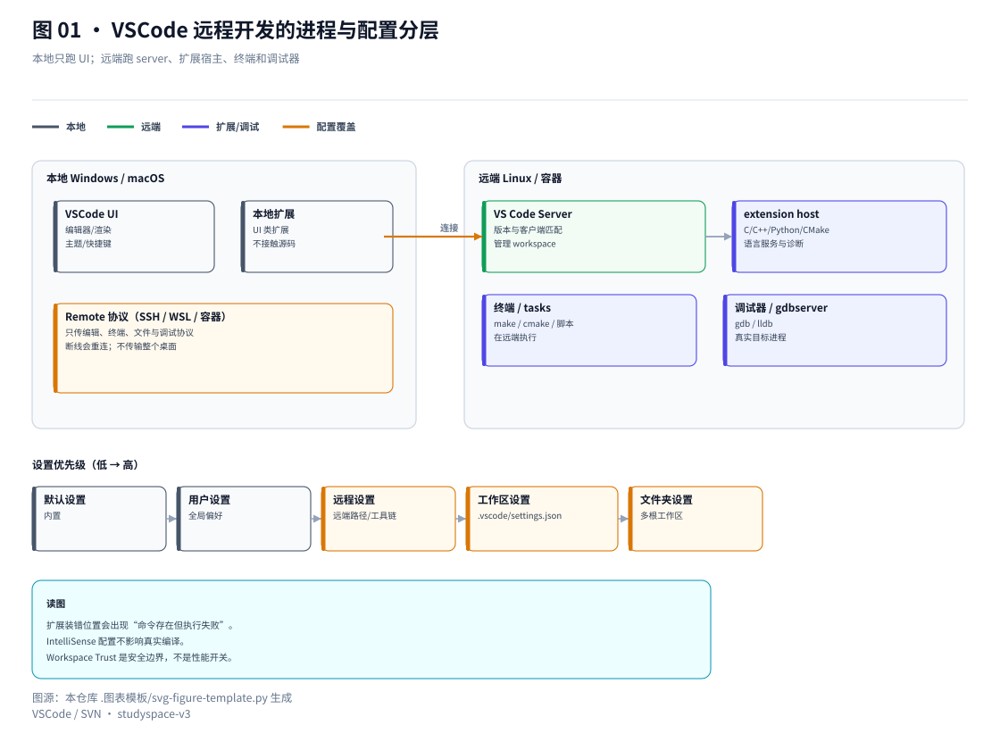

# VSCode 远程开发与配置

一句话结论：VSCode 的远程开发不是“把整个 IDE 传过去”，而是**本地只跑 UI，远端跑 VS Code Server、扩展宿主和调试器**；理解这条分界线，才能解释扩展为什么分“本地/远程”、终端和端口为什么在远端、配置文件为什么有多层优先级。

> 本篇定位：Remote-WSL/SSH/Containers 的架构、设置与配置文件分层、C/C++ 工程的 tasks/launch 配置、Dev Container 的取舍。WSL 环境见 [WSL2 架构与安装](../03-WSL/00-WSL2架构与安装.md)，Git 协作见 [Git 对象模型与引用](../01-Git/00-Git对象模型与引用.md)。

## 目录

- [1 一句话模型](#s1)
- [2 速览](#s2)
- [3 组件与配置字段](#s3)
- [4 连接、构建与调试流程](#s4)
- [5 状态机与定时器](#s5)
- [6 设计取舍与边界](#s6)
- [7 与相邻主题的关系](#s7)
- [名词解释](#名词解释)
- [8 参考与关联](#s8)

## 1 · 一句话模型

```text
本地 VSCode（UI/渲染）
   │  Remote 协议
   ▼
远端 VS Code Server
   ├─ 扩展宿主（workspace 扩展、语言服务）
   ├─ 终端 / 任务 / 调试适配器
   └─ 文件系统 / 工具链 / 容器
```

三个关键认知：

1. **UI 与工作区分离**：编辑器窗口在本地，代码、终端、编译、调试都在远端。
2. **扩展分两处运行**：UI 类扩展（主题、快捷键）在本地；工作区类扩展（C/C++、Python、CMake）在远端。
3. **配置有层级**：默认 < 用户 < 远程 < 工作区 < 文件夹；同一项在不同层可能互相覆盖。

## 2 · 速览

| 项 | 内容 |
| --- | --- |
| 所属层/领域 | 编辑器 / 远程开发环境 |
| 核心对象 | VS Code Server、extension host、workspace、devcontainer |
| 关键参数 | `remote.SSH.*`、`settings.json`、`tasks.json`、`launch.json` |
| 典型场景 | Windows 编辑 + Linux 编译、容器内复现环境、远程服务器开发 |
| 主要标准 | LSP、DAP、SSH、Dev Container Spec |

## 3 · 组件与配置字段

### 3.1 远程模式对比

| 模式 | 远端是什么 | 适用 | 边界 |
| --- | --- | --- | --- |
| Remote-WSL | WSL2 发行版 | Windows 上开发 Linux 程序 | 跨 `/mnt/c` 性能差 |
| Remote-SSH | 一台 Linux 主机 | 服务器/构建机开发 | 依赖 SSH、密钥与网络 |
| Dev Containers | Docker 容器 | 团队统一工具链 | 需要 Docker，镜像/挂载有成本 |
| Tunnels | 通过微软隧道访问远端 | 无公网 IP 的机器 | 依赖账号与网络策略 |

### 3.2 配置文件与优先级

| 文件 | 作用 | 关键点 |
| --- | --- | --- |
| 用户 `settings.json` | 全局偏好 | 跨项目生效；不要放项目专属路径 |
| 远程 `settings.json` | 远端环境的设置 | 与本地设置分开，适合 Linux 路径/工具链 |
| 工作区 `.vscode/settings.json` | 项目设置 | 随仓库提交，团队共享 |
| `.vscode/tasks.json` | 构建/清理任务 | 可调用 Make/CMake/脚本，输出到终端 |
| `.vscode/launch.json` | 调试配置 | `program`、`args`、`cwd`、`miDebuggerPath` |
| `.vscode/c_cpp_properties.json` | IntelliSense | `includePath`、`compilerPath`、`defines` |
| `.vscode/extensions.json` | 推荐扩展 | 新成员打开项目时提示安装 |
| `.devcontainer/devcontainer.json` | 容器开发环境 | 镜像、挂载、端口、postCreateCommand |

优先级（从低到高）：默认设置 → 用户设置 → 远程设置 → 工作区设置 → 工作区文件夹设置。语言特定设置（`"[c]"`）再覆盖通用设置。

### 3.3 C/C++ 工程常用字段

| 字段 | 作用 | 常见误判 |
| --- | --- | --- |
| `includePath` | 头文件搜索路径 | 只影响 IntelliSense，不影响真实编译 |
| `compilerPath` | 指定编译器 | 交叉编译时要指向目标工具链，不是宿主 gcc |
| `defines` | 预处理宏 | 与构建系统里的宏不一致会导致“编辑器不报错、编译报错” |
| `compileCommands` | 使用 `compile_commands.json` | 最准确，但需要构建系统生成 |
| `tasks.json` 的 `command` | 实际执行的构建命令 | 在远端执行，路径是远端路径 |
| `launch.json` 的 `miDebuggerPath` | gdb/lldb 路径 | 交叉调试要用目标架构的 gdb/gdbserver |

## 4 · 连接、构建与调试流程

### 4.1 连接与扩展安装



**读图**：左侧本地只负责 UI，右侧远端运行 VS Code Server、扩展宿主、终端和调试器；下方是设置文件的覆盖顺序。

> 图源：`images/图01-远程开发.svg`

正常路径：

1. 安装 Remote 扩展（WSL/SSH/Containers）。
2. 连接目标：`WSL: Ubuntu`、`SSH: host` 或 `Dev Container: Reopen in Container`。
3. 远端自动下载/启动 VS Code Server（版本与本地客户端匹配）。
4. 在远端安装工作区扩展；本地 UI 扩展保持在本地。
5. 打开项目文件夹，终端、任务、调试器都在远端执行。

异常分支：

- **连不上远端**：SSH 密钥/代理/防火墙；WSL 未启动；容器未运行。
- **扩展“在本地可用、远端不可用”**：该扩展声明为 UI 扩展，或未在远端安装；看扩展页的“Install in Remote”。
- **终端命令找不到**：远端 shell 的 PATH 与本地不同；`settings.json` 里的 `terminal.integrated.env.linux` 可补充。
- **调试器起不来**：`program` 路径是本地路径、`miDebuggerPath` 不存在，或缺少 `gdbserver`。
- **文件监视失效**：Linux 的 `fs.inotify.max_user_watches` 太小；大型仓库需要调大。

### 4.2 任务与调试配置示例

```jsonc
// .vscode/tasks.json
{
  "version": "2.0.0",
  "tasks": [
    {
      "label": "build",
      "type": "shell",
      "command": "make -j$(nproc)",
      "group": { "kind": "build", "isDefault": true },
      "problemMatcher": ["$gcc"]
    }
  ]
}
```

```jsonc
// .vscode/launch.json
{
  "version": "0.2.0",
  "configurations": [
    {
      "name": "debug app",
      "type": "cppdbg",
      "request": "launch",
      "program": "${workspaceFolder}/build/app",
      "args": [],
      "cwd": "${workspaceFolder}",
      "MIMode": "gdb",
      "miDebuggerPath": "/usr/bin/gdb",
      "preLaunchTask": "build"
    }
  ]
}
```

要点：

- `${workspaceFolder}` 在远端展开，指向远端路径。
- `preLaunchTask` 的 label 必须与 `tasks.json` 一致，否则调试前不会构建。
- 交叉调试时，`program` 是目标机可执行文件，`miDebuggerPath` 用交叉 gdb，必要时配 `gdbServer`/`pipeTransport`。

### 4.3 Dev Container 的流程

1. 仓库提供 `.devcontainer/devcontainer.json` 和 `Dockerfile`/`compose.yaml`。
2. VSCode 构建或拉取镜像，挂载工作区。
3. 执行 `postCreateCommand` 安装依赖。
4. 在容器内启动 VS Code Server，扩展和工具链都装在容器里。
5. 端口通过 VSCode 转发到本地。

这条路径把“环境即代码”落到仓库里，适合团队统一工具链；代价是首次构建慢、容器内文件性能与挂载方式相关。

## 5 · 状态机与定时器

| 对象 | 状态 | 说明 |
| --- | --- | --- |
| 远程连接 | disconnected → connecting → connected → disconnected | 网络中断会重连；容器/VM 停止则失败 |
| VS Code Server | 未安装 → 下载 → 运行 → 版本不匹配 | 客户端升级后可能要求重装 server |
| 扩展宿主 | 启动 → 加载扩展 → 崩溃/重启 | 扩展崩溃只影响该宿主 |
| 调试会话 | 未启动 → 启动 → 运行 → 终止 | `preLaunchTask` 失败会阻止启动 |
| 端口转发 | 未转发 → 已转发 → 关闭 | 远端服务停止后转发失效 |

没有协议状态机；相关定时器主要是 SSH keepalive、连接重试、任务/调试超时。工作区信任（Workspace Trust）是安全状态，不是定时器。

## 6 · 设计取舍与边界

- **为什么 UI 与工作区分开**：本地保留流畅编辑体验，远端获得 Linux 工具链和真实运行环境；代价是网络依赖和 server 版本管理。
- **扩展装在哪**：语言服务、调试器、构建工具必须装远端；主题、快捷键、UI 增强装本地。装错位置会出现“命令存在但无法执行”。
- **设置放哪**：团队共享的放 `.vscode/settings.json`；个人偏好放用户设置；机器相关的路径放远程设置，不要提交。
- **Dev Container 不是万能**：它保证工具链一致，但不保证内核/硬件/串口一致；需要真实设备的场景仍要 USB 透传或远程目标机。
- **Workspace Trust 是安全边界**：打开不可信仓库时不要自动执行任务/调试；`tasks.json` 和 `launch.json` 都可能执行任意命令。
- **远程开发不等于远程桌面**：VSCode 只传编辑协议和终端，比 xrdp 轻得多；需要完整 GUI 时再考虑 [WSL 桌面](../03-WSL/02-USB串口与桌面GUI.md)。
- **常见误判**：IntelliSense 的 `includePath` 配好不代表能编译；真实编译由 `tasks.json`/Make/CMake 决定，两者要分别验证。

## 7 · 与相邻主题的关系

| 相邻对象 | 关系 |
| --- | --- |
| [WSL2 架构与安装](../03-WSL/00-WSL2架构与安装.md) | Remote-WSL 的连接目标与文件系统边界 |
| [WSL USB 串口与桌面 GUI](../03-WSL/02-USB串口与桌面GUI.md) | 需要完整桌面/串口时的补充路径 |
| [Git 对象模型与引用](../01-Git/00-Git对象模型与引用.md) | 工作区分支、提交与远程协作 |
| [Make 与 CMake](../../60-软件开发/65-构建与调试/01-Make与CMake.md) | `tasks.json` 背后的真实构建系统 |
| [调试与诊断](../../60-软件开发/65-构建与调试/02-调试与诊断.md) | gdb/lldb、core dump 与远程调试 |

一句话边界：本篇讲“编辑器怎么连远端、配置怎么分层”；编译系统和调试器原理由 60-软件开发负责。

## 名词解释

> 缩写给出英文全称；非缩写用“—”表示。

| 术语 | 英文全称 | 解释 |
| --- | --- | --- |
| VSCode | Visual Studio Code | 微软的开源代码编辑器。 |
| UI | User Interface | 用户界面；远程模式下留在本地。 |
| VS Code Server | — | 运行在远端的服务端组件，承载工作区能力。 |
| extension host | — | 扩展宿主进程，扩展在其中运行。 |
| Remote-SSH | — | 通过 SSH 连接远端主机的远程开发模式。 |
| Remote-WSL | — | 连接 WSL 发行版的远程开发模式。 |
| Dev Container | Development Container | 用容器定义开发环境的规范与工具。 |
| LSP | Language Server Protocol | 语言服务器协议，编辑器与语言服务解耦。 |
| DAP | Debug Adapter Protocol | 调试适配器协议，编辑器与调试器解耦。 |
| SSH | Secure Shell | 安全远程登录协议。 |
| gdb | GNU Debugger | GNU 调试器。 |
| gdbserver | — | 在目标端运行、供 gdb 远程连接的调试服务。 |
| IntelliSense | — | VSCode 的代码补全/跳转/诊断能力。 |
| Workspace Trust | — | 工作区信任机制，限制不可信仓库自动执行代码。 |
| JSONC | JSON with Comments | 允许注释的 JSON 变体，VSCode 配置常用。 |

## 8 · 参考与关联

**标准**

- LSP、DAP 规范
- Dev Container Specification
- Microsoft Learn：VS Code Remote Development

**关联**

- [WSL2 架构与安装](../03-WSL/00-WSL2架构与安装.md)
- [WSL USB 串口与桌面 GUI](../03-WSL/02-USB串口与桌面GUI.md)
- [Make 与 CMake](../../60-软件开发/65-构建与调试/01-Make与CMake.md)
- [调试与诊断](../../60-软件开发/65-构建与调试/02-调试与诊断.md)
- [Git 对象模型与引用](../01-Git/00-Git对象模型与引用.md)

---

> **本篇定位**：VSCode 远程开发架构、配置分层与 C/C++ 调试入口。
> **素材来源**：`studyspace-v2/10.工程方法/3.开发环境/03-vscode.md`、`studyspace/4.其他技能/7.vscode/settings.json`（配置项）、`项目开发管理手册.md`（流程部分仅作背景，未搬运）。
> **待验证**：Remote-SSH/WSL 的具体设置项随 VSCode 版本变化；Dev Container 规范对 Compose 的支持范围需按版本核对。
